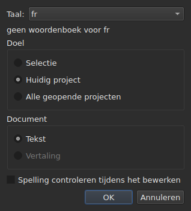
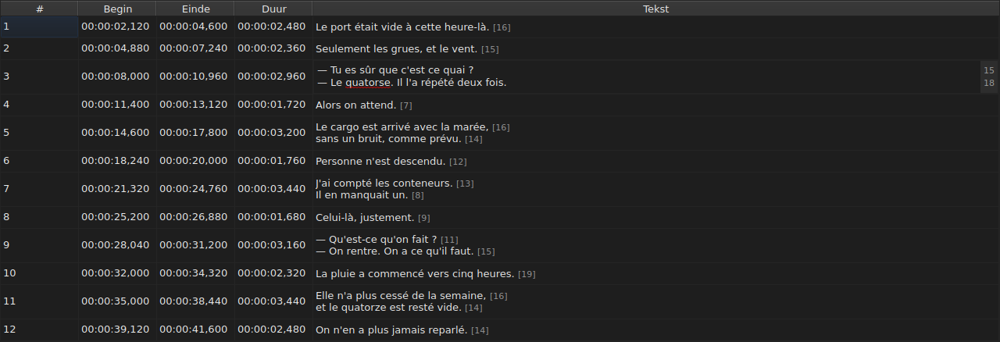
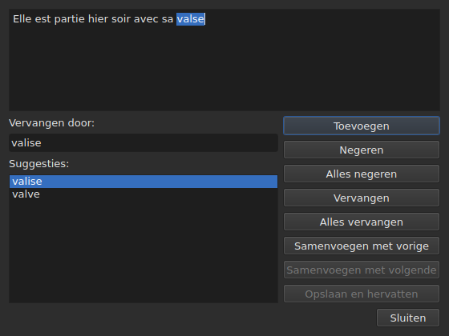

# Spelling controleren…

<!-- machine-translated -->
> Deze pagina is een machinevertaling en is nog niet nagelezen door een lezer van de taal.

`Gereedschap ▸ Spelling controleren…` loopt de woorden langs die het woordenboek niet kent,
een voor een, naar het model van de spellingcontrole van Gaupol. Het heeft een metgezel,
`Gereedschap ▸ Instellingen voor spellingcontrole…`, die de taal, het doel en het document instelt, en het onderstrepen tijdens het typen.
Beide steunen op de woordenboeken van het systeem, via Enchant.

Het label van het eerste wordt geschreven als `Chec&k Spelling…`: `C` is al
de sneltoets van `Correct Texts…`, en `k` is vrij in het menu `Tools`.
Geen van beide heeft een sneltoets.

**Beide zijn uitgeschakeld bij een document zonder ondertitel**, zoals
[`Correct Texts…`](correct-texts.md): er is niets om te controleren. `Check Spelling…`
is ook uitgeschakeld zonder woordenboek voor de ingestelde taal, zie
[Zonder woordenboek](#zonder-woordenboek).

## Spellingcontrole-instellingen…




| Groep | Keuzes | Standaard |
| :---- | :------ | :------ |
| `Language` | de taalcodes die het systeem aanbiedt, en de reeds gekozen code | de taal van het systeem, als die erbij zit |
| `Target` | `Selection`, `Current Project`, `All Open Projects` | `Current Project` |
| `Document` | `Text`, `Translation` | `Text` |
| `Check spelling while editing` | een selectievakje, zie [Onderstrepen tijdens het typen](#onderstrepen-tijdens-het-typen) | niet aangevinkt |

`Selection` is uitgeschakeld als in het getoonde tabblad geen regel is gekozen; `Translation`
is uitgeschakeld zolang geen enkel geopend project een vertaling bevat. Een onthouden
instelling die niet meer beschikbaar is — een lege selectie, een ontbrekende vertaling —
opent op `Current Project` of `Text`. `OK` behoudt de instellingen, `Cancel` wijzigt
niets.

**Dit venster hangt niet af van het woordenboek**: het blijft ingeschakeld zolang het
document ondertitels heeft, ook zonder woordenboek voor de ingestelde taal, en het is
het venster waarmee u een taal zonder woordenboek kunt verlaten. De taal waarvoor geen
woordenboek bestaat, blijft bewerkbaar en staat in de lijst, met daaronder
de zin `no dictionary for`, gevolgd door haar code.

**De vier instellingen worden onthouden** van de ene sessie op de andere, in het
instellingenbestand van `subedit` — zie [De instellingen](preferences.md) voor de
locatie ervan:

| Sleutel | Waarden | Standaard |
| :-- | :----- | :------ |
| `spell-check.language` | een taalcode, zoals `fr_FR`; leeg: de taal van het systeem | leeg |
| `spell-check.target` | `selection`, `current-project`, `all-projects` | `current-project` |
| `spell-check.document` | `main`, `translation` | `main` |
| `spell-check.inline` | `true` of `false` — onbekende woorden in de editor van een cel onderstrepen | `false` |

Een waarde die de sleutel niet accepteert, wordt genegeerd, de standaardwaarde geldt, en de optie
wordt bij het openen van het venster op de foutuitvoer genoemd — zie
[De instellingen](preferences.md#wat-er-gebeurt-als-het-bestand-niet-zegt-wat-wordt-verwacht).

## Onderstrepen tijdens het typen




Het selectievakje `Check spelling while editing` van `Spell-Check Settings…` onderstreept,
**met een rode golflijn en terwijl u typt**, elk onbekend woord in de editor van een
tekstcel — die van de kolom `Text` zowel als die van de kolom
`Translation`. De onderstreping volgt het typen: ze verschijnt, verplaatst en
verdwijnt met het woord. **Het is standaard uitgevinkt**, net als bij Gaupol: zonder
het verandert er niets in de editor.

**De taal is die van `Language:`**, in hetzelfde venster, en de onbekende woorden
zijn die welke `Check Spelling…` zou vinden: dezelfde gevallen van informeel
Engels (`goin'`, `we'd`, `1st`), dezelfde indeling in woorden. Een onderstreept woord wordt niet
vanuit een menu gecorrigeerd: het selectievakje toont het alleen.

**Zonder woordenboek voor de ingestelde taal blijft de editor stil**: er wordt niets
onderstreept en er mislukt niets, en de zin `no dictionary for` van het venster zegt
waarom. Het selectievakje geldt voor de editors die erna worden geopend; een editor die al
open is, behoudt wat hij had.

## De wandeling




Het venster toont de tekst van de ondertitel waar het is gestopt, met het onbekende woord
erin geselecteerd. **Bij elk onbekend woord komt het tabblad van het project terug en wordt de
regel van de ondertitel in de tabel geselecteerd.** De wandeling gaat ondertitel
na ondertitel, en dan project na project wanneer het doel er meerdere aanwijst.

Onder de tekst: het vak `Replace with:`, gevuld met de eerste suggestie, en de lijst
`Suggestions:`. Een suggestie kiezen kopieert haar naar het vak; typen in het
vak vernieuwt de lijst.

| Knop | Wat ze doet |
| :----- | :----------- |
| `Add` | voegt het woord toe aan het persoonlijke woordenboek van de gebruiker en gaat door naar het volgende |
| `Ignore` | laat dit woord staan en gaat door naar het volgende |
| `Ignore All` | laat dit woord staan, en al zijn andere voorkomens tijdens deze wandeling |
| `Replace` | vervangt het woord door de inhoud van `Replace with:`; uitgeschakeld zolang het vak leeg is |
| `Replace All` | doet hetzelfde voor zijn andere voorkomens; uitgeschakeld zolang het vak leeg is |
| `Join with Previous` | voegt het woord samen met het woord ervoor; uitgeschakeld als er geen is, of als ze niet door een spatie zijn gescheiden |
| `Join with Next` | voegt het woord samen met het woord erna, onder dezelfde voorwaarden |
| `Save and Resume` | behoudt de tekst zoals het tekstgebied hem draagt, en hervat het lezen van **deze tekst vanaf het begin** |
| `Close` | sluit het venster |

**Het tekstgebied is bewerkbaar.** Zodra u erin typt, blijft alleen `Save and Resume`
ingeschakeld: de andere handelingen werken op het gekozen woord, dat niet meer
dat van de tekst is.

**De wandeling eindigt vanzelf** wanneer er geen onbekend woord meer is: de
knoppen zijn uitgeschakeld, de tekst wordt leeg. Een doel zonder enig onbekend woord
toont geen venster.

### Sluiten halverwege

`Close`, of het kruisje van het venster, **past toe wat is gedaan**, zoals het einde
van de wandeling: de teksten die al zijn verlaten, **en** de handelingen — vervangen,
alles vervangen, samenvoegen — die al op de huidige tekst zijn uitgevoerd. Het is een afwijking van
Gaupol, dat de huidige tekst verliest. Wat niet meetelt, is wat er van de wandeling resteert, noch
de aanpassingen die in het tekstgebied zijn getypt en die `Save and Resume` niet
heeft bevestigd.

**Eén enkel item in de geschiedenis per aangeraakt project**, ongeacht het aantal
vervangingen: `Undo` maakt alle correcties van dat project in één keer ongedaan.
Het menu noemt het `Undo: correcting texts`. De statusbalk geeft dan de
telling:

```text
Edited 2 and removed 0 subtitles
```

**De lijst met vervangingen** — wat de gebruiker heeft vervangen, en waarmee —
wordt bij het sluiten geschreven naar `spell-check/<language>.repl`, in de configuratiemap
van `subedit`, en niet in die van Gaupol, die nooit wordt gelezen.
Ze telt dan mee onder de suggesties van de spellingcontrole, hier zoals in
[`Correct Texts…`](correct-texts.md#splits-woorden-of-voeg-ze-samen--samenvoegen-en-splitsen-door-de-spellingcontrole).
Als ze niet kan worden geschreven, zegt een foutvenster het: `Could not save the
replacements for`, gevolgd door de taal en de reden, zonder de
correcties te annuleren.

## Zonder woordenboek

Wanneer de ingestelde taal — die van het systeem, als er geen is gekozen — geen
woordenboek heeft, is **`Check Spelling…` uitgeschakeld**, en zijn knopinfo en ook de statusbalk,
wanneer erover wordt gezweefd, zeggen waarom:

```text
no dictionary for fr
```

`Spell-Check Settings…` blijft, om een taal te kiezen die er wel een heeft. Een venster
dat zonder enige woordenboekprovider is gebouwd, zegt hetzelfde en controleert
niets.

## De meldingen

| Melding | Waar | Wat het veroorzaakt |
| :------ | :---- | :--------------- |
| `no dictionary for fr` | knopinfo en statusbalk | geen woordenboek voor de ingestelde taal |
| `Nothing to check.` | statusbalk | het doel wijst geen tekst aan — bijvoorbeeld een lege selectie |
| `Edited N and removed M subtitles` | statusbalk | aan het einde of bij het sluiten; `M` blijft `0` |
| `Could not save the replacements for fr: …` | foutvenster | de lijst met vervangingen is niet geschreven |

## Een voorbeeld

Een geopend bestand bevat `Elle est partie hier soir avec sa valse`. Het Franse
woordenboek is aanwezig: `Gereedschap ▸ Spelling controleren…` stopt bij `valse`, selecteert de
regel in de tabel en stelt `valise` voor, al in `Replace with:`. `Replace`
en dan `Close`: de regel wordt `Elle est partie hier soir avec sa valise`, en de
statusbalk zegt:

```text
Edited 1 and removed 0 subtitles
```
