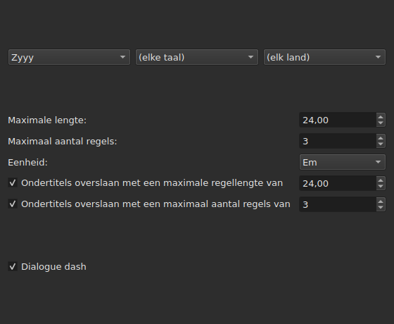
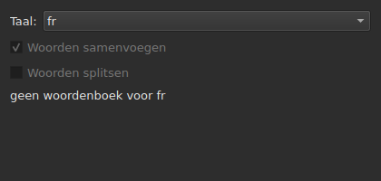
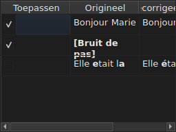

# Teksten corrigeren…

<!-- machine-translated -->
> Deze pagina is een machinevertaling en is nog niet nagelezen door een lezer van de taal.

`Gereedschap ▸ Teksten corrigeren…` opent een assistent met meerdere pagina's, naar het model van
die van Gaupol: een pagina met doel en taken, één pagina per aangevinkte taak,
een voortgangspagina en een bevestigingspagina die de
wijzigingen voorstelt zonder ze ooit op te leggen.

**Uitgeschakeld bij een leeg document**: er is niets te corrigeren.

**De opdrachtregel doet hetzelfde** voor alle taken: [`subedit-cli correct`](../subedit-cli/correct.md), met dezelfde
patronen en dezelfde tellingen — en in tekens waar het venster in em meet.
**Hij leest standaard vier van de onthouden instellingen van deze assistent** — de twee klassen van
veelvoorkomende fouten (`Human`, `OCR`), `Remove all blank subtitles` en het maximale aantal regels van
`Line Break` — en neemt al het andere (de taken, hun code, de regellengte, de taal,
de patroonvakjes) van zijn eigen opdrachtregel. Zie
[Twee blokken, waarvan één gedeeld met de opdrachtregel](preferences.md#twee-blokken-waarvan-één-gedeeld-met-de-opdrachtregel)
en [`subedit-cli config`](../subedit-cli/config.md).

## Tasks and Target — de eerste pagina

| Groep | Keuzes | Standaard |
| :---- | :------ | :------ |
| `Target` | `Selection`, `Current Project`, `All Open Projects` | `Current Project` |
| `Document` | `Text`, `Translation` | `Text` |
| `Tasks` | `Mentions`, `Join or Split Words`, `Common Errors`, `Capitalization`, `Line Break` — aan te vinken, één of meer | `Common Errors` en `Capitalization` aangevinkt, de drie andere niet |

`Selection` is uitgeschakeld als in het getoonde tabblad geen regel is gekozen; `Translation`
is uitgeschakeld zolang geen enkel geopend project een vertaling bevat.

**Het doel en het document worden niet onthouden**: de assistent opent altijd
op `Current Project` en `Text`. De aangevinkte taken worden daarentegen wel onthouden.

**Wat elk doel aanwijst**:

| Doel | Werkt in op |
| :----- | :------ |
| `Selection` | de regels die in het getoonde tabblad zijn gekozen |
| `Current Project` | het hele bestand van het getoonde tabblad |
| `All Open Projects` | het hele bestand van elk geopend tabblad |

**`All Open Projects` op `Translation` slaat de projecten zonder vertaling over**:
een project dat er geen heeft, kan in een lege kolom niets voorstellen, en
de assistent telt het niet mee.

**De taakpagina's volgen in de volgorde van Gaupol — `Mentions`,
`Join or Split Words`, `Common Errors`, `Capitalization`, `Line Break` — nooit in die waarin de vakjes
zijn aangevinkt.** Een niet-aangevinkte taak heeft geen pagina; haar onthouden
instellingen veranderen daardoor niet. **Geen enkele taakpagina heeft een eigen
vakje ‘actief’**: alleen het vakje van deze eerste pagina
bepaalt of de taak wordt uitgevoerd.

## De taakpagina's

Elk van de vier patroonpagina's — alle behalve `Join or Split Words`, die er geen heeft — heeft dezelfde basis: drie opeenvolgende
keuzelijsten — schrift, taal, land — om de code te kiezen van de toe te passen patronen,
daarna de lijst van de patronen van die code, met een vakje per naam. **De drie
keuzelijsten bieden alleen aan wat de patroonbibliotheek echt
bevat** — de patronen die met het programma worden meegeleverd en die welke een gebruiker daar
heeft neergezet (zie [Weggelaten patronen](#weggelaten-patronen)) — nooit een lijst
met talen of landen die elders is gelezen. `Zyyy` (‘elk schrift’) is de startcode
van `Common Errors`, die de overal geldige patronen geeft. **De drie
andere typen hebben alleen patronen onder een schrift**: hun pagina opent op de
eerste die de bibliotheek aanbiedt, `Latn` bij de meegeleverde patronen, en niet op `Zyyy`.

**De beschrijving van elk patroon is de knopinfo van zijn vakje.** Namen en beschrijvingen volgen de
taal van het venster voor de patronen die met het programma worden meegeleverd; een eigen patroon wordt getoond
zoals zijn bestand het schrijft ([Taal](invocation.md#taal)).

**Een niet-aangevinkt patroon blijft niet-aangevinkt tot het weer wordt aangevinkt**, ook als
u van code wisselt en dan terugkeert, en die keuze wordt onthouden van de ene opening
van de assistent op de andere. Opnieuw aangevinkt vindt het gewoon zijn oorspronkelijke
instelling terug, en de onthouden keuze verdwijnt.

| Pagina | Wat ze aan de basis toevoegt |
| :--- | :----------------------- |
| `Mentions` | twee selectievakjes, `Sound in brackets` en `Sound in parentheses`, standaard niet aangevinkt |
| `Common Errors` | twee selectievakjes, `Human` en `OCR`, standaard aangevinkt |
| `Capitalization` | niets meer |
| `Line Break` | een maximale lengte (standaard `24`), een maximaal aantal regels (`3`), een eenheid — `Characters` of `Ems`, standaard `Ems` — en twee overslaan-voorwaarden, hieronder beschreven |

**De twee vakjes van `Mentions` noemen geen gecompileerd patroon**: ze
sturen een scan van de tekst in de kern aan, dezelfde die
[`Remove Hearing-Impaired Mentions…`](operations.md#remove-hearing-impaired-mentions)
al in een directe handeling uitvoert. Eén **of** het andere aangevinkt is genoeg om hem te starten. **De patroonlijst van de pagina herhaalt ze niet**: die twee namen staan er maar één keer, als selectievakjes.

**`Common Errors` filtert op klasse**: een patroon dat beide klassen draagt,
wordt toegepast zodra een van beide vakjes is aangevinkt; de drie andere pagina's kennen
dit onderscheid niet.

### Line Break — de eenheid en het overslaan




| Instelling | Wat ze doet | Standaard |
| :------ | :----------- | :------ |
| `Maximum length` | de lengte van een regel, in de gekozen eenheid; van `1` tot `1000` | `24` |
| `Maximum lines` | het beoogde aantal regels; van `1` tot `100` | `3` |
| `Unit` | `Characters` telt tekens; `Ems` meet de breedte met het lettertype van het venster, waarbij een gemiddelde kleine letter `0.55` waard is — de eenheid van Gaupol | `Ems` |
| `Skip subtitles with maximum line length of` | laat een ondertitel ongemoeid waarvan de langste regel binnen deze lengte past, in de gekozen eenheid | aangevinkt, `24` |
| `Skip subtitles with maximum line amount of` | laat een ondertitel ongemoeid waarvan het aantal regels binnen dit aantal past | aangevinkt, `3` |

**Het overslaan heeft eigen drempels**, los van de beoogde limieten: dat is
de regel van Gaupol. Een ondertitel blijft ongemoeid als hij binnen **alle
drempels past waarvan het vakje is aangevinkt**; anders wordt hij afgebroken, en de afbreking wordt
alleen behouden als ze de ondertitel dichter bij een overschreden drempel brengt — minder
lengte of minder regels. Geen enkel vakje aangevinkt: elke ondertitel wordt afgebroken,
of hij nu al past of niet.

**Als u de eenheid wijzigt, verandert wat wordt voorgesteld**: de lengte van elke regel wordt
bij elke berekening gemeten, in de eenheid van de pagina op dat moment, en van een eerdere meting
blijft niets over. Een tekst van negenentwintig tekens, waarvan de helft
smalle letters, overschrijdt `24` in `Characters` en past er ruimschoots in
in `Ems`.

**De zeven instellingen worden onthouden** van de ene sessie op de andere, de eenheid inbegrepen.

### Splits woorden of voeg ze samen — samenvoegen en splitsen door de spellingcontrole




Een aparte pagina, tussen `Mentions` en `Common Errors`, om te herstellen wat
tekstherkenningssoftware met spaties doet. Ze heeft geen lijst met
patronen: ze steunt op de woordenboeken van het systeem, via Enchant.

| Instelling | Wat ze doet | Standaard |
| :------ | :----------- | :------ |
| `Language` | de taal van het woordenboek; de codes die het systeem aanbiedt, en de reeds gekozen code | de taal van het systeem, als die erbij zit |
| `Join words` | voegt een verkeerd gespeld woord samen met het naburige woord | aangevinkt |
| `Split words` | knipt een verkeerd gespeld woord in tweeën | niet aangevinkt |

**Samenvoegen**: een verkeerd gespeld woord wordt samengevoegd met het woord ervoor of het woord
erna **als, en alleen als, slechts een van beide richtingen een correct gespeld
woord geeft**. Als beide er een geven, of geen van beide, gebeurt er niets.
`bon jour` wordt `bonjour`; twee opeenvolgende spaties worden eerst teruggebracht tot
één, maar een tekst waarin niets wordt samengevoegd, wordt teruggegeven zoals hij was, spaties
inbegrepen.

**Splitsen**: een verkeerd gespeld woord wordt geknipt als, onder de suggesties van
de spellingcontrole, **slechts één** dat woord met een spatie erin is — dezelfde
letters, in dezelfde volgorde. Twee suggesties van dat soort, of geen: er gebeurt
niets. Een woord waarvan alleen de eerste letter een hoofdletter is (`Bonjourtous`) wordt
nooit gesplitst: het is vaak een naam, en woordenboeken hebben die niet.

**De lijst met vervangingen van de gebruiker** (`spell-check/<language>.repl`,
in de configuratiemap van het programma) telt mee onder de suggesties van de
spellingcontrole; de assistent leest haar en schrijft haar niet.

**Zonder woordenboek voor de gekozen taal blijft de pagina staan en is ze grijs**: de
twee vakjes zijn uitgeschakeld en de pagina zegt `no dictionary for`, gevolgd door de code van
de taal. De taal blijft bewerkbaar — er kan een woordenboek voor een andere taal
zijn — en de taak, al dan niet aangevinkt op de eerste pagina, doet dan niets en
meldt geen fout.

**De taal, de twee vakjes en het vakje van de eerste pagina worden onthouden** van de ene
opening van de assistent op de andere.

### Weggelaten patronen

Een patroon dat een gebruiker in zijn eigen patronenmap heeft neergezet,
wordt toegevoegd aan de patronen die met het programma worden meegeleverd, in dezelfde bibliotheek en onder dezelfde
keuzelijsten — niets onderscheidt ze nog zodra ze zijn geladen.

| Patronen | Waar |
| :------- | :---- |
| meegeleverd | `<prefix>/share/subedit/patterns`, naast `<prefix>/bin` |
| die van de gebruiker | `$XDG_DATA_HOME/subedit/patterns`, of `~/.local/share/subedit/patterns` als de variabele niet is ingesteld of geen absoluut pad is |

**Het formaat is dat van Gaupol, ongewijzigd gelezen**: één bestand `<Code>.<type>` per schrift,
taal en land — `Latn-en.common-error` —, met zijn activeringsbestand `.conf` ernaast. De typen
zijn `common-error`, `capitalization`, `hearing-impaired` en `line-break`. De meegeleverde
bestanden dienen als model. **Patronen worden één keer gelezen, bij het starten**: een bestand
dat wordt neergezet terwijl het venster open is, wordt pas bij de volgende start gezien.

## Voortgang

Zodra `Next` is ingedrukt vanaf de laatste aangevinkte taakpagina (of vanaf de
eerste pagina als geen taak is aangevinkt), berekent de assistent de voorgestelde
correcties in een achtergrondthread, met een onbepaalde voortgangsbalk
op het scherm. Zodra de berekening klaar is, opent de bevestigingspagina vanzelf.

**`Cancel` in deze stap geeft de berekening op zonder haar te onderbreken**: er
wordt niets toegepast, maar de assistent wacht, voordat hij sluit, tot de lopende
berekening klaar is — een wachttijd die wordt begrensd door de tijdslimiet die de patroon-
engine aan elke zoekopdracht oplegt.

**`Back` in deze stap gaat terug naar de vorige pagina zonder te wachten**: de berekening
wordt op de achtergrond afgerond en haar resultaat wordt weggegooid — de assistent springt niet
uit zichzelf naar de bevestiging. `Next` start een nieuwe berekening.

## Bevestiging — de laatste pagina




Eén regel per tekst die de assistent zou wijzigen — nooit een regel voor een
tekst die een taak ongemoeid heeft gelaten.

| Kolom | Wat ze toont |
| :----- | :------------ |
| `Accept` | een selectievakje, standaard aangevinkt: de correctie wordt wel of niet toegepast |
| `Original` | de tekst zoals hij is, het deel dat zou veranderen **vetgedrukt** |
| `Corrected Text` | de voorgestelde tekst, het gewijzigde deel vetgedrukt, **bewerkbaar** — bijschaven wijzigt wat er wordt geschreven, zonder het vakje `Accept` te wijzigen |

**De wijziging wordt vetgedrukt gemarkeerd, nooit met kleur**: hetzelfde verschil leest
in beide paletten zonder van enige tint af te hangen.

**Een regel waarvan het voorstel een verwijdering is** — de ondertitel zou geen
tekst meer hebben — toont de kolom `Corrected Text` leeg, en zijn hele `Original`
vetgedrukt.

| Knop | Wat ze doet |
| :----- | :----------- |
| `Mark All` | vinkt `Accept` aan op alle regels |
| `Unmark All` | vinkt `Accept` uit op alle regels |
| `Preview` | zet de ingebouwde speler op de ondertitel van de gekozen regel, als het project een film heeft — niets als het er geen heeft |
| `Finish` | past de aangevinkte regels toe en sluit de assistent |

`Remove all blank subtitles`, standaard aangevinkt, verwijdert de ondertitels
die een correctie zonder enige tekst zou achterlaten, in plaats van ze leeg te houden.

**Een patroon dat de berekening niet kon toepassen, wordt onder de tabel genoemd**, met
de reden:

```text
Not applied: some pattern (will not compile)
```

Een patroon dat zo wordt genoemd, wordt genoemd **één keer per reden**, ongeacht het aantal
teksten of projecten waarop het mislukte: het scherm zegt niet welke.

| Reden | Wat het veroorzaakt |
| :----- | :--------------- |
| `cannot be translated` | de expressie gebruikt wat de omzetting van de syntaxis van Python weigert |
| `will not compile` | de engine weigert de expressie |
| `has an invalid replacement` | de vervanging leest niet zoals Python haar leest |
| `timed out` | een zoekopdracht overschreed de tijd die de engine haar op een tekst geeft |
| `never settled` | `Repeat` wijzigde de tekst na honderd doorgangen nog steeds |
| `grew the text too long` | de tekst overschreed 16.384 bytes terwijl het patroon eraan werkte |

**Een patroon dat op een tekst mislukt, laat hem zoals hij was vóór dat patroon**: een half
uitgevoerde vervanging is minder waard dan geen vervanging. De andere patronen worden toegepast.

**Een regel van een patroonbestand die niet kan worden gelezen, wordt op dezelfde
plaats genoemd**, met zijn bestand, zijn regel en de reden — bij elke opening van de
assistent, aangezien de patronen maar één keer worden gelezen, bij het starten:

```text
Could not be read: Zyyy.common-error, line 8 (malformed line)
```

| Reden | Wat het veroorzaakt |
| :----- | :--------------- |
| `directory cannot be read` | de map met de meegeleverde patronen kon niet worden doorlopen |
| `file cannot be read` | een patroonbestand kon niet worden gelezen |
| `malformed line` | een regel die geen kop, geen commentaar en geen `Key=Value` is |
| `field outside any pattern` | een `Key=Value` vóór de eerste patroonkop |
| `unknown field` | een sleutel waar dit type patroon niets mee kan — het patroon blijft behouden |
| `missing field` | een sleutel zonder welke dit type patroon niets kan doen — het patroon wordt weggelaten |
| `invalid value` | een waarde die de sleutel niet accepteert — het patroon wordt weggelaten |
| `malformed activation` | een element `<pattern>` van een `.conf` dat niets noemt |

De andere patronen, die correct zijn gelezen en toegepast, worden hierdoor niet
getroffen.

## Wat ongedaan maken zegt, en wat `Cancel` nooit doet

**`Finish` maakt één item in de geschiedenis per aangeraakt project**, nooit één per
correctie: `Undo` maakt alle op dat project geaccepteerde correcties in één keer
ongedaan, elk met de tekst die het had. Het menu noemt het
`Undo: correcting texts`.

De statusbalk geeft de telling, eerst de gewijzigde teksten, daarna de verwijderde
ondertitels:

```text
Edited 3 and removed 1 subtitles
```

**`Cancel`, op welke pagina ook, past niets toe en onthoudt niets** — noch
de tijdens deze opening gekozen instellingen, noch de minste correctie. De
volgende opening van de assistent begint weer met de instellingen van daarvoor.

## Een voorbeeld

Een geopend bestand bevat twee spaties tussen twee woorden van een regel en een
vermelding tussen haakjes zonder andere tekst. `Gereedschap ▸ Teksten corrigeren…`,
`Common Errors` al aangevinkt, `Next` tot aan de bevestiging: de regel met de twee spaties
toont links `Bonjour  Marie`, rechts `Bonjour Marie`, de correctie vetgedrukt
en al geaccepteerd. `Finish` past haar toe, en de statusbalk zegt:

```text
Edited 1 and removed 0 subtitles
```
