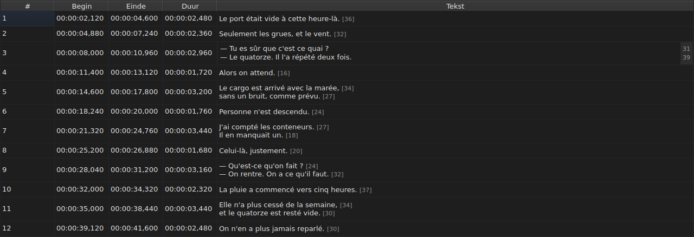

# Een cel bewerken

<!-- machine-translated -->
> Deze pagina is een machinevertaling en is nog niet nagelezen door een lezer van de taal.

Vier kolommen worden ter plaatse bewerkt: `Start`, `End`, `Duration` en `Text` — vijf
met de kolom `Translation`, wanneer het project een vertaling heeft. `#` kan niet
worden bewerkt — het nummer is de rang van de regel, geen gegeven van het bestand.

**De editor van een cel openen:** dubbelklik erop, of selecteer haar
en druk op `F2`.

## De tekst

**De vertaling wordt bewerkt zoals de tekst**, met hetzelfde meerregelige veld en
dezelfde regels; alleen de cel verandert, en de hoofdtekst blijft zoals
hij was. Een bevestiging die niets wijzigt, doet niets, voor de een als voor de
ander — zie [hieronder](#een-bevestiging-die-niets-wijzigt-doet-niets).

De editor is een **meerregelig** veld, en opent op de hoogte van de ondertitel:
een ondertitel van twee regels wordt erin getypt zoals hij zal worden geschreven, met zijn twee regels
leesbaar en zonder schuifbalk. Een `Shift+Enter` die er een toevoegt, vergroot
de editor; de rij van de tabel past zich aan bij het bevestigen.

| Toets | Effect |
| :---- | :----- |
| `Enter` | bevestigt en sluit de editor |
| `Shift+Enter` | voegt een regeleinde in de tekst in |
| `Esc` | sluit de editor; de cel houdt wat ze had |
| `Tab` | bevestigt en gaat naar de volgende cel |

Elders klikken bevestigt ook: de focus verliezen is een `Enter` waard.

**Elf gebaren zonder dialoogvenster bevestigen eveneens** voordat ze hun doel berekenen:
`Italic`, `Hoofdlettergebruik ▸ …`, `Dialogue`, `Merge Subtitles`, `Split Subtitle`,
`Cut Texts`, `Paste Texts`, `Copy Texts`, `Remove Subtitles`, `Undo` en `Redo`.
Gestart vanuit het menu, de werkbalk of een sneltoets van het venster nemen ze
de tekst over zoals de editor die zojuist heeft bevestigd, net als na een klik
elders. `Ctrl+X`, `Ctrl+C` en `Ctrl+V` blijven echter bij de editor zolang
die geopend is — zie [Teksten knippen, kopiëren en plakken](clipboard.md): dan is het
het menu dat `Cut Texts`, `Copy Texts` en `Paste Texts` start.

`Undo` en `Redo` lezen de geschiedenis en niet het document: zie
[Ongedaan maken en opnieuw uitvoeren](undo.md). Een gebaar dat een dialoogvenster opent, heeft
deze regel niet nodig, omdat het dialoogvenster de focus neemt zodra het opent, wat
de invoer al bevestigt.

### De tags zijn die van het bestand

De getoonde en getypte tekst is **die van het bestand, tags inbegrepen**: een
`<i>…</i>` van een SubRip wordt zo geschreven, en een `{\i1}…{\i0}` van een Advanced SSA
ook. Er wordt niets vertaald voor de weergave — de tabel van
[`Italic`](operations.md#italic) zegt wat elk formaat schrijft.

Voor cursief hoeft u dus niets te weten: `Ctrl+I` zet de juiste tag
voor het geopende document, en een formaat dat er geen kent — TMPlayer, LRC —
schakelt het item uit in plaats van u te laten zoeken. Vet en onderstreept
worden getypt, zoals in Gaupol.

**En de tags volgen de tekstbewerkingen niet**: een ondertitel in kleine
letters zetten verandert zijn `<I>` niet in `<i>`, en een dialoogstreepje wordt
vóór de tekst gezet en niet vóór een openende tag. Zie
[`Case` en `Dialogue`](operations.md#case-en-dialogue).

## De lengte van regels

**De teksteditor toont in een marge rechts de lengte van elke
regel**, in lijn met de eerste rij van die regel. De marge is zo breed
als het grootste getal, wordt **tijdens het typen** bijgewerkt en volgt het scrollen.
Een lege tekst toont niets. De lengtes zijn die van de tabel — zonder de
tags, naar beneden afgerond, in de ingestelde eenheid — en worden verwijderd met het
selectievakje `Show line lengths in the editor` van `Aanpassen ▸ Instellingen…`. Zie
[Regellengtes](preferences.md#regellengtes).

## Het begin en het einde

De editor is een veld van één regel, **beperkt tot de vorm van een tijdcode**:
hij weigert tijdens het typen wat er nooit een zou kunnen zijn.

De geaccepteerde vormen zijn die welke het lezen van een bestand al accepteert:

| Element | Wat erdoor komt |
| :------ | :-------------- |
| velden | `MM:SS` of `HH:MM:SS`, elk met een of twee cijfers |
| decimalen | een tot drie, na een komma of een punt, of geen |
| teken | een voorafgaand `-`, voor een positie vóór het begin van de video |
| grenzen | minuten en seconden onder 60 |

`00:01:02,500`, `1:02.5` en `-0:01,000` zijn dus drie geldige invoeren.

**Een invoer die het lezen weigert, laat de cel ongewijzigd.** Dat is het geval
van `00:70:00,000`, waarvan de vorm klopt maar waarvan de minuten buiten de
grenzen vallen: de editor sluit en niets is verschoven. Er wordt geen positie verzonnen
— een positie verkeerd hebben is stil, niets op het scherm onderscheidt een
slecht getimede ondertitel van een goed getimede.

Een begin of een einde wijzigen werkt de `Duration` meteen bij.

## De duur

**Een duur typen verschuift het einde, en nooit het begin**: het einde wordt
`Start + Duration`. Het begin verschuiven zou de hele ondertitel verschuiven, wat
het werk is van [`Shift Positions…`](operations.md), en in de kolom `Start` kan
al worden getypt.

De duur wordt getypt **in de vorm van een tijdcode**, die welke de kolom
toont, en de vormen van de tabel hierboven gelden — met één verschil:

| Element | Begin, einde | Duur |
| :------ | :----------- | :--- |
| vorm | die van een tijdcode | dezelfde |
| voorafgaand teken `-` | geaccepteerd | **geweigerd tijdens het typen** |

`0:02.5` en `00:00:02,500` zijn dus twee geldige invoeren van een duur van twee
en een halve seconde; `-0:01,000` kan niet worden getypt. Een duur van nul wordt geaccepteerd:
de ondertitel verdwijnt dan op het moment dat hij verschijnt.

**Een einde dat over de volgende ondertitel heen gaat, is toegestaan.** De
overlap wordt in de tabel getint, met haar knopinfo — zie
[De tabel](table.md#de-afwijkingen) — een kennisgeving, geen weigering: het kan zijn wat
u wilde. De [lijst met diagnostische meldingen](files.md#de-diagnostiek-van-een-leesbewerking)
bevat haar ook, en verwijdert haar wanneer u haar hebt gecorrigeerd.

**Een einde dat voorbij het einde van de film is getypt, wordt niet gemeld**, anders dan
bij een bewerking van het menu `Tools` die het daar zou brengen — zie
[De bewerkingen](operations.md#voorbij-het-einde-van-de-film). Een cel toont al
de waarde die u zojuist hebt getypt.

Een onleesbare invoer laat de cel ongewijzigd, zoals bij een positie, en
een duur die gelijk is aan de getoonde komt niet in de geschiedenis.

## Een bevestiging die niets wijzigt, doet niets

Open een cel, typ niets, druk op `Enter`: er gebeurt niets.
Er wordt geen wijziging vastgelegd, en het bestand wordt nog steeds beschouwd als identiek aan
dat op schijf.

De vergelijking gaat over de **positie**, niet over de tekenreeks: `0:01.0` typen
in een cel die `00:00:01,000` toont, duidt hetzelfde moment aan,
en wijzigt dus evenmin iets.

## Wat er van een bewerkte cel wordt

Ze **kan ongedaan worden gemaakt** — één cel, één item. Zie
[Ongedaan maken en opnieuw uitvoeren](undo.md).

Ze **wordt opgeslagen**, en het venster sluiten zonder dat te hebben gedaan vraagt om
bevestiging. Zie [Openen en opslaan](files.md).
