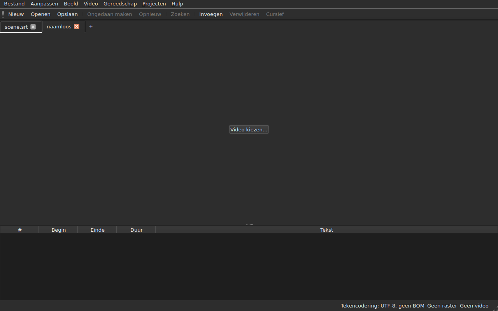
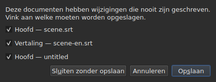
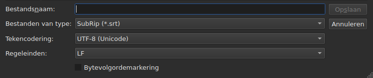
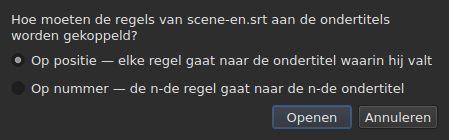
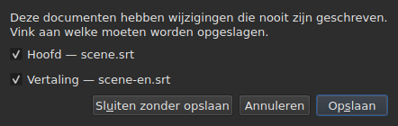

# Openen en opslaan

<!-- machine-translated -->
> Deze pagina is een machinevertaling en is nog niet nagelezen door een lezer van de taal.

Het menu **Bestand** bevat de drie commando's, twee voor de tabbladen en drie
voor de vertaling; het menu **Projecten** werkt op alle tabbladen tegelijk.

| Commando | Sneltoets | Wat het doet |
| :------ | :------- | :----------- |
| Nieuw project | `Ctrl+N` | een leeg project, in een nieuw tabblad — ook de knop `+` na het laatste tabblad |
| Openen… | `Ctrl+O` | kiest een bestand en opent het in een nieuw tabblad — of in plaats van een leeg project |
| Vertaling openen… | — | kiest een vertaalbestand en lijnt het uit op het hoofdbestand van het huidige tabblad |
| Opslaan | `Ctrl+S` | schrijft het geopende bestand opnieuw |
| Opslaan als… | `Ctrl+Shift+S` | kiest een pad en een formaat, en schrijft dan |
| Vertaling opslaan | — | schrijft het bestand van de vertaling opnieuw |
| Vertaling opslaan als… | — | kiest een pad en een formaat voor de vertaling, en schrijft dan |
| Sluiten | `Ctrl+W` | sluit het huidige tabblad — uitgeschakeld als er maar één is |

`New Project`, `Open…` en `Save` staan ook in de
[werkbalk](index.md#de-werkbalk), onder de woorden `New`, `Open` en
`Save`. **De drie items van de
vertaling staan niet in de balk**: ze dienen alleen wie een
vertaling heeft, en de balk is van iedereen.

## Meerdere projecten, in tabbladen

**Elk geopend project heeft zijn tabblad**, boven het beeld en de tabel:
het label is de naam van het bestand, of `untitled` voor een project dat er
nog geen heeft. Klikken op een tabblad schakelt ernaar over; `Ctrl+PageDown` en `Ctrl+PageUp` doen
hetzelfde, zonder muis, en gaan na het laatste tabblad terug naar het eerste.
**De knop `+`, direct na het laatste tabblad**, opent een leeg project in een
nieuw tabblad, zoals `New Project`.




**`Open…` raakt ze nooit aan.** Een bestand openen vervangt niet langer wat het
venster toonde: het komt in een nieuw tabblad ernaast, en het tabblad waar u
eerder naar keek, behoudt alles wat het had — zijn geschiedenis, zijn selectie, zijn
gekoppelde video. Daarom vraagt het openen ook niets meer: er is
niets te verliezen, want er is niets te vervangen.

**Eén uitzondering: het lege project staat zijn plaats af.** Gestart zonder bestand, of
na `New Project`, toont het venster een project `untitled` waar niets in staat.
Een geopend bestand — via `Open…` zowel als via neerzetten — **neemt dan zijn tabblad,
op dezelfde plaats in de balk**, in plaats van er naast een
nutteloos project nog een te openen. Een project is leeg wanneer het **geen bestand, geen ondertitel,
niets om ongedaan te maken of opnieuw uit te voeren, geen film heeft en nooit is gewijzigd**: elk
van deze dingen volstaat om het zijn tabblad te laten behouden. Een leeg project dat niet
het huidige tabblad is, wordt niet aangeraakt.

**Een bestand dat al open is, wordt niet een tweede keer geopend.** `Open…` op een
bestand dat een ander tabblad al vasthoudt, geeft de focus terug aan dat tabblad, en zegt dat
in de statusbalk:

```text
premier.srt: already open
```

**Elk tabblad is een heel project, onafhankelijk van de andere**: zijn
geschiedenis, zijn selectie, zijn gekoppelde video en wat zijn laatste leesbewerking
is tegengekomen, worden alleen getoond wanneer dat tabblad het huidige is, en
veranderen niet terwijl een ander het is. **Eén uitzondering, en die staat in ADR
0033**: de videospeler is uniek voor het hele venster — één enkel mpv-proces — en zijn film wisselt mee met het tabblad; **elk tabblad onthoudt waar zijn film
was**, en hervat die daar, gepauzeerd, wanneer u ernaar terugkeert. Het klembord behoort op zijn beurt aan het venster: kopiëren
in het ene tabblad en plakken in het andere is waarvoor u er twee opent.

**`Close` sluit het huidige tabblad**, en stelt zo nodig
[de vraag over niet-opgeslagen wijzigingen](#niet-opgeslagen-wijzigingen) —
die van dit tabblad alleen, de andere zijn er niet bij betrokken. **Uitgeschakeld als er
maar één tabblad is**: het venster houdt er altijd minstens één, en dat sluiten
zou het venster sluiten — wat de knop van het systeem al doet.

**Elk tabblad draagt ook een kruisje**, dat **zijn** project sluit, met dezelfde
vraag. Het kruisje van een tabblad dat niet het huidige is, sluit dat tabblad, en
het tabblad waar u naar kijkt blijft getoond; als dat project wijzigingen heeft, komt zijn
tabblad naar voren voor de duur van de vraag. **Geen kruisje wanneer er nog maar één
tabblad over is**, om dezelfde reden als waarom `Close` is uitgeschakeld.

**Een tabblad meldt dat het is gewijzigd**: een sterretje volgt zijn naam, `premier.srt*`,
zolang een van zijn documenten verschilt van zijn bestand — zoals de venstertitel dat
zegt van het project waar u naar kijkt. Het verdwijnt bij het opslaan.

## Het menu Projecten

Twee commando's werken op alle projecten tegelijk.

| Commando | Sneltoets | Wat het doet |
| :------ | :------- | :----------- |
| Alles opslaan | `Ctrl+Shift+L` | schrijft elk gewijzigd document, tabblad voor tabblad |
| Alles sluiten | `Ctrl+Shift+W` | sluit alle projecten — dat wil zeggen het venster |

**`Save All` volgt de volgorde van de tabbladen**, het hoofddocument vóór de vertaling.
Een document dat een bestand heeft, wordt daar opnieuw geschreven **zonder dat zijn tabblad naar voren komt**;
**een document dat er geen heeft, opent `Save As…`, één tegelijk**, op zijn tabblad —
het enige geval waarin `Save All` van tabblad wisselt, zodat het vak laat zien over welk
project het gaat. **Een `Save As…` annuleren, of een
opslagbewerking die mislukt, stopt de rest**: de volgende projecten worden niet
aangeraakt, en een vak zegt wat er is geschreven.

```text
Save All stopped: 1 of 3 documents saved
```

Wanneer alles is geschreven, meldt de statusbalk dat — `2 documents saved`, of
`Nothing to save` wanneer niets was gewijzigd. Als een `Save As…` een
tabblad naar voren heeft gebracht, gaat het venster daarna terug naar het tabblad waar het commando werd
gestart.

**`Close All` en het kruisje van het venster zijn één en hetzelfde**: het venster
houdt altijd een project, en ze allemaal sluiten is het sluiten ervan. Ze stellen dus
**één enkele vraag voor alle projecten**, dezelfde als bij
[twee gewijzigde documenten](#afsluiten-met-twee-gewijzigde-documenten), met één selectievakje
per gewijzigd document van elk tabblad:




**`Cancel` sluit niets**, en laat niets geschreven. `Save` schrijft de
aangevinkte documenten zoals `Save All`: achter hun tabblad, behalve een document zonder
naam, wiens tabblad naar voren komt voor zijn `Save As…`. Bij één enkel document
gewijzigd over alle projecten heen is het de eenvoudige vraag die we altijd
hebben gehad, gesteld op zijn tabblad. `Save All As…` bestaat niet: het is een reeks
`Save As…`, die `Save All` al stelt, één tegelijk, voor de documenten zonder naam.

## Openen

Het dialoogvenster filtert **de negen gelezen formaten**, elk één item, en een eerste
item dat ze allemaal toont. Het formaat wordt dan herkend **aan de inhoud, niet aan
de extensie**: een `.txt` die SubRip bevat, opent, en het filter beslist
niets — het verbergt alleen bestanden.

| Filteritem | Extensie |
| :----------- | :-------- |
| `SubRip` | `.srt` |
| `WebVTT` | `.vtt` |
| `SubViewer 2` | `.sub` |
| `Sub Station Alpha` | `.ssa` |
| `Advanced SSA` | `.ass` |
| `MicroDVD` | `.sub` |
| `MPL2` | `.txt` |
| `TMPlayer` | `.txt` |
| `LRC` | `.lrc` |

**Twee extensies wijzen elk twee formaten aan** — `.sub` is SubViewer 2 en
MicroDVD, `.txt` is MPL2 en TMPlayer. Dat heeft geen gevolgen bij het openen,
aangezien de inhoud beslist; bij het opslaan geeft de **naam** van
het gekozen item het formaat, nooit zijn patroon.

**Een onleesbaar bestand opent niets.** Ontbrekend, door het systeem geweigerd, geschreven
in een codering waaronder de bytes niet te decoderen zijn, of van geen enkel bekend
formaat: een modaal venster **noemt de oorzaak**, er wordt geen tabblad geopend, en de tabbladen die
er waren, verroeren zich niet.

| Melding | Wat er is gebeurd |
| :------ | :------------ |
| `does not exist` | het pad wijst geen bestand aan |
| `cannot be opened: permission denied` | het systeem weigert het te openen |
| `cannot be read` | het systeem weigerde om een andere reden |
| `cannot be decoded in the chosen encoding` | de bytes zijn niet te lezen in de gekozen codering |
| `is in no format this tool knows` | geen enkel formaat herkent de inhoud |
| `holds nothing recognisable as a subtitle` | het formaat wordt herkend, maar niets erin is een ondertitel |

Het pad gaat aan de melding vooraf: `notes.txt: is in no format this tool knows`.
Dit zijn de woorden van de opdrachtregel, en dat is geen toeval — beide
oppervlakken lezen een bestand volgens hetzelfde recept.

### Bestanden op het venster neerzetten

**Bestanden ergens op het venster neerzetten opent ze**, vanuit de
bestandsbeheerder: de tabel, de tabbladbalk, de knop
`Select Video…`, en **het beeld van de film zelf**, zowel tijdens het afspelen als gestopt.
Het beeld is een apart venster dat door de speler wordt getekend, en niets garandeerde
dat het een neergezet bestand zou doorgeven; dit is met de hand gecontroleerd op een echt bureaublad,
in een Wayland-sessie. `subedit-gui` wordt daar onder X11 gestart om de film
te kunnen tonen, zodat het neerzetten via het X11-protocol gaat — dat van een
X11-sessie, waar het niet afzonderlijk is geprobeerd.

- **Elk ondertitelbestand opent zijn tabblad**, in de volgorde waarin ze zijn
  neergezet — precies als `Open…`. Een bestand dat **al open is**, wordt niet
  opnieuw gelezen: zijn tabblad komt naar voren, en de statusbalk zegt dat
  (`premier.srt: already open`).
- **Een neergezette video wordt gekoppeld aan het huidige tabblad**, zoals door
  `Select Video…`. Samen met ondertitels neergezet, gaat hij naar het laatste tabblad
  dat die hebben geopend, wat de volgorde van het neerzetten ook is. Een video wordt herkend aan
  zijn extensie — dezelfde lijst als die welke een film naast het
  bestand voorstelt.
- **Twee of meer video's tegelijk worden niet geopend**: een project let op één
  enkele film. De ondertitels van dezelfde neerzetting openen daarentegen wel.
- **Een bestand dat niet opent, stopt de andere niet.** Eén enkel vak zegt dan
  wat niet kon, één regel per bestand, met de woorden
  van `Open…`:

  ```text
  /films/notes.txt: is in no format this tool knows
  /films/absent.srt: does not exist
  ```

Alleen lokale bestanden worden genomen: een link uit een browser gesleept
wijst niets aan wat het venster kan lezen.

Openen vanaf de opdrachtregel werkt nog steeds: `subedit-gui film.srt`.
Daar wordt dezelfde reden op de foutenstroom geschreven, en het venster opent
leeg — zie [Aanroep](invocation.md#wanneer-het-openen-mislukt).

## De diagnostiek van een leesbewerking

Een echt bestand is zelden perfect, en het lezen herstelt in plaats van
op te geven: een ontbrekend nummer, een regel die nergens heen gaat, gemengde
regeleinden. **Wat het is tegengekomen, past in een knop van de statusbalk**
— `2 diagnostics`, links van wat de balk al over het document zegt —, en **de lijst opent met een klik
in een zwevend venster** boven de knop. Er wordt geen regel van het venster voor ingenomen:
de tabel behoudt zijn volle hoogte, of het lezen nu iets te melden had of niet. De lijst
sluit met een klik elders of met `Esc`.

```
a SubRip block without its number, settled by the reader: 5
```

**Elke regel telt**: wat is tegengekomen, wat eraan is gedaan, en
hoe vaak. Een slecht gemaakt bestand komt er honderden tegen, en weten
hoeveel van elke soort is wat u laat handelen; het regelnummer van elk voorkomen in het
bestand wordt op zijn beurt op de opdrachtregel gelezen, op uitvoerigheidsniveau `-vvv`. De
knop telt deze regels — één per soort —, niet de voorkomens.

**De geraden codering verschijnt daar ook**, één keer: ze werd voorgesteld door het wegen van de
bytes, voordat er ook maar één regel van het bestand bestond.

```
an encoding nothing declared, settled by the reader: 1
```

Ze wordt alleen getoond wanneer de codering **geraden is en geen
UTF-8 is** — een UTF-8-bestand dat als zodanig is gelezen, is geen gebeurtenis, en dat bij
elke opening zeggen zou een knop in de statusbalk van elk gewoon
document zetten. Een bestand dat een bytevolgordemarkering draagt, activeert haar
evenmin: het heeft zijn codering opgegeven, er is niets geraden.

**Dezelfde lijst telt ook wat er mis is in de ondertitels zelf**: een
ondertitel die begint voordat de vorige is afgelopen, een einde vóór zijn
begin, een begin vóór dat van de ondertitel erboven. De tabel kleurt ze, maar
een kleur vindt men door te scrollen, en in een bestand van tweeduizend regels
mist men er gemakkelijk een; hier staan de soorten allemaal bij elkaar, **één per
regel en met hun aantal**, in de woorden van het rapport van `inspect`:

```
subtitle starts before the previous one ends: 12
subtitle starts before the previous one starts: 3
```

**Een klik op een regel leidt naar de eerste betrokken ondertitel**, geselecteerd in de
tabel. Deze regels **volgen de correcties** — sorteren of een duur corrigeren
verwijdert er enkele, of verlaagt hun aantal —, zonder de lijst te sluiten die
u leest. Een ondertitel kan twee keer geteld worden: beginnen vóór het einde van de
vorige en vóór zijn begin zijn twee bevindingen, op twee
manieren gecorrigeerd. Om ze een voor een te noemen: `subedit-cli inspect --detail`.

De knop **verschijnt niet** wanneer er niets te melden is, noch in het lezen noch
in de ondertitels, en **hij volgt het tabblad**: elk project houdt de
diagnostiek van zijn eigen leesbewerking bij, en de knop toont die van het getoonde project.

## De codering in de statusbalk

**De statusbalk geeft altijd de codering van het geopende document**, links van wat
hij zegt over het [framerooster](frame-grid.md) en de
[gekoppelde video](video.md):

| Situatie | Wat er wordt geschreven |
| :-------- | :-------------- |
| het bestand is gelezen als UTF-8, zonder markering | `Encoding: UTF-8, no BOM` |
| … met een markering | `Encoding: UTF-8, BOM` |
| een bestand in Latin-1 | `Encoding: ISO-8859-1, no BOM` |

**De diagnose en deze regel beantwoorden niet dezelfde vraag**, en daarom
bestaan ze allebei. De diagnose zegt wat het lezen **heeft gedaan** — het
heeft geraden, en misschien wilt u het controleren; ze wordt dus alleen getoond wanneer er
een gok was. De statusbalk zegt wat het document **is**,
permanent, ook voor een bestand dat zijn codering zelf opgeeft en waarover
het lezen niets te vertellen heeft.

**Waar het antwoord vandaan komt, verschijnt daar niet.** `inspect` geeft het — `detected`,
`from its byte order mark`, `as asked for` — omdat een rapport ruimte heeft om
het te zeggen; een regel van de statusbalk niet, en de lijst van diagnoses draagt het al wanneer
het ertoe doet.

## Opslaan

`Save` schrijft het geopende bestand opnieuw **in zijn oorspronkelijke vorm**: zijn formaat, zijn
codering, zijn regeleinden, zijn bytevolgordemarkering en zijn koptekst. Een
bestand dat is geopend en dan zonder wijziging opgeslagen, verandert niet met één byte — zie
hieronder de exacte garantie.

Het schrijven is **atomair**: het gaat via een tijdelijk bestand dat eroverheen wordt
hernoemd. Een opslagbewerking die op welk moment ook wordt onderbroken, laat de vorige versie
intact.

Een document opslaan dat nooit op schijf heeft gestaan, komt neer op `Save As…`.

**Een schrijfbewerking die mislukt, zegt dat en verliest niets**: een volle schijf, een
alleen-lezenbestand, een ontbrekende map — of **een teken dat de codering van het bestand
niet kan schrijven**, een `ł` in een Latin-1-bestand. De melding is
dan `holds a character the chosen encoding cannot write`, en er wordt niets
geschreven: het teken door een `?` vervangen zou tekst verliezen voor de ogen van wie
die zojuist heeft getypt. De melding noemt het bestand en de reden, het venster behoudt
zijn wijzigingen, en de markering van de titel blijft.

## Opslaan als

`Save As…` vraagt om een pad, een formaat, **en de vorm van de geschreven bytes**:
de codering, de regeleinden, de bytevolgordemarkering. Het document **leeft dan
daar**: de titel verandert, `Save` richt zich op het nieuwe bestand en schrijft in de
gekozen vorm, en het oorspronkelijke bestand blijft zoals het was.

**De negen formaten worden aangeboden**, en het item dat is geselecteerd wanneer het vak
opent, is **dat van het document**. Onder een andere naam opslaan zonder het
filter aan te raken, wijzigt dus het formaat niet.




**De afbeeldingen tonen alleen de onderkant van het vak**, niet de lijst van bestanden
erboven: die hangt af van de machine — haar mappen, haar data, haar
zijsnelkoppelingen —, dus haar foto zou nooit twee keer dezelfde zijn.
Deze strook wel, en daar gebeurt alles.

| Veld | Wat het aanbiedt | Standaard |
| :---- | :------------- | :------ |
| `Encoding` | veertien coderingen die een ondertitelbestand in de praktijk draagt, plus `Other…` | **die van het gelezen bestand** |
| `Other…` | een veld om elke codering te typen die ICU kan schrijven, **met aanvulling** — `cp1257`, `EUC-KR` | — |
| `Line endings` | `LF`, `CRLF` of `CR` | die van het gelezen bestand |
| `Byte order mark` | de markering, **uitgeschakeld voor een codering die er geen draagt** | die van het gelezen bestand |

**De standaardwaarden zijn die van het gelezen bestand, en dat is een garantie en geen
gemak**: een bestand dat is geopend en dan opnieuw opgeslagen zonder deze drie
velden aan te raken, geeft dezelfde bytes terug.

**De lijst is kort, en is geen plafond.** ICU kent er tweehonderdeenentwintig; wat het menu aanbiedt, is wat een ondertitelbestand
in de praktijk draagt, want een menu van tweehonderd items helpt niemand. `Other…`
opent de rest.

**Het veld vult aan over de tweehonderdeenentwintig**, dus de exacte naam hoeft u
niet te kennen: `1252` typen stelt `windows-1252` voor, `koi` typen
stelt `KOI8-R` en `KOI8-U` voor. De aanvulling werkt op wat de naam **bevat**
en niet op waarmee hij begint — de canonieke naam van Windows Westers is
`windows-1252`, en `cp1252` is degene waaraan men denkt. Beide kunnen
ook volledig worden geschreven zonder aanvulling: ICU accepteert zijn eigen aliassen.

**Een naam die niemand kent, schrijft niets.** `klingon-1` typen valt niet
terug op UTF-8: er wordt niets geschreven, en de melding zegt dat.

**Een naam die de bytevolgorde niet vermeldt, evenmin.** `UTF-16` en `UTF-32` zijn
namen die ICU kent, waarvan de converter **zijn eigen markering** schrijft: het
selectievakje `Byte order mark` zou dan niets meer bepalen. Beide
worden geweigerd, en de melding verwijst naar `UTF-16LE` of `UTF-16BE`, die dezelfde
bytes schrijven onder de controle van het selectievakje. Het is dezelfde weigering, in dezelfde
woorden, als die van de opdrachtregel.

**Een teken dat de gekozen codering niet kan schrijven, stopt het opslaan**
— een `ł` in Latin-1. De melding is
`holds a character the chosen encoding cannot write`, het venster behoudt zijn
wijzigingen, en het doelbestand wordt niet aangeraakt.

**Het document verroert zich evenmin**: het blijft op zijn bestand, in zijn
formaat en zijn codering, en de volgende `Save` schrijft het bestand opnieuw dat is geopend.
Een opslagbewerking die niet heeft plaatsgevonden, wijzigt helemaal niets — noch op schijf,
noch in het venster.

Het formaat wijzigen wijzigt wat de tabel toont — het decimaalteken volgt het
formaat, een komma voor SubRip, een punt voor WebVTT, en **de tags worden herschreven
in het vocabulaire van het doelformaat**: een `<i>` wordt `{\i1}` in Sub
Station Alpha, `{Y:i}` in MicroDVD, `/` aan het begin van een regel in MPL2. Het document
**is** dat bestand **geworden**, dus de tabel toont wat het bestand draagt.

**Het is geen commando, en `Ctrl+Z` maakt het niet ongedaan.** Een document waarvan het
formaat LRC zei en waarvan de teksten nog `<i>` zeiden, zou een
incoherent document zijn; er is geen helft om ongedaan te maken.

## Wat een formaat niet kan bevatten, gezegd vóór het schrijven

**Een modaal venster waarschuwt, en u kunt nog steeds nee antwoorden.** Het somt op wat het
doelformaat niet zal bevatten, item voor item, in de woorden die de opdrachtregel
daarna schrijft:

```
ends are not carried by LRC, line breaks were joined in 2 subtitles, 1 tag dropped
```

| Knop | Effect |
| :----- | :----- |
| `Save` | schrijft toch, het verlies geaccepteerd |
| `Cancel` | schrijft niets; het document verroert zich niet, noch bestand noch formaat |

`Cancel` is de standaardknop: een Enter-toets die wordt ingedrukt zonder te lezen, laat het
bestand zoals het is.

**Er wordt niets gevraagd wanneer er niets verloren gaat.** Een vak dat “er gaat niets
verloren” aankondigde, zou u leren om het vak weg te klikken dat ertoe doet.

Wat kan worden aangekondigd:

| Item | Wanneer |
| :--- | :------ |
| de einden | het doelformaat draagt er geen — TMPlayer, LRC |
| de regeleinden | het doelformaat draagt ze niet — LRC |
| de tags | een tag van de bron heeft geen equivalent in het doel, of de spil kent hem niet |
| de koptekst | het gelezen bestand droeg er een, en hij gaat niet mee over |
| de aangegeven velden | de volgorde van de SSA-kolommen, de vorm van de TMPlayer-tijd |
| de precisie | het doelformaat telt grover — het tiende van MPL2, de seconde van TMPlayer |

**Wat bij het andere formaat hoort, blijft terzijde.** Een WebVTT-bestand
draagt cue-identificaties en plaatsingsinstellingen; SubRip draagt weergave-
coördinaten. Schrijven in het andere formaat negeert ze in plaats van
ze willekeurig om te zetten — ze zijn er daarom niet verloren, ze worden gewoon
niet geschreven.

## De garantie van de heen-en-terugreis

Ze heeft twee helften, en beide zijn nodig:

- **trouw byte voor byte** op een bestand dat al in de indeling is die
  `subedit` schrijft — die van Gaupol, inclusief de laatste lege regel —, en **ongeacht
  zijn codering**: een bestand in CP1252 of in UTF-16 wordt herschreven in
  zijn eigen codering, markering inbegrepen;
- **idempotent** voor het overige: de eerste opslagbewerking normaliseert de indeling,
  geen enkele daarna raakt nog iets aan.

Concreet: een bestand waarvan het laatste blok niet wordt gevolgd door een lege regel,
krijgt er één, eenmalig. Het is de enige wijziging die een opslagbewerking zonder
wijziging kan opleveren.

## Een vertaling openen

`Bestand ▸ Vertaling openen…` zet een **tweede bestand** naast het hoofdbestand.
Het item is uitgeschakeld zolang er geen ondertitel is om de regels van
de vertaling aan te geven.

**Twee vragen, na elkaar.** De bestandskiezer, die van
`Open…` — hetzelfde filter, dezelfde beginmap, de codering herkend zoals bij het
hoofdbestand — en dan **de uitlijnmethode**:




| Methode | Wat het doet |
| :----- | :----------- |
| `By position` (standaard) | elke regel gaat naar de ondertitel waarin haar midden valt |
| `By number` | de n-de regel gaat naar de n-de ondertitel, zonder naar de posities te kijken |

**Positie is de standaard**, omdat één enkele ontbrekende regel in het midden
*alle* volgende laat verschuiven wat het nummer betreft, terwijl bij positie één enkele
ondertitel zonder vertaling blijft.

**Wat er wordt gedaan, wat er wordt geschreven:**

- de teksten van de gekoppelde regels komen in de kolom `Translation`, die
  verschijnt;
- **een regel die geen ondertitel vindt, brengt er een voort**, met **de
  posities van die regel** — bij beide methoden;
- **er wordt niets gesorteerd**, noch het bestand noch het document: de regels worden doorlopen
  in tijdsvolgorde, en het aantal van degene die er niet in stonden, wordt gegeven;
- **een vertaling die al open is, wordt vervangen**, al haar teksten eerst gewist.

**Wat er is gebeurd, wordt gezegd.** Wanneer elke regel haar ondertitel heeft gevonden en
er geen alleen is overgebleven, schrijft de statusbalk dat; anders **een vak om te sluiten**,
zoals bij elke handeling die iets te melden heeft:

```text
translation: 3 lines attached
translation: 2 lines attached; 1 subtitle left without a translation
translation: 3 lines attached; 1 subtitle born of a line; 2 lines out of order
```

De items worden alleen geschreven als ze niet nul zijn: de gekoppelde regels, de
ondertitels die uit een regel zijn voortgekomen, die welke geen regel heeft bereikt, de regels
buiten volgorde. Een bestand zonder enige regel zegt dat
(`translation: the file holds no line`) in plaats van de
ondertitels er de schuld van te geven.

**Een verschoven vertaling wordt herkend, en verschoven heropend.** Een vertaling die twee
seconden te laat is getimed, lijnt uit op de verkeerde ondertitels zonder dat iets haar onderscheidt van een
correcte koppeling. Wanneer het openen **op positie** niet zuiver is, zoekt het venster naar
**een constante verschuiving**: de verschillen tussen het begin van elke regel en dat van de ondertitels
eromheen geven kandidaten, gegroepeerd op tien milliseconden, en **elke
wordt beoordeeld door de koppeling zelf van het openen**. Als één enkele verschuiving het openen
zuiver maakt, zegt het vak dat na zijn telling en **biedt aan om verschoven te heropenen**:

```text
translation: 4 subtitles born of a line; 4 subtitles left without a translation
the lines sit 2.000 s later than the subtitles; moved back, 4 lines would attach instead of 0
```

`Yes` maakt het openen ongedaan en voert het opnieuw uit met de regels teruggebracht door die verschuiving; `No`, het
standaardantwoord, laat het openen zoals het is. **Het resultaat is één enkel item in de
geschiedenis**: ongedaan maken geeft alles terug, zoals bij elke opening.

**Er wordt niets voorgesteld wanneer de verschuiving niet constant is** — een drift, een verschuiving die
slechts een deel van het bestand raakt —, wanneer twee verschuivingen het openen even
zuiver zouden maken, of wanneer geen enkele het zuiver maakt: de zin zegt dan niet dat er een is. Ook niet
bij nummer, waar niet naar de posities wordt gekeken. Er is daarvoor **geen opdrachtregel**.

**Een vertaling openen is één enkel item in de geschiedenis**, `Undo: opening a translation`,
en ongedaan maken geeft alles terug: de teksten, de geboren ondertitels verwijderd,
het bestand van de vertaling losgekoppeld — de kolom verdwijnt ermee. Om het met
de andere methode te openen, maakt u eerst ongedaan.

**De zojuist geopende vertaling is niet gewijzigd**: er is niets getypt, en
haar sluiten biedt niet aan om op te slaan. Als er ondertitels zijn geboren, is het het
hoofddocument dat is gewijzigd.

**Een gewijzigde vertaling wordt aangeboden om te worden opgeslagen voordat ze
wordt vervangen**, met de drie uitkomsten van de sectie over
[niet-opgeslagen wijzigingen](#niet-opgeslagen-wijzigingen).

| Melding | Wat er is gebeurd |
| :------ | :------------ |
| `the file is already open as the main document` | het gekozen bestand is het hoofddocument zelf, hoe zijn pad ook is geschreven |
| `does not exist`, `cannot be decoded in the chosen encoding`, … | dezelfde oorzaken als bij `Open…` |

Het pad gaat aan de melding vooraf, en **er verandert niets**: het venster behoudt zijn
geschiedenis en zijn wijzigingen.

**De problemen die het lezen is tegengekomen**, indien aanwezig — een herstelde regel,
een genegeerd veld —, komen in de lijst van diagnoses, die van
[de laatste leesbewerking](#de-diagnostiek-van-een-leesbewerking).

**Wat de vertaling niet bewaart**: de instellingen **per ondertitel** van haar
bestand — een SSA-stijl, de positie van een WebVTT-ondertitel. Een ondertitel
draagt maar één set, die van het hoofddocument; ze worden niet teruggelezen en niet herschreven.

## De vertaling opslaan

**Elk document wordt apart opgeslagen**, in zijn bestand, zijn formaat, zijn
codering en zijn regeleinden: een vertaling in `.ass` onder een hoofdbestand in
`.srt`, in Windows-1252 onder een hoofdbestand in UTF-8, komt terug zoals ze is.

| Item | Wat het doet |
| :---- | :----------- |
| `Save Translation` | schrijft het bestand van de vertaling opnieuw — dat waar ze vandaan komt |
| `Save Translation As…` | de kiezer van `Save As…`, geopend op het bestand **van de vertaling**, met haar formaat en haar codering |

Beide zijn **uitgeschakeld zolang het project geen vertaling heeft**.
`Save Translation As…` is `Save As…` op het andere document: dezelfde velden, dezelfde
[verliesmelding](#wat-een-formaat-niet-kan-bevatten-gezegd-vóór-het-schrijven), die
telt **wat het geschreven bestand zou verliezen** — de tags van de hoofdtekst
zijn niet die van de vertaling, en een formaat dat geen cursief schrijft,
klaagt er alleen over als de vertaling er heeft.

**Elk document heeft zijn eigen gewijzigd-status.** Het hoofddocument opslaan laat de
vertaling gewijzigd, en omgekeerd; **de venstertitel is gewijzigd als een van de
twee dat is**, en heeft maar één sterretje.

**Niets van het ene raakt het andere**: de vertaling opslaan schrijft het
hoofddocument niet, en wijzigt noch zijn bestand, noch zijn formaat, noch zijn teksten.

## Afsluiten met twee gewijzigde documenten

Het huidige tabblad of het venster sluiten terwijl **twee documenten** of meer
van hun bestanden verschillen, stelt **één enkele vraag**, een selectievakje per
document:




| Knop | Wat er gebeurt |
| :----- | :------------- |
| `Save` | schrijft de documenten waarvan het selectievakje is aangevinkt, en gaat dan door — uitgeschakeld als er geen is |
| `Close Without Saving` | verliest beide, ongeacht de selectievakjes |
| `Cancel` | er gebeurt niets; het venster blijft zoals het was |

**Een document uitvinken betekent het verliezen**: `Save` schrijft de andere en gaat
door. **Als een opslagbewerking mislukt, gaat de actie niet door.** Het
vak sluiten zonder te antwoorden geldt als `Cancel`.

**Bij één enkel gewijzigd document is de vraag die we altijd hebben gehad**,
hieronder beschreven, en de zin zegt welke: `The translation has changes that were never written.`
of `The document has …`.

**Een bestand dat van de schijf is verdwenen, telt als gewijzigd**, en de lijst zegt dat —
`(file is gone from the disk)`: wat het venster vasthoudt, is dan **het enige
exemplaar**, en sluiten zonder te schrijven zou het vernietigen. Bij één enkel document in dat geval
is de zin `The document is no longer where it was read from.`

## Niet-opgeslagen wijzigingen

Het venster sluiten, het huidige tabblad, of een vertaling openen die de
al aanwezige zou vervangen, terwijl het document van dat op schijf verschilt, **vraagt om
bevestiging**, met drie uitkomsten:

| Antwoord | Wat er gebeurt |
| :----- | :------------- |
| `Save` | het document wordt geschreven, daarna gaat de actie door |
| `Discard` | de wijzigingen gaan verloren, en de actie gaat door |
| `Cancel` | er gebeurt niets; het venster blijft zoals het was |

Het vak sluiten zonder te antwoorden geldt als `Cancel`.

**Als het opslaan mislukt**, gaat de actie niet door: het werk is noch
geschreven noch verloren.
