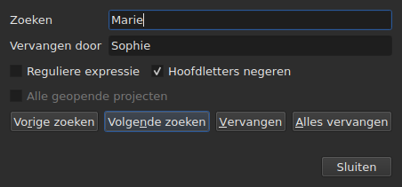
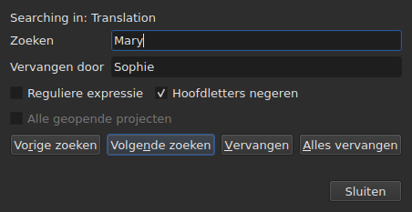

# Zoeken en vervangen

<!-- machine-translated -->
> Deze pagina is een machinevertaling en is nog niet nagelezen door een lezer van de taal.

`Aanpassen ▸ Zoeken en vervangen…`, of `Ctrl+F`, opent het zoekdialoogvenster.




**Het dialoogvenster is niet modaal**: het blijft open terwijl u naar de tabel kijkt,
een cel bewerkt, opnieuw zoekt. `Close` sluit het; als u het opnieuw opent,
krijgt u het terug zoals u het achterliet, met patroon en vervanging.

| Veld | Wat het bevat |
| :---- | :-------------- |
| `Find` | het patroon waarnaar wordt gezocht |
| `Replace with` | wat het vervangt |
| `Regular expression` | het patroon is een reguliere expressie in plaats van gewone tekst |
| `Ignore case` | ‘marie’ vindt ‘Marie’ |
| `All open projects` | het zoeken loopt door alle tabbladen — [zie hieronder](#in-alle-geopende-projecten) |

Het item is uitgeschakeld bij een leeg document: er is niets om te doorzoeken.

## De vier handelingen

| Knop | Wat ze doet |
| :----- | :----------- |
| `Find Previous` | zoekt de vorige overeenkomst, en de tabel gaat ernaartoe |
| `Find Next` | zoekt de volgende — het is de knop waarop `Enter` drukt |
| `Replace` | vervangt de gevonden overeenkomst en zoekt dan de volgende |
| `Replace All` | vervangt alle overeenkomsten van het doel |

Alle vier zijn uitgeschakeld zolang `Find` leeg is.

**De tabel gaat naar de overeenkomst** door haar regel te selecteren. Na de
laatste begint `Find Next` weer bij de eerste; `Find Previous` doet hetzelfde in
de andere richting.

**`Replace` zonder gevonden overeenkomst zoekt eerst**: de eerste druk
toont wat er vervangen gaat worden, de volgende vervangt het. Dat is wat
Gaupol doet.

## Wat de zoekopdracht omvat

**De selectie, of het hele document als er niets is geselecteerd** — de regel van het
menu `Tools`. Zie [De bewerkingen](operations.md#waarop-ze-inwerken).

**Het doel wordt bij de eerste handeling bepaald en behouden** zolang het zoeken
doorgaat: `Find Next` selecteert de regel van een overeenkomst, en die
selectie verkleint het doel niet. **Zelf andere regels selecteren
wijzigt het doel** voor de volgende handeling.

De zoekopdracht omvat de tekst van de ondertitels; noch de posities noch het nummer
worden doorzocht.

### In alle geopende projecten

Het selectievakje **`All open projects`** verbreedt het bereik tot elk tabblad. **Uitgeschakeld bij
één geopend project** — er valt niets te verbreden —, wordt het ingeschakeld zodra een
tweede tabblad opent, en vinkt zichzelf uit als er nog maar één over is.

**Als het is aangevinkt, telt de selectie niet meer**: elk project wordt volledig doorzocht,
in **het beoogde document** — dat van de huidige kolom, het hoofddocument of de
vertaling, net als bij één project.

- **`Find Next` en `Find Previous` gaan van tabblad naar tabblad, in de volgorde van de
  tabbladen.** Eerst het getoonde project; als dat geen overeenkomsten meer heeft, het
  volgende, waarvan het venster het tabblad toont en waarvan het de regel selecteert.
- **De ronde eindigt waar ze begon**: wanneer het zoeken voorbij het laatste
  tabblad gaat om terug te keren naar het eerste — of omgekeerd bij omhoog zoeken —, zegt de regel
  van het dialoogvenster dat, in plaats van zonder een woord opnieuw te beginnen:

  ```text
  Search wrapped around
  ```

  De stap daarna is een gewone stap, en de regel wordt gewist.
- **`Replace` vervangt waar het zoeken is**, en gaat dan door naar de volgende
  overeenkomst, die in een ander tabblad kan staan.
- **`Replace All` loopt door alle projecten**, en **maakt één item in de geschiedenis
  per aangeraakt project**: ongedaan maken in een tabblad maakt alleen ongedaan wat dat tabblad
  heeft gekregen. De telling zegt hoeveel projecten zijn gewijzigd, niet alleen hoeveel
  vervangingen er waren:

  ```text
  replaced 4 matches in 3 projects
  ```

  Een project waarin het patroon ontbreekt, wordt niet aangeraakt en heeft niets om ongedaan te maken.
  **Er komt geen tabblad op de voorgrond**: elk project ontvangt zijn vervangingen
  achter zijn tabblad, dat zijn sterretje krijgt, en het tabblad waarvan de handeling
  uitging, blijft getoond, met zijn film.

### In welke tekst

**Met een vertaling omvat de zoekopdracht maar één van de twee teksten: die van
de kolom van de huidige cel** — de vertaling als de huidige cel in
de kolom `Translation` staat, de hoofdtekst overal elders. Het is de
regel van alle tekstbewerkingen, en er is geen extra instelling:
zie [De tekst waarop de bewerkingen zich richten](table.md#de-tekst-waarop-de-bewerkingen-zich-richten).

**Het dialoogvenster zegt in welke tekst het zoekt**, op een regel boven
`Find`, en wijzigt dat wanneer de huidige kolom verandert — zelfs terwijl het open is:




| De huidige cel staat in | De regel zegt |
| :--------------------- | :------------ |
| de kolom `Translation` | `Searching in: Translation` |
| elke andere kolom | `Searching in: Main` |
| — het project heeft geen vertaling, of de kolom is verwijderd | niets: de regel is er niet |

**Vervangen schrijft in die tekst, en alleen daarin.** `Replace` en `Replace
All` op de vertaling laten de hoofdtekst zoals hij was, en
omgekeerd; `Undo` geeft terug wat ze schreven. **De tags zijn die van het formaat
van het bestand van die tekst**: een vertaling in Advanced SSA wordt gelezen met haar
`{\i1}`, ook als de hoofdtekst SubRip is. `Replace with` wordt daar
in dezelfde tags geschreven.

**De tabel blijft in de kolom waar hij was.** `Find Next` selecteert de regel
van een overeenkomst zonder de huidige cel van de ene kolom naar de andere te verplaatsen:
een zoekopdracht die in de vertaling is begonnen, gaat door in de vertaling.

**Beide teksten tegelijk doorzoeken bestaat niet**: elke overeenkomst
zou een paar (ondertitel, tekst) zijn, en de tabel die ernaartoe gaat, zou
geen duidelijke plaats hebben om heen te gaan. U zoekt in de ene, en wisselt dan van kolom.

**Wat helemaal opnieuw begint**:

| Handeling | Wat wordt vergeten |
| :------ | :---------------- |
| `Find`, `Replace with` of een optie wijzigen | de huidige overeenkomst, en de statusregel |
| zelf andere regels selecteren | het doel en de overeenkomst |
| de huidige cel van de ene tekst naar de andere verplaatsen — van `Text` naar `Translation`, of omgekeerd | de overeenkomst: ze is een plaats in een tekst |
| een ander bestand openen | het doel en de overeenkomst; het dialoogvenster blijft open, patroon inbegrepen |

## De doorzochte tekst is de zichtbare tekst

**Tags zijn geen tekst.** Zoeken naar `<i>` vindt niets, en zoeken naar
`Bonjour` vindt een `<i>Bon</i>jour` dat door een tag is doorgeknipt.

**De vervanging gebeurt in de tekst van het bestand, zonder de tags te breken**:

| Tekst | Gezocht → ervoor in de plaats gezet | Wat er wordt geschreven |
| :--- | :-------------------------- | :-------------- |
| `<i>Bonjour</i>` | `Bonjour` → `Salut` | `<i>Salut</i>` |
| `<i>Bon</i>jour` | `Bonjour` → `Salut` | `<i>Salut</i>` |
| `<i>Bonjour</i> Marie` | `Bonjour Marie` → `Salut Sophie` | `<i>Salut Sophie</i>` |

Een tag die een woord doorknipt, omvat het hele woord, en elke stijl die de
overeenkomst raakt, bedekt de vervanging. **De tags die de overeenkomst niet
raakt, blijven waar ze zijn**, ook een tag die een ander woord van dezelfde
ondertitel doorknipt: `Marie` vervangen in `<i>Bon</i>jour Marie` geeft
`<i>Bon</i>jour Sophie`. Een woord bestaat uit letters en cijfers — een vaste
spatie of een aanhalingsteken hoort er niet bij. **`Replace with` wordt gelezen in de tags van de
beoogde tekst**: `<b>Salut</b>` daar typen in een SubRip maakt het woord vet.

## De twee opties

| Optie | Standaard | Wat ze wijzigt |
| :----- | :------ | :-------------- |
| `Regular expression` | niet aangevinkt | `.` zoekt niet meer naar een punt maar naar elk teken |
| `Ignore case` | aangevinkt | hoofdletters tellen niet, ook niet bij letters met accent: `élise` vindt `Élise` |

Dit zijn de standaardwaarden van Gaupol. **Beide worden onthouden** van de ene opening op
de andere en van de ene sessie op de andere, in de opties `search.regex` en
`search.ignore-case` van het [instellingenbestand](preferences.md#het-bestand).

### Een reguliere expressie

Het patroon wordt door ICU gelezen. Net als bij Gaupol gaat `.` over een regeleinde heen, en gelden `^`
en `$` aan het begin en einde **van elke regel** van een ondertitel:
`^` vervangen door `- ` zet een streepje vóór elke regel.

In `Replace with`, en alleen voor een reguliere expressie:

| Geschreven | Wat het zet |
| :------ | :----------- |
| `$1` tot `$9` | de groep met dat nummer; een afwezige groep zet niets |
| `$0` | de hele overeenkomst |
| `\n` | een regeleinde |
| `\$`, `\\` | een `$`, een backslash |
| `\` gevolgd door elk ander teken | dat teken: `\t` zet een `t` |

**`\1` is geen groep**, en zet een `1`. Dat is de syntaxis van Gaupol, dat
zijn expressies in Python leest; die hier is die van ICU, dat het patroon leest.

## Wat het dialoogvenster zegt

Onder de knoppen zegt een regel wat het zoeken niet kon doen, of wat een
`Replace All` heeft gedaan:

| Situatie | Wat wordt getoond |
| :-------- | :------------ |
| geen overeenkomst in het doel | `"Sophie" not found` |
| een reguliere expressie die niet leest | `not a regular expression (U_REGEX_MISMATCHED_PAREN)` |
| `Replace All` heeft vervangen | `replaced 3 matches` |
| `Replace All` vond het patroon, maar de vervanging wijzigt geen enkele tekst | `nothing to change` |

**Een zoekopdracht die niets vindt, raakt niets aan**: de selectie blijft waar
ze was, en er komt niets in de geschiedenis.

**`not found` en `nothing to change` zeggen niet hetzelfde.** `not found`
zegt dat het patroon nergens in het doel staat. `nothing to change` zegt dat het er
wel staat, maar dat de vervanging elke tekst laat zoals hij was — `Marie`
vervangen door `Marie`, bijvoorbeeld. In beide gevallen komt er niets in
de geschiedenis. Het getal van `replaced N matches` telt de overeenkomsten van de
ondertitels waarvan de tekst is gewijzigd.

## Wat de actie voor ongedaan maken erover zegt

| Handeling | Wat `Undo` meldt |
| :------ | :---------------- |
| `Replace` | `Undo: replacing` — één per vervanging |
| `Replace All` | `Undo: replacing all` — **één enkel item**, ongeacht het aantal overeenkomsten |

Zie [Ongedaan maken en opnieuw uitvoeren](undo.md).
