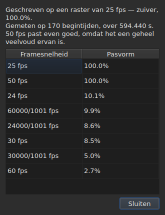

# Het framerooster

<!-- machine-translated -->
> Deze pagina is een machinevertaling en is nog niet nagelezen door een lezer van de taal.

Een ondertitelbestand **vermeldt niet** op welke framesnelheid
zijn posities zijn berekend: SubRip heeft geen koptekst, die van
WebVTT is vrije tekst. Het venster **leidt** die snelheid bij het openen
**af** uit de posities zelf en toont haar op twee plaatsen die niet
dezelfde vraag beantwoorden.

| Oppervlak | Wat het geeft |
| :-------- | :------------ |
| de statusbalk | **het antwoord**, permanent en zonder dat erom wordt gevraagd |
| `Gereedschap ▸ Framesnelheidsanalyse…` | **de redenering**, wanneer u die wilt zien |

## Wat de statusbalk toont

Rechts, tussen wat de balk zegt over de
[codering](files.md#de-codering-in-de-statusbalk) van het gelezen bestand en wat
ze zegt over de [gekoppelde video](video.md#wat-de-statusbalk-toont):

| Situatie | Wat er wordt geschreven |
| :------- | :---------------------- |
| de posities liggen op een raster | `Grid: 24 fps` |
| slechts een deel ervan | `Grid: 29.97 fps (partial)` |
| geen enkel bekend raster past | `No grid` |

**`No grid` noemt geen framesnelheid, en dat is bedoeld.** De verzameling
kandidaten is gesloten — de acht die het conversiedialoogvenster aanbiedt — en
de minst foute ervan melden zou een fout antwoord geven waar
“ik weet het niet” het juiste antwoord is.

**`No grid` heeft twee oorzaken, en het is niet hetzelfde antwoord.** Ofwel past
geen enkel raster, ofwel heeft het bestand te weinig ondertitels om er iets over
te kunnen zeggen — twee beginposities lijken altijd perfect uitgelijnd, en dat bewijst
niets. De statusbalk zegt over beide hetzelfde;
**de analyse onderscheidt ze**, en geeft in het eerste geval aan hoeveel de
beste kandidaat tekortschiet.

De regel **wordt na elke bewerking bijgewerkt**. Een bestand uitlijnen op een andere
framesnelheid verandert het raster, en de statusbalk mag niet het oude blijven
melden.

### Een document in frames geteld heeft geen raster, maar een framerate

**MicroDVD is het enige van de negen dat in frames telt.** Elke regel
bevat twee framenummers en niets anders, en het bestand **zegt niet** met welke
framesnelheid ze gelezen moeten worden. Dezelfde plaats van de statusbalk schrijft dan:

| Situatie | Wat er wordt geschreven |
| :------- | :---------------------- |
| het document is in frames geteld | `Frames: 24000/1001 fps` |

**Dit is niet het raster, en het raster zou hier circulair zijn.** De posities
van een MicroDVD-document zijn berekend *uit* zijn frames met precies die
framesnelheid; er een raster uit afleiden zou dat getal teruggeven, dat wil zeggen een gegeven
dat zich als meting voordoet.

**Waar het vandaan komt, wordt één keer gezegd**, bij het lezen, in de
[lijst met diagnostische meldingen](files.md#de-diagnostiek-van-een-leesbewerking):
`counts in frames and states no rate; it was read at ("24000/1001")`. De regel van de
statusbalk zegt van zijn kant permanent hoe het is.

**Een verkeerde framesnelheid verschuift het hele bestand**, en het
dialoogvenster [`Convert Frame Rate…`](operations.md#convert-frame-rate) is waar u dat herstelt:
het opent op de leesframesnelheid en zegt dat het die is.

## Wat de analyse toont

`Gereedschap ▸ Framesnelheidsanalyse…` **wijzigt niets.** Het opent met een samenvatting en
de rangschikking van de acht kandidaten met hun score.




De samenvatting geeft het antwoord en vervolgens wat het nuanceert — elke zin staat er
alleen als ze iets te zeggen heeft:

| Wat er te lezen valt | Wanneer |
| :------------------- | :------ |
| over hoeveel beginposities, en over welke tijdspanne | altijd |
| hoeveel het bestand van zijn raster afwijkt | de posities liggen er op tot op een constante na |
| dat een andere framesnelheid even goed past | het is een geheel veelvoud van de behouden snelheid |
| dat de tijdspanne niet toelaat twee framesnelheden van elkaar te onderscheiden | het bestand is te kort om ze te scheiden |
| hoeveel beginposities het raster verlaten, **en in hoeveel reeksen** | het bestand is gedeeltelijk |

**Het aantal reeksen onderscheidt twee verhalen** die het
percentage alleen door elkaar haalt. Veel reeksen van één enkele beginpositie zijn
posities die met de hand, één voor één, zijn gecorrigeerd. Enkele lange reeksen zijn een
opnieuw getimed gedeelte, of een bestand dat uit twee andere is samengesteld.

**De volledige rangschikking wordt getoond in plaats van één enkel antwoord.** Een bestand dat
voor honderd procent op 25 past en voor honderd procent op 50, zegt iets wat een
oordeel alleen zou verbergen.

## Wanneer de conversie fout was

Een bestand dat op geen enkel raster valt, is soms een bestand dat **met de verkeerde
framesnelheid is omgezet**: het ligt dan op een heel reëel raster, maar verschoven met een verhouding die die van
geen van de acht is. Wanneer de afleiding `none` of `partial` teruggeeft, zoekt de analyse **onder de
zesenvijftig geordende paren van de acht standaardframesnelheden** — dat is de verzameling, gesloten — naar het paar
waarvan de omzetting de posities weer op een raster brengt. Elke verhouding wordt op de posities toegepast, en
**de afleiding zelf beoordeelt het resultaat**: de betrouwbaarheid is wat zij zou zeggen, nooit een
verzonnen getal. Twee paren met dezelfde verhouding, zoals 30 naar 25 en 60 naar 50, zijn één enkele
omzetting.

De zin wordt aan de samenvatting toegevoegd:

```text
converting from 24 to 25 fps puts the positions on a 24 fps grid: 99.9%, against 11.8% as they are and 14.9% for the next best conversion
```

Ze geeft de omzetting, het raster waarop de posities zouden vallen en hoe goed ze erop vallen,
**daarna het verschil met de posities zoals ze zijn en met de beste van de andere
omzettingen.** Een knop `Convert Frame Rate…` sluit de analyse en opent [het
dialoogvenster voor de omzetting](operations.md#convert-frame-rate), **ingevuld met het gevonden paar** — er wordt niets toegepast
zolang het dialoogvenster niet is bevestigd, en annuleren is genoeg om terug te gaan. De ernaast geopende video
laat u op het beeld beoordelen of het antwoord het juiste is.

**Wanneer twee paren even goed zijn, wordt er geen voorgesteld, en de zin zegt dat:**

```text
converting from 30 to 25 fps and converting from 25 to 24 fps fit equally well (99.7% and 99.6%), so none is proposed
```

Dit is eerder het gewone geval dan de uitzondering: een raster van 28,8 frames per seconde gaat
even goed terug op 24 als op 30, en een bestand waarvan alle tijden zijn verdubbeld, blijft op het 25-raster.
Het gebaar dat één enkel herstel heeft, is een bestand omzetten dat **al** op de doelframesnelheid staat. Bij
een gelijkstand beslist de video: u opent zelf `Convert Frame Rate…` op een van de twee paren.

**Er wordt niets gezegd** over een bestand dat al op een raster ligt, een bestand dat te kort is om een
oordeel waardevol te maken, noch over een bestand dat geen enkele omzetting van de verzameling terugbrengt op een raster — een
drift, een verhouding buiten de acht framesnelheden, posities zonder structuur.

## Wat de tabel niet toont

**Geen enkele regel van de tabel wordt gemarkeerd vanwege het raster**, nooit.

Zodra u een positie met de hand corrigeert, is ze niet meer uitgelijnd. Een
automatische markering zou het werk van de gebruiker dus als een
afwijking melden, in een bestand dat hij juist aan het corrigeren is. De afleiding
spreekt over het **document**, en de analyse is de enige uitzondering — omdat u
die daarvoor hebt geopend.

De markeringen van de tabel gaan van hun kant over wat niet samenhangt: een einde
vóór zijn begin, een overlap, een verbroken volgorde. Zie [De tabel](table.md).
