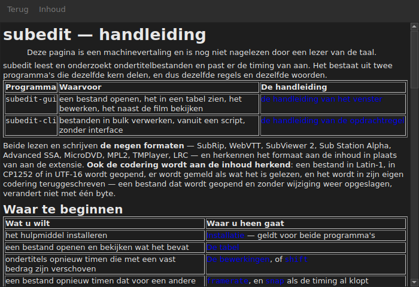

# De handleiding in het venster

<!-- machine-translated -->
> Deze pagina is een machinevertaling en is nog niet nagelezen door een lezer van de taal.

`Hulp ▸ Handleiding`, of `F1`, opent **deze handleiding zelf** in een eigen venster.




## Wat er opent, en waarom geen adres

**De handleiding die naast het programma is geïnstalleerd**, geen pagina op internet.

Een adres zou de versie in ontwikkeling beschrijven, niet de versie die u hebt.
Een gebruiker die de handleiding leest van een versie die hij niet heeft, is slechter af dan een
gebruiker zonder enige handleiding — daarom leest het venster de bestanden die
de installatie neerlegt, onder `<prefix>/share/subedit/manual`. Zie
[Installatie](../subedit-cli/installation.md).

Het opent op de [startpagina](../index.md), die zegt waar u moet beginnen.

## In welke taal

**In de taal van het venster.** De handleiding opent in de taal die de
interface spreekt: die welke in `Aanpassen ▸ Instellingen…` is gekozen, of anders die van de
omgeving — zie
[De interfacetaal](preferences.md#de-interfacetaal).

| Het venster spreekt | De handleiding opent in |
| :---------------- | :------------------ |
| Engels | Engels |
| een taal waarvan de handleiding is geïnstalleerd — Catalaans, Tsjechisch, Duits, Spaans, Fins, Frans, Galicisch, Hebreeuws, Hongaars, Interlingue, IJslands, Italiaans, Nederlands | die taal |
| een taal waarvan de handleiding niet is geïnstalleerd | Engels |

**Pagina voor pagina, niet alles of niets**: een pagina die de vertaling niet heeft,
opent in het Engels, en elke andere pagina blijft in de taal van het venster. Een
link leidt op dezelfde manier van de ene naar de andere.

De vertalingen worden naast de Engelse handleiding geïnstalleerd, elk in een map
die naar de taal is genoemd: `<prefix>/share/subedit/manual/fr` voor het Frans. De
taal is die waarin het venster is gestart, dus een taal die in de
instellingen is gekozen, geldt ook voor de handleiding, bij de volgende start.

## Navigeren

| Wat u doet | Wat er gebeurt |
| :---------- | :----------- |
| op een link van de handleiding klikken | de pagina opent in hetzelfde venster |
| op een link klikken die naar een sectie verwijst | de pagina opent, en het venster scrolt ernaartoe |
| op een link klikken die alleen naar een sectie verwijst | het venster scrolt ernaartoe, zonder van pagina te wisselen |
| `Back` | gaat terug naar de vorige pagina; uitgeschakeld op de eerste |
| `Contents` | gaat terug naar de startpagina; uitgeschakeld als u er bent |

Het venster **is niet modaal**: het blijft open terwijl u werkt, en dat is precies
de bedoeling van een handleiding binnen handbereik. Het item opnieuw kiezen maakt geen
tweede venster aan, het brengt dit venster naar voren.

## Wat het niet kan openen, en dat zegt het

De handleiding verwijst soms naar de **roadmap** of naar een **architectuurbeslissing**.
Dat zijn documenten van de repository, niet van het pakket: ze worden niet
geïnstalleerd, en het venster zegt dat in gewone woorden in plaats van de
klik zonder effect te laten.

```
../../feuille-de-route.md is not part of the installed manual;
it lives in the project's repository.
```

Ze zijn te lezen in de repository, waarvan het adres in `Hulp ▸ Over subedit` staat.

## Wanneer het item is uitgeschakeld

**`Hulp ▸ Handleiding` is uitgeschakeld wanneer er geen handleiding naast het programma staat.** Twee
gevallen, en geen van beide is een fout:

| Geval | Waarom |
| :--- | :-- |
| het programma wordt vanuit zijn bouwmap uitgevoerd | daar is niets geïnstalleerd, dus er is niets te lezen |
| de installatie is onvolledig | de handleiding is verwijderd, of nooit gekopieerd |

Met de muisaanwijzer boven het item wordt gezegd welke van de twee: “Naast dit programma
is geen handleiding geïnstalleerd”.

Een ontbrekende pagina terwijl de handleiding er is — een met de hand verwijderd bestand — sluit het venster
niet: het noemt het bestand dat het niet kon lezen en laat op het scherm staan wat
het toonde.

## Waar de handleiding wordt gezocht

**Naast het uitvoerbare bestand**, in `../share/subedit/manual` — de indeling die elke
installatie oplevert, wat het voorvoegsel ook is. Daardoor vindt een installatie
onder `~/.local` haar handleiding net zo goed als een pakket dat onder `/usr` is geïnstalleerd.
