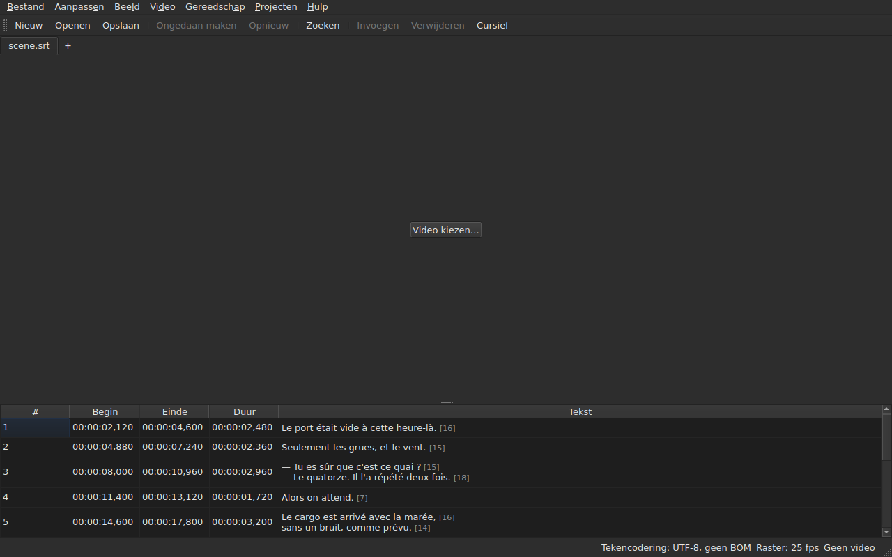

# subedit-gui — handleiding

<!-- machine-translated -->
> Deze pagina is een machinevertaling en is nog niet nagelezen door een lezer van de taal.

Het venster van subedit: open een ondertitelbestand en bekijk het in een tabel. Voor het
andere programma en om te weten waar u moet beginnen, zie [de handleiding](../index.md).

> **Huidige stand.** Het venster **opent meerdere bestanden, elk in een eigen tabblad**, ongeacht
> hun codering — via `Open…` of door ze erop neer te zetten —, **toont ze**,
> **bewerkt zijn cellen**, **voegt regels in en verwijdert ze**,
> **maakt ongedaan**, **slaat op — met keuze van de codering, de regeleinden en de
> bytevolgordemarkering** — en **markeert de ondertitels waarvan de posities
> niet bij elkaar passen**. Het **voegt regels samen en splitst ze**, **knipt,
> kopieert en plakt** teksten en **zoekt en vervangt** in de zichtbare tekst
> zonder de tags te breken, in één project of in alle. Het **opent een vertaling
> naast het hoofdbestand**, uitgelijnd op positie of op nummer, in een extra kolom,
> en slaat die apart op. Het menu `Tools` bevat zestien bewerkingen en twee items voor de spelling —
> verschuiven, transformeren, de framerate omrekenen, duren aanpassen,
> **een bestand toevoegen, het project in tweeën splitsen**, cursief
> zetten, dialoogstreepjes toevoegen, het hoofdlettergebruik op vier manieren wijzigen,
> vermeldingen voor slechthorenden verwijderen, **teksten corrigeren met een
> assistent van meerdere pagina's**, **de spelling woord voor woord controleren**, op een framerate uitlijnen, terugbrengen
> op het raster — en de rasteranalyse, die niets wijzigt. Het menu `Projects`
> **slaat alles op en sluit alles** in één handeling. Het **koppelt een video
> aan het document**, gekozen of geraden, en **speelt die af in het venster**, met de huidige
> regel op het beeld getekend; het **stelt een begin, een einde of een
> ondertitel in vanaf de positie in de film**, **gaat frame voor frame** en **verschuift een rand met één frame**. De afspeelbalk **spoelt, stelt het
> volume en de positie in**, de tabel **volgt het afspelen** zonder een handmatige scrollbeweging ongedaan te maken, posities
> kunnen **in frames** worden getoond, en het menu `Video` **kiest het audiospoor**. Twee detecties
> **stellen voor zonder ooit toe te passen**: een vertaling die met een vast bedrag is verschoven en **verschoven
> opnieuw geopend** kan worden, en de framerate-omrekening die een bestand terugbrengt op een raster. Het **onthoudt zijn geometrie, de volgorde, breedte en zichtbaarheid van zijn
> kolommen en zijn instellingen** van de ene
> sessie op de andere, en verschijnt **licht of donker**, zoals u kiest. `Hulp ▸ Handleiding`
> opent **deze handleiding** in een venster. Deze handleiding beschrijft wat bestaat, nooit
> wat gepland is; wat er hierna komt, staat in de
> [roadmap](../../../../feuille-de-route.md).

> **De afbeeldingen van deze handleiding worden gegenereerd, de tekst niet.** De voorbeelden van
> `subedit-cli` worden gegenereerd door het commando uit te voeren; de schermafbeeldingen
> worden gegenereerd door het echte venster te bouwen en te fotograferen — `make
> manual` doet beide. Een afbeelding kan dus geen interface beschrijven die
> niet meer bestaat, en een interface die verandert, is te zien in de diff van
> de repository. Zonder vangnet blijft de tekst eromheen, waarvan de
> juistheid op nalezen berust.

**Elk scherm wordt twee keer getoond, onder de twee paletten die de toepassing
instelt** — `Light` en `Dark`, die welke
[de instellingen](preferences.md#het-thema) aanbieden. Onder een bureaublad waarvan het
thema bepalend is, geeft `System` het ene of het andere, naargelang wat het bureaublad heeft gekozen.

## De menu's

`File`, `Edit`, `View`, `Video`, `Tools`, `Projects`, `Help` — in de volgorde waarin
u ze gebruikt: het document, wat u ermee doet, hoe u ernaar kijkt, wat erbij
hoort, wat het onderzoekt, wat voor alle geopende projecten geldt, wat
het uitlegt.

`View` bevat een submenu, `Columns`, met één aanvinkbaar item per kolom behalve `Text`
— zie [De tabel](table.md#kolommen-verbergen-en-verplaatsen) — en een instelling, `Positions in Frames`, die
`Start` en `End` als framenummers toont — zie [Posities in frames](table.md#posities-in-frames).

`Projects` bevat twee items, `Save All` en `Close All` — zie
[Het menu Projecten](files.md#het-menu-projecten).

`Edit` bevat vijf blokken, elk onder een scheidingslijn: het ongedaan maken; het
klembord — teksten knippen, kopiëren, plakken; `Find and Replace…`;
het invoegen, verwijderen, samenvoegen en splitsen van regels; ten slotte
`Preferences…`. Ongedaan maken is wat u met een bewerking *doet*, het verplaatsen van een tekst
voegt geen regel toe en verwijdert er geen, de vier items van het volgende blok wijzigen het aantal
regels, en het instellen van het thema is helemaal geen bewerking.

**Toetsen worden genoemd zoals het menu ze toont**, in het Engels zoals de rest
van de interface: `Ins`, `Del`, `Ctrl+Shift+Z`. Een toets die u indrukt en
die geen menu noemt, behoudt zijn Engelse naam: `Enter`, `Esc`, `Shift`.

`Help` bevat twee items, in de volgorde waarin het menu ze toont. `Manual`, of
`F1`, opent deze handleiding in een venster — zie
[De handleiding in het venster](help.md). `About subedit` geeft de versie, de
licentie en de bibliotheken waartegen het venster draait, met hun versies — zie
[`--version`](invocation.md#--version).

## De werkbalk

Onder de menu's bevat een balk **de meest gebruikte handelingen**, in groepen.
Elke knop draagt een kort woord; het menu behoudt het volledige item, en de
sneltoets is dezelfde.

| Knop | Menu-item | Sneltoets |
| :----- | :--------- | :------- |
| Nieuw | Bestand ▸ Nieuw project | `Ctrl+N` |
| Openen | Bestand ▸ Openen… | `Ctrl+O` |
| Opslaan | Bestand ▸ Opslaan | `Ctrl+S` |
| Ongedaan maken | Aanpassen ▸ Ongedaan maken | `Ctrl+Z` |
| Opnieuw | Aanpassen ▸ Opnieuw | `Ctrl+Shift+Z` |
| Zoeken | Aanpassen ▸ Zoeken en vervangen… | `Ctrl+F` |
| Invoegen | Aanpassen ▸ Ondertitels invoegen… | `Ins` |
| Verwijderen | Aanpassen ▸ Ondertitels verwijderen | `Del` |
| Cursief | Gereedschap ▸ Cursief | `Ctrl+I` |

**Een uitgeschakelde knop is uitgeschakeld om dezelfde reden als zijn item**: `Undo` zonder
iets om ongedaan te maken, `Remove` zonder gekozen regel. De items van de vertaling
en de bewerkingen van het menu `Tools`, behalve `Italic`, blijven in hun
menu's: ze worden minder vaak gebruikt, of niet door iedereen.

## Onderdelen

| Onderdeel | Inhoud |
| :------ | :------- |
| [Installatie](../subedit-cli/installation.md) | bouwen en installeren — de pagina geldt voor beide programma's |
| [Aanroep](invocation.md) | het venster starten, argumenten, afsluitcodes |
| [Openen en opslaan](files.md) | de commando's, de tabbladen, het menu `Projects`, bestanden neerzetten, de vertaling en het verschoven heropenen ervan, de diagnostiek, de codering in de statusbalk, de heen-en-terugreis, het sluiten |
| [De tabel](table.md) | wat elke kolom toont, ze verbergen en verplaatsen, posities in frames, de vertaalkolom en de tekst waarop de bewerkingen zich richten |
| [Een cel bewerken](editing.md) | welke cellen kunnen worden bewerkt, en hoe |
| [Teksten knippen, kopiëren en plakken](clipboard.md) | de drie items, wat er wordt overgedragen, de toegevoegde regels, de omgezette tags |
| [Zoeken en vervangen](find-and-replace.md) | het dialoogvenster, de vier handelingen, de twee opties, wat de zoekopdracht omvat, in alle geopende projecten |
| [Regels invoegen, verwijderen, samenvoegen, splitsen, sorteren en niet-overlappend maken](lines.md) | de vier items, hun sneltoetsen, waar de nieuwe regels komen |
| [Ongedaan maken en opnieuw uitvoeren](undo.md) | de geschiedenis, de twee acties, de wijzigingsmarkering |
| [Het framerooster](frame-grid.md) | de uit de posities afgeleide framerate, de analyse en de omrekening die een bestand terugbrengt op een raster |
| [De bewerkingen](operations.md) | verschuiven, transformeren, omrekenen, duren aanpassen, een bestand toevoegen, het project splitsen, cursief zetten, het hoofdlettergebruik, de streepjes, vermeldingen verwijderen, uitlijnen, terugbrengen op het raster, en wat voorbij het einde van de film valt |
| [Teksten corrigeren…](correct-texts.md) | de correctie-assistent: het doel en de taken, de pagina van elke taak, de voortgang, de bevestiging |
| [Spelling controleren…](check-spelling.md) | de spellingcontrole: de instellingen, de doorloop, tussentijds sluiten, het ontbreken van een woordenboek |
| [De gekoppelde video](video.md) | een video kiezen, het automatische voorstel, het audiospoor, de statusbalk, `ffmpeg` |
| [De speler](player.md) | de videoweergave, de afspeelbalk, afspelen, navigeren, het volume, de tabel die meeloopt, de getekende regel |
| [Timing vanaf de video](timing.md) | het begin of einde van een ondertitel instellen, invoegen, selecteren vanaf de positie in de film, frame voor frame gaan, een rand verschuiven |
| [De instellingen](preferences.md) | het thema, het instellingenbestand, de opties ervan, en wat er van een onleesbare waarde wordt |
| [De handleiding in het venster](help.md) | `Hulp ▸ Handleiding`, wat het opent en hoe u erin navigeert |
