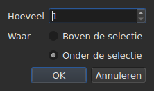

# Regels invoegen, verwijderen, samenvoegen, splitsen, sorteren en niet-overlappend maken

<!-- machine-translated -->
> Deze pagina is een machinevertaling en is nog niet nagelezen door een lezer van de taal.

Acht items van het menu `Edit`, onder een scheidingslijn die ze afzet van
`Find and Replace…`. Vier ervan hebben gemeen dat ze het aantal regels wijzigen, terwijl
knippen, kopiëren en plakken, hierboven, teksten verplaatsen; `Sort Subtitles` wijzigt
alleen **de volgorde** van de regels, `Join Repeated Subtitles` maakt weer één enkele
ondertitel van de opeenvolgende stukken van één en dezelfde tekst, en `Make Ranges Disjoint…`
knipt ze opnieuw waar ze overlappen.

| Item | Sneltoets | Wat het doet |
| :---- | :------- | :----------- |
| Ondertitels invoegen… | `Ins` | opent een dialoogvenster en voegt dan lege regels toe |
| Ondertitels verwijderen | `Del` | verwijdert de selectie, zonder iets te vragen |
| Ondertitels samenvoegen | geen | maakt één regel van een blok naburige regels |
| Ondertitel splitsen | geen | knipt een regel in tweeën, halverwege de duur |
| Herhaalde ondertitels samenvoegen | geen | maakt één enkele ondertitel van de opeenvolgende stukken van één en dezelfde tekst |
| Ondertitels sorteren | geen | brengt de regels weer in de volgorde van hun begin, over het hele project |
| Bereiken niet-overlappend maken… | geen | knipt de overlappende regels zo dat geen enkel bereik nog een ander overlapt |
| Ondertitels herstellen… | geen | voert de drie voorgaande items na elkaar uit — de herhalingen samenvoegen, sorteren, de bereiken knippen — in één keer |

Alle acht komen in de geschiedenis terecht: `Ctrl+Z` maakt ze ongedaan zoals de rest.

## Invoegen

| Veld | Wat het bevat | Standaard |
| :---- | :------------ | :------ |
| `How many` | een geheel getal van 1 tot 99.999 | `1` |
| `Where` | `Above the selection` of `Below the selection` | de laatste keuze, `Below` bij de eerste start |

`OK` voegt de regels toe, `Cancel` voegt niets toe.

### Waar ze komen

**Bij de laatste geselecteerde regel**, niet bij de eerste. Als u regel 1 en 3
selecteert en daarna eronder invoegt, komt de nieuwe regel op positie 4 — niet op
positie 2. Dat is wat Gaupol al twintig jaar doet, en wat de hand
verwacht na een veeg van boven naar beneden.

`Above the selection` zet de regel vlak vóór diezelfde regel.

### Hoe lang ze duren

Een lege regel heeft geen tekst, maar wel posities. Die worden afgeleid
uit de beschikbare ruimte:

| Situatie | Begin | Duur |
| :-------- | :---- | :------- |
| tussen twee ondertitels | het einde van de vorige | de ruimte tot de volgende, in gelijke delen verdeeld |
| na de laatste | het einde van de laatste | elk drie seconden |
| vooraan in een bestand | de oorsprong | de ruimte tot de eerste, verdeeld |
| in een leeg bestand | de oorsprong | elk drie seconden |

Als het bestand op de gekozen plaats overlapt, is er **geen ruimte om te
verdelen**: de regels krijgen een duur van nul, die de tabel toont, in plaats van
een verzonnen duur die over de buurman heen zou gaan.

### Het lege document

**Er is geen selectie nodig**, en dit is de enige manier om een
nieuw bestand te beginnen: de regels komen op index nul. De keuze van de kant is dan uitgeschakeld
in het dialoogvenster — er is geen selectie om ze tegenover te plaatsen.

Zodra het document een regel bevat, is het item `Insert Subtitles…` **uitgeschakeld zolang
er niets is geselecteerd**: zonder selectie zou de index worden geraden.

### Daarna

De toegevoegde regels zijn **geselecteerd**, en de tabel gaat ernaartoe. Een tweede keer op
`Ins` drukken voegt dus na deze regels in, zonder dat u er tussendoor hoeft te klikken.

### De kant wordt onthouden

`Above` of `Below` wordt onthouden **van de ene invoeging op de andere, en van de ene sessie
op de andere**: het is de optie `edit.insert-placement` van het
[instellingenbestand](preferences.md#het-bestand). U voegt niet één keer in,
u voegt tien regels achter elkaar in, steeds aan dezelfde kant.

## Verwijderen

`Remove Subtitles`, of `Del`, verwijdert de geselecteerde regels — ook een
niet-aaneengesloten selectie, waarbij elke regel op zijn plaats terugkeert als u ongedaan maakt.

**Er wordt geen bevestiging gevraagd**, en dat is geen vergissing:
de bewerking wordt ongedaan gemaakt met `Ctrl+Z`. Een modaal venster vóór een ongedaan te maken handeling
zou telkens een klik kosten om af en toe een `Ctrl+Z` te besparen.

**Het item is uitgeschakeld als er niets is geselecteerd.** Elders in het venster
betekent ‘niets geselecteerd’ ‘het hele bestand’ — daardoor is een
verschuiving bruikbaar zonder vierduizend regels te selecteren. Hier zou die lezing
met een ongelukkige `Del` een document leegmaken, dus wordt ze niet aangeboden.

Na het verwijderen **is de regel geselecteerd die de plaats van de eerste verwijderde heeft
ingenomen** — of de laatste die overblijft, als het verwijderen het einde van het
bestand heeft weggenomen. Meermaals achter elkaar op `Del` drukken verwijdert dus de regels
een voor een.

Een volledig leeggemaakt bestand laat het venster bruikbaar: `Insert Subtitles…`
wordt weer ingeschakeld, want in een leeg document wordt zonder selectie ingevoegd.

## Samenvoegen

`Merge Subtitles` maakt **één regel** van de geselecteerde regels:

| Wat de samengevoegde regel krijgt | Waar het vandaan komt |
| :---------------------------- | :------------------ |
| het begin | het begin van de eerste |
| het einde | het einde van de laatste |
| de tekst | de teksten van alle regels, op volgorde, met een regeleinde tussen twee teksten |
| de vertaling | de vertalingen, op dezelfde manier samengevoegd |
| wat het formaat verder bevat — een stijl, een laag, coördinaten | die van de eerste |

**Een lege tekst laat geen lege regel achter**: de samenvoeging van `Un.`, een regel zonder
tekst en `Trois.` geeft twee regels tekst, geen drie.

De samengevoegde regels verdwijnen, en de regel die ze vervangt neemt de plaats
van de eerste in.

**Het item is uitgeschakeld** zolang de selectie niet **een blok van minstens
twee naburige regels** is. Eén enkele regel heeft niets om mee samen te voegen; regel
1 en 3 zonder 2 evenmin, want het resultaat zou over 2 heen gaan en
die bedekken.

Na het samenvoegen **is de samengevoegde regel geselecteerd**: `Split Subtitle` staat
klaar om haar weer te knippen.

## Splitsen

`Split Subtitle` knipt de geselecteerde regel **halverwege haar duur**, op de
milliseconde nauwkeurig:

| Helft | Begin | Einde | Tekst |
| :--- | :---- | :-- | :--- |
| de eerste | het oorspronkelijke begin | het midden | **alle** tekst, en de vertaling |
| de tweede | het midden | het oorspronkelijke einde | leeg |

**De tekst wordt niet geknipt bij het regeleinde.** Dat zou goed zijn voor een
ondertitel van twee regels en verkeerd voor een ondertitel van één of van drie regels;
alle tekst blijft in de eerste helft, en wat naar de tweede moet,
verplaatst u zelf.

De eerste helft behoudt wat het formaat naast de tekst bevatte; de tweede
wordt geboren als een ingevoegde regel, met niets.

**Het item is uitgeschakeld** zolang de selectie niet **precies één
regel** telt. Niets geselecteerd betekent hier niet ‘het hele bestand’.

Na het splitsen zijn **beide helften geselecteerd** — dat is wat Gaupol
na elke invoeging doet, en `Merge Subtitles` staat dan klaar om de
handeling ongedaan te maken.

## Sorteren

`Sort Subtitles` brengt **het hele project** terug in de volgorde van de begintijden. Nooit de
selectie: een volgorde is een eigenschap van het document, en de helft van een
bestand sorteren betekent niets. De sortering is **stabiel**: twee ondertitels die
tegelijk beginnen, behouden de volgorde die het bestand ze gaf.

**Tijdens het sorteren loopt er een balk in de statusbalk en wordt de cursor een
zandloper**: bij een lang bestand reageert het venster een tijdje niet — de
tabel wordt regel voor regel opnieuw opgebouwd —, en zonder dat weet u niet of er iets
bezig is. De balk toont geen deelstreep, de sortering meldt er geen,
en de balk verdwijnt samen met de sortering.

De statusbalk zegt hoeveel regels van plaats zijn veranderd — `3 subtitles moved`
— of, als alles op volgorde was, `already in order`. **Een project dat al op volgorde is,
komt niet in de geschiedenis**: een bewerking die niets wijzigt, is geen
bewerking om ongedaan te maken. Het item is uitgeschakeld voor een project van één ondertitel.

Een bestand **met iets te corrigeren bij het openen** biedt dat zelf aan,
[in één enkel vakje](#bij-het-openen-één-vakje): zie verderop. Verkeerd geplaatste
ondertitels worden ook [meegeteld bij de diagnostiek](files.md#de-diagnostiek-van-een-leesbewerking),
zodat u ze vindt zonder door de tabel te scrollen.

Op de opdrachtregel doet [`sort`](../subedit-cli/sort.md) hetzelfde op
bestanden, en `--sort` doet het in het voorbijgaan bij
[`convert`](../subedit-cli/convert.md#sorteren-bij-het-schrijven),
[`append`](../subedit-cli/append.md#het-resultaat-sorteren) en
[`split-file`](../subedit-cli/split-file.md#knippen-in-tijdsvolgorde).

## Herhaalde ondertitels samenvoegen

`Join Repeated Subtitles` maakt **één enkele ondertitel** van de ondertitels die achter elkaar
hetzelfde tonen: een tekst die in opeenvolgende stukken is geknipt, zoals
sommige segmentatiehulpmiddelen hem achterlaten. Het werkt op **het hele project**.

**Een herhaling** heeft dezelfde tekst, dezelfde vertaling en dezelfde formaatinstellingen
(een stijl, een positie, cue-instellingen) als een andere, **en begint uiterlijk
wanneer die eindigt**. Een reeks herhalingen wordt de herhaling die als eerste
begint, met het grootste einde van de reeks; de andere verdwijnen.
`Alpha [1, 2]`, `Alpha [2, 4]` en `Alpha [4, 6]` geven `Alpha [1, 6]`.

- **De volgorde van het bestand doet er niet toe, en wordt er niet door gewijzigd**: de bewaarde ondertitel
  is die welke als eerste begint, waar de andere ook staan.
- **Er wordt niets per vergissing samengevoegd**: een andere tekst, andere instellingen, een tussenruimte
  tussen twee stukken, een ondertitel zonder tekst of waarvan het einde vóór het begin ligt
  blijven gescheiden.
- De statusbalk zegt wat er is gedaan — `2 repeated subtitles joined`, of
  `no repeated subtitles`.

**Te doen vóór het sorteren en knippen**, die een schone reeks beter lezen: een
tekst in drie stukken, plus een andere tekst over het hele bereik, in willekeurige
volgorde aangeleverd, wordt gesorteerd en geknipt tot regels die van het ene stuk naar het andere springen; eerst
samengevoegd komt hij vanzelf op volgorde en voegt hij netjes samen. Het openingsvakje, hieronder, doet
alle drie in die volgorde.

## De bereiken niet-overlappend maken

`Make Ranges Disjoint…` knipt de overlappende ondertitels zo dat **geen enkel
bereik `[start, end]` nog een ander overlapt**. Het werkt op **het hele
project**, nooit op de selectie: een groep overlappende ondertitels
wordt geknipt waar ze overlappen, en de helft van een groep betekent niets.

**Niets wordt verkort of verlengd.** Op elk moment toont het venster
dezelfde teksten als voorheen. Wat verandert, is hoe de tijdlijn is geknipt:
ze wordt geknipt bij elk begin en elk einde van een groep; een interval dat door
één ondertitel wordt gedekt, blijft die ondertitel; een interval dat door meerdere wordt gedekt,
wordt **één** ondertitel met hun regels, **de vroegste op regel 1**.
`A [0, 5]` en `B [3, 8]` geven `[0, 3] A`, `[3, 5] A / B`, `[5, 8] B`.

Het dialoogvenster vraagt om drie instellingen, die van de ene keer op de andere worden onthouden:

| Veld | Wat het bevat | Standaard |
| :---- | :------------ | :------ |
| `Shortest interval kept` | van 0 tot 10.000 ms: een korter interval wordt door een buur overgenomen | `80 ms` (ongeveer twee frames) |
| `Most lines in a subtitle` | van 0 tot 10; `No limit` bij 0 | `2` |
| `Put a dash before each subtitle's text` | een streepje vóór wat elke ondertitel bijdraagt aan een samengevoegde ondertitel | niet aangevinkt |

`OK` knipt, `Cancel` doet niets. **De geschreven regels zijn geselecteerd**
daarna, en de statusbalk zegt wat er is gedaan: `2 subtitles split, 1 merged`.
Een tweede ronde wijzigt niets en zegt dat ook: `already disjoint`.

- **Een regel wordt nooit gedupliceerd.** Twee ondertitels met dezelfde tekst geven één
  enkele regel waar ze overlappen, en twee naburige stukken die hetzelfde
  tonen, maken maar één ondertitel. De tekst van een ondertitel die in meerdere
  stukken is geknipt, wordt verder in elk stuk herhaald: het is wat op dat moment in beeld is.
- **Een zeer kort interval wordt door een buur overgenomen**: die waarvan de regels
  de eigen regels al bevatten, anders de langste, breidt zijn bereik uit om het te dekken.
  Een hele ondertitel die korter is dan de drempel wordt nooit overgenomen.
- **Meer regels dan de limiet: vensters.** Drie regels over drie seconden
  worden twee helften, eerst de eerste twee regels en dan de laatste twee;
  vier regels, drie derden, enzovoort. Er wordt niets afgekapt.
- De vertaling volgt dezelfde sneden; de stijl en positie van de eerste
  dekkende ondertitel blijven behouden.

**Wat niet volledig kon worden gedaan, wordt gemeld in een af te sluiten vakje**, niet in
de statusbalk: vensters, overgenomen intervallen, te korte ondertitels
heel gelaten, stijlen die verschillen, ondertitels waarvan het einde vóór het
begin ligt (gelaten waar ze staan).

**Het item wordt geweigerd, met de reden, als de ondertitels niet op
volgorde van hun begin staan**: de groepen zijn reeksen buren, en de kern sorteert
nooit uit zichzelf. Eerst `Sort Subtitles` — of het openingsvakje, dat
beide in die volgorde doet.

### Alles in één keer: `Repair Subtitles…`

`Repair Subtitles…` voert de drie voorgaande items **na elkaar** uit, in de enige volgorde die werkt: de
herhalingen worden samengevoegd, de ondertitels in de volgorde van hun begin gezet, en dan de bereiken niet-overlappend gemaakt. Het is het item
voor een bestand dat slecht is gesegmenteerd, slecht is geordend en overlapt, wanneer u weet dat u alle drie wilt. Het dialoogvenster vraagt om de
knip-instellingen (dezelfde als bij `Make Ranges Disjoint…`, van de ene keer op de andere onthouden) en zegt dat het eerst samenvoegt en sorteert.
De statusbalk — of het af te sluiten vakje, als iets niet volledig kon worden gedaan — geeft **één enkel verslag**
van alle drie: `2 repeated subtitles joined; already in order; 2 subtitles split, 1 merged`. Elke correctie is een eigen
item in de geschiedenis: `Ctrl+Z` maakt ze een voor een ongedaan. Op de opdrachtregel: [`repair`](../subedit-cli/repair.md).

### Bij het openen, één vakje

Een bestand dat opent met iets wat we kunnen corrigeren, **biedt dat aan in
één enkel vakje**, `Problems found in this file`, in plaats van er één per
probleem te openen. Elk gevonden probleem is een regel met zijn selectievakje, aangevinkt:

- `Join the repeated subtitles` — ondertitels herhalen een andere die ze
  raken, met hun nummer;
- `Sort the subtitles` — de ondertitels staan niet in de volgorde van hun begin,
  met hun nummer;
- `Make the ranges disjoint` — ondertitels beginnen vóór het einde van de vorige,
  geteld **zodra het bestand op volgorde is**, want daar worden ze gecorrigeerd.

**Elk probleem wordt geteld waar het wordt gecorrigeerd**, op een kopie waarop de
voorafgaande correcties al zijn uitgevoerd: een tekst die in stukken is geknipt, is de
oorzaak van sommige wanorde, en hem eerst samenvoegen kan er geen overlaten — het vakje
biedt dan het sorteren niet aan.

Een probleem dat niet is gevonden, heeft geen regel. Het sorteren uitvinken **maakt het andere
selectievakje grijs en vinkt het uit**: bereiken worden alleen op volgorde niet-overlappend gemaakt.
`Fix` past toe wat is aangevinkt — het samenvoegen, dan het sorteren, dan het knippen, met de
instellingen van de laatste `Make Ranges Disjoint…` — en geeft daarvan **één enkel verslag**;
`Keep as is` raakt niets aan. **Er wordt niets gedaan zonder een ja**, elke correctie
is een item in de geschiedenis, en een bestand zonder iets te corrigeren is
het onderwerp van geen enkele vraag.

Op de opdrachtregel doet [`disjoint`](../subedit-cli/disjoint.md) hetzelfde op bestanden, en `--disjoint`
doet het in het voorbijgaan bij [`convert`](../subedit-cli/convert.md#de-bereiken-niet-overlappend-maken),
[`append`](../subedit-cli/append.md#de-bereiken-niet-overlappend-maken) en
[`split-file`](../subedit-cli/split-file.md#de-bereiken-niet-overlappend-maken).

### Waarom niet de sneltoetsen van Gaupol

Gaupol voegt samen met `M` en splitst met `S`. Een kale letter zou door de
tabel worden afgevangen voordat ze een cel in bewerking bereikt, en `Ctrl+S`
slaat al op: de twee items zijn bereikbaar via het menu.

## Wat de actie voor ongedaan maken erover zegt

**Eén item in de geschiedenis per handeling.** Vijf regels samenvoegen wordt met één enkele
`Ctrl+Z` ongedaan gemaakt, en geeft de vijf regels terug zoals ze waren — posities, teksten en
alles wat het formaat bevatte.

| Bewerking | Wat `Undo` meldt |
| :-------- | :---------------- |
| een invoeging | `Undo: inserting` |
| een verwijdering | `Undo: removing` |
| een samenvoeging | `Undo: merging` |
| een splitsing | `Undo: splitting` |
| een samenvoeging van herhalingen | `Undo: joining repeated subtitles` |
| een knip van de bereiken | `Undo: making the ranges disjoint` |

Een correctie die bij het openen wordt aangeboden, is één item in de geschiedenis per correctie: het samenvoegen, het sorteren en dan het knippen worden na elkaar ongedaan gemaakt.

Zie [Ongedaan maken en opnieuw uitvoeren](undo.md).

## Sneltoetsen terwijl een cel open is

`Ins` en `Del` behoren toe aan het invoerveld zolang een celeditor
open is: de toets Delete wist daar een teken, geen
ondertitel. Als u de editor sluit — `Enter` of `Esc` — krijgen ze hun betekenis terug. Vanuit
het menu gestart bevestigt `Remove Subtitles` eerst de invoer, zoals de andere
handelingen van [Een cel bewerken](editing.md).

Deze handleiding noemt de toetsen zoals het menu ze toont — zie
[De menu's](index.md#de-menus).
