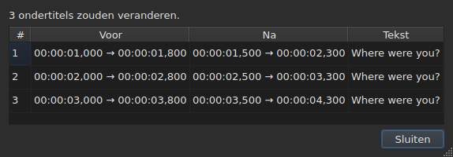
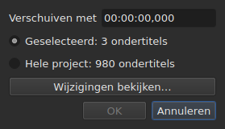
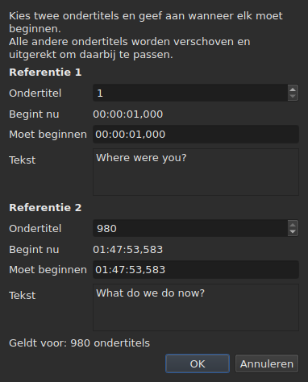
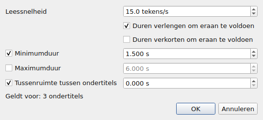
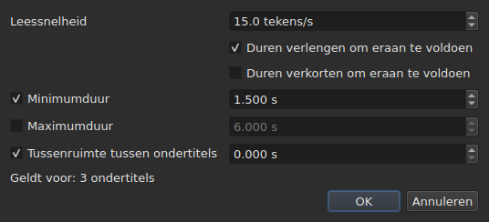
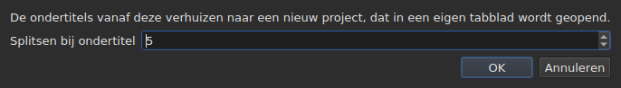

# De bewerkingen

<!-- machine-translated -->
> Deze pagina is een machinevertaling en is nog niet nagelezen door een lezer van de taal.

Het menu **Gereedschap** bevat zestien bewerkingen, een analyse en twee spellingitems. Elk van de
zestien wordt met een `Ctrl+Z` ongedaan gemaakt; de analyse wijzigt niets. `Check Spelling…` wordt ook ongedaan gemaakt, en `Spell-Check Settings…` raakt geen tekst aan.

| Item | Dialoogvenster | Wat het doet |
| :---- | :----- | :----------- |
| `Shift Positions…` | ja | verschuift het doel met een duur |
| `Transform Positions…` | ja | corrigeert het doel aan de hand van twee markeringen |
| `Convert Frame Rate…` | ja | timet het doel opnieuw van de ene framerate naar de andere |
| `Adjust Durations…` | ja | verplaatst de einden om een leessnelheid, duren en een tussenruimte te halen |
| `Append File…` | een bestandskiezer | voegt een bestand toe aan het einde van het project |
| `Split Project…` | ja | knipt het project in tweeën, de rest komt in een nieuw tabblad |
| `Italic` | **nee** | zet het doel cursief, of haalt het cursief weg |
| `Dialogue` | **nee** | zet een dialoogstreepje aan het begin van elke regel, of verwijdert het |
| `Hoofdlettergebruik ▸ Hoofdletter bij elk woord` | **nee** | elk woord krijgt een hoofdletter |
| `Hoofdlettergebruik ▸ Hoofdletter aan zinsbegin` | **nee** | de eerste letter van de tekst, en die alleen |
| `Hoofdlettergebruik ▸ HOOFDLETTERS` | **nee** | alles in hoofdletters |
| `Hoofdlettergebruik ▸ kleine letters` | **nee** | alles in kleine letters |
| `Remove Hearing-Impaired Mentions…` | ja, zonder instellingen | verwijdert vermeldingen voor slechthorenden |
| `Correct Texts…` | ja, een assistent met meerdere pagina's | stelt correcties voor — vermeldingen, woorden samenvoegen en splitsen, veelvoorkomende fouten, hoofdletters, regelafbreking — en past ze toe zodra ze zijn geaccepteerd, zie [Teksten corrigeren…](correct-texts.md) |
| `Check Spelling…` | ja, een doorloop woord voor woord | loopt de woorden langs die het woordenboek niet kent en past toe wat is gecorrigeerd, zie [Spelling controleren…](check-spelling.md) |
| `Spell-Check Settings…` | ja | kiest de taal, het doel en het document van de controle, en het onderstrepen tijdens het typen, zie [Spelling controleren…](check-spelling.md#spellingcontrole-instellingen) |
| `Snap to Frame Rate…` | ja | zet elke tijdcode terug op het dichtstbijzijnde frame |
| `Shift Whole File onto Grid (…)` | **nee** | brengt het hele bestand terug op zijn raster |
| `Frame Rate Analysis…` | ja, zonder instellingen | **wijzigt niets** — zie [Het framerooster](frame-grid.md) |

**Wat een bewerking heeft gedaan, wordt gezegd in een informatievak dat moet worden
gesloten, behalve bij `Italic`, `Case` en `Dialogue`**: die drie openen geen
dialoogvenster, en hun rapport — “niets te wijzigen” inbegrepen — wordt getoond
in de statusbalk, zonder iets te sluiten. `Split Project…` geeft zijn eigen rapport ook
in de statusbalk: het resultaat staat al voor u, in het nieuwe tabblad. De meldingen worden geciteerd in de
sectie van elke bewerking.

Regels invoegen, verwijderen, samenvoegen en splitsen staan hier niet maar in het
menu `Edit`, omdat ze het aantal regels wijzigen. Zie
[Regels invoegen, verwijderen, samenvoegen, splitsen, sorteren en niet-overlappend maken](lines.md).

## Waarop ze inwerken

**De geselecteerde regels, of het hele bestand als er geen is geselecteerd.** Het is dezelfde
regel voor allemaal, en de dialoogvensters, wanneer er een is, herinneren er in gewone
woorden aan:

```
Applies to: 4 subtitles
```

Alle regels selecteren komt op hetzelfde neer als er geen selecteren.

**Wanneer slechts een deel van de regels is geselecteerd, vraagt het dialoogvenster
waarop het moet inwerken.** Er worden twee keuzes getoond, met hun aantal, en **de selectie
is de aangevinkte**:

```
(•) Selected: 2 subtitles
( ) Whole project: 4 subtitles
```

`Whole project` aanvinken verbreedt de bewerking tot het hele bestand zonder eerst
de selectie te hoeven wijzigen. Wanneer er niets te kiezen is — niets
geselecteerd, of alles —, blijft de regel `Applies to:` hierboven alleen staan.

De dialoogvensters van `Shift Positions…`, `Transform Positions…`,
`Convert Frame Rate…`, `Adjust Durations…`, `Snap to Frame Rate…` en
`Remove Hearing-Impaired Mentions…` bieden deze keuze.

### Zien voordat u toepast

`Shift Positions…`, `Transform Positions…`, `Convert Frame Rate…`,
`Adjust Durations…` en `Snap to Frame Rate…` dragen een knop **`Preview changes…`**.
Die opent een klein venster dat zegt hoeveel ondertitels de bewerking
zou wijzigen **met wat op dat moment is getypt, op het aangevinkte doel**, en
dat de eerste twaalf opsomt: hun nummer, hun positie ervoor, hun positie
erna, en de eerste regel van hun tekst. **Er wordt niets toegepast**: het venster
sluiten brengt u terug in het dialoogvenster, waar u een waarde kunt wijzigen en opnieuw
kunt kijken.




Het opent groot genoeg om alle kolommen te tonen, en kan met de hand van
grootte worden veranderd.

Als de bewerking niets zou wijzigen, zegt het venster dat (`Nothing would change.`).
Zolang wat is getypt geen bewerking bepaalt — een onleesbare duur, twee
markeringen op dezelfde ondertitel —, is de voorvertoning leeg om dezelfde reden waarom de knop
`OK` grijs is. `Remove Hearing-Impaired Mentions…` heeft geen voorvertoning: wat
het wijzigt is tekst, en het rapport dat het daarna geeft,
zegt dat.

**Met een vertaling, welke tekst?** Bewerkingen op positie en structuur
werken in op de hele ondertitel — zijn twee teksten volgen. Die welke een tekst
herschrijven — `Italic`, `Case`, `Dialogue`,
`Remove Hearing-Impaired Mentions…` — richten zich op **de tekst van de kolom van de huidige cel**: de
vertaling in haar kolom, de hoofdtekst elders. De andere blijft intact, en
de statusbalk zegt welke wordt geraakt. Zie [De tabel](table.md#de-tekst-waarop-de-bewerkingen-zich-richten).

**Eén uitzondering, en haar label draagt haar**: `Shift Whole File onto Grid`
negeert de selectie. Een raster is een eigenschap van het document, en een half
document heeft geen eigen raster; het item zegt dat dus in zijn naam in plaats van
alleen in deze handleiding.

**`Append File…` negeert de selectie ook**, om een andere reden: het is
geen doel dat het herschrijft, het is een einde dat het naar achteren duwt. Zie zijn
[eigen sectie](#append-file). **`Split Project…` ook**: het knipt waar het
wordt gezegd. Zie [de zijne](#split-project).

**`Correct Texts…` kiest zijn doel op zijn eigen pagina**, in plaats van de
huidige selectie te volgen: de selectie, het huidige project of alle geopende
projecten. Zie [Teksten corrigeren…](correct-texts.md). **`Check Spelling…` kiest het in
`Spell-Check Settings…`**, en onthoudt het: zie [Spelling controleren…](check-spelling.md).

**De twee rasterbewerkingen spreken niet over hetzelfde als het raster.**
Een bewerking werkt in op de selectie; de analyse en de statusbalk spreken over het
**hele document**. Vijf regels van de honderdzesenzeventig uitlijnen wijzigt die
vijf wel — de tabel laat het zien — zonder dat een van beide beweegt, wat
leest als een gemiste verversing. Dat is het niet: ze hebben niets
te zeggen. Zie [`Snap to Frame Rate…`](#snap-to-frame-rate) en
[Het framerooster](frame-grid.md).

### Wat “niets geselecteerd” betekent, item voor item

De regel geldt voor het menu `Tools` en voor het zoeken. De items van het
menu `Edit` die de regels aanraken of leegmaken, lezen hem anders — anders zou een
ongelukkige `Del` of `Ctrl+X` het document leegmaken.

| Item | Zonder selectie | Wat het vereist |
| :---- | :------------------ | :--------------- |
| de bewerkingen van het menu `Tools` | het hele bestand | een niet-leeg document |
| `Shift Whole File onto Grid` | het hele bestand, **altijd** | een gevonden raster |
| `Find and Replace…` | het hele bestand | een niet-leeg document |
| `Cut Texts`, `Copy Texts`, `Paste Texts` | **uitgeschakeld** | ten minste één geselecteerde regel |
| `Remove Subtitles` | **uitgeschakeld** | ten minste één geselecteerde regel |
| `Merge Subtitles` | **uitgeschakeld** | een blok van ten minste twee naburige regels |
| `Split Subtitle` | **uitgeschakeld** | precies één regel |
| `Insert Subtitles…` | uitgeschakeld, behalve op een leeg document | een regel om ze tegenaan te plaatsen |

Elke pagina geeft de reden: [het klembord](clipboard.md#waarop-ze-inwerken),
[de regels](lines.md), [het zoeken](find-and-replace.md#wat-de-zoekopdracht-omvat).

De items zijn **uitgeschakeld op een leeg bestand**: er zou niets te
verschuiven zijn. `Italic` heeft een tweede voorwaarde, die zijn sectie beschrijft: het geopende
formaat moet een stijl kunnen schrijven. Hoofdletters en streepjes hebben er geen — een
tekst is een tekst in alle negen formaten.

## `Shift Positions…`

Verplaatst het doel met een duur, vooruit of achteruit. Beide grenzen van
elke ondertitel verschuiven met hetzelfde bedrag: geen enkele blijft langer of korter in beeld
dan voorheen.

De duur wordt geschreven **als een tijdcode, teken inbegrepen** — `00:00:02,500` verschuift vooruit,
`-00:00:01,250` verschuift terug. **Het veld wordt overschreven, er wordt niet in geschreven**: het begint als `00:00:00,000`, een cijfer vervangt het cijfer onder de cursor en de cursor slaat de `:` en de `,` zelf over, zodat de vorm nooit verandert. Alleen cijfers worden aangenomen, en `-` (of `+`) om het teken te wijzigen; `Backspace` en `Delete` zetten weer een nul terug. Hetzelfde veld wordt overal gebruikt waar een tijd wordt ingesteld: het transformatiedialoogvenster, de positiecellen van de tabel en het bereik van een transcriptie.




| Weigering | Reden |
| :------ | :-- |
| een onleesbare duur | de knop blijft uitgeschakeld; er wordt niets willekeurig verschoven |
| een verschuiving van nul | er is geen bewerking om vast te leggen |
| een ondertitel zou vóór het begin van de video komen | **geen enkel bestand kan zo'n positie dragen** |

Het derde geval noemt de schuldige — “ondertitel 1 zou vóór de oorsprong beginnen” —
en die is het om naar te kijken om te zien met hoeveel u ernaast zat. Er wordt niets
toegepast.

## `Transform Positions…`

De correctie van een bestand dat op een andere montage is getimed. U zegt waar **twee**
ondertitels werkelijk beginnen, en al het andere volgt, proportioneel.

Het dialoogvenster vraagt twee keer hetzelfde: een ondertitelnummer, en de
positie waar het begin ervan hoort. Voor elke markering toont het **wat dat
nummer aanwijst** — zijn tekst (`Text`) en het tijdstip waarop het **nu**
begint (`Now starts`), als gewone labels — en ze volgen het nummer
terwijl u het wijzigt. De tekst houdt **drie regels ruimte** wat de
ondertitel ook zegt: een langere, of een lang adres, scrolt erin, en
het dialoogvenster behoudt zijn grootte wanneer de markering wisselt. **Per markering hoeft maar één veld te worden getypt:
`Should start`**, het tijdstip waarop deze ondertitel moet beginnen. U hoeft de tabel niet af te zoeken om te weten welke regel `980` is.

`Should start` wordt **voorgesteld op de huidige waarde**: zolang u het niet
aanraakt, zegt de markering “deze ondertitel staat al waar hij hoort te staan”. U wijzigt alleen
wat u wilt wijzigen. De tweede markering is vooraf ingevuld op de laatste
ondertitel van het bestand — twee verre markeringen geven een betrouwbaardere correctie
dan twee naburige.




**Beide markeringen komen precies terecht waar erom is gevraagd.** Het is geen
benadering: de berekening is zo gemaakt dat het klopt.

| Weigering | Reden |
| :------ | :-- |
| twee markeringen op dezelfde ondertitel | ze bepalen geen correctie |
| een onleesbare positie | dezelfde reden als bij de verschuiving |

Een nummer buiten het bestand kan niet worden getypt: het veld wordt begrensd door het
aantal ondertitels.

## `Convert Frame Rate…`

Timet het doel opnieuw wanneer de posities zijn berekend op de ene
framerate en op een andere moeten zijn.

Beide lijsten bieden de acht standaardframerates aan.

> **Een verkeerde invoerframerate verschuift het hele bestand zonder iets
> te melden.** Het is de ergste faalwijze van deze bewerking, en daarom
> zegt het dialoogvenster waar de waarden vandaan komen die het voorstelt in plaats van
> ze stilzwijgend in te stellen.

### De twee bronnen, en wat ze antwoorden

Het dialoogvenster draagt tot twee extra regels, die elk verschijnen wanneer ze
iets te zeggen hebben:

| Regel | Wat ze zegt | Wat ze vooraf invult |
| :--- | :----------- | :---------------- |
| `The positions say` | het [framerooster](frame-grid.md) afgeleid uit de posities van het bestand | `Timed against` |
| `The video declares` | de framerate die de container aankondigt, bijvoorbeeld `24000/1001` | `Should play at` |
| `The file was read at` | de framerate waarmee een bestand dat **in frames is geteld** is gelezen | `Timed against` |

**Elk voorstel gaat naar het veld dat het beantwoordt.** Het raster zegt waartegen het
bestand is *geschreven* — dat is de bovenste lijst. Wat de container aankondigt, is
de framerate waarmee de film *loopt*, en dus die waarmee de ondertitels
moeten aankomen — dat is de onderste lijst.

**Alleen een zuiver raster vult de invoer vooraf in.** Een gedeeltelijk raster is een
aanwijzing die de afleiding zelf als gedeeltelijk kwalificeert, en dit veld beslist over een
bewerking op het hele bestand. De [statusbalk](frame-grid.md) en de analyse
dragen dat geval; dit dialoogvenster niet.

**Een bestand dat in frames is geteld, vervangt het raster in plaats van eraan toe te voegen.**
MicroDVD draagt framenummers, en de posities van het document zijn
berekend uit die nummers met de leesframerate: een uit die posities afgeleid raster
kan alleen dat getal terugvinden. `The positions say` verdwijnt dus, en
`The file was read at` neemt zijn plaats in — het is dezelfde keuze die
[de statusbalk](frame-grid.md#een-document-in-frames-geteld-heeft-geen-raster-maar-een-framerate) maakt.

**Zo wijzigt u de framerate van een MicroDVD.** De gelezen framerate instellen
als invoer en de ware als uitvoer berekent elke positie opnieuw uit de frames van het bestand
— zonder iets opnieuw te lezen, en de bewerking wordt ongedaan gemaakt zoals de
andere.

### Een meningsverschil is geen tegenspraak

Beide regels kunnen samen worden getoond en verschillende getallen aankondigen.
**Het is geen fout om te beslechten**: de film loopt met één framerate, het
bestand is op een ander raster geschreven. Een bestand op 24 voor een film op 25 is
precies het geval waarvoor de uitlijning — `snap` op de opdrachtregel — bestaat om
te behandelen.

Er wordt dus niets in de plaats van de gebruiker gekozen: beide lijsten blijven
bewerkbaar, en dat is bewust. Een bron die zich opdringt, verbiedt kruiscontrole.

De regels verschijnen niet wanneer er niets te zeggen is: geen video
gekoppeld, geen `ffprobe`, of geen zuiver raster. Het dialoogvenster is dan het
hierboven beschrevene, en **geen enkele bewerking weigert daarom** — de
framerate komt van de gebruiker. Zie
[De gekoppelde video](video.md#ffmpeg-is-niet-vereist).

Een framerate die de film aankondigt maar die niet een van de acht standaardframerates is,
wordt **getoond zonder te worden gekozen**: weten dat de film op een
ongebruikelijke framerate loopt, is de informatie, en er is hier niets om hem naar om te zetten.

Een framerate in zichzelf omzetten wijzigt niets: de knop blijft uitgeschakeld.

## `Adjust Durations…`

Verlengt of verkort de duur van de ondertitels van het doel **door hun
einde te verplaatsen, nooit hun begin**. Het begin verplaatsen zou de ondertitel verplaatsen, wat
de taak is van [`Shift Positions…`](#shift-positions).





### De vier beperkingen

| Veld | Wat het vraagt | Waarden | Standaard |
| :---- | :--------------- | :----- | :------ |
| `Reading speed` | de tijd die nodig is om de tekst te lezen | van 1 tot 99 tekens per seconde, op de tiende nauwkeurig | 15 tekens/s |
| `Lengthen durations to match it` | verlengen wat te kort is om gelezen te worden | aangevinkt of niet | aangevinkt |
| `Shorten durations to match it` | verkorten wat langer in beeld blijft dan nodig | aangevinkt of niet | niet aangevinkt |
| `Minimum duration` | een ondergrens voor de duur | van 0 tot 99 s, op de milliseconde nauwkeurig | aangevinkt, 1,5 s |
| `Maximum duration` | een bovengrens voor de duur | van 0 tot 99 s, op de milliseconde nauwkeurig | niet aangevinkt, 6 s |
| `Gap between subtitles` | de ruimte die voor de volgende ondertitel moet blijven | van 0 tot 99 s, op de milliseconde nauwkeurig | aangevinkt, 0 s |

Dit zijn de standaardwaarden van Gaupol.

**Een niet-aangevinkte beperking is afwezig**: haar veld is grijs en wordt niet gelezen.
Een beperking die op nul is aangevinkt, telt voor nul — een tussenruimte van 0 s verbiedt een
ondertitel om de volgende te overlappen. De leessnelheid wordt alleen gelezen als
`Lengthen` of `Shorten` is aangevinkt.

**Wanneer alles is uitgevinkt, is `OK` uitgeschakeld**: er is niets om te vragen.

Het dialoogvenster heropent op de waarden van de laatste aanpassing, **en houdt ze bij van de ene
sessie op de andere** — zoals de twee zoekopties. **Een uitgevinkt vakje
behoudt zijn waarde**: `Minimum duration` uitvinken nadat 2 s is ingesteld, brengt 1,5 s niet
terug, en het opnieuw aanvinken vindt 2 s. De negen instellingen staan in het
[instellingenbestand](preferences.md#het-bestand), onder `duration-adjust.`.

**De opdrachtregel deelt ze.** [`subedit-cli adjust`](../subedit-cli/adjust.md) leest
standaard dezelfde negen instellingen, dus een hier ingestelde snelheid is de snelheid die het gebruikt, tenzij zijn eigen opties
anders zeggen; [`subedit-cli config`](../subedit-cli/config.md) toont en wijzigt ze. Zie
[Twee blokken, waarvan één gedeeld met de opdrachtregel](preferences.md#twee-blokken-waarvan-één-gedeeld-met-de-opdrachtregel).

### In welke volgorde, en welke wint

Elke ondertitel van het doel doorloopt de vier beperkingen **in deze volgorde**, en
elke stelt op haar beurt het einde in:

| Rang | Beperking | Wat ze instelt |
| ---: | :--------- | :----------- |
| 1 | leessnelheid | `end = start + length ÷ speed`, als de ondertitel te kort (`Lengthen`) of te lang (`Shorten`) is |
| 2 | minimumduur | `end = start + minimum`, als de duur korter is |
| 3 | maximumduur | `end = start + maximum`, als de duur langer is |
| 4 | tussenruimte | `end = next start − gap`, als het einde er te dichtbij is — nooit vóór het begin |

**De laatst toegepaste wint.** De tussenruimte komt als laatste en kan een
duur terugbrengen onder het zojuist ingestelde minimum: twee ondertitels die tegelijk in beeld
staan, zijn een fout die de kijker ziet, een iets te korte ondertitel is dat
niet.

**De lengte van de tekst wordt zonder tags geteld**, in tekens, regeleinden
inbegrepen: `<i>été</i>` telt drie tekens. De leessnelheid gaat over
wat de kijker leest.

**De volgende is de volgende ondertitel van het bestand**, of die nu in het doel zit of
niet. **De laatste ondertitel van het bestand heeft geen volgende**: de tussenruimte
beperkt hem niet.

### Wat geen einde kan voldoen, wordt gezegd

Zodra de aanpassing is gedaan, zegt het venster hoeveel einden zijn verplaatst, en **wat
niet kon worden gehaald** — een beperking verschijnt alleen als ze
voor minstens één ondertitel is opgeofferd:

```text
adjusted the durations of 12 subtitles; could not satisfy the reading speed in 9 subtitles, the minimum duration in 4 subtitles
```

De drie mogelijke vermeldingen zijn `the reading speed`, `the minimum duration` en
`the gap`. **De maximumduur wordt altijd gehaald**: ze komt na de snelheid
en het minimum, en alleen de tussenruimte volgt erop, die alleen kan verkorten. Een minimum
groter dan het maximum wijkt ervoor, en het is het minimum dat wordt geteld. De tussenruimte
wordt alleen opgeofferd wanneer de volgende begint vóór het begin van de ondertitel
zelf.

De telling omvat het hele doel, **inclusief de ondertitels waarvan het einde niet
is verplaatst**: een ondertitel die al tegen zijn volgende is gezet en te kort is voor het
minimum, wordt geteld. Wanneer geen enkel einde verschuift, zegt het venster dat —
`no duration to adjust` — en komt er niets in de geschiedenis.

## `Append File…`

Voegt een bestand toe aan het einde van het geopende project. **Er wordt niets tussen de
twee ingevoegd**: het gekozen bestand wordt verschoven met het einde van de laatste ondertitel van het
project, precies zoals Gaupol doet.

**Uitgeschakeld op een leeg document**: er zou geen einde zijn om van te verschuiven. Er opent een
bestandskiezer, zonder codering om te kiezen — zoals `Open…`.

**Het toegevoegde bestand gaat door een conversie**, in de woorden van `Save As…` en van
[plakken uit een ander formaat](clipboard.md#tags-van-een-ander-formaat-worden-omgezet):
zijn tags worden omgezet naar het formaat van het project, en wat dat formaat niet kan
schrijven, wordt gezegd:

```text
appended 12 subtitles; Advanced SSA into SubRip: 1 tag dropped
```

**Wat het toegevoegde bestand droeg, overleeft niet helemaal.** Zijn posities
volgen, tags inbegrepen; zijn koptekst, zijn formaatspecifieke velden — stijl-
naam, marges — en wat een tag niet kan worden in het formaat van het project,
volgen niet, en zeggen dat. **Het heeft geen vertaling**: een vertaling blijft
specifiek voor het document dat haar heeft ontvangen, en het toegevoegde bestand komt alleen aan.

**Daarna geselecteerd**, zoals de regels die een plakbewerking voorbij
het einde schreef. Wanneer er niets verloren gaat, wordt de telling getoond in de statusbalk in plaats van
in een vak om te sluiten — dezelfde regel als bij
[het openen van een vertaling](files.md#een-vertaling-openen).

**Een enkel item in de geschiedenis**, hoeveel ondertitels er ook
worden toegevoegd: `Ctrl+Z` verwijdert ze allemaal ineens.

**Een bestand dat al open is, kan aan zichzelf worden toegevoegd**: niets verbiedt het, zoals
in Gaupol.

**Op de opdrachtregel** doet [`append`](../subedit-cli/append.md) hetzelfde voor meerdere bestanden
tegelijk, in één enkel resultaat.

## `Split Project…`

Knipt het project in tweeën: **het exacte omgekeerde van `Append File…`**. Een vak
vraagt vanaf welke ondertitel te knippen — van de tweede tot de laatste, genummerd
zoals in de tabel — en opent op de huidige regel.

**De tabel toont waar u knipt voordat u knipt**: elk nummer dat het
vak neemt, selecteert zijn regel. `Cancel` geeft de vorige selectie terug.




**Uitgeschakeld onder twee ondertitels**: een knip wil een ondertitel aan elke
kant.

**De rest wordt gekopieerd naar een nieuw project, geopend in een nieuw tabblad, en
verwijderd uit het oorspronkelijke project.** Het nieuwe project wordt **verschoven met min het einde van de
laatste ondertitel die bleef**: splitsen en daarna toevoegen geeft het uitgangsproject terug.
Zijn twee teksten, hoofdtekst en vertaling, volgen hun ondertitels, en het
behoudt het formaat en de codering van het origineel — **zonder pad**: geen bestand
bevat het nog. Zijn tabblad heet daarom vanaf zijn geboorte `untitled*`, en
sluiten zonder opslaan stelt de vraag die voor alles wordt gesteld wat niet is
geschreven.

**De statusbalk zegt hoeveel ondertitels zijn vertrokken**, zonder vak om te
sluiten — het nieuwe tabblad toont het resultaat al:

```text
split 12 subtitles into a new project
```

**Een enkel item in de geschiedenis**, in het oorspronkelijke project:
`Undo: splitting the project` geeft het zijn rest terug. Het nieuwe project heeft een eigen
geschiedenis, leeg; ongedaan maken raakt het niet aan, en het blijft open.

**Geweigerd wanneer geen enkel bestand het resultaat zou kunnen schrijven.** Als de twee
helften bij de knip overlappen, zou de verschuiving een ondertitel vóór
het begin van de video brengen — een negatieve positie, die geen enkel formaat schrijft. Het vak
dat weigert, **noemt de ondertitel** en stelt voor ergens anders te knippen:

```text
Cannot split at subtitle 3: subtitle 3 would fall before the start of the video. Cut somewhere else.
```

Precies op het begin aankomen is toegestaan: nul is een positie.

**Op de opdrachtregel** knipt [`split-file`](../subedit-cli/split-file.md) een bestand op dezelfde manier, in twee
benoemde bestanden.

## `Snap to Frame Rate…`

Zet **elke tijdcode** — begin en einde — op het dichtstbijzijnde frame van de
gekozen framerate. Eén enkele lijst, en dat is het hele verschil met de
omrekening: een omrekening heeft twee framerates nodig omdat ze het
bestand van de ene naar de andere schaalt; een uitlijning heeft alleen het
raster nodig om op te landen.

| | `Convert Frame Rate…` | `Snap to Frame Rate…` |
| :--- | :-------------------- | :-------------------- |
| beweging | evenredig met de tijd — **meerdere seconden** over een speelfilm | hooguit een half frame, **overal** |
| voor welk bestand | een bestand waarvan de **timing fout is** | een bestand waarvan de timing **goed is** en het raster fout |

**Het gebruiksgeval**, uitgeschreven: een film met 25 frames per seconde,
ondertitels geschreven op een raster van 24, regels die al ongeveer op hun
plaats staan op enkele milliseconden na. Er valt niets opnieuw te timen — alleen de
tijdcodes terug te zetten op de juiste frames.

De lijst **opent op wat de video declareert**, en niet op wat de
posities zeggen: de bedoeling is aan te sluiten op het raster van de film, en de
afleiding noemt het raster dat wordt verlaten. Zonder video of zonder `ffprobe` opent hij
op de framerate van het project.

Een bestand uitlijnen op het raster dat het al bezet, wijzigt het niet, en het is geen
fout: de bewerking wordt toegepast, verplaatst niets, en wordt ongedaan gemaakt zoals
elke andere.

**Een deel van het bestand uitlijnen zegt dat, zodra het gedaan is.** Er wordt een melding getoond
wanneer de selectie niet alles omvat en het document nog op een ander
raster wordt gelezen:

```
5 of 176 subtitles aligned to 25 fps; the document is still read on a 24 fps grid
```

Ze koppelt de handeling aan haar effect, en ze verklaart waarom de statusbalk en
de analyse niet bewogen: die spreken over het document, de bewerking werkte in op
vijf regels. Er wordt niets verhinderd — een deel van een bestand uitlijnen kan
bedoeld zijn.

**Het is bijna altijd onbedoeld, en dat is gemeten.** Over de acht rasterbestanden
van de repository brengt het hele bestand uitlijnen de afgeleide framerate op het
doel en zijn concentratie op 100 %; vijf regels uitlijnen verplaatst de afgeleide
framerate nooit en **verlaagt** de concentratie in zeven gevallen van de acht — de
uitgelijnde regels hebben het raster verlaten waarop de rest van het bestand leeft. Het achtste is
50 naar 25, waar het doelraster dat van het bestand deelt en waar de posities er al
op lagen.

De melding wordt niet getoond wanneer de selectie het hele bestand omvat, wanneer
geen raster wordt afgeleid, of wanneer het document nu wordt gelezen op de
gevraagde framerate — dan heeft de uitlijning gedaan wat ervan werd gevraagd.

## `Shift Whole File onto Grid`

Verschuift **het hele bestand** met het bedrag dat zijn posities terugbrengt op het raster
dat ze hebben verlaten. Een bestand waarvan de posities op een raster liggen op een
constante na, is verschoven, en die constante kan worden gemeten.

**Het menu-item draagt het bedrag en het bereik** —
`Shift Whole File onto Grid (+0.001 s)`. Er is geen dialoogvenster:
de bewerking neemt geen optie, en een item dat een heel
bestand gaat verplaatsen, moet zeggen met hoeveel, en dat het dat volledig doet, voordat het wordt gekozen.
Het is de enige bewerking van het menu die de selectie negeert.

**Het is uitgeschakeld wanneer er geen raster is gevonden.** Er valt dan niets
bij aan te sluiten, en een fase gemeten op ruis zou het bestand willekeurig verplaatsen.
“Niets om bij aan te sluiten” en “aansluiten met nul” zeggen niet hetzelfde: het
tweede blijft aangeboden, want een bestand dat al op zijn raster ligt, is er een
normaal geval van.

**Dit is niet `Snap to Frame Rate…`.** Dit item verschuift alles met hetzelfde bedrag
en behoudt de relatieve timing **exact**; de uitlijning verplaatst elke
positie afzonderlijk en neemt in het voorbijgaan degene mee die met de hand waren
gecorrigeerd. Op een zuiver bestand geven beide hetzelfde resultaat; op een
gedeeltelijk bestand niet — en het [detail van de analyse](frame-grid.md) zegt welke van de
twee u voor u hebt.

## `Italic`

Zet het doel cursief door de tags van het **geopende formaat** te schrijven, of
verwijdert ze als het al cursief is. Geen dialoogvenster: de bewerking heeft geen instelling, en
wordt met een `Ctrl+Z` ongedaan gemaakt zoals de andere.

| Actie | Sneltoets | Waar |
| :----- | :------- | :---- |
| Cursief | `Ctrl+I` | menu **Gereedschap**, werkbalk |

Het is de enige bewerking van het menu `Tools` die een knop heeft in de
[werkbalk](index.md#de-werkbalk).

### Wat het schrijft, formaat per formaat

De tekst van een ondertitel is die van zijn bestand, tags inbegrepen — zie
[Een cel bewerken](editing.md). Elk formaat heeft de zijne, en dat is wat
dit item u bespaart om te weten:

| Formaat | Wat er wordt geschreven |
| :----- | :-------------- |
| SubRip, WebVTT, SubViewer 2 | `<i>text</i>` |
| Sub Station Alpha, Advanced SSA | `{\i1}text{\i0}` |
| MicroDVD | `{Y:i}text` — de tag loopt tot het einde van de ondertitel, er valt niets te sluiten |
| MPL2 | `/` aan het begin van **elke** regel, waarbij de markering alleen op de eigen regel werkt |
| TMPlayer, LRC | niets: deze twee formaten schrijven geen stijl |

**Het item is uitgeschakeld voor een TMPlayer en een LRC, niet verborgen.** Een afwezig
item leert niets; een grijs item beantwoordt “waarom kan
ik het niet?”.

**Het gelezen formaat is dat van de geraakte tekst.** Met een vertaling kan de hoofdtekst
in SubRip zijn en de vertaling in Advanced SSA: `Italic` schrijft `<i>` in
de eerste en `{\i1}` in de tweede. Het item is eveneens uitgeschakeld wanneer de
geraakte tekst in een formaat is dat geen stijl schrijft, ook als de andere dat wel doet.

### Welke kant het op gaat

Eén enkel item voor beide richtingen, en het is het doel dat beslist:

- **één enkele ondertitel die niet cursief is, volstaat** om het hele doel cursief te zetten;
- het doel gaat er alleen uit wanneer het er **helemaal** in staat.

Dat is de regel van Gaupol, en het is de enige die één enkele knop
bruikbaar maakt: een gemengde selectie gaat als één blok in plaats van regel
voor regel te worden omgekeerd, en twee keer drukken geeft haar terug zoals ze was.

Het rapport zegt wat er is gedaan, in de richting waarin het is gedaan:

```
2 subtitles put in italics
2 subtitles taken out of italics
```

**Een lege regel krijgt nooit tags** — een `<i></i>` rond niets zou
in de tabel te zien zijn. Een doel dat alleen zulke regels bevat, wijzigt dus niets, en
zegt dat: “niets te wijzigen”. Er komt dan geen item in de geschiedenis.

### Wat het niet aanraakt

**De andere tags blijven precies waar ze zijn**: een kleur, een
lettertype, een Advanced SSA-`{\pos(x,y)}` gaan door de bewerking zonder te bewegen.
Alleen cursieftags worden gezet en verwijderd.

Een tag die meerdere dingen tegelijk zegt, wordt niet helemaal weggehaald:
`{\b1\i1}` wordt `{\b1}`, en `{Y:bi}` wordt `{Y:b}`. Het vet blijft, en de
tekst gaat werkelijk uit het cursief.

## `Case` en `Dialogue`

Twee transformaties van de **zichtbare tekst**, en de tags worden niet aangeraakt: een
ondertitel in kleine letters behoudt zijn `<I>` zoals het is, en een streepje wordt gezet
vóór de tekst, niet vóór een openende tag. **Geen enkele tag verandert
van plaats**: `<i>bon</i>jour` in hoofdletters geeft `<i>BON</i>JOUR`, waar
[een vervanging](find-and-replace.md#de-doorzochte-tekst-is-de-zichtbare-tekst) het cursief
tot het hele woord zou hebben verlengd.

| Item | Sneltoets | Wat het doet |
| :---- | :------- | :----------- |
| Hoofdlettergebruik ▸ Hoofdletter bij elk woord | — | `bonjour marie` wordt `Bonjour Marie` |
| Hoofdlettergebruik ▸ Hoofdletter aan zinsbegin | — | `BONJOUR MARIE` wordt `Bonjour marie` |
| Hoofdlettergebruik ▸ HOOFDLETTERS | — | alles in hoofdletters |
| Hoofdlettergebruik ▸ kleine letters | — | alles in kleine letters |
| Dialoog | — | voegt de streepjes toe of verwijdert ze |

### Wat hoofdlettergebruik niet aanraakt

**Wat voor de eerste letter of het eerste cijfer staat, blijft zoals het is.**
Een dialoogstreepje, een openend aanhalingsteken, een haakje blijven behouden:
`- bonjour` met een hoofdletter aan het zinsbegin geeft `- Bonjour`, en niet `- bonjour` met een
streepje als hoofdletter, wat nergens op zou slaan.

**Hoofdletter aan zinsbegin zet de rest weer in kleine letters.** `BONJOUR MARIE` wordt
`Bonjour marie`: dat is wat Gaupol doet, en daarmee kunt u een
ondertitel die in hoofdletters is getypt, temperen.

**Accenten en niet-Latijnse alfabetten worden goed behandeld.** `éléonore`
geeft `ÉLÉONORE`, en een apostrof knipt een woord niet: `l'été` met een hoofdletter bij elk
woord geeft `L'été` en niet `L'Été`. Een letter die van lengte verandert, behoudt zijn
tags eromheen: `fi <i>x</i>` in hoofdletters geeft `FI <i>X</i>`.

**Hoofdlettergebruik hangt niet af van de taal van het systeem.** Het volgt de regels die voor
alle talen gelden: `istanbul` in hoofdletters geeft `ISTANBUL`, of de machine
nu op Frans of op Turks staat.

### Welke kant `Dialogue` op gaat

Eén enkel item voor beide richtingen, en het is het doel dat beslist:

- **één enkele regel zonder streepje volstaat** om het hele doel er een te geven;
- het doel verliest ze alleen wanneer **al** zijn regels er een hebben.

Twee keer drukken geeft het doel terug zoals het was. Het is de regel van
[`Italic`](#italic), en de enige die één enkele knop bruikbaar maakt.

**Drie streepjes worden herkend** — het koppelteken van het toetsenbord en de twee
streepjes van de typograaf, `–` en `—` — en het koppelteken is wat er wordt geschreven.
Extra spaties na het streepje verdwijnen. Een lege regel krijgt er
geen.

### Wat ze zeggen

```
2 subtitles recased
2 subtitles dashed
2 subtitles undashed
```

En wanneer er niets verandert — een doel dat al in het gevraagde hoofdlettergebruik staat — “niets te
wijzigen”, zonder iets in de geschiedenis te zetten.

## `Remove Hearing-Impaired Mentions…`

Verwijdert de vermeldingen die bedoeld zijn voor doven en slechthorenden — de
beschrijvingen van geluiden tussen haken. **Ronde haakjes blijven**: ze dienen ook voor
gefluisterde regels, en `Correct Texts…` verwijdert ze, via zijn selectievakje `Sound in parentheses`.
**Niets anders**: songteksten
tussen hekjes en de naam van de spreker vóór een dubbele punt worden alleen verwijderd via
[`Correct Texts…`](correct-texts.md), pagina `Mentions`.

Het dialoogvenster vraagt niets: de bewerking heeft geen instelling, en het dialoogvenster dient alleen om
te bevestigen en eraan te herinneren waarop ze inwerkt.

**Het is de enige van het menu `Tools` die regels laat verdwijnen**, en de enige
in het hele programma die ze laat verdwijnen zonder dat erom wordt gevraagd. Een
ondertitel die *alleen* een vermelding was, heeft na het opschonen geen tekst meer, en een
ondertitel zonder tekst heeft geen reden van bestaan: hij wordt uit het bestand verwijderd. De andere
worden herschreven zonder hun vermelding.

**De tags van het formaat tellen niet als tekst**: `<i>[SOUPIR]</i>` van een
SubRip en `{\i1}[SOUPIR]{\i0}` van een Advanced SSA worden evenzeer verwijderd.
Een `<i>` in een TMPlayer of een LRC, die geen tags schrijven, is tekst.

**Gericht op de vertaling verwijdert het geen regel.** Een vertaling die de
regel leegmaakt — een tekst die alleen een vermelding was — wordt **leeggemaakt** en de ondertitel
blijft: hij heeft een hoofdtekst, waar de bewerking zich niet op richtte, en hem verwijderen zou die
vernietigen. Het rapport telt hem als opgeschoond:

```text
1 subtitle cleaned, 0 removed
```

De gelezen tags zijn die van het formaat van de vertaling, dat niet dat van
het hoofdbestand hoeft te zijn.

Het rapport zegt beide:

```
1 subtitle cleaned, 1 removed
```

**Wanneer niets aanslaat, gebeurt er niets** — en het dialoogvenster zegt dat: “geen vermelding
om te verwijderen”. Er komt geen item in de geschiedenis, want een bewerking die
niets wijzigt, is geen bewerking om ongedaan te maken.

**Ongedaan maken zet alles terug**, de verwijderde ondertitels evenals de herschreven
teksten, elk met de tekst die het had. Een ondertitel die door de regel is leeggemaakt,
wordt nooit herschreven voordat hij wordt verwijderd, juist zodat hij
heel terugkomt.

> **De selectie gaat bij deze gelegenheid verloren**: regels verwijderen wijzigt de
> structuur van de tabel, die opnieuw wordt opgebouwd. Alle andere bewerkingen van het menu
> `Tools` behouden haar, `Italic`, `Case` en `Dialogue` inbegrepen. De vier
> structuuritems van het menu `Edit` — invoegen, verwijderen, samenvoegen, splitsen —
> wijzigen de structuur ook, en geven een selectie terug in plaats van degene die
> ze hebben weggenomen — zie
> [Regels invoegen, verwijderen, samenvoegen, splitsen, sorteren en niet-overlappend maken](lines.md).

Een louter numerieke verwijzing — “Zie [1] de noot” — is geen vermelding
en blijft zoals ze is.

## Voorbij het einde van de film

Wanneer een video open is, meldt een bewerking die **ondertitels voorbij het
einde van de film duwt**, dat zodra ze is gedaan:

```
shifting leaves 3 subtitles past the end of the video, by 4.200 s at most
```

De zin noemt de bewerking — `shifting`, `transforming`,
`converting the frame rate`, `adjusting durations`,
`aligning on the frame rate` —, hoeveel ondertitels erover gaan, en met hoeveel
de verste erover gaat. `Shift Whole File onto Grid` is een verschuiving, en heet
`shifting`.

| Wat wordt geteld | Wat niet |
| :-------------- | :---------- |
| wat de bewerking zojuist heeft aangeraakt, dat wil zeggen het doel | een ondertitel die niemand heeft verplaatst |
| een ondertitel die **na** het einde eindigt | een ondertitel die precies met het einde eindigt |

**Het is een waarschuwing, en niets anders.** Er wordt niets geweigerd, niets
gecorrigeerd: een ondertitel die na de aftiteling valt, kan precies
zijn wat u wilde, en een weigering die verkeerd is, kost meer dan een
waarschuwing die u negeert. De bewerking staat in de geschiedenis, en `Undo`
maakt haar ongedaan zoals elke andere.

**Eén enkel vak per bewerking.** `Adjust Durations…` en `Align` hebben al
iets te zeggen — wat een aanpassing niet kon halen, wat een gedeeltelijke
uitlijning terzijde heeft gelaten. Wanneer ze ook een ondertitel voorbij het einde duwen,
draagt het vak beide zinnen, onder elkaar, die van de bewerking
eerst:

```
adjusted the durations of 2 subtitles
adjusting durations leaves 1 subtitle past the end of the video, by 1.000 s at most
```

De melding verschijnt niet als er geen video open is: de duur komt van de
speler, en zonder film is er geen einde om overheen te gaan. Alleen de vijf bewerkingen
die hierboven zijn genoemd, zijn betrokken — `Adjust Durations…` inbegrepen, dat een
einde voorbij de film kan verlengen. Alle andere niet: die van het menu
`Tools` die een tekst herschrijven, en in het menu `Edit` invoegen,
samenvoegen, splitsen, plakken, vervangen en bewerkte cellen — een
met de hand getypt einde voorbij de film wordt niet gemeld.
