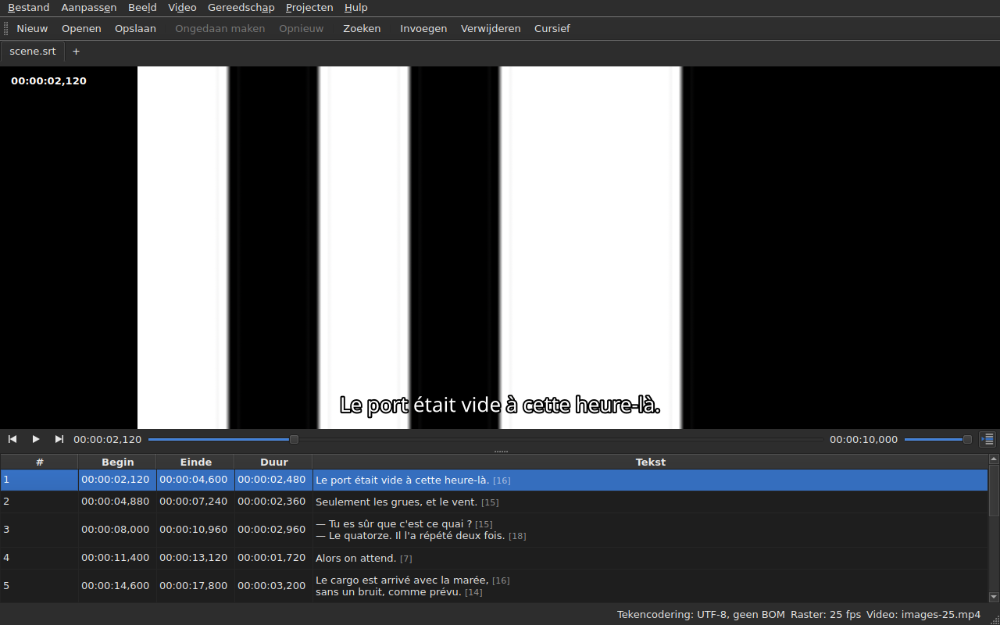

# De speler

<!-- machine-translated -->
> Deze pagina is een machinevertaling en is nog niet nagelezen door een lezer van de taal.

De gekoppelde video wordt bekeken **in het venster**, met de huidige regel
erover getekend. Zo kunt u op de film controleren wat het resultaat
is van een verschuiving, een omrekening of een omzetting van de framesnelheid.

Zie [De gekoppelde video](video.md) voor hoe u een film koppelt; deze
pagina beschrijft wat er gebeurt zodra dat is gedaan.

## De videoweergave

| Situatie | Wat het venster toont |
| :-------- | :-------------------- |
| een video is gekoppeld en opent | het beeld neemt de bovenkant in, de tabel eronder |
| geen video gekoppeld | geen beeld, de tabel neemt het hele venster in |
| de video opent niet | geen beeld, een melding, en het venster blijft bruikbaar |

De verdeling tussen het beeld en de tabel **verplaatst u met de muis**. Het beeld
wordt niet lager dan 180 pixels hoog. Als u het venster vergroot, gaat de gewonnen ruimte
naar de tabel, niet naar het beeld: wat u bij het bewerken tekortkomt, zijn regels.

Onder het beeld staat **een afspeelbalk**: waar de film is, hoe lang hij duurt,
afspelen en pauzeren, en het volume. Zie [De afspeelbalk](#de-afspeelbalk).

## Afspelen en stoppen

| Commando | Sneltoets | Wat het doet |
| :------ | :------- | :----------- |
| Video ▸ Afspelen / Pauzeren | `Ctrl+P` | speelt af als het afspelen is gestopt, stopt het anders |

Het commando is **uitgeschakeld zolang er geen video is geopend**. Een video die
net is gekoppeld, wordt **gestopt** geopend: een film openen is niet
ernaar kijken.

`Ctrl+P` waar Gaupol een gewone `P` heeft: een sneltoets van één letter met
vensterbereik wordt afgevangen voordat de widget met de focus hem ziet,
dus een `P` zou onderweg naar een celeditor worden opgeslokt. Hier
drukt niets af, de combinatie is vrij.

## De afspeelbalk

Onder het beeld, van links naar rechts — de drie knoppen zijn **pictogrammen**, die van het bureaubladthema als dat ze heeft, anders die van de stijl van Qt:

| Element | Wat het doet |
| :------ | :----------- |
| de twee stapknoppen | zetten de film terug, vooruit **met één framestap** — zie [Frame voor frame](timing.md#frame-voor-frame) |
| afspelen / pauzeren | speelt af of stopt, zoals `Ctrl+P` — de knop toont **wat hij zal doen**: een driehoek als het is gestopt, twee streepjes tijdens het afspelen; de knopinfo zegt het in gewone woorden |
| de positie | `HH:MM:SS,mmm`, geschreven zoals de tabel een positie schrijft — **als framenummer** wanneer [`Beeld ▸ Posities in frames`](table.md#posities-in-frames) is aangevinkt |
| de schuifregelaar | **leest en verplaatst**: u sleept de greep, klikt in de groef, gebruikt de pijltoetsen |
| de duur | die welke de video declareert, geschreven zoals de positie |
| het volume | van 0 tot 100, zie [Het volume](#het-volume) |
| tabel volgen | ingedrukt zolang de tabel het afspelen volgt, en brengt hem terug naar de regel die wordt afgespeeld als u erop drukt — zie [De tabel volgt het afspelen](#de-tabel-volgt-het-afspelen) |

**De schuifregelaar geeft niet bij elke pixel door.** Het slepen van de greep vraagt om tientallen
posities per seconde, en elke positie kost een gedecodeerd frame: de eerste positie gaat meteen
weg, de volgende wachten een twintigste van een seconde, en **de laatst gevraagde positie wordt
altijd bereikt** — uiterlijk wanneer u de greep loslaat. Het beeld loopt daardoor niet
achter op de hand, en begint geen pad te tekenen waar niemand naar kijkt.

**De schuifregelaar beweegt tijdens het afspelen vanzelf**, en dat telt niet als handeling:
alleen wat u doet, verplaatst de film. Zolang u de greep vasthoudt, neemt het afspelen hem niet terug.

## De tijdcode

**De positie staat op het beeld geschreven**, linksboven, op een doorschijnende achtergrond waardoor ze
op elke scène leesbaar is. Ze wordt door het venster getekend, in zijn lettertype, en vraagt
de speler om niets behalve de positie die hij al geeft; ze wordt bij elke handeling bijgewerkt,
zonder op de volgende ronde van het volgen te wachten.

## Door de film navigeren

In het menu **Video** staan **de handelingen van Gaupol**, onder hun namen. Alle zijn **uitgeschakeld zonder video**, zoals
het afspelen; de drie die op de selectie werken, zijn ook uitgeschakeld zolang er niets is geselecteerd.

| Commando | Sneltoets | Wat het doet |
| :------ | :------- | :----------- |
| Video ▸ Selectie afspelen | `Ctrl+Shift+P` | speelt af vanaf **een beetje vóór het begin** van de selectie **tot het einde van haar laatste ondertitel**, en stopt op het beeld |
| Video ▸ Naar vorige ondertitel | `Ctrl+Left` | zet het afspelen op het begin van de laatste ondertitel die vóór de positie **is geëindigd** |
| Video ▸ Naar volgende ondertitel | `Ctrl+Right` | zet het afspelen op het begin van de eerste ondertitel die na de positie **begint** |
| Video ▸ Terugspoelen | `Ctrl+Shift+Left` | gaat een sprong terug — standaard dertig seconden |
| Video ▸ Vooruitspoelen | `Ctrl+Shift+Right` | gaat een sprong vooruit |
| Video ▸ Naar begin van selectie | `Ctrl+Up` | zet het afspelen op het begin van de selectie, **de aanloop ervoor** |
| Video ▸ Naar einde van selectie | `Ctrl+Down` | zet het afspelen op het einde van de selectie, **de aanloop ervoor** |

**De sneltoetsen zijn die van Gaupol**, op één na: `Play Selection` is daar `O`, en een
kale letter wordt door het venster afgevangen voordat de cel in bewerking hem ziet — een
`o` typen in een tekst zou de film starten. `Ctrl+P` is het antwoord van het afspelen, `Ctrl+Shift+P` dat van
de selectie. De pijltoetsen van het toetsenbord blijven bij de celeditor als die
open is: `Ctrl+Left` verplaatst daar de cursor een woord, niet het afspelen.

- **De sprong** is 30 seconden, en kan worden ingesteld van 1 seconde tot een uur — zie
  [De instellingen](preferences.md#de-speler). Hij gaat niet voorbij het begin van de film en ook niet voorbij het einde.
- **De aanloop** is één seconde: u kijkt een beetje **vóór** de ondertitel, om hem te zien aankomen.
  Hij kan worden ingesteld van 0 tot 60 seconden, en het afspelen gaat niet onder nul.
- **Een buurman die niet bestaat** — niets vóór de eerste ondertitel, niets na de laatste — doet
  niets, en zegt niets: het afspelen blijft waar het is.
- **Elke handeling is meteen zichtbaar**: de balk, de tijdcode en de getekende regel zijn
  bijgewerkt wanneer ze klaar is, zonder op de volgende ronde te wachten.

## Het volume

Het volume is dat van **de speler**, van 0 tot 100, en niet dat van het systeem. Het wordt ingesteld met de schuifregelaar van
de balk, of met twee handelingen, in het submenu `Video ▸ Audio`, in stappen van vijf:

| Commando | Sneltoets | Wat het doet |
| :------ | :------- | :----------- |
| Video ▸ Audio ▸ Volume omlaag | `Ctrl+-` | verlaagt het volume met vijf |
| Video ▸ Audio ▸ Volume omhoog | `Ctrl++` of `Ctrl+=` | verhoogt het met vijf — de tweede voor toetsenborden waar de plus de shifttoets nodig heeft |

**Het wordt onthouden van de ene sessie op de andere**, en meegegeven aan elke video die u opent. Een waarde buiten
0 tot 100 in het instellingenbestand breekt het openen niet af: ze wordt genegeerd, en het venster zegt dat.
**Het audiospoor wordt daarentegen niet onthouden** — een spoornummer hoort bij zijn bestand; zie
[Het audiospoor](video.md#het-audiospoor).

## Selectie en afspelen

Beide werken in beide richtingen.

| Wat u doet | Wat er gebeurt |
| :---------- | :----------- |
| een regel selecteren | het afspelen gaat **naar het begin van die ondertitel** |
| de selectie naar beneden uitbreiden | verder niets: de eerste regel van de selectie is wat telt |
| het afspelen gaat verder | de **huidige regel** volgt de ondertitel in beeld, **getint**, en de tabel **centreert** hem — zie [De tabel volgt het afspelen](#de-tabel-volgt-het-afspelen) |

De huidige regel en de selectie zijn twee verschillende dingen. Het afspelen
verplaatst de eerste en **raakt de tweede nooit aan**: de selectie is waarop
een bewerking wordt toegepast, en een film die in een hoek speelt, heeft er niets mee te maken
het doel van de gebruiker regel na regel te herschrijven.

De tint volgt dezelfde regel: ze is een markering, geen selectie. **Een
afwijking gaat voor**: een regel die beide draagt, behoudt de kleur van
zijn fout, want een fout is er om te worden hersteld, terwijl een getoonde regel dat alleen
is voor de duur van een regel dialoog. Zie [De tabel](table.md).

### De tabel volgt het afspelen

**De tabel centreert de regel die wordt afgespeeld** — in het midden van wat ze toont, niet aan de rand waar het zou volstaan om
hem zichtbaar te maken. Ze doet dat **wanneer de regel verandert**, niet bij elke tik van het volgen: een regel dialoog duurt
seconden, en elke tiende van een seconde opnieuw centreren zou zinloos scrollen zijn.

**Handmatig scrollen schort het volgen op.** Het wiel, de schuifbalk en een klik in de tabel
schorten het op: de tabel blijft waar u hem hebt gezet, terwijl de huidige regel, de getekende regel en de balk
de film blijven volgen. De volgknop — **het pictogram van de regels van een tabel, één ervan met een pijl gemarkeerd**, rechts van de afspeelbalk;
zijn knopinfo begint met ‘Volgen’ — **is ingedrukt zolang de tabel volgt** en springt dan omhoog.

**Het volgen hervat bij een handeling van de speler**: het afspelen gestart, een sprong, een stap, een markering gezet, een
invoeging op de positie, of een verplaatsing van de balk — de tabel centreert dan meteen op de
regel die wordt afgespeeld, ook als het al dezelfde was. **Of op verzoek**: indrukken van de knop herstelt het, en
loslaten schort het op. Er is geen timer: wat het volgen hervat, is altijd een handeling.

Overschakelen naar een ander tabblad hervat het volgen op de film van dat tabblad.

**Een bewerking in uitvoering wordt niet onderbroken.** Zolang een celeditor
open is, blijft de huidige regel waar hij is; de regel die op
het beeld is getekend, blijft daarentegen volgen, want die hindert niemand.

## De getekende regel

Wat op het beeld wordt getoond, komt uit het **geopende document**, nooit uit een bestand:
**wat u op het beeld ziet, is wat u zojuist hebt getypt**, zonder via de
schijf te gaan. De tekst verschijnt gecentreerd, onderaan het beeld, en verdwijnt tussen twee
ondertitels.

**Met een vertaling is de regel die van de beoogde tekst**: de vertaling wanneer
de huidige cel in de kolom `Translation` staat, de hoofdtekst
overal elders. Het is de regel van alle tekstbewerkingen — zie [De
tekst waarop de bewerkingen zich richten](table.md#de-tekst-waarop-de-bewerkingen-zich-richten) —
en **er is geen instelling**: van de ene kolom naar de andere gaan wijzigt wat
het beeld toont, hooguit een tiende van een seconde later. Zonder vertaling, of
met de kolom verwijderd, verandert er niets: het is de hoofdtekst.

Een ondertitel waar de vertaling nog niet aan toe is, toont **niets** zolang
de huidige kolom de vertaling is: de hoofdtekst neemt zijn plaats
niet in.

**De tags van het formaat worden begrepen, nooit zoals ze zijn getekend.** Het model bevat de
tekst zoals het bestand hem schrijft, en het is de tagpivot — die van de
formaatconversie — die hem leest voordat hij aan het beeld wordt gegeven:

| In het bestand | Op het beeld |
| :---------- | :------------- |
| vet, cursief, onderstreept | toegepast: `<i>no</i>` wordt getoond als *no*, zonder zijn tags |
| kleur | toegepast |
| lettertype, grootte | verwijderd, de tekst blijft |
| positie, uitlijning, spreker, alles zonder equivalent op het scherm | verwijderd, de tekst blijft |
| `{` en `}` in de tekst | getekend: ‘{laughs}’ wordt getoond als ‘{laughs}’ |

Een Advanced SSA-bestand wordt op dezelfde manier gelezen: zijn `{\i1}` worden toegepast, en zijn
`{\an8}` wordt verwijderd — de regel blijft onderaan het beeld. Elke tekst wordt gelezen **in het formaat
van zijn eigen bestand**, de vertaling zowel als de hoofdtekst.

**Het naburige ondertitelbestand wordt niet geladen** door de speler, ook niet als het de naam van de
film draagt. Het zou het bestand zijn dat wordt bewerkt, en het beeld zou dan de toestand van de schijf tonen
terwijl de tabel iets anders toont.

## Een wijziging bekijken

U hoeft **niets bijzonders te doen**: u past de bewerking toe, kijkt naar
de film, en kiest `Undo: shifting` — of de betreffende bewerking — als het
resultaat u niet bevalt. Zie [Ongedaan maken en opnieuw uitvoeren](undo.md).

Er bestaat geen aparte voorvertoningsmodus, en dat is met opzet: wat u
bekijkt, is het document zoals het is, niet een onzichtbare voorlopige toestand.

## Wanneer het beeld niet verschijnt

Twee mogelijke meldingen, beide voorafgegaan door het pad van het bestand:

| Melding | Wat er is gebeurd |
| :------ | :------------ |
| `<file>: <reason>` | de speler weigerde het bestand — onbekend formaat, ontbrekend bestand, map |
| `<file>: no video player is available` | er kon geen speler worden gebouwd |

In beide gevallen **blijft de video gekoppeld** — u moet immers zien om welk
bestand het gaat om een ander te kunnen kiezen — en **blijft het venster bruikbaar**:
het document is geopend, de bewerkingen werken, en opslaan ook.

**Het beeld wordt in het venster zelf getekend**: `libmpv` vult een buffer van de
grootte van de weergave, in echte pixels, en het venster schildert hem. Niets daarvan hangt af van het
grafische platform — hetzelfde beeld onder X11, onder Wayland en zonder scherm — en het
volgt het wijzigen van de grootte: de beeldverhouding van de film blijft behouden, de rest van de
weergave is zwart.

De tweede melding verschijnt dus alleen als de bibliotheek `libmpv` weigert te starten,
hoewel ze bij het bouwen vereist is.

Het renderen gaat via de processor, maar **het decoderen kan op de grafische kaart gebeuren**: zij
decodeert, het beeld wordt teruggekopieerd naar het geheugen en dan getekend als voorheen. Een machine zonder
bruikbare kaart decodeert op de processor, zonder melding. Bij een 1080p-film in H.264 houdt het afspelen
ruimschoots de werkelijke tijd bij. **Een 4K-film in zware HEVC houdt het mogelijk niet bij**: gemeten op twee
kernen decodeert hij met 0,6 keer de werkelijke tijd zonder de kaart, en één frame doorstappen kost daar enkele
seconden wanneer het sleutelframe ver weg ligt. De kaart verkort die tijd — met een derde tot twee derde, afhankelijk van de film
— zonder hem weg te nemen. **Het gedisplayde beeld verandert er niet door**: een stap of een sprong komt met en zonder de kaart op
hetzelfde frame uit. Om haar uit te schakelen, vinkt u `Decode on the graphics card` uit in
[`Preferences…`](preferences.md#de-speler).

## Wat er niet is

**Een markering zetten, frame voor frame doorstappen en een rand een frame verschuiven** staan in
[Timing vanaf de video](timing.md), niet hier. Wat niet bestaat, en wat zoeken zinloos maakt:

- een golfvorm;
- automatisch afspelen wanneer een film wordt geopend;
- de stijl van de getekende regel (lettertype, kleur, positie, achtergrond): hij behoudt die van het venster;
- hardwaredecodering zonder kopiëren: zie ‘Wanneer het beeld niet verschijnt’ hierboven.

Deze handleiding beschrijft wat bestaat: wat er komt, en in welke volgorde, staat in de
[roadmap](../../../../feuille-de-route.md).
