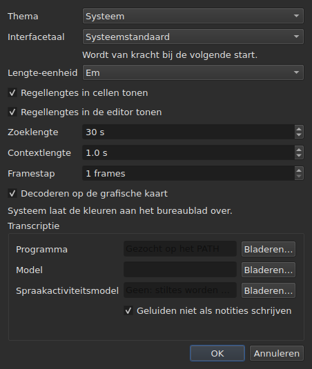

# De instellingen

<!-- machine-translated -->
> Deze pagina is een machinevertaling en is nog niet nagelezen door een lezer van de taal.

Het venster onthoudt wat u met de muis instelt — **waar het stond**, **of het
was gemaximaliseerd**, **de breedte van zijn kolommen**, **de positie van de
greep** tussen de film en de tabel — en **waar u werkt**, zodat
`Open…` op de juiste plaats opent. Niets hiervan wordt via een dialoogvenster ingesteld:
u verplaatst, u sleept, en het wordt onthouden.

**Zes instellingen hebben een eigen dialoogvenster**, `Aanpassen ▸ Instellingen…`, en dat is het
criterium: een instelling die al een handeling heeft, heeft geen veld nodig. Het
thema heeft er geen, de eenheid van regellengtes evenmin, noch de twee selectievakjes die
ze tonen, noch de sprong en de aanloop van de speler. Zie [Het thema](#het-thema),
[Regellengtes](#regellengtes) en [De speler](#de-speler).

**De interfacetaal staat in hetzelfde dialoogvenster, en is degene die wacht**: ze geldt bij de
volgende start, niet direct. Zie [De interfacetaal](#de-interfacetaal).

**Het volume heeft er geen**: de balk onder het beeld en twee handelingen stellen het in, en het wordt onthouden.

**Een andere wordt ingesteld waar ze wordt gebruikt**: de kant waar `Insert Subtitles…` zijn
regels neerzet, is een veld van dat dialoogvenster, en de laatste keuze wordt onthouden. Zie
[Regels invoegen, verwijderen, samenvoegen, splitsen, sorteren en niet-overlappend maken](lines.md#de-kant-wordt-onthouden).

**Zo ook de twee zoekopties**: `Regular expression` en
`Ignore case` blijven aangevinkt of uitgevinkt van de ene opening van het dialoogvenster naar de
volgende, en van de ene sessie naar de andere. Zie
[Zoeken en vervangen](find-and-replace.md#de-twee-opties).

**Zo ook de instellingen van `Adjust Durations…`**: de leessnelheid, haar twee
richtingen, en de drie duren met hun selectievakjes — elk behoudt zijn waarde, aangevinkt
of niet. Zie [`Adjust Durations…`](operations.md#adjust-durations).

**En de laatste codering die in `Save As…` is gekozen**, met haar bytevolgorde-
markering. Zie [het bestand](#het-bestand).

**En wat de assistent `Correct Texts…` en `Spell-Check Settings…` instellen**: de
aangevinkte taken en hun code, de patroonselectievakjes, de instellingen voor regelafbreking, de taal,
het doel van de controle en het onderstrepen tijdens het typen. Zie [Teksten corrigeren…](correct-texts.md) en
[Spelling controleren…](check-spelling.md#spellingcontrole-instellingen). **Het doel en het
document van `Correct Texts…` worden niet onthouden.**

**Wat niet wordt onthouden:** het laatst geopende bestand — zie
[De onthouden map](#de-onthouden-map).

## De speler

Vier velden. **Seek length** en **Context length** zijn die van Gaupol en hebben zijn waarden; **Frame step** en **Decode on the graphics card** zijn eigen aan subedit:

| Veld | Wat het instelt | Standaard | Grenzen |
| :---- | :----------- | ------: | :----- |
| `Seek length` | de sprong van `Seek Backward` en `Seek Forward` | 30 s | van 1 s tot een uur |
| `Context length` | de aanloop vóór de selectie, voor `Seek Selection Start`, `Seek Selection End` en `Play Selection` | 1 s | van 0 tot 60 s, op de tiende nauwkeurig |
| `Frame step` | de stap, **in frames**, van `Step Backward` en `Step Forward`, en van het verschuiven van een rand | 1 frame | van 1 tot 1000 frames |
| `Decode on the graphics card` | laat de grafische kaart de film decoderen wanneer de machine er een heeft; zonder kaart verandert er niets | aangevinkt | aangevinkt of niet |

Ze gelden **direct**, zonder op een herstart te wachten, en worden van de ene sessie naar de andere onthouden
onder `video.seek-length` (in seconden), `video.context-length-ms` (in milliseconden) `video.step-frames` (in frames) en `video.hardware-decoding` (`true` of `false`).
**Een waarde buiten de grenzen, of die geen getal is**, verhindert niet dat het venster opent: ze
wordt genegeerd, de standaardwaarde blijft, en het venster zegt dat bij het openen. **De framestap is nooit in milliseconden**: een stap van N frames is altijd N frames, wat de framerate van de film ook is — zie [Timing vanaf de video](timing.md#frame-voor-frame). Het volume wordt onthouden in `video.volume`,
van 0 tot 100, met dezelfde tolerantie.

## Het bestand

```
~/.config/subedit/settings.conf
```

Preciezer `$XDG_CONFIG_HOME/subedit/settings.conf` wanneer die variabele
is ingesteld. Het wordt geschreven **wanneer het venster sluit**, en gelezen wanneer het opent.
Een onderbroken programma — beëindigd, of gestopt door een crash — schrijft niets, en de
volgende sessie vindt wat de vorige had achtergelaten.

Het bestand is tekst, en kan met de hand worden bewerkt. Dat is een eigenschap en geen
neveneffect: daardoor is een instelling te corrigeren wanneer de interface
die haar instelt juist degene is die kapot is.

### Twee blokken, waarvan één gedeeld met de opdrachtregel

Het bestand wordt in **twee blokken** geschreven, elk onder een opschriftcommentaar:

| Blok | Sleutels | Gelezen door |
| :---- | :--- | :------ |
| `# Operation settings: shared by the window and the command line` | de sleutels `duration-adjust.*` en `correction.*` | het venster **en** `subedit-cli` |
| `# Display preferences: the window's own` | elke andere sleutel — geometrie, kolommen, thema, interfacetaal, zoeken, spellingcontrole, editor, video, laatste map, schrijfcodering | alleen het venster |

**`subedit-cli` leest standaard het bewerkingsblok**: wat `Adjust Durations…` en
`Correct Texts…` hier onthouden, is ook waarmee [`subedit-cli adjust`](../subedit-cli/adjust.md)
en een deel van [`subedit-cli correct`](../subedit-cli/correct.md) beginnen, tenzij een optie van
de opdrachtregel anders zegt. **Het leest nooit de weergave-instellingen.** Het commando
[`config`](../subedit-cli/config.md) somt de bewerkingssleutels op, toont hun waarden en
wijzigt ze — `subedit-cli config set duration-adjust.speed 12` — en het venster ziet de wijziging
bij zijn volgende opening. **Een wijziging die wordt gemaakt terwijl het venster open is, overleeft het sluiten ervan niet**: het
venster herschrijft het hele bestand met wat het vasthoudt. `--no-config` laat een opdrachtregel het
bestand negeren. Zie
[Het instellingenbestand](../subedit-cli/invocation.md#het-instellingenbestand).

De lezer neemt de sleutels in elke volgorde, met of zonder de opschriften: een bestand dat is geschreven voordat de
twee blokken bestonden, wordt ongewijzigd gelezen, en bij de volgende sluiting in twee blokken herschreven.

| Optie | Wat het bevat | Standaard |
| :----- | :------------ | :------ |
| `window.geometry` | `x,y,width,height`, in pixels; breedte en hoogte niet nul | het venster bepaalt zelf zijn grootte |
| `window.maximised` | `true` of `false` | `false` |
| `table.columns` | vier breedtes in pixels, gescheiden door komma's — `#`, `Start`, `End`, `Duration`, ook verborgen | de tabel bepaalt zelf haar grootte |
| `table.order` | de zes kolommen, **elk één keer**, in de volgorde waarin de tabel ze toont: `number`, `start`, `end`, `duration`, `text`, `translation` | `number,start,end,duration,text,translation` |
| `table.hidden` | de verwijderde kolommen, onder `number`, `start`, `end` en `duration`; leeg, geen | geen |
| `window.table-share` | het aandeel van de hoogte dat aan de tabel wordt gegeven, in procenten, van 1 tot 99 | het venster verdeelt zoals het altijd deed |
| `file.directory` | een **absoluut** mappad | geen: `Open…` opent waar het programma is gestart |
| `general.theme` | `system`, `light` of `dark` | `system` |
| `interface.language` | `system`, of de naam van een taal zoals haar catalogus heet: twee of drie kleine letters, dan eventueel `_` en twee hoofdletters — `fr`, `pt_BR`; `en` voor Engels | `system` |
| `edit.insert-placement` | `above` of `below` | `below` |
| `file.write-encoding` | de naam van een codering die ICU kan schrijven, en waarvan de converter geen eigen markering schrijft | geen |
| `file.write-bom` | `true` of `false` | `false` |
| `search.regex` | `true` of `false` — het patroon is een reguliere expressie | `false` |
| `search.ignore-case` | `true` of `false` — hoofdletters worden genegeerd | `true` |
| `duration-adjust.speed` | de leessnelheid, in tekens per seconde, strikt positief; een decimaal getal wordt zo kort mogelijk geschreven (`15`, `12.5`) | `15` |
| `duration-adjust.lengthen` | `true` of `false` — verlengen wat te kort is om gelezen te worden | `true` |
| `duration-adjust.shorten` | `true` of `false` — verkorten wat langer in beeld blijft dan nodig | `false` |
| `duration-adjust.minimum-enabled` | `true` of `false` — de minimumduur wordt gevraagd | `true` |
| `duration-adjust.minimum-ms` | de minimumduur, in milliseconden, geheel en niet-negatief | `1500` |
| `duration-adjust.maximum-enabled` | `true` of `false` — de maximumduur wordt gevraagd | `false` |
| `duration-adjust.maximum-ms` | de maximumduur, in milliseconden, geheel en niet-negatief | `6000` |
| `duration-adjust.gap-enabled` | `true` of `false` — de tussenruimte tot de volgende ondertitel wordt gevraagd | `true` |
| `duration-adjust.gap-ms` | de tussenruimte, in milliseconden, geheel en niet-negatief | `0` |
| `correction.mentions.enabled`, `correction.common-errors.enabled`, `correction.capitalization.enabled`, `correction.line-break.enabled` | `true` of `false` — de taak is aangevinkt op de eerste pagina van `Correct Texts…` | `false`, `true`, `true`, `false` |
| `correction.mentions.code`, `correction.common-errors.code`, `correction.capitalization.code`, `correction.line-break.code` | de code van de patronen van de taak: `Zyyy`, of `Script[-language[-COUNTRY]]` — `Latn-en-US`; niet leeg | `Zyyy` |
| `correction.human`, `correction.ocr` | `true` of `false` — de klassen van veelvoorkomende fouten | `true`, `true` |
| `correction.sound-in-brackets`, `correction.sound-in-parentheses` | `true` of `false` — de twee selectievakjes van de pagina `Mentions` | `false`, `false` |
| `correction.line-break.max-length` | de maximale lengte van een regel, decimaal; het dialoogvenster begrenst haar van 1 tot 1000 | `24` |
| `correction.line-break.max-lines` | het maximale aantal regels, geheel; het dialoogvenster begrenst het van 1 tot 100 | `3` |
| `correction.line-break.in-ems` | `true`: de lengte wordt gemeten in *em*; `false`: in tekens | `true` |
| `correction.line-break.skip-on-length`, `correction.line-break.skip-on-lines` | `true` of `false` — de twee overslagvoorwaarden worden gevraagd | `true`, `true` |
| `correction.line-break.skip-max-length`, `correction.line-break.skip-max-lines` | de twee overslagdrempels, in de gekozen eenheid | `24`, `3` |
| `correction.join-split.enabled` | `true` of `false` — de taak `Join or Split Words` is aangevinkt | `false` |
| `correction.join-split.join`, `correction.join-split.split` | `true` of `false` — samenvoegen, splitsen | `true`, `false` |
| `correction.join-split.language` | een taalcode — `fr`, `en_US`, `sr@Latn` —; leeg: de taal van het systeem | leeg |
| `correction.remove-blank` | `true` of `false` — `Remove all blank subtitles` | `true` |
| `transcription.engine` | de naam van de engine: kleine letters, cijfers, `.`, `-` en `_` | `whisper.cpp` |
| `transcription.executable`, `transcription.model` | een absoluut pad; leeg: de engine wordt in het `PATH` gezocht, en er is geen model ingesteld | leeg |
| `transcription.language` | twee kleine letters, een ISO 639-1-code; leeg: de taal wordt gedetecteerd | leeg |
| `transcription.merge-gap-ms` | stukken van één zin die dichter bij elkaar liggen dan dit worden samengevoegd, in milliseconden, geheel en niet-negatief | `400` |
| `transcription.max-duration-ms` | de maximale tijd dat een getranscribeerde ondertitel in beeld blijft, in milliseconden, van 1 tot 3600000 | `7000` |
| `transcription.max-characters` | het maximale aantal tekens van een getranscribeerde ondertitel, van 1 tot 1000 | `84` |
| `correction.activations` | de patroonselectievakjes die de gebruiker heeft gewijzigd, `<type>:<code>:<name>:<0\|1>`, gescheiden door komma's; **een komma of een backslash in een naam wordt geschreven met een backslash ervoor** (`\,` en `\\`), en een onleesbaar item verliest alleen zijn eigen instelling — het wordt gemeld, de andere blijven behouden | leeg |
| `spell-check.language` | een taalcode, zoals `fr_FR`; leeg: de taal van het systeem | leeg |
| `spell-check.target` | `selection`, `current-project` of `all-projects` | `current-project` |
| `spell-check.document` | `main` of `translation` | `main` |
| `spell-check.inline` | `true` of `false` — onbekende woorden onderstrepen tijdens het typen in de editor van een cel | `false` |
| `editor.length-unit` | `em` of `characters` — de eenheid van de regellengtes die de tabel en de editor tonen | `em` |
| `editor.show-lengths-cell` | `true` of `false` — elke regel van een tekstcel wordt gevolgd door haar lengte | `true` |
| `editor.show-lengths-edit` | `true` of `false` — de editor van een cel toont de lengte van elke regel in een marge | `true` |

**Het bestand accepteert meer dan het dialoogvenster.** De lezer neemt elke strikt
positieve snelheid en elke niet-negatieve duur; het dialoogvenster `Adjust
Durations…` begrenst op zijn beurt de snelheid van 1 tot 99 tekens per seconde en elke
duur van 0 tot 99 s. Een waarde van het bestand buiten die grenzen wordt teruggebracht tot de
grens wanneer het dialoogvenster opent, en het bestand houdt haar zo nadat het
dialoogvenster is bevestigd en het venster gesloten. Een geannuleerd dialoogvenster wijzigt niets in wat
wordt onthouden.

**`file.write-encoding` onthoudt de laatste codering die in `Save As…` is gekozen, en
legt zich nooit aan een bestand op.** Een geopend document draagt zijn eigen codering,
en dat is die welke het vak voorstelt: het in een andere herschrijven omdat een
instelling van drie weken oud dat zegt, zou verliezen wat het lezen had behouden.
Wat deze instelling onthoudt, dient het document dat geen bestand heeft — het
net aangemaakte.

**Het is een bewust “nee” en geen vergissing.** Iemand die altijd in
dezelfde codering aflevert en geërfde bestanden in een andere opent, kiest haar opnieuw voor
elk bestand; het vak stelt haar voor, en de garantie van de heen-en-terugreis geldt
voor iedereen.

**`file.write-bom` draagt de markering van dezelfde codering**, en twee
regels zijn inderdaad nodig: de naam van een codering zegt niet of ze door haar markering wordt voorafgegaan, evenmin
als `--encoding` zegt wat `--bom` zegt. Beide worden samen gelezen, in
elke volgorde, en een `file.write-bom` zonder onthouden codering stelt niets in.

**Een aandeel en geen hoogtes voor de greep**, en dat is wat het
nuttig maakt: drie hoogtes in pixels betekenen niets meer zodra het venster
op een andere grootte opent, en een venster opent vaak op een andere grootte.
Het aandeel speelt overal opnieuw. Het wordt **teruggebracht tot wat het venster accepteert** als
het te klein is — de strook van de film heeft een minimumhoogte.

**Vier breedtes voor zes kolommen**, en dat is geen vergissing: het zijn die
van `#`, `Start`, `End` en `Duration`, in die volgorde wat de volgorde van de
tabel ook is, en **een verborgen kolom behoudt de zijne** — ze vindt hem terug wanneer ze
weer wordt getoond. De laatste getoonde kolom neemt wat de andere overlaten, en haar
een breedte geven zou niets doen; die van de tekst en de vertaling worden daarom
niet onthouden.

## Wat er gebeurt als het bestand niet zegt wat wordt verwacht

Een configuratie is een gemak. **Haar falen kost het gemak en niets
anders**: het venster opent in elk geval.

| Geval | Wat er gebeurt |
| :--- | :----------- |
| het bestand bestaat niet | alle standaardwaarden, en er wordt niets gezegd — het is de eerste start |
| het bestand bestaat en kan niet worden gelezen | alle standaardwaarden, en de reden wordt op de foutenstroom geschreven |
| een optie ontbreekt | haar standaardwaarde |
| een sleutel is onbekend | genegeerd, zonder een woord, en afwezig in het herschreven bestand |
| een waarde kan niet worden gelezen | haar standaardwaarde blijft behouden, en de optie wordt op de foutenstroom genoemd |

```console
$ subedit-gui film.srt
subedit-gui: /home/vous/.config/subedit/settings.conf: window.geometry: "plus tard" cannot be read, keeping the default
```

**De melding gaat naar de foutenstroom en nergens anders heen.** Een modaal
venster bij het starten voor een onleesbare instelling zou de gebruiker ophouden voor
een fout die hem niets belet, en voordat hij om iets heeft gevraagd.

## De becommentarieerde opties

Het herschreven bestand bevat **alle** bekende opties, en die welke op hun
standaardwaarde staan, worden als commentaar geschreven:

```
#window.geometry = 0,0,1280,800
#window.maximised = false
#table.columns = 60,110,110,110
#table.order = number,start,end,duration,text,translation
#table.hidden = start,end
```

Het is geen aanstellerij. Zonder dit zou een nooit aangeraakte optie bevroren blijven
op de waarde van de dag waarop ze werd geschreven, en **een verbeterde standaardwaarde
zou nooit iemand bereiken**. Hiermee wijzigt het veranderen van een standaardwaarde het
gedrag van iedereen die haar niet heeft overschreven — precies
wat een standaardwaarde hoort te doen.

Om een optie te overschrijven: haal het `#` weg en wijzig de waarde. Om terug te gaan
naar de standaardwaarde: verwijder de regel, of maak er weer commentaar van.

De geometrie, de breedtes en de verwijderde kolommen tonen een **vorm** en
geen geldende waarde: de standaardwaarde van de geometrie en die van de breedtes zijn
“wat het venster kiest”, wat niet in getallen wordt geschreven, en die van
`table.hidden` is “geen”, wat niet te lezen is. De kop van het bestand zegt dat
ook. `table.order` toont op zijn beurt wel de standaardvolgorde.

## De onthouden map

`Open…` opent op de map van het **laatst geopende of opgeslagen bestand**,
en niet op die van een vak dat u hebt geannuleerd: wat telt, is waar u
werkt, niet waar u keek.

**Het laatste bestand zelf wordt niet onthouden.** Het onthouden zou betekenen dat bij het starten een
document wordt heropend waar niemand om vroeg. Een map onthouden
*wijst* een dialoogvenster aan; een bestand onthouden zou er een openen.

## Het thema

`Aanpassen ▸ Instellingen…` opent met het thema, een instelling zonder handeling, boven de
[regellengtes](#regellengtes).

| Waarde | Wat het doet |
| :---- | :----------- |
| `System` | **niets** — de kleuren blijven die van het bureaublad |
| `Light` | stelt een licht palet in |
| `Dark` | stelt een donker palet in |

Het gekozen thema geldt **direct**, zonder herstart.

**“System” doet niets, en dat is geen tekort.** De versie van Qt waarop
subedit is gebouwd, heeft geen manier om het bureaublad te vragen of het
licht of donker wil zijn, noch om op de hoogte te worden gebracht wanneer het van gedachten verandert. In plaats van
een lezing te verzinnen die we niet weten te doen, levert het hulpmiddel de twee thema's mee
waarom kan worden gevraagd en laat het de toolkit beslissen voor het derde —
wat Gaupol onder dezelfde omstandigheden doet.

Onder een bureaublad waarvan het thema al donker is, geeft `System` dus een donker
venster; onder een licht bureaublad een licht venster. `Light` en `Dark` overschrijven
het, wat het bureaublad ook is.

**De kleuren van de afwijkingen blijven leesbaar in beide paletten** — zie
[De tabel](table.md#de-afwijkingen). Het is geen aanname: het contrast
van de tekst op elk van de tinten wordt door een test gecontroleerd, op beide achtergronden.

## De interfacetaal

`Aanpassen ▸ Instellingen…` kiest de taal van het venster, onder het thema.

| Veld | Waarden | Standaard |
| :---- | :----- | :------ |
| `Interface language` | `System default`; `English`; daarna elke taal die met het programma is geïnstalleerd, met haar eigen naam — `Français` | `System default` |

**Ze geldt bij de volgende start**, en het dialoogvenster zegt dat onder het veld: het venster wordt
vertaald terwijl het wordt gebouwd, en een draaiend venster behoudt de taal waarin het is gestart. De keuze wordt
bewaard in het instellingenbestand, onder `interface.language`, en gelezen wanneer het venster de volgende keer opent.

| Keuze | Het venster start in |
| :----- | :------------------- |
| `System default` | de taal van de omgeving, zoals vóór elke keuze — `LANGUAGE`, `LC_ALL`, `LC_MESSAGES`, `LANG`; zie [Taal](invocation.md#taal) |
| `English` | Engels, wat de omgeving ook zegt |
| een geïnstalleerde taal | die taal, **wat de omgeving ook zegt**, `LC_ALL=C` inbegrepen: een hier gemaakte keuze is een expliciete |

De lijst bevat de talen waarvan de catalogus onder `<prefix>/share/subedit/locale` is geïnstalleerd;
Engels staat er altijd in, aangezien het de taal is waarin het programma is geschreven. Een taal wordt getoond
met haar eigen naam, die geen enkele catalogus vertaalt, zodat een lezer degene vindt die hij leest.

**Een waarde die het programma niet kan honoreren, kost niets dan de keuze:**

| Wat het bestand zegt | Wat er gebeurt |
| :----------------- | :----------- |
| de naam van een taal zonder geïnstalleerde catalogus — een bestand van een andere machine | het venster volgt de omgeving, zonder een woord; `Preferences…` toont die taal, met haar naam of haar code, en behoudt haar tenzij een andere wordt gekozen |
| iets wat geen taalnaam is — `French`, `fr_FR.UTF-8` | `system`, de standaardwaarde, en de optie wordt op de foutenstroom genoemd, zoals elke onleesbare waarde |

```console
$ subedit-gui film.srt
subedit-gui: /home/vous/.config/subedit/settings.conf: interface.language: "French" cannot be read, keeping the default
```

**De opdrachtregel leest haar nooit**: `subedit-cli` kiest zijn taal alleen uit de omgeving,
en `subedit-cli config set interface.language fr` wordt als weergave-instelling geweigerd.

## Regellengtes




`Aanpassen ▸ Instellingen…` stelt ook in **wat de tabel en de editor tonen van de
lengte van regels** — de liniaal en de marge van Gaupol.

| Veld | Wat het doet | Standaard |
| :---- | :----------- | :------ |
| `Length unit` | de eenheid van lengtes: `Ems` of `Characters` | `Ems` |
| `Show line lengths in cells` | elke regel van een tekstcel wordt gevolgd door haar lengte | aangevinkt |
| `Show line lengths in the editor` | de editor van een cel toont de lengte van elke regel in een marge rechts | aangevinkt |

**`Length unit` is grijs wanneer geen van beide selectievakjes is aangevinkt**: zonder
lengte om te tonen stelt de eenheid niets in. De keuze geldt **direct** voor de
tabel, en de editors die daarna openen, volgen haar. De drie waarden worden
van de ene sessie naar de andere onthouden: `editor.length-unit`, `editor.show-lengths-cell`
en `editor.show-lengths-edit`, in de tabel [van het bestand](#het-bestand). Zie
[De lengte van regels](table.md#de-lengte-van-regels) en
[in de editor](editing.md#de-lengte-van-regels).

**Het is niet de limiet van de assistent.** De eenheid van `Correct Texts…` — de
lengte waarop het regels afbreekt — is een aparte instelling, in zijn
assistent: u kunt em lezen in de tabel en afbreken in tekens.

## Wat niet kan worden ingesteld

**Negen onthouden instellingen worden in een dialoogvenster gekozen** — de instellingen van
de correctie-assistent en van de spellingcontrole niet meegerekend, die elk
hun eigen hebben —, en elk in het dialoogvenster waar het wordt gebruikt: het thema en de drie instellingen voor regellengtes, hier; de kant van een invoeging, in het invoegdialoogvenster;
de twee zoekopties, in het zoekdialoogvenster; de codering en
de bytevolgordemarkering, in `Save As…`; de leessnelheid, de duren
en de tussenruimte van de duuraanpassing, in het eigen dialoogvenster. Er is geen
andere: er kan niets worden ingesteld voor de diagnostiek, het volume van de speler,
noch het standaardformaat voor opslaan — dat komt van het geopende bestand.

En **geen enkel getal dat bij een document hoort, wordt van de ene sessie naar de
volgende bewaard**: een verschuivingsbedrag, twee transformatiemarkeringen zijn waar voor één
bestand en onwaar voor het volgende. De dialoogvensters vragen er bij elke start opnieuw om,
bewust. De instellingen van `Adjust Durations…` zijn op dezelfde manier een uitzondering als
de twee zoekopties: een leessnelheid, een minimumduur of
een tussenruimte zijn keuzes van methode in plaats van metingen van een bestand, en
blijven daarom van de ene sessie naar de andere bestaan.

Deze handleiding beschrijft wat bestaat: wat komt, staat in de
[roadmap](../../../../feuille-de-route.md).
