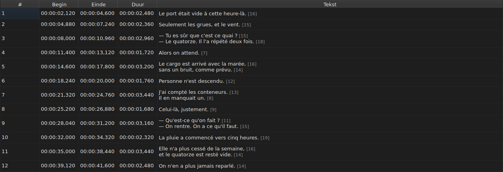
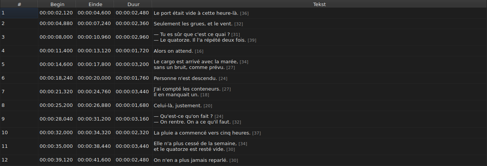
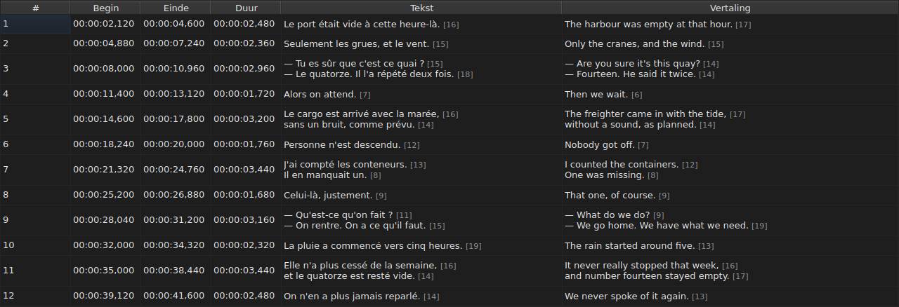
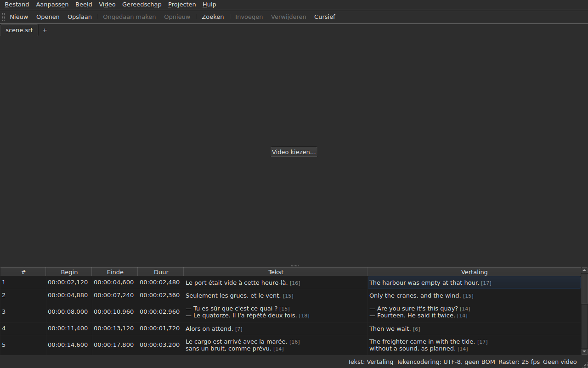

# De tabel

<!-- machine-translated -->
> Deze pagina is een machinevertaling en is nog niet nagelezen door een lezer van de taal.

Het venster toont de ondertitels van het geopende bestand, één per regel, in vijf
kolommen — zes wanneer het project een vertaling bevat.

**Deze handleiding citeert de kopteksten van het venster zoals het Engelse venster ze
toont**, evenals voor de opdrachtregel; een vertaald venster toont ze in
zijn eigen taal.

| Kolom | Wat ze toont |
| :----- | :------------ |
| `#` | de rang van de ondertitel, vanaf 1 |
| `Start` | de positie waar hij verschijnt, `HH:MM:SS,mmm` |
| `End` | de positie waar hij verdwijnt |
| `Duration` | `End − Start` |
| `Text` | de tekst van de ondertitel |
| `Translation` | de vertaling van de ondertitel — **afwezig zolang het project er geen heeft** |




## De lengte van regels




**Elke regel van een tekstcel wordt gevolgd door zijn lengte**, `[N]`, kleiner
en bleker — in de kolom `Text` zoals in de kolom `Translation`.
Dat is wat Gaupol doet.

| Wat meetelt | Wat de tabel doet |
| :---------- | :------------------ |
| **tags** | tellen niet mee: `<i>Bonjour</i>` geeft `[7]`, net als `Bonjour` |
| **afronding** | naar beneden: een regel van 12,9 em wordt getoond als `[12]` |
| **een lege regel** | heeft geen lengte; een lege tekst evenmin |
| **de eenheid** | standaard *em*, of tekens — `Aanpassen ▸ Instellingen…` |
| **een regel die te lang is voor de kolom** | wordt afgekapt met `…` **vóór** het getal, dat zichtbaar blijft |

**De *em* is die van Gaupol, niet die van de typografie**: het alfabet in kleine letters
is 0,55 em per letter waard, in het lettertype van de tabel. Een lengte in *em* hangt dus
af van het lettertype; een lengte in tekens telt codepunten, een
accent voor één.

**De tabel markeert een regel die te lang is niet.** Ze toont het getal, en het is aan
het oog om het te vergelijken met de limiet die u zelf hebt gesteld — zoals bij Gaupol. Het is niet
de limiet van de assistent `Correct Texts…`, die een eigen instelling heeft.

**Om ze niet te zien:** vink `Show line lengths in cells` uit in
`Aanpassen ▸ Instellingen…`. Zie [Regellengtes](preferences.md#regellengtes).

## Kolommen verbergen en verplaatsen

**`Beeld ▸ Kolommen`** bevat één aanvinkbaar item per kolom, **behalve `Text`**:
zonder de hoofdtekst zou er niets meer te bewerken zijn.

| Item | Kolom |
| :---- | :----- |
| `Beeld ▸ Kolommen ▸ Nummer` | `#` |
| `Beeld ▸ Kolommen ▸ Begin` | `Start` |
| `Beeld ▸ Kolommen ▸ Einde` | `End` |
| `Beeld ▸ Kolommen ▸ Duur` | `Duration` |
| `Beeld ▸ Kolommen ▸ Vertaling` | `Translation` — zie [De vertaalkolom](#de-vertaalkolom) |

Een item uitvinken verwijdert zijn kolom, het opnieuw aanvinken zet haar terug, met de breedte
die ze had. **De instelling geldt voor het hele venster**, alle tabbladen
inbegrepen: er is één enkele tabel, waarvan het project met het tabblad verandert.

**De huidige cel verlaat de kolom die wordt verwijderd**: ze verhuist naar `Text`,
op dezelfde regel, en de selectie verplaatst niet. Een huidige cel in een
kolom die niemand ziet, zou een cel zijn die een toetsaanslag
blind zou bewerken.

**Kolommen worden verplaatst door hun kop te slepen**, elke kolom, `Text`
inbegrepen. De laatste getoonde kolom neemt de ruimte in die de andere vrijlaten.

**De volgorde en de verwijderde kolommen worden onthouden van de ene sessie op de andere**, met
de breedtes, in het [instellingenbestand](preferences.md) — `table.order`
en `table.hidden`. De vertaalkolom staat daar niet in: ze volgt haar eigen
regel, en komt terug bij elke geopende vertaling.

**Het nummer is geen gegeven van het bestand** maar de rang van de regel. Een
invoeging of een verwijdering nummert dus alles wat volgt opnieuw, zonder dat er iets
wordt herschreven.

**Het decimaalteken volgt het formaat van het bestand**: een komma voor SubRip,
een punt voor de acht andere. SubRip is de enige van de negen die een komma schrijft.

**Het is het scheidingsteken dat volgt, niet de hele schrijfwijze.** De tabel schrijft altijd
de uren en altijd drie decimalen; een WebVTT-bestand laat de
uren weg onder een uur, SubViewer 2 en de twee Sub Station Alpha tellen in
honderdsten, MPL2 in tienden, TMPlayer in seconden, MicroDVD in frames. Een
kolom waarvan de breedte het formaat volgde, zou vermoeiender te lezen zijn dan een
kolom die gewoon niet de exacte schrijfwijze van het bestand is.

Wat de tabel garandeert, is dus **de waarde en het scheidingsteken**, niet het aantal
decimalen. Wat een doelformaat zou afronden, wordt gezegd op het moment van
opslaan — zie
[Wat een formaat niet kan bevatten, gezegd vóór het schrijven](files.md#wat-een-formaat-niet-kan-bevatten-gezegd-vóór-het-schrijven).

**De duur (`Duration`) wordt berekend**, nooit opgeslagen: hem typen verplaatst het
einde. Een ondertitel waarvan het einde vóór het begin ligt, toont
een negatieve duur in plaats van nul: het is een afwijking van het
bestand, en haar verbergen zou het onmogelijk maken haar te vinden.

**Het begin, het einde, de duur, de tekst en de vertaling worden ter plaatse bewerkt**; het
nummer niet. Zie [Een cel bewerken](editing.md).

**De selectie wijst aan waarop een bewerking werkt** — zie
[De bewerkingen](operations.md).

**De hoogte van een regel volgt de ondertitel die ze draagt**: een ondertitel van
twee regels neemt er twee in, een van drie neemt er drie in. De tekst wordt volledig
getoond, zoals hij zal worden geschreven.

**Wat afgekapt blijft, is een regel die te lang is voor zijn kolom**, en hij
eindigt dan met een beletselteken. De kolom `Text` verbreden, of het venster, toont hem
volledig; de cel openen ook. De regels van de tekst worden nooit
afgebroken: alleen een echt regeleinde maakt een regel, zodat de hoogte
van een tabelrij niet verandert wanneer u de rand van een kolom sleept.

## Posities in frames

**`Beeld ▸ Posities in frames`** — een aanvinkbaar item, één enkele instelling voor het venster — toont de
kolommen `Start` en `End` **als framenummers** in plaats van tijdstempels, en **accepteert een framenummer als invoer**. De
kopteksten zeggen het: `Start (frames)` en `End (frames)`.

| Wat verandert | Wat niet verandert |
| :----------- | :------------------- |
| wat `Start` en `End` schrijven, en wat ze accepteren | de kolom `Duration`, die een tijd blijft |
| de kopteksten van die twee kolommen | het document: er wordt niets gewijzigd, de geschiedenis krijgt geen nieuw item, en **wat het bestand schrijft, is wat het schreef** |

**De framesnelheid die de frames telt** is, in deze volgorde:

1. **die van het bestand**, wanneer het in frames wordt geteld — MicroDVD, dat nummers bevat en geen
   framesnelheid: **het venster toont dan de cijfers van zijn bestand**, welke video ook;
2. **die welke de gekoppelde video declareert**;
3. **het raster dat de posities tekenen**, wanneer ze er een tekenen.

De knopinfo van het item zegt welke is gekozen: *Posities zijn framenummers, geteld op 25 fps, de snelheid die de
video declareert*. **Zonder een van de drie is het item uitgeschakeld, en zijn knopinfo zegt waarom**: het bestand wordt
niet in frames geteld, de video declareert geen framesnelheid, en de posities vallen op geen enkel raster.

- **Een getal is het nummer van het frame waarin de positie valt**, afgerond op het dichtstbijzijnde frame. **Getypt
  geeft het het moment waarop dat frame begint**, **slechts één keer** afgerond vanuit de exacte verhouding
  ([ADR 0013](../../../../adr/0013-mise-a-l-echelle-exacte-des-positions.md)): frame 37 bij 23,976 frames per seconde
  begint op 1543,04 ms, dat is `00:00:01,543`.
- **Alleen gehele getallen worden geaccepteerd** — met het minteken, aangezien een begin vóór de film kan liggen. Een
  tijdstempel die in framemodus wordt getypt, of een getal dat er geen is, laat de cel zoals ze was.
- **De afspeelbalk volgt dezelfde instelling**: de positie en de duur aan weerszijden van de schuifregelaar
  worden als framenummers geschreven zoals `Start` en `End`, op hetzelfde moment — zie
  [De afspeelbalk](player.md#de-afspeelbalk). De klok die bovenaan het beeld is getekend, blijft een
  tijdstempel.
- **Deze instelling wordt niet onthouden** van de ene sessie op de andere: ze is een instelling van het venster, niet van een
  document, en wordt met één handeling weer ingeschakeld.

## De afwijkingen

Een ondertitel waarvan de posities niet bij elkaar passen, wordt **getint op zijn
tijdkolommen**, en erover zweven zegt wat er mis is.

| Tint | Wat ze meldt | Wat te doen |
| :--- | :-------------- | :--------- |
| rood | `ends before it starts` | corrigeer zijn einde, of zijn begin |
| blauw | `starts before the previous one starts` | zet hem terug op zijn plaats in de volgorde |
| amber | `starts before the previous one ends` | pas zijn timing aan |


Alleen de kolommen `Start`, `End` en `Duration` worden getint: een afwijking
spreekt alleen over tijd, en de tekst tinten zou suggereren dat die er iets
mee te maken had.

**Een ondertitel kan er meerdere dragen**, en de knopinfo noemt ze alle. De
tint is die van de eerste die moet worden hersteld: een ondertitel die in zichzelf kapot is,
is kapot wat zijn buren ook doen; een verkeerd geplaatste ondertitel wordt op zijn plaats gezet,
en zijn overlap verdwijnt daarmee.

> Het is geen toeval dat wanorde bijna altijd wint van
> overlap: beginnen vóór het begin van de vorige is beginnen
> vóór het einde ervan — tenzij de vorige zelf kapot is.

**De markering wordt na elke wijziging van een positie opnieuw berekend**, of die nu komt
van een bewerkte cel, een bewerking of een ongedaanmaking. Ze zegt wat het
bestand nu is, niet wat het was bij het openen.

Ze steunt op geen enkel framerooster: zodra een positie met de
hand is gecorrigeerd, verlaat ze het, en een markering die erop was gebaseerd, zou het werk van de
gebruiker melden.

## De vertaalkolom

Een ondertitel bevat **twee teksten en één enkel paar posities**: de
vertaling heeft geen eigen timing, ze is gekoppeld aan die van de ondertitel.
De tabel toont haar in een zesde kolom, `Translation`, rechts van `Text`.




**De kolom is er alleen als het project een vertaling heeft.** Zonder vertaling behoudt de tabel
haar vijf kolommen, en gedraagt het venster zich alsof de vertaling
niet bestond — niets wordt grijs gemaakt of toegevoegd. `Bestand ▸ Vertaling openen…` opent
er een: zie [Een vertaling openen](files.md#een-vertaling-openen).

**Een item van het menu `View` toont of verwijdert haar**:

| Item | Wat het doet |
| :---- | :----------- |
| `Beeld ▸ Kolommen ▸ Vertaling` | aangevinkt: de kolom wordt getoond; uitgevinkt: ze wordt verwijderd |

Het item is **uitgeschakeld wanneer het project geen vertaling heeft** — er is niets om
te tonen — en aangevinkt bij het opstarten. **De keuze om haar te verwijderen is die van de
gebruiker**: ze geldt van het ene bestand tot het andere, tot ze opnieuw
wordt aangevinkt. De kolom verwijderen verwijdert de vertaling niet: die blijft in het
project, en komt terug met het item. Een bestand openen dat er geen heeft, verwijdert de
kolom.

**In de cellen van de vertaling wordt getypt zoals in die van de tekst** — zie
[Een cel bewerken](editing.md).

### De tekst waarop de bewerkingen zich richten

Met twee teksten in een regel moeten tekstbewerkingen weten welke van de twee
ze herschrijven. **Het is die van de kolom van de huidige cel**: de
vertaling als de huidige cel in de kolom `Translation` staat, de hoofdtekst
overal elders — in een tijdkolom zoals in `Text`.

| Bewerking | Waarop ze zich richt |
| :-------- | :-------------- |
| `Italic`, `Case`, `Dialogue`, `Remove Hearing-Impaired Mentions…` | de tekst van de huidige kolom |
| `Cut Texts`, `Copy Texts`, `Paste Texts` | de tekst van de huidige kolom |
| `Find and Replace…` | de tekst van de huidige kolom — zie [Zoeken en vervangen](find-and-replace.md#in-welke-tekst) |
| de positiebewerkingen, invoegen, verwijderen, samenvoegen, splitsen | **beide teksten**: een ondertitel is een geheel |

**De statusbalk zegt het wanneer er twee teksten zijn**, links van de andere
aanduidingen:

```text
Text: Translation
```

of `Text: Main` voor de hoofdtekst. Ze zwijgt wanneer de kolom niet
wordt getoond: er is dan maar één tekst, en het heeft geen zin dat te zeggen.




**De regel die op het beeld wordt getekend, volgt dezelfde regel**: het is de tekst van de
huidige kolom. Zie [De speler](player.md#de-getekende-regel).

**Er wordt niets grijs gemaakt.** Tekstbewerkingen blijven beschikbaar wat de
huidige kolom ook is, en zonder vertaalkolom richten ze zich op de hoofdtekst,
zoals voorheen.

## Regels toevoegen en verwijderen

`Aanpassen ▸ Ondertitels invoegen…` en `Aanpassen ▸ Ondertitels verwijderen` voegen
regels toe en verwijderen ze, `Aanpassen ▸ Ondertitels samenvoegen` en `Aanpassen ▸ Ondertitel splitsen` voegen ze samen en
splitsen ze; de tabel nummert zichzelf opnieuw. Zie
[Regels invoegen, verwijderen, samenvoegen en splitsen](lines.md).

## Wat de tabel niet doet

**Sorteren op kolom bestaat niet.** De getoonde volgorde is die van het bestand, en
het is de enige die zinvol is voor ondertitels: de rang van een regel *is*
zijn plaats in de tijd.
