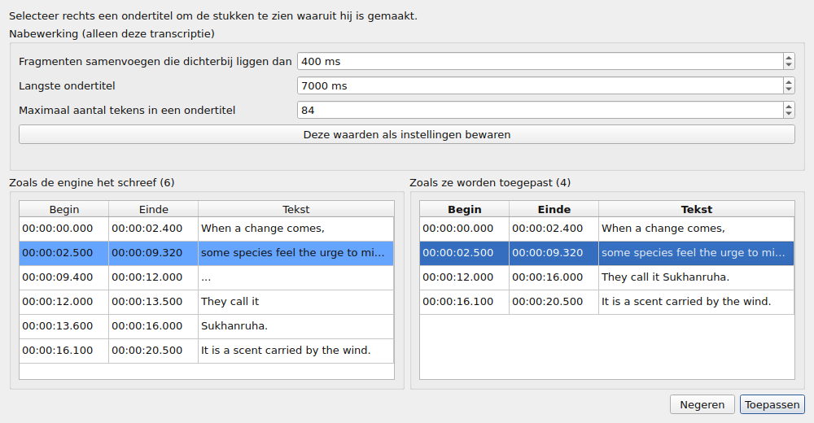
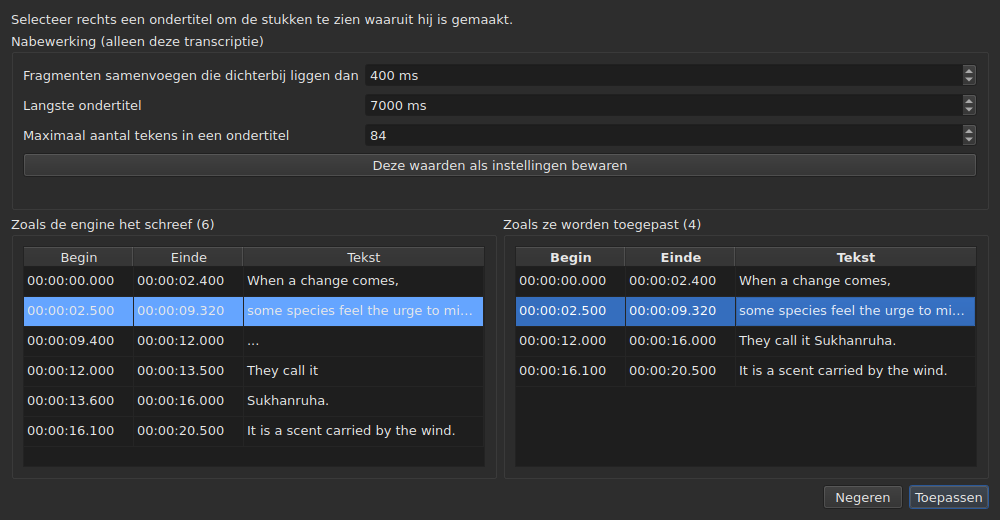

# De gekoppelde video

<!-- machine-translated -->
> Deze pagina is een machinevertaling en is nog niet nagelezen door een lezer van de taal.

Het menu **Video** bevat eerst drie commando's, en daarna de gebaren die de film aansturen
— zie [De speler](player.md#door-de-film-navigeren).

| Commando | Sneltoets | Wat het doet |
| :------- | :-------- | :----------- |
| Video kiezen… | geen | kiest het videobestand waarbij het document hoort |
| Audio transcriberen… | geen | transcribeert de audio van de film tot ondertitels die die van het project vervangen — zie [De audio transcriberen](#de-audio-transcriberen) |
| Synchroniseren met audio… | geen | verplaatst de ondertitels van het project naar waar hun woorden worden gezegd in de audio van de film — zie [Synchroniseren met de audio](#synchroniseren-met-de-audio) |
| Afspelen / Pauzeren | `Ctrl+P` | speelt de video af of stopt haar — zie [De speler](player.md#afspelen-en-stoppen) |

De gekoppelde video is **een eigenschap van het geopende document**, geen instelling van
het programma: een ander ondertitelbestand openen begint opnieuw. Ze
wordt in geen enkel bestand geschreven en verdwijnt met het venster.

## Het audiospoor

Een film kan meerdere geluidssporen bevatten — de originele versie, een nasynchronisatie, een commentaar. Het
submenu **`Video ▸ Audio ▸ Taal`** toont ze, **één item per spoor**, en **markeert het spoor dat wordt afgespeeld**:

| Wat het bestand geeft | Wat het item zegt |
| :-------------------- | :---------------- |
| een taal en een titel | `1: fra — Original` |
| alleen een taal | `2: eng` |
| alleen een titel | `3: Commentary` |
| geen van beide | `1` |

Het nummer is **de plaats van het spoor in de film**, telkens één verder, in de volgorde van het bestand: twee sporen
kunnen `eng` zeggen, en een bestand dat over zijn labels zwijgt heeft toch een eerste en een tweede.

**Een item kiezen speelt dat spoor af.** De markering is het antwoord van de speler, niet de klik: ze geeft aan
welk spoor wordt afgespeeld.

- **Het submenu is uitgeschakeld** zonder video of zonder audiospoor. Met één enkel spoor blijft het ingeschakeld en
  toont het dat spoor, aangevinkt: het zegt in welke taal de film is. De twee volumegebaren, die ernaast staan, blijven
  in elk geval ingeschakeld: zie [Het volume](player.md#het-volume).
- **Het spoor wordt niet onthouden** van de ene video naar de volgende, noch van de ene sessie naar de volgende: een spoornummer is
  dat van zijn bestand, en het overnemen naar de volgende film zou kiezen wat daar toevallig dat nummer draagt.
  Teruggaan naar een tabblad heropent zijn film op het spoor dat de speler zelf kiest.
- Geen sneltoets: u wisselt zelden van taal, en het menu volstaat.

## Een video kiezen

Het dialoogvenster opent in de map van het ondertitelbestand en filtert op
de herkende video-extensies:

    .avi .flv .m2ts .mkv .mov .mp4 .ogg .ogv .vob .webm

Het biedt ook aan alle bestanden te tonen. Het dialoogvenster annuleren verandert
niets.

Het gekozen bestand wordt **meteen geopend**: het beeld verschijnt in het venster,
gepauzeerd op zijn eerste moment. Zie [De speler](player.md).

**Een videobestand op het venster neerzetten doet hetzelfde** — zie
[Bestanden op het venster neerzetten](files.md#bestanden-op-het-venster-neerzetten).

**De video is die van het project van het huidige tabblad.** Elk tabblad houdt
de zijne; van tabblad wisselen wisselt van film. **Teruggaan naar een tabblad hervat zijn
film waar u hem hebt achtergelaten**, gepauzeerd, zoals bij elke opening. Een andere film
die in de tussentijd voor dat project is gekozen, begint van zijn kant vanaf het begin.

## Het automatische voorstel

Wanneer een ondertitelbestand wordt geopend, **als er geen video is gekozen**,
zoekt het venster er een in dezelfde map: een videobestand waarvan de naam
zonder extensie een voorvoegsel is van de onze, tot aan een punt.

| Ondertitelbestand | Gevonden video | Waarom |
| :---------------- | :------------- | :----- |
| `film.fr.srt` | `film.mkv` | `film` is een voorvoegsel van `film.fr` |
| `film.en.forced.srt` | `film.mkv` | idem, ongeacht het aantal segmenten |
| `film.fr.srt` | `film.fr.mkv` in plaats van `film.mkv` | de langste naam wint |
| `film.fr.srt` | geen, als `film.mkv` **en** `film.mp4` er zijn | twee kandidaten zijn niet van elkaar te onderscheiden |
| `film.fr.srt` | geen, als alleen `fil.mkv` er is | `fil` eindigt niet op een punt |

**Een voorstel is geen keuze.** Het laat zich vervangen door een ander
voorstel — een ander bestand openen, onder een andere naam opslaan. Een uitdrukkelijke
keuze daarentegen wordt nooit overschreven: zodra `Select Video…` is gebruikt, komt het
automatische voorstel er niet meer achteraan.

Dat maakt de gok aanvaardbaar: ze kan worden gecorrigeerd, en haar
correctie blijft staan.

## Wat de statusbalk toont

Rechts op de statusbalk zegt een regel waarbij het document hoort. Ze
is de laatste van drie: de [codering](files.md#de-codering-in-de-statusbalk)
van het gelezen bestand komt eerst, het [framerooster](frame-grid.md) dat uit de
posities wordt afgeleid daarna.

| Situatie | Wat er wordt geschreven |
| :------- | :---------------------- |
| een video is gekoppeld | `Video: film.mkv` |
| … en `ffprobe` geeft haar framesnelheid | `Video: film.mkv, 24000/1001 fps` |
| geen | `No video` |

**De framesnelheid hoort bij de film in plaats van ernaast te staan.** Ze vormen één feit — waarbij
dit document hoort — en een derde vermelding zou haar op dezelfde rang plaatsen als
het [raster dat uit de posities wordt afgeleid](frame-grid.md), wat een ander feit is.

## De audio transcriberen

**`Transcribe Audio…`** schrijft de gesproken tekst van de film als ondertitels. Het is uitgeschakeld zolang er geen film
is geopend: het is de audio van **de film van het project**, nooit een bestand dat u zou kiezen — om een
audiobestand te transcriberen gebruikt u [`transcribe`](../subedit-cli/transcribe.md) op de opdrachtregel.

Het dialoogvenster vraagt om vier dingen en zegt of het kan beginnen:

- **het audiospoor**, opgesomd zoals het menu [`Audio`](#het-audiospoor) ze opsomt, met de taal
  en de titel die het bestand opgeeft;
- **de taal**, gekozen in een **lijst**: eerst een item dat ze detecteert, “Detecteren uit de eerste 30 seconden geluid”, dan de talen die de
  engine voor het model biedt, met hun naam in de taal van het venster, gevolgd door hun code — “Frans (fr)”. De lijst is die van de
  engine: ongeveer honderd bij een meertalig model; bij een model dat alleen Engels kent heeft ze het ene item, Engels, en kan ze niet
  worden gewijzigd, en een regel zegt dat de film als Engels uitkomt, welke taal hij ook spreekt. De lijst begint met de taal van het gekozen
  spoor wanneer het bestand er een opgeeft en de engine ze biedt, volgt het spoor zolang u er geen hebt gekozen, en
  **een regel eronder zegt waar ze vandaan komt**. Geeft het bestand geen taal op voor het spoor, dan zegt de regel dat, en waarschuwt:
  het model zal ze dan detecteren uit de eerste dertig seconden geluid, en **een film die opent met muziek of stilte kan voor een andere taal worden aangezien
  en zijn spraak dan in die taal vertaald**. Kies de taal als u ze kent;
- **geluiden geschreven als notities**: een vakje, “Geluiden niet als notities schrijven”, standaard aangevinkt. De engine krijgt dan de opdracht geluiden niet als
  notities te schrijven, zoals `(phone ringing)` of `[MUSIC PLAYING]`; waar hij geen spraak heeft om te schrijven, schrijft hij `...`, en de stukken die geen letter en geen cijfer hebben
  worden door de nabewerking weggelaten. Vink het vakje uit om de notities te houden, voor ondertitels voor doven en slechthorenden. Het vakje is grijs, met de reden,
  voor een engine waaraan dat niet kan worden opgedragen. Het is de instelling `transcription.suppress-notes`, die ook de [instellingen](preferences.md#transcriptie)
  bevatten;
- **het deel van de film**, van de ene tijd tot de andere — zie [Eerst een deel proberen](#eerst-een-deel-proberen). Beide velden
  leeg is de hele film.

**Het zegt ook wat er ontbreekt.** Drie regels zeggen of de engine, `ffmpeg` en het model er zijn, en
waar; als er een ontbreekt, blijft `OK` uitgeschakeld en zegt het dialoogvenster dat met de verwijzing naar
[De transcriptiehulpmiddelen installeren](../subedit-cli/install-transcription.md). Een knop `Preferences…` opent
de [instellingen](preferences.md#transcriptie), waar het programma en het model worden ingesteld — het zijn feiten
over de machine, geen keuzes die bij elke transcriptie opnieuw moeten worden gemaakt — en het dialoogvenster kijkt opnieuw wanneer ze sluiten.

De taal wordt voor de volgende keer bewaard. De engine zelf en de grenzen van de ondertitels zijn
[instellingen](preferences.md) (`transcription.*`).

**Wanneer het project al ondertitels bevat, vraagt het venster of het ze mag vervangen**, en zegt het hoeveel
er verdwijnen. Het vraagt vóór het werk, zodat weigeren niets kost. Wanneer het project leeg is, valt er
niets te vragen.

Het werk draait **op de achtergrond**, met een venstertje en een knop `Cancel`; het venster blijft eromheen bruikbaar. **Het venstertje
zegt hoe ver het werk is**, zodat u weet dat het leeft en hoe lang het zal duren:

- **de stap**: eerst “De audio uitpakken…” — het venstertje is dan bezig, zonder getal, want uitpakken zegt niets over hoe ver het
  is —, dan “De audio transcriberen…”, met een balk;
- **de resterende tijd**, “nog ongeveer 38 min”: eerst afwezig, getoond zodra de engine genoeg voortgang heeft gemeld om uit te extrapoleren, en
  berekend uit zijn snelheid sinds het begin, tot de laatste minuut; het is een nauwkeurigheid van enkele minuten, geen belofte;
- **de verstreken tijd**, “verstreken: 0:05:12”, die doorloopt ook als niets anders beweegt;
- **de positie**, “0:12:30 van 0:50:00”: hoe ver in de film de engine is, zodra hij zijn eerste tekst heeft geproduceerd, getoond **net boven de laatste tekst** waarbij ze hoort;
- **de laatste tekst** die is verkregen, zodat u kunt zien dat het werk zinvol is.

Bij een lange film met een groot model op een processor kunnen de eerste minuten lang zijn: de engine laadt het model en werkt aan zijn eerste
vensters van dertig seconden. De positie en de laatste tekst bewegen voordat het eigen procent van de engine dat doet, dat alleen in stappen
van 5 % van de film komt.

### Het voorbeeld

**Niets vervangt de ondertitels van het project voordat u ze hebt gezien.** Wanneer het werk klaar is — en ook wanneer u het annuleert, of het mislukt
nadat het iets heeft opgeleverd — toont een venster het resultaat in twee tabellen naast elkaar, elk met **zijn eigen begin en einde**:

- **links, “Zoals de engine het schreef”**: alles wat de engine heeft teruggegeven, zoals hij het heeft geknipt, zonder enige nabewerking — wat
  [`--raw`](../subedit-cli/transcribe.md) zou schrijven —, de plaatsvervangers (`...`) inbegrepen;
- **rechts, “Zoals ze worden toegepast”**: de ondertitels na de nabewerking, precies wat in het project komt. Het gebeurt in drie stappen, elk over het hele transcript voordat de volgende begint: de stukken zonder letter en zonder cijfer (`...`) worden weggelaten; de nabije stukken van één zin worden samengevoegd; de te lange worden geknipt — **eerst bij een zinseinde (`. ? ! …`), dan bij een komma, een puntkomma of een dubbele punt, en midden in een zin alleen als er geen leesteken is om bij te knippen**. Een knip die een ondertitel zou achterlaten die te klein is om te lezen (een paar tekens, een fractie van een seconde) wordt vermeden als er een andere is. Een ondertitel die een stuk begint behoudt zijn begin, en die het afsluit behoudt zijn einde: de tijden van de woorden dienen alleen voor de knippen binnen een stuk.

Boven de tabellen bevat **“Nabewerking (alleen deze transcriptie)”** de drie grenzen van de nabewerking: “Fragmenten samenvoegen die dichterbij liggen dan”, “Langste ondertitel” en “Maximaal aantal tekens in een ondertitel” — de instellingen `transcription.merge-gap-ms`, `transcription.max-duration-ms` en `transcription.max-characters`. **Een ervan wijzigen maakt de rechtertabel meteen opnieuw**, zonder dat de engine eraan te pas komt, en de ondertitel die u had geselecteerd blijft geselecteerd. De waarden die u invoert gelden alleen voor **deze transcriptie**: of u haar toepast of negeert, de instellingen van de toepassing blijven zoals ze waren. **“Deze waarden als instellingen bewaren”** geeft de drie waarden door aan de instellingen van de toepassing — die van de [instellingen](preferences.md#transcriptie), samen met die opgeslagen —, en het venster zegt dat; het venster sluiten doet dat niet vanzelf.

De twee komen niet regel voor regel overeen, daarom heeft elk zijn eigen tijden. **Een ondertitel rechts selecteren markeert links de stukken waaruit hij
is gemaakt**, en schuift de linkerkant ernaartoe; één ondertitel tegelijk, en alleen in die richting. Geen van beide tabellen kan worden bewerkt: wat geen enkele instelling goed krijgt, bewerkt u daarna in de tabel van het project, zoals elke ondertitel.

Twee knoppen sluiten het. **“Toepassen”** vervangt de ondertitels van het project **in één bewerking**: één `Undo` geeft terug wat er stond, vertaalteksten
inbegrepen. **“Negeren”** gooit het resultaat weg, en het is verloren. “Toepassen” is uitgeschakeld als er
niets toe te passen is.

**Wanneer het werk is gestopt**, zegt het venster dat — “Gedeeltelijk resultaat: het werk is gestopt bij …” — en biedt het aan wat tot dan toe was verkregen, om toe te passen
of te negeren, zodat een lange run die laat is gestopt zijn werk niet ongevraagd verliest. Die stukken hebben geen woorden met tijd (de engine schrijft ze aan het
einde), en de nabewerking knipt op de eigen grenzen van de stukken. Een mislukking wordt eerst in een venstertje gemeld, zoals elke mislukking; een annulering meldt niets van dien aard.

### Eerst een deel proberen

Met een bereik kunt u **een model of een taal op twee minuten beoordelen voordat u zich aan twee uur verbindt**. De velden “Deel van de film” nemen een begin en een einde, elk geschreven als `HH:MM:SS` en cijfer voor cijfer overschreven, zoals in het [verschuivingsdialoogvenster](operations.md#shift-positions) (een als `2:00` geplakte tijd wordt in vorm gebracht); een van beide alleen is toegestaan (van daar tot het einde, of van het begin tot daar). `OK` blijft uitgeschakeld zolang een veld
geen tijd is of het einde niet na het begin komt, en een regel onder de velden zegt welke.

- **De ondertitels behouden de tijd van de film**: wat op 2:10 wordt gezegd, staat in het resultaat op `0:02:10`.
- **Het gaat langs het voorbeeld zoals elke transcriptie**, en vervangt de ondertitels van het project zodra het is toegepast; één `Undo` geeft ze terug.
  Om een bereik te proberen zonder uw werk aan te raken, negeert u het voorbeeld, of bewaart u eerst.

**Wat het nodig heeft wordt niet meegeleverd**: een engine (whisper.cpp), een model en `ffmpeg` om de audio uit te pakken.
Zie [De transcriptiehulpmiddelen installeren](../subedit-cli/install-transcription.md).

## Synchroniseren met de audio

**`Synchronize with Audio…`** hertimet de ondertitels van het project op de audio van de film. Het is het geval van de `.srt`
die online is opgehaald, aan het begin en aan het einde verschoven, en die een enkele verschuiving niet terugbrengt: elke ondertitel wordt gezocht in wat er
wordt gezegd en neemt de plaats in waar hij wordt gezegd. **Alleen begin en einde veranderen** — nooit de tekst, de stijl, het aantal
ondertitels of hun volgorde. Zoals `Transcribe Audio…` is het uitgeschakeld zolang er geen film is geopend, en het is de audio van **de film van het project**; dezelfde
opdrachtregel is [`sync`](../subedit-cli/sync.md).

De ondertitels moeten in de gesproken taal staan: er wordt niets vertaald. Het werk wordt gedaan door de engine die transcribeert — die van
de [instellingen](preferences.md#transcriptie), met hetzelfde programma, dezelfde `ffmpeg` en hetzelfde model — en **het dialoogvenster zegt wat er ontbreekt** precies zoals dat van de
transcriptie, met de verwijzing naar [De transcriptiehulpmiddelen installeren](../subedit-cli/install-transcription.md) en een
knop `Preferences…`.

Het dialoogvenster vraagt om:

- **het audiospoor** en **de taal**, zoals bij de transcriptie;
- **het deel van de film**, van de ene tijd tot de andere, beide leeg voor de hele film: alleen de ondertitels die in het bereik **beginnen** worden
  gezocht en verplaatst;
- **“Alleen de geselecteerde ondertitels”**: een vakje, uitgeschakeld als er niets is geselecteerd. Het zoekt alleen de geselecteerde ondertitels, in het deel van de
  film dat een minuut vóór de eerste ervan begint en een minuut na de laatste eindigt, zodat een bestand dat te laat of te vroeg is
  toch binnen wat wordt beluisterd valt;
- **“Te horen woorden”**, in procenten: het aandeel van de woorden van een ondertitel dat moet worden gehoord om de ondertitel te vinden, standaard 50 % — de instelling
  `alignment.min-match`;
- **“Te controleren verschuiving”**, in milliseconden: hoever een ondertitel mag afwijken van de verschuiving van zijn buren voordat hij wordt gemarkeerd, standaard 2000 ms —
  de instelling `alignment.doubt-gap`.

De drie laatste worden voor de volgende keer bewaard. Het werk draait **op de achtergrond**, met hetzelfde vakje en dezelfde knop `Cancel` als de transcriptie;
een uitvoering die mislukt of die u stopt, verandert niets.

### Het resultaat

**Er beweegt niets voordat u hebt gezien waar de ondertitels heen zouden gaan.** Wanneer het werk eindigt toont een venster, voor elke ondertitel die is gezocht,
zijn nummer, zijn tekst, **het begin dat hij had, het begin dat hij krijgt, de verschuiving ertussen**, en wat er **te controleren** is, in woorden:

- **“niet gevonden in de audio, ongewijzigd gelaten”**: er zijn minder woorden gehoord dan het vakje vraagt. De ondertitel behoudt zijn tijden — **er wordt nooit een
  positie verzonnen, en geen enkele wordt uit de buren geraden**;
- **“slechts gedeeltelijk gehoord”**: gevonden, maar minder dan 80 % van zijn woorden is gehoord;
- **“anders verschoven dan zijn buren”**: gevonden, maar zijn verschuiving wijkt met meer dan de
  “Te controleren verschuiving” af van de middelste verschuiving van de twee ondertitels aan elke kant;
- **“ingekort tot het begin van de volgende ondertitel”** en **“overlapt de volgende ondertitel nog steeds”**: een ondertitel die tegen de volgende zou aanlopen, wordt ingekort tot
  waar de volgende begint; een die hem nog overlapt, wat inkorten niet verhelpt, wordt gelaten en gemeld.

Een regel boven de tabel zegt waar het op uitkwam — hoeveel ondertitels zijn geplaatst, hoeveel er te controleren zijn, de mediane verschuiving en de drift —, en
**“Alleen de te controleren ondertitels”** toont alleen die. De tabel kan niet worden bewerkt.

Twee knoppen sluiten het. **“Toepassen”** verplaatst de begin- en eindtijden **als één enkele bewerking**: één `Undo` geeft de tijden terug die er waren. “Annuleren”
laat het project zoals het is. “Toepassen” is uitgeschakeld als er niets zou bewegen. Wanneer geen enkele ondertitel kon worden gevonden, zegt het venster dat in een vak
en toont het niets om toe te passen: het is vrijwel zeker de verkeerde audio of de verkeerde taal.

## Wanneer er geen film is

Het venster toont een knop **`Select Video…`** waar het beeld zou komen, in plaats van
helemaal niets. Het is hetzelfde commando als dat van het menu `Video`, binnen
handbereik van de muis: een afwezigheid waar u niets aan kunt doen, is moeilijk te onderscheiden van
een fout.

De knop verdwijnt zodra een film is geopend, en het beeld neemt **al** zijn
plaats in: de hoogte die de tabel erboven laat — die welke
[`window.table-share`](preferences.md) van de ene sessie naar de volgende heeft onthouden —, en
nooit minder dan de minimale hoogte van het beeld, waaraan de tabel zo nodig toegeeft.
Wanneer de film verdwijnt, neemt de knop dezelfde plaats weer in.

**De naam van het bestand, nooit zijn pad.** Een pad van tweehonderd tekens
zou al het andere uit de balk duwen; het volledige pad is dat wat het
dialoogvenster toonde.

## `ffmpeg` is niet vereist

`subedit-gui` raadpleegt `ffprobe` — meegeleverd met `ffmpeg` — voor één ding en
niets anders: **de framesnelheid die de container opgeeft**. Ze wordt één keer
per film gelezen, wanneer die wordt gekoppeld.

| Met `ffprobe` | Zonder |
| :------------ | :----- |
| de statusbalk schrijft de framesnelheid naast de naam van de film | ze schrijft alleen de naam |
| het conversiedialoogvenster stelt de framesnelheid van de film voor in het onderste veld | het stelt niets voor, en opent zoals voorheen |
| het dialoogvenster voor de uitlijning opent erop | het opent op de framesnelheid van het project |

**Niets anders hangt ervan af, en geen enkele bewerking weigert.** De speler heeft
`ffprobe` helemaal niet nodig: hij steunt op `libmpv`, dat een
afhankelijkheid bij het bouwen is. De duur van de film, die waarmee wordt gemeld wat
voorbij het einde komt, komt van de speler en niet van `ffprobe`.

**De transcriptie is het enige dat wel `ffmpeg` nodig heeft**: het haalt de audio van de film eruit. Zie
[De transcriptiehulpmiddelen installeren](../subedit-cli/install-transcription.md).

Het is dus geen verminderde modus maar **de normale werking** van een machine
waarop `ffmpeg` nooit is geïnstalleerd: het gegeven komt van de gebruiker, en `ffprobe`
stelt het voor wanneer het aanwezig is.

Een gelezen framesnelheid is een **exacte breuk** — `24000/1001`, niet `23.976`.
Daarom wordt `ffprobe` voor dat antwoord behouden: de
speler kent hetzelfde gegeven als een kommagetal, en een benaderde framesnelheid
zou het hele bestand een beetje verkeerd opnieuw timen.
