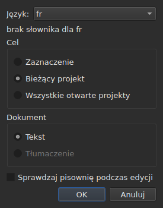
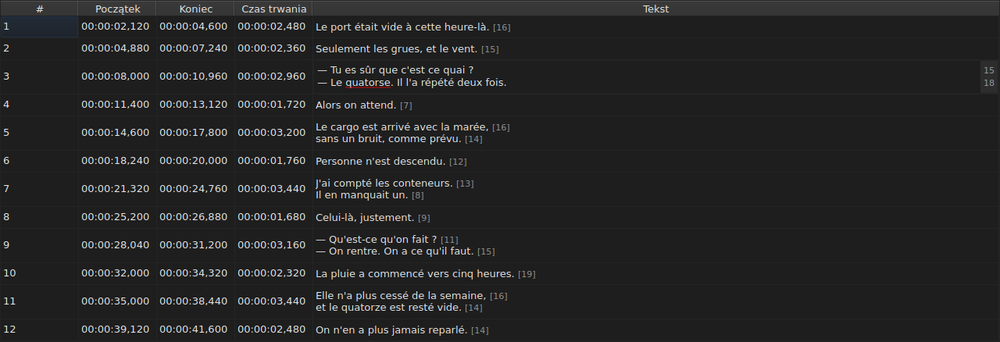
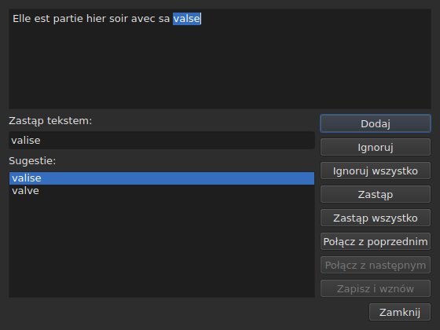

# Sprawdź pisownię…

<!-- machine-translated -->
> Ta strona jest tłumaczeniem maszynowym i nie została jeszcze sprawdzona przez osobę władającą tym językiem.

`Narzędzia ▸ Sprawdź pisownię…` przechodzi po wyrazach, których słownik nie zna,
po jednym, wzorując się na sprawdzaniu pisowni w Gaupolu. Ma towarzysza,
`Narzędzia ▸ Ustawienia sprawdzania pisowni…`, który ustawia język, cel i dokument oraz podkreślanie w trakcie pisania.
Oba opierają się na słownikach systemu, przez Enchant.

Etykieta pierwszego jest zapisana jako `Chec&k Spelling…`: `C` jest już
akceleratorem `Correct Texts…`, a `k` jest wolne w menu `Tools`.
Żaden z dwóch nie ma skrótu.

**Oba są wyłączone w dokumencie bez napisów**, tak jak
[`Correct Texts…`](correct-texts.md): nie ma czego sprawdzać. `Check Spelling…`
jest też wyłączone, gdy brakuje słownika dla ustawionego języka, zobacz
[Bez słownika](#bez-słownika).

## Ustawienia sprawdzania pisowni…




| Grupa | Wybory | Domyślnie |
| :---- | :----- | :-------- |
| `Language` | kody języków oferowane przez system oraz ten, który już wybrano | język systemu, jeśli jest wśród nich |
| `Target` | `Selection`, `Current Project`, `All Open Projects` | `Current Project` |
| `Document` | `Text`, `Translation` | `Text` |
| `Check spelling while editing` | pole wyboru, zobacz [Podkreślanie w trakcie pisania](#podkreślanie-w-trakcie-pisania) | niezaznaczone |

`Selection` jest wyłączone, gdy w wyświetlanej karcie nie wybrano żadnej linii; `Translation`
jest wyłączone, dopóki żaden otwarty projekt nie zawiera tłumaczenia. Zapamiętane
ustawienie, które nie jest już dostępne — puste zaznaczenie, nieobecne tłumaczenie —
otwiera się na `Current Project` lub `Text`. `OK` zachowuje ustawienia, `Cancel` niczego
nie zmienia.

**To okno nie zależy od słownika**: pozostaje dostępne, dopóki
dokument ma napisy, nawet bez słownika dla ustawionego języka, i to
ono pozwala opuścić język, który go nie ma. Język, dla którego nie istnieje
słownik, pozostaje edytowalny i widnieje na liście, a pod
nim zdanie `no dictionary for`, po którym następuje jego kod.

**Cztery ustawienia są zapamiętywane** od jednej sesji do następnej, w
pliku ustawień `subedit` — jego położenie opisuje [Preferencje](preferences.md):

| Klucz | Wartości | Domyślnie |
| :---- | :------- | :-------- |
| `spell-check.language` | kod języka, taki jak `fr_FR`; pusty: język systemu | pusty |
| `spell-check.target` | `selection`, `current-project`, `all-projects` | `current-project` |
| `spell-check.document` | `main`, `translation` | `main` |
| `spell-check.inline` | `true` lub `false` — podkreślaj nieznane wyrazy w edytorze komórki | `false` |

Wartość, której klucz nie przyjmuje, jest ignorowana, obowiązuje wartość domyślna, a opcja
jest wymieniana na strumieniu błędów przy otwarciu okna — zobacz
[Co się dzieje, gdy plik nie mówi tego, czego się oczekuje](preferences.md#co-się-dzieje-gdy-plik-nie-mówi-tego-czego-się-oczekuje).

## Podkreślanie w trakcie pisania




Pole wyboru `Check spelling while editing` w `Spell-Check Settings…` podkreśla,
**czerwoną falistą linią i w trakcie pisania**, każdy nieznany wyraz w edytorze
komórki tekstowej — zarówno w kolumnie `Text`, jak i w kolumnie
`Translation`. Podkreślenie podąża za pisaniem: pojawia się, przesuwa i
znika razem z wyrazem. **Domyślnie jest wyłączone**, tak jak w Gaupolu: bez
niego nic się w edytorze nie zmienia.

**Język jest językiem z `Language:`**, w tym samym oknie, a nieznane wyrazy
to te, które znalazłoby `Check Spelling…`: te same przypadki potocznej angielszczyzny
(`goin'`, `we'd`, `1st`), ten sam podział na wyrazy. Podkreślonego wyrazu nie poprawia się
z menu: pole wyboru tylko go pokazuje.

**Bez słownika dla ustawionego języka edytor milczy**: nic nie jest
podkreślane i nic nie zawodzi, a zdanie okna `no dictionary for` mówi
dlaczego. Pole wyboru dotyczy edytorów otwartych po nim; edytor już
otwarty zachowuje to, co miał.

## Przejście po tekstach




Okno pokazuje tekst napisu, na którym się zatrzymało, z zaznaczonym w nim nieznanym wyrazem.
**Przy każdym nieznanym wyrazie wraca karta projektu, a wiersz
napisu jest zaznaczany w tabeli.** Przejście idzie napis
po napisie, a potem projekt po projekcie, gdy cel wskazuje kilka.

Pod tekstem: pole `Replace with:`, wypełnione pierwszą sugestią, oraz lista
`Suggestions:`. Wybranie sugestii kopiuje ją do pola; pisanie w
polu odnawia listę.

| Przycisk | Co robi |
| :------- | :------ |
| `Add` | dodaje wyraz do osobistego słownika użytkownika i przechodzi do następnego |
| `Ignore` | pomija ten wyraz i przechodzi do następnego |
| `Ignore All` | pomija ten wyraz i wszystkie jego pozostałe wystąpienia podczas tego przejścia |
| `Replace` | zastępuje wyraz zawartością `Replace with:`; wyłączone, dopóki pole jest puste |
| `Replace All` | robi to samo dla jego pozostałych wystąpień; wyłączone, dopóki pole jest puste |
| `Join with Previous` | łączy wyraz z wyrazem poprzedzającym; wyłączone, jeśli go nie ma albo jeśli nie rozdziela ich spacja |
| `Join with Next` | łączy wyraz z wyrazem następującym, na tych samych warunkach |
| `Save and Resume` | zachowuje tekst taki, jaki niesie go obszar tekstu, i wznawia czytanie **tego tekstu od początku** |
| `Close` | zamyka okno |

**Obszar tekstu jest edytowalny.** Gdy tylko coś w nim wpiszesz, dostępne
pozostaje tylko `Save and Resume`: pozostałe gesty działają na wybranym wyrazie, który nie jest już
wyrazem tego tekstu.

**Przejście kończy się samo**, gdy nie zostaje żaden nieznany wyraz:
przyciski są wyłączone, tekst się opróżnia. Cel bez żadnego nieznanego wyrazu
nie pokazuje okna.

### Zamykanie w połowie

`Close` lub krzyżyk okna **stosuje to, co zrobiono**, tak jak koniec
przejścia: teksty już opuszczone **oraz** gesty — zastąp,
zastąp wszystkie, połącz — już wykonane na bieżącym tekście. To odejście od
Gaupola, który traci bieżący tekst. Nie liczy się to, co zostaje z przejścia, ani
poprawki wpisane w obszarze tekstu, których `Save and Resume` nie
zatwierdziło.

**Jeden wpis w historii na każdy dotknięty projekt**, niezależnie od liczby
zamian: `Undo` cofa naraz wszystkie poprawki tego projektu.
Menu nazywa go `Undo: correcting texts`. Pasek stanu podaje wtedy
liczby:

```text
Edited 2 and removed 0 subtitles
```

**Lista zamienników** — co użytkownik zastąpił i czym —
jest zapisywana przy zamknięciu w `spell-check/<language>.repl`, w katalogu
konfiguracji `subedit`, a nie w katalogu Gaupola, którego nigdy się nie czyta.
Liczy się wtedy do sugestii sprawdzania pisowni, tutaj tak jak w
[`Correct Texts…`](correct-texts.md#łączenie-lub-dzielenie-wyrazów--ponowne-łączenie-i-dzielenie-przez-sprawdzanie-pisowni).
Jeśli nie da się jej zapisać, mówi o tym okno błędu, `Could not save the
replacements for`, po czym następują język i powód, bez anulowania
poprawek.

## Bez słownika

Gdy ustawiony język — systemowy, jeśli żadnego nie wybrano — nie ma
słownika, **`Check Spelling…` jest wyłączone**, a jego podpowiedź oraz pasek
stanu, gdy wskaże się pozycję, mówią dlaczego:

```text
no dictionary for fr
```

`Spell-Check Settings…` pozostaje, by wybrać język, który go ma. Okno
zbudowane bez żadnego dostawcy słowników mówi to samo i niczego
nie sprawdza.

## Komunikaty

| Komunikat | Gdzie | Co go wywołuje |
| :-------- | :---- | :------------- |
| `no dictionary for fr` | podpowiedź i pasek stanu | brak słownika dla ustawionego języka |
| `Nothing to check.` | pasek stanu | cel nie wskazuje żadnego tekstu — na przykład puste zaznaczenie |
| `Edited N and removed M subtitles` | pasek stanu | na końcu lub przy zamknięciu; `M` pozostaje `0` |
| `Could not save the replacements for fr: …` | okno błędu | lista zamienników nie została zapisana |

## Przykład

Otwarty plik zawiera `Elle est partie hier soir avec sa valse`. Francuski
słownik jest dostępny: `Narzędzia ▸ Sprawdź pisownię…` zatrzymuje się na `valse`, zaznacza
wiersz w tabeli i proponuje `valise`, już w `Replace with:`. `Replace`,
potem `Close`: wiersz staje się `Elle est partie hier soir avec sa valise`, a
pasek stanu mówi:

```text
Edited 1 and removed 0 subtitles
```
