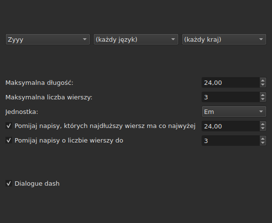
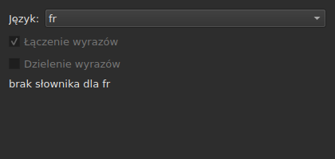
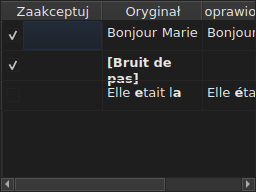

# Popraw teksty…

<!-- machine-translated -->
> Ta strona jest tłumaczeniem maszynowym i nie została jeszcze sprawdzona przez osobę władającą tym językiem.

`Narzędzia ▸ Popraw teksty…` otwiera kreator wielostronicowy, wzorowany na
kreatorze Gaupola: strona celu i zadań, po jednej stronie na każde zaznaczone zadanie,
strona postępu i strona potwierdzenia, która proponuje
zmiany, nigdy ich nie narzucając.

**Wyłączony w pustym dokumencie**: nie ma czego poprawiać.

**Wiersz poleceń robi to samo** dla wszystkich zadań: [`subedit-cli correct`](../subedit-cli/correct.md), z tymi
samymi wzorcami i tymi samymi liczbami — a w znakach tam, gdzie okno mierzy w em.
**Domyślnie odczytuje cztery z zapamiętanych ustawień tego kreatora** — dwie klasy
częstych błędów (`Human`, `OCR`), `Remove all blank subtitles` oraz maksymalną liczbę linii
`Line Break` — a wszystko inne (zadania, ich kod, długość linii, język,
pola wzorców) bierze z własnego wiersza poleceń. Zobacz
[Dwa bloki, jeden wspólny z wierszem poleceń](preferences.md#dwa-bloki-jeden-wspólny-z-wierszem-poleceń)
oraz [`subedit-cli config`](../subedit-cli/config.md).

## Zadania i cel — pierwsza strona

| Grupa | Wybory | Domyślnie |
| :---- | :----- | :-------- |
| `Target` | `Selection`, `Current Project`, `All Open Projects` | `Current Project` |
| `Document` | `Text`, `Translation` | `Text` |
| `Tasks` | `Mentions`, `Join or Split Words`, `Common Errors`, `Capitalization`, `Line Break` — do zaznaczenia, jedno lub więcej | zaznaczone `Common Errors` i `Capitalization`, trzy pozostałe nie |

`Selection` jest wyłączone, gdy w wyświetlanej karcie nie wybrano żadnej linii; `Translation`
jest wyłączone, dopóki żaden otwarty projekt nie zawiera tłumaczenia.

**Cel i dokument nie są zapamiętywane**: kreator zawsze otwiera się
na `Current Project` i `Text`. Zaznaczone zadania natomiast są zapamiętywane.

**Co oznacza każdy cel**:

| Cel | Działa na |
| :-- | :-------- |
| `Selection` | linie wybrane w wyświetlanej karcie |
| `Current Project` | cały plik wyświetlanej karty |
| `All Open Projects` | cały plik każdej otwartej karty |

**`All Open Projects` w połączeniu z `Translation` pomija projekty bez tłumaczenia**:
projekt, który go nie ma, nie ma nic do zaproponowania w pustej kolumnie, a
kreator go nie liczy.

**Strony zadań następują w kolejności Gaupola — `Mentions`,
`Join or Split Words`, `Common Errors`, `Capitalization`, `Line Break` — nigdy w tej, w której pola
zaznaczono.** Niezaznaczone zadanie nie ma strony; jego zapamiętane
ustawienia mimo to się nie zmieniają. **Żadna strona zadania nie ma własnego pola
„aktywne”**: to pole tej pierwszej strony, i tylko ono,
decyduje, czy zadanie się wykona.

## Strony zadań

Każda z czterech stron wzorców — wszystkie poza `Join or Split Words`, która ich nie ma — ma tę samą podstawę: trzy kaskadowe
listy rozwijane — pismo, język, kraj — służące do wyboru kodu wzorców do
zastosowania, a potem listę wzorców tego kodu, po jednym polu wyboru na nazwę. **Te trzy
listy oferują tylko to, co katalog wzorców rzeczywiście
zawiera** — wzorce dostarczone z programem i te, które użytkownik
tam umieścił (zobacz [Odrzucone wzorce](#odrzucone-wzorce)) — nigdy listę
języków czy krajów odczytaną skądinąd. `Zyyy` („dowolne pismo”) jest początkowym
kodem `Common Errors`, który daje wzorce obowiązujące wszędzie. **Trzy
pozostałe rodzaje mają wzorce tylko pod jakimś pismem**: ich strona otwiera się na
pierwszym, jaki oferuje katalog, `Latn` w przypadku dostarczonych wzorców, a nie na `Zyyy`.

**Opis każdego wzorca jest podpowiedzią jego pola.** Nazwy i opisy podążają za
językiem okna w przypadku wzorców dostarczonych z programem; własny wzorzec jest pokazywany
tak, jak zapisuje go jego plik ([Język](invocation.md#język)).

**Odznaczony wzorzec pozostaje odznaczony, dopóki nie zostanie zaznaczony ponownie**, także przy
zmianie kodu i powrocie do niego, a ten wybór jest zapamiętywany od jednego otwarcia
kreatora do następnego. Zaznaczony ponownie, po prostu wraca do swojego pierwotnego
ustawienia, a zapamiętany wybór znika.

| Strona | Co dodaje do podstawy |
| :----- | :-------------------- |
| `Mentions` | dwa pola wyboru, `Sound in brackets` i `Sound in parentheses`, domyślnie niezaznaczone |
| `Common Errors` | dwa pola wyboru, `Human` i `OCR`, domyślnie zaznaczone |
| `Capitalization` | nic więcej |
| `Line Break` | maksymalna długość (domyślnie `24`), maksymalna liczba linii (`3`), jednostka — `Characters` lub `Ems`, domyślnie `Ems` — oraz dwa warunki pominięcia, opisane niżej |

**Dwa pola `Mentions` nie wskazują żadnego skompilowanego wzorca**: sterują
przeszukaniem tekstu w rdzeniu, takim, jakie
[`Remove Hearing-Impaired Mentions…`](operations.md#remove-hearing-impaired-mentions)
wykonuje już jako bezpośredni gest. Wystarczy zaznaczyć jedno **lub** drugie, by je uruchomić. **Lista wzorców tej strony ich nie powtarza**: te dwie nazwy pojawiają się tam tylko raz, jako pola wyboru.

**`Common Errors` filtruje według klasy**: wzorzec, który należy do obu klas,
stosuje się, gdy tylko zaznaczone jest jedno z dwóch pól; trzy pozostałe strony nie
znają tego rozróżnienia.

### Line Break — jednostka i pominięcie




| Ustawienie | Co robi | Domyślnie |
| :--------- | :------ | :-------- |
| `Maximum length` | długość linii w wybranej jednostce; od `1` do `1000` | `24` |
| `Maximum lines` | docelowa liczba linii; od `1` do `100` | `3` |
| `Unit` | `Characters` liczy znaki; `Ems` mierzy szerokość czcionką okna, gdzie przeciętna mała litera jest warta `0.55` — jednostka Gaupola | `Ems` |
| `Skip subtitles with maximum line length of` | pozostawia bez zmian napis, którego najdłuższa linia mieści się w tej długości, w wybranej jednostce | zaznaczone, `24` |
| `Skip subtitles with maximum line amount of` | pozostawia bez zmian napis, którego liczba linii mieści się w tej liczbie | zaznaczone, `3` |

**Pominięcie ma własne progi**, odrębne od limitów, do których się dąży: to
reguła Gaupola. Napis pozostaje bez zmian, jeśli mieści się we **wszystkich
progach, których pole jest zaznaczone**; w przeciwnym razie jest łamany, a złamanie
jest zachowywane tylko wtedy, gdy przybliża napis do progu, który przekraczał — mniejsza
długość lub mniej linii. Gdy żadne pole nie jest zaznaczone: łamany jest każdy napis,
niezależnie od tego, czy już się mieści.

**Zmiana jednostki zmienia to, co jest proponowane**: długość każdej linii jest
mierzona przy każdym obliczeniu, w jednostce strony w danej chwili, i nic nie
zostaje z poprzedniego pomiaru. Tekst z dwudziestu dziewięciu znaków, z których połowa
to wąskie litery, przekracza `24` w `Characters` i mieści się w tej wartości z łatwością
w `Ems`.

**Siedem ustawień jest zapamiętywanych** od jednej sesji do następnej, łącznie z jednostką.

### Łączenie lub dzielenie wyrazów — ponowne łączenie i dzielenie przez sprawdzanie pisowni




Osobna strona, między `Mentions` i `Common Errors`, do naprawiania tego, co
oprogramowanie do rozpoznawania tekstu robi ze spacjami. Nie ma listy
wzorców: opiera się na słownikach systemu, przez Enchant.

| Ustawienie | Co robi | Domyślnie |
| :--------- | :------ | :-------- |
| `Language` | język słownika; kody oferowane przez system oraz ten, który już wybrano | język systemu, jeśli jest wśród nich |
| `Join words` | łączy wyraz z błędem pisowni z sąsiednim wyrazem | zaznaczone |
| `Split words` | tnie wyraz z błędem pisowni na dwa | niezaznaczone |

**Łączenie**: wyraz z błędem pisowni jest łączony z wyrazem poprzedzającym lub
następującym **wtedy i tylko wtedy, gdy tylko jeden z dwóch kierunków daje wyraz
poprawnie napisany**. Gdy dają go oba albo żaden, nic się nie dzieje.
`bon jour` zamienia się w `bonjour`; dwie spacje pod rząd są najpierw sprowadzane do
jednej, ale tekst, w którym nic nie zostało połączone, jest oddawany w stanie pierwotnym, ze
spacjami włącznie.

**Dzielenie**: wyraz z błędem pisowni jest cięty, jeśli wśród
sugestii sprawdzania pisowni **tylko jedna** to ten wyraz ze spacją w środku — te same
litery w tej samej kolejności. Dwie takie sugestie lub żadna: nic
się nie dzieje. Wyraz, w którym wielką literą jest tylko pierwsza (`Bonjourtous`),
nigdy nie jest dzielony: to często nazwa własna, a słowniki ich nie zawierają.

**Lista zamienników użytkownika** (`spell-check/<language>.repl`,
w katalogu konfiguracji programu) liczy się do sugestii
sprawdzania pisowni; kreator ją odczytuje, a nie zapisuje.

**Bez słownika dla wybranego języka strona pozostaje i jest wyszarzona**: oba
pola są wyłączone, a strona mówi `no dictionary for`, po czym podaje kod
języka. Język pozostaje edytowalny — słownik dla innego może
być dostępny — a zadanie, zaznaczone lub nie na pierwszej stronie, nie robi wtedy nic i
nie zgłasza błędu.

**Język, oba pola i pole pierwszej strony są zapamiętywane** od jednego
otwarcia kreatora do następnego.

### Odrzucone wzorce

Wzorzec, który użytkownik umieścił we własnym katalogu wzorców,
jest dodawany do tych dostarczonych z programem, w tym samym katalogu i pod tymi
samymi listami — po załadowaniu nic ich nie odróżnia.

| Wzorce | Gdzie |
| :----- | :---- |
| dostarczone | `<prefix>/share/subedit/patterns`, obok `<prefix>/bin` |
| użytkownika | `$XDG_DATA_HOME/subedit/patterns` lub `~/.local/share/subedit/patterns`, jeśli zmienna nie jest ustawiona albo nie jest ścieżką bezwzględną |

**Format jest formatem Gaupola, odczytywanym bez zmian**: jeden plik `<Code>.<type>` na pismo,
język i kraj — `Latn-en.common-error` —, a obok niego jego aktywacja `.conf`. Rodzaje
to `common-error`, `capitalization`, `hearing-impaired` i `line-break`. Dostarczone
pliki służą za wzór. **Wzorce są odczytywane raz, przy uruchomieniu**: plik
umieszczony w trakcie działania okna jest widoczny dopiero przy następnym uruchomieniu.

## Postęp

Po naciśnięciu `Next` z ostatniej zaznaczonej strony zadania (lub z
pierwszej strony, jeśli żadne zadanie nie jest zaznaczone) kreator oblicza proponowane
poprawki w wątku w tle, a na ekranie widać pasek postępu o nieokreślonym przebiegu. Po zakończeniu obliczeń strona potwierdzenia otwiera się sama.

**`Cancel` na tym etapie porzuca obliczenie, nie przerywając go**: nic
nie jest stosowane, ale kreator czeka przed zamknięciem, aż trwające
obliczenie się zakończy — czeka nie dłużej niż limit czasu, który silnik
wzorców nakłada na każde wyszukiwanie.

**`Back` na tym etapie wraca do poprzedniej strony bez czekania**: obliczenie
kończy się w tle, a jego wynik jest odrzucany — kreator nie przeskakuje
sam do potwierdzenia. `Next` rozpoczyna nowe obliczenie.

## Potwierdzenie — ostatnia strona




Jedna linia na każdy tekst, który kreator zmieniłby — nigdy linia dla
tekstu, który zadanie pozostawiło bez zmian.

| Kolumna | Co pokazuje |
| :------ | :---------- |
| `Accept` | pole wyboru, domyślnie zaznaczone: poprawka zostanie zastosowana lub nie |
| `Original` | tekst w obecnej postaci, część, która by się zmieniła, **pogrubiona** |
| `Corrected Text` | proponowany tekst, zmieniona część pogrubiona, **edytowalny** — poprawienie go zmienia to, co zostanie zapisane, bez zmiany pola `Accept` |

**Zmiana jest oznaczona pogrubieniem, nigdy kolorem**: ta sama różnica czyta się
w obu paletach, nie zależąc od żadnego odcienia.

**Linia, której propozycją jest usunięcie** — napis nie miałby już
tekstu — pokazuje kolumnę `Corrected Text` pustą, a cały jej `Original`
pogrubiony.

| Przycisk | Co robi |
| :------- | :------ |
| `Mark All` | zaznacza `Accept` we wszystkich liniach |
| `Unmark All` | odznacza `Accept` we wszystkich liniach |
| `Preview` | ustawia wbudowany odtwarzacz na napisie wybranej linii, jeśli projekt ma film — nic, jeśli go nie ma |
| `Finish` | stosuje zaznaczone linie i zamyka kreator |

`Remove all blank subtitles`, domyślnie zaznaczone, usuwa napisy,
którym poprawka nie zostawiłaby żadnego tekstu, zamiast zachowywać je puste.

**Wzorzec, którego obliczenie nie mogło zastosować, jest wymieniony pod tabelą** wraz z
powodem:

```text
Not applied: some pattern (will not compile)
```

Tak wymieniony wzorzec pojawia się **raz na powód**, niezależnie od liczby
tekstów lub projektów, w których zawiódł: ekran nie mówi, w których.

| Powód | Co go wywołuje |
| :---- | :------------- |
| `cannot be translated` | wyrażenie używa tego, czego tłumaczenie składni Pythona odmawia |
| `will not compile` | silnik odrzuca wyrażenie |
| `has an invalid replacement` | zamiennik nie czyta się tak, jak czyta go Python |
| `timed out` | wyszukiwanie przekroczyło czas, który silnik przyznaje mu na tekst |
| `never settled` | `Repeat` wciąż zmieniało tekst po stu przejściach |
| `grew the text too long` | tekst przekroczył 16 384 bajty, gdy wzorzec na nim pracował |

**Wzorzec, który zawodzi na jakimś tekście, pozostawia go takim, jaki był przed nim**: zamiennik
wykonany do połowy jest wart mniej niż żaden zamiennik. Pozostałe wzorce się stosują.

**Linia pliku wzorców, której nie można odczytać, jest wymieniona w tym samym
miejscu**, z podaniem pliku, linii i powodu — przy każdym otwarciu
kreatora, ponieważ wzorce są odczytywane tylko raz, przy uruchomieniu:

```text
Could not be read: Zyyy.common-error, line 8 (malformed line)
```

| Powód | Co go wywołuje |
| :---- | :------------- |
| `directory cannot be read` | nie udało się przejść katalogu dostarczonych wzorców |
| `file cannot be read` | nie udało się odczytać pliku wzorców |
| `malformed line` | linia, która nie jest ani nagłówkiem, ani komentarzem, ani `Key=Value` |
| `field outside any pattern` | `Key=Value` przed pierwszym nagłówkiem wzorca |
| `unknown field` | klucz, do którego ten rodzaj wzorca nie ma zastosowania — wzorzec jest zachowywany |
| `missing field` | klucz, bez którego ten rodzaj wzorca nic nie może zrobić — wzorzec jest odrzucany |
| `invalid value` | wartość, której klucz nie przyjmuje — wzorzec jest odrzucany |
| `malformed activation` | element `<pattern>` pliku `.conf`, który niczego nie wskazuje |

Pozostałych wzorców, tych, które zostały odczytane i poprawnie zastosowane, to
nie dotyczy.

## Co mówi cofanie i czego `Cancel` nigdy nie robi

**`Finish` tworzy jeden wpis w historii na każdy dotknięty projekt**, nigdy jeden na
poprawkę: `Undo` cofa naraz wszystkie poprawki zaakceptowane w tym
projekcie, każdą z tekstem, jaki miała. Menu nazywa go
`Undo: correcting texts`.

Pasek stanu podaje liczby, najpierw zmienione teksty, potem usunięte
napisy:

```text
Edited 3 and removed 1 subtitles
```

**`Cancel` na dowolnej stronie niczego nie stosuje i niczego nie zapamiętuje** — ani
ustawień wybranych podczas tego otwarcia, ani najmniejszej poprawki.
Następne otwarcie kreatora zaczyna od ustawień sprzed.

## Przykład

Otwarty plik zawiera dwie spacje między dwoma wyrazami jednej linii oraz
wzmiankę w nawiasach kwadratowych bez innego tekstu. `Narzędzia ▸ Popraw teksty…`,
`Common Errors` już zaznaczone, `Next` aż do potwierdzenia: linia z dwiema spacjami
pokazuje `Bonjour  Marie` po lewej, `Bonjour Marie` po prawej, poprawkę
pogrubioną i już zaakceptowaną. `Finish` ją stosuje, a pasek stanu mówi:

```text
Edited 1 and removed 0 subtitles
```
