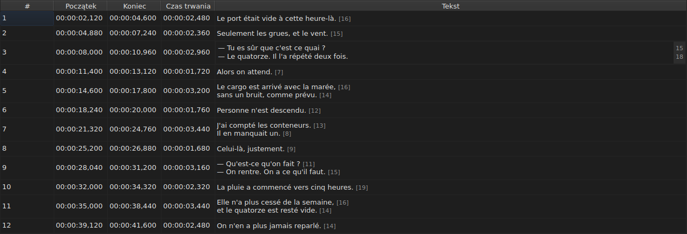
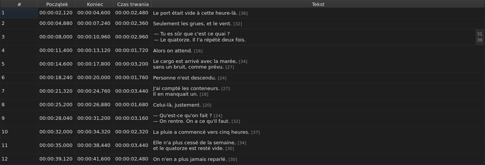

# Edycja komórki

<!-- machine-translated -->
> Ta strona jest tłumaczeniem maszynowym i nie została jeszcze sprawdzona przez osobę władającą tym językiem.

Cztery kolumny edytuje się w miejscu: `Start`, `End`, `Duration` i `Text` — pięć
z kolumną `Translation`, gdy projekt ma tłumaczenie. Kolumny `#` nie można
edytować — numer to pozycja linii w kolejności, a nie dana pliku.

**Otwarcie edytora komórki:** kliknij ją dwukrotnie albo zaznacz
i naciśnij `F2`.

## Tekst

**Tłumaczenie edytuje się tak jak tekst**, w tym samym wieloliniowym polu i według
tych samych reguł; zmienia się tylko komórka, a tekst główny pozostaje
taki, jaki był. Zatwierdzenie, które nic nie zmienia, nic nie robi — w przypadku jednego i
drugiego — zobacz [niżej](#zatwierdzenie-które-nic-nie-zmienia-nic-nie-robi).

Edytor to pole **wieloliniowe** i otwiera się na wysokości napisu:
napis dwuliniowy wpisuje się w nim tak, jak zostanie zapisany, z dwiema liniami
czytelnymi i bez paska przewijania. `Shift+Enter`, który dodaje linię, powiększa
edytor; wiersz tabeli dostosowuje się przy zatwierdzeniu.

| Klawisz | Efekt |
| :------ | :---- |
| `Enter` | zatwierdza i zamyka edytor |
| `Shift+Enter` | wstawia podział linii w tekście |
| `Esc` | zamyka edytor; komórka zachowuje to, co miała |
| `Tab` | zatwierdza i przechodzi do następnej komórki |

Kliknięcie gdzie indziej też zatwierdza: utrata fokusu jest warta tyle co `Enter`.

**Jedenaście gestów bez okna dialogowego zatwierdza tak samo** przed obliczeniem swojego celu:
`Italic`, `Case ▸ …`, `Dialogue`, `Merge Subtitles`, `Split Subtitle`,
`Cut Texts`, `Paste Texts`, `Copy Texts`, `Remove Subtitles`, `Undo` i `Redo`.
Uruchomione z menu, paska narzędzi lub skrótu okna,
biorą tekst taki, jaki edytor właśnie zatwierdził, jak po kliknięciu
gdzie indziej. `Ctrl+X`, `Ctrl+C` i `Ctrl+V` pozostają jednak przy edytorze, dopóki
jest otwarty — zobacz [Wycinanie, kopiowanie i wklejanie tekstów](clipboard.md): wtedy to
menu uruchamia `Cut Texts`, `Copy Texts` i `Paste Texts`.

`Undo` i `Redo` czytają historię, a nie dokument: zobacz
[Cofanie i ponawianie](undo.md). Gest otwierający okno dialogowe nie
potrzebuje tej reguły, ponieważ okno dialogowe przejmuje fokus przy otwarciu, co
już zatwierdza wpisane dane.

### Znaczniki są takie jak w pliku

Pokazywany i wpisywany tekst jest **taki jak w pliku, razem ze znacznikami**:
`<i>…</i>` w SubRip jest zapisane właśnie tak, a `{\i1}…{\i0}` w Advanced SSA
również. Nic nie jest tłumaczone na potrzeby wyświetlania — tabela
[`Italic`](operations.md#italic) mówi, co zapisuje każdy format.

W przypadku kursywy nie trzeba więc nic wiedzieć: `Ctrl+I` ustawia właściwy znacznik
dla otwartego dokumentu, a format, który żadnego nie obsługuje — TMPlayer, LRC —
wyłącza pozycję, zamiast kazać szukać. Pogrubienie i podkreślenie
wpisuje się ręcznie, jak w Gaupolu.

**A znaczniki nie podążają za operacjami na tekście**: zamiana napisu
na małe litery nie zmienia jego `<I>` w `<i>`, a myślnik dialogowy
jest umieszczany przed tekstem, a nie przed znacznikiem otwierającym. Zobacz
[`Case` i `Dialogue`](operations.md#case-i-dialogue).

## Długość linii

**Edytor tekstu pokazuje w marginesie po prawej długość każdej
linii**, wyrównaną z pierwszym wierszem tej linii. Margines jest tak szeroki,
jak największa liczba, aktualizuje się **w trakcie pisania** i podąża za przewijaniem.
Pusty tekst nic nie pokazuje. Długości są takie jak w tabeli — bez
znaczników, zaokrąglone w dół, w ustawionej jednostce — i wyłącza je
pole wyboru `Show line lengths in the editor` w `Edycja ▸ Preferencje…`. Zobacz
[Długości linii](preferences.md#długości-linii).

## Początek i koniec

Edytor to pole jednowierszowe, **ograniczone do kształtu kodu czasowego**:
podczas pisania odrzuca to, co nigdy nie mogłoby nim być.

Akceptowane postacie to te, które przyjmuje już odczyt pliku:

| Element | Co przechodzi |
| :------ | :------------ |
| pola | `MM:SS` lub `HH:MM:SS`, po jednej lub dwie cyfry każde |
| ułamki | od jednej do trzech cyfr, po przecinku lub kropce, albo brak |
| znak | początkowy `-`, dla pozycji przed początkiem wideo |
| granice | minuty i sekundy poniżej 60 |

`00:01:02,500`, `1:02.5` i `-0:01,000` to zatem trzy poprawne dane wejściowe.

**Dane, które odczyt odrzuca, zostawiają komórkę bez zmian.** Tak jest w przypadku
`00:70:00,000`, które ma właściwy kształt, ale minuty wykraczają poza
granice: edytor się zamyka i nic się nie zmieniło. Żadna pozycja nie jest wymyślana
— pomyłka w pozycji przechodzi bez śladu, nic na ekranie nie odróżnia
źle zsynchronizowanego napisu od dobrze zsynchronizowanego.

Zmiana początku lub końca natychmiast aktualizuje `Duration`.

## Czas trwania

**Wpisanie czasu trwania przesuwa koniec, a nigdy początek**: koniec staje się
`Start + Duration`. Przesunięcie początku przesunęłoby cały napis, co jest
zadaniem [`Shift Positions…`](operations.md), a w kolumnie `Start` można
już przecież pisać.

Czas trwania wpisuje się **w kształcie kodu czasowego**, takiego, jaki
wyświetla kolumna, i obowiązują formy z powyższej tabeli — z jedną różnicą:

| Element | Początek, koniec | Czas trwania |
| :------ | :--------------- | :----------- |
| kształt | taki jak kodu czasowego | ten sam |
| początkowy znak `-` | akceptowany | **odrzucany podczas pisania** |

`0:02.5` i `00:00:02,500` to zatem dwa poprawne zapisy czasu trwania dwóch
i pół sekundy; `-0:01,000` nie da się wpisać. Zerowy czas trwania jest akceptowany:
napis znika wtedy w chwili, w której się pojawia.

**Koniec wykraczający poza następny napis jest dozwolony.**
Nakładanie się jest zaznaczone w tabeli odcieniem, z podpowiedzią — zobacz
[Tabela](table.md#anomalie) — to ostrzeżenie, a nie odmowa: może to być to, czego
chciałeś. [Lista komunikatów diagnostycznych](files.md#komunikaty-diagnostyczne-odczytu)
również je zawiera i usuwa, gdy je poprawisz.

**Koniec wpisany poza końcem filmu nie jest zgłaszany**, inaczej niż
w przypadku operacji menu `Tools`, która by go tam przesunęła — zobacz
[Operacje](operations.md#poza-końcem-filmu). Komórka od razu pokazuje
wartość, którą właśnie wpisano.

Nieczytelne dane wejściowe zostawiają komórkę bez zmian, tak jak w przypadku pozycji, a
czas trwania identyczny z wyświetlanym nie trafia do historii.

## Zatwierdzenie, które nic nie zmienia, nic nie robi

Otwórz komórkę, nic nie wpisuj, naciśnij `Enter`: nic się nie dzieje.
Żadna modyfikacja nie jest rejestrowana, a plik nadal jest uważany za identyczny z
tym na dysku.

Porównanie dotyczy **pozycji**, a nie łańcucha znaków: wpisanie `0:01.0`
w komórce, która wyświetla `00:00:01,000`, wskazuje ten sam moment,
a więc również niczego nie zmienia.

## Co dzieje się z edytowaną komórką

**Można ją cofnąć** — jedna komórka, jeden wpis. Zobacz
[Cofanie i ponawianie](undo.md).

**Jest zapisywana**, a zamknięcie okna bez zapisu prosi o
potwierdzenie. Zobacz [Otwieranie i zapisywanie](files.md).
