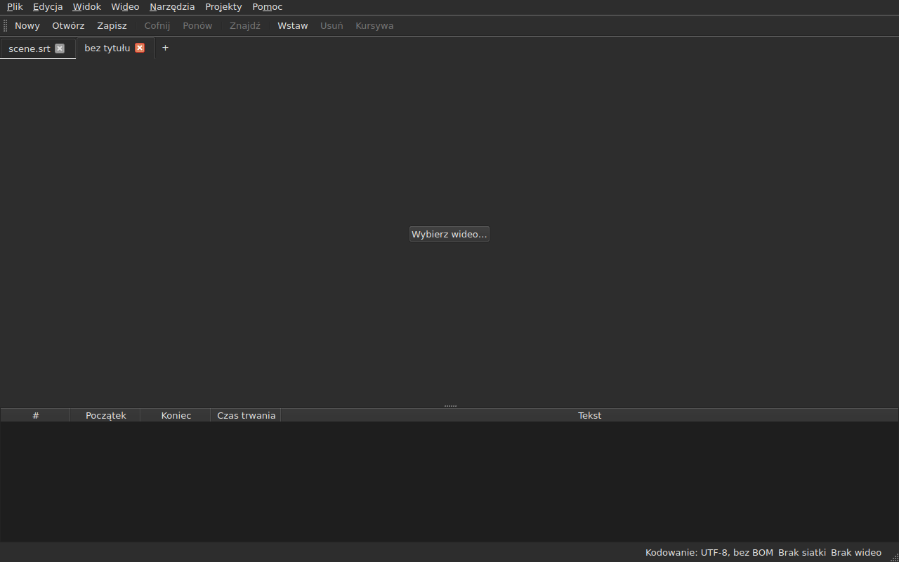
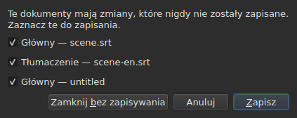
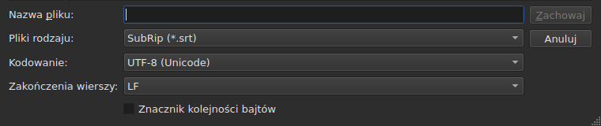
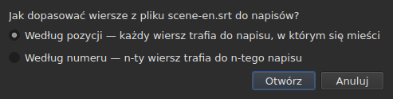
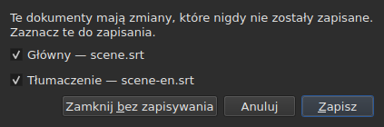

# Otwieranie i zapisywanie

<!-- machine-translated -->
> Ta strona jest tłumaczeniem maszynowym i nie została jeszcze sprawdzona przez osobę władającą tym językiem.

Menu **Plik** zawiera trzy polecenia, dwa dla kart i trzy
kolejne dla tłumaczenia; menu **Projekty** działa na wszystkie karty naraz.

| Polecenie | Skrót | Co robi |
| :------ | :------- | :----------- |
| Nowy projekt | `Ctrl+N` | pusty projekt na nowej karcie — także przycisk `+` za ostatnią kartą |
| Otwórz… | `Ctrl+O` | wybiera plik i otwiera go na nowej karcie — albo w miejscu pustego projektu |
| Otwórz tłumaczenie… | — | wybiera plik tłumaczenia i dopasowuje go do pliku głównego bieżącej karty |
| Zapisz | `Ctrl+S` | przepisuje otwarty plik |
| Zapisz jako… | `Ctrl+Shift+S` | wybiera ścieżkę i format, a potem zapisuje |
| Zapisz tłumaczenie | — | przepisuje plik tłumaczenia |
| Zapisz tłumaczenie jako… | — | wybiera ścieżkę i format dla tłumaczenia, a potem zapisuje |
| Zamknij | `Ctrl+W` | zamyka bieżącą kartę — wyłączone, jeśli jest tylko jedna |

`New Project`, `Open…` i `Save` są także na
[pasku narzędzi](index.md#pasek-narzędzi), pod słowami `New`, `Open` i
`Save`. **Trzech pozycji dotyczących
tłumaczenia nie ma na pasku**: służą tylko tym, którzy mają
tłumaczenie, a pasek jest dla wszystkich.

## Kilka projektów, na kartach

**Każdy otwarty projekt ma swoją kartę**, nad obrazem i tabelą:
jej etykietą jest nazwa pliku albo `untitled` dla projektu, który jeszcze
go nie ma. Kliknięcie karty przełącza na nią; `Ctrl+PageDown` i `Ctrl+PageUp`
robią to samo, bez myszy, i po ostatniej karcie wracają do pierwszej.
**Przycisk `+`, tuż za ostatnią kartą**, otwiera pusty projekt na
nowej karcie, tak jak `New Project`.




**`Open…` nigdy ich nie rusza.** Otwarcie pliku nie zastępuje już tego, co
okno pokazywało: trafia na nową kartę, obok, a karta, na którą
patrzyłeś wcześniej, zachowuje wszystko, co miała — swoją historię, zaznaczenie, powiązane
wideo. Dlatego też otwieranie o nic już nie pyta: nie ma
nic do stracenia, skoro nie ma czego zastępować.

**Jeden wyjątek: pusty projekt ustępuje miejsca.** Okno uruchomione bez pliku albo
po `New Project` pokazuje projekt `untitled`, w którym nic nie ma.
Otwarty plik — przez `Open…` tak samo jak przez upuszczenie — **zajmuje wtedy jego kartę,
w tym samym miejscu paska**, zamiast otwierać drugą obok
bezużytecznego projektu. Projekt jest pusty, gdy nie ma **pliku, napisu,
niczego do cofnięcia ani ponowienia, filmu i nigdy nie był modyfikowany**: wystarczy
jedna z tych rzeczy, by zachował swoją kartę. Pusty projekt, który nie jest
bieżącą kartą, nie jest ruszany.

**Plik już otwarty nie jest otwierany po raz drugi.** `Open…` na
pliku, który trzyma już inna karta, oddaje fokus tej karcie i mówi o tym
na pasku stanu:

```text
premier.srt: already open
```

**Każda karta jest całym projektem, niezależnym od pozostałych**: jej
historia, zaznaczenie, powiązane wideo i to, co napotkał jej ostatni odczyt,
są pokazywane tylko wtedy, gdy ta karta jest bieżąca, i nie
zmieniają się, gdy jest nią inna. **Jeden wyjątek, opisany w ADR
0033**: odtwarzacz wideo jest jeden dla całego okna — jeden proces
mpv — a jego film zmienia się wraz z kartą; **każda karta pamięta, gdzie był jej film**,
i wznawia go tam, wstrzymanego, gdy do niej wrócisz. Schowek natomiast należy do okna: kopiowanie
na jednej karcie i wklejanie na innej to powód, dla którego otwiera się dwie.

**`Close` zamyka bieżącą kartę**, zadając w razie potrzeby
[pytanie o niezapisane zmiany](#niezapisane-zmiany) —
tylko o tę kartę, bo pozostałych to nie dotyczy. **Wyłączone, gdy jest
tylko jedna karta**: okno zawsze zachowuje co najmniej jedną, a jej zamknięcie
byłoby zamknięciem okna — co robi już przycisk systemu.

**Każda karta ma też krzyżyk**, który zamyka **jej** projekt, z tym samym
pytaniem. Krzyżyk karty, która nie jest bieżąca, zamyka tamtą, a karta, na którą
patrzysz, pozostaje wyświetlona; jeśli w tamtym projekcie są zmiany, jego
karta wysuwa się na wierzch na czas pytania. **Brak krzyżyka, gdy została
tylko jedna karta**, z tego samego powodu, dla którego `Close` jest wyłączone.

**Karta mówi, że jest zmodyfikowana**: gwiazdka następuje po jej nazwie, `premier.srt*`,
dopóki jeden z jej dokumentów różni się od swojego pliku — tak jak tytuł okna
mówi o projekcie, na który patrzysz. Znika po zapisaniu.

## Menu Projekty

Dwa polecenia działają na wszystkie projekty naraz.

| Polecenie | Skrót | Co robi |
| :------ | :------- | :----------- |
| Zapisz wszystko | `Ctrl+Shift+L` | zapisuje każdy zmodyfikowany dokument, karta po karcie |
| Zamknij wszystko | `Ctrl+Shift+W` | zamyka wszystkie projekty — czyli okno |

**`Save All` idzie w kolejności kart**, dokument główny przed tłumaczeniem.
Dokument, który ma plik, jest tam przepisywany **bez wysuwania jego karty na wierzch**;
**dokument, który go nie ma, otwiera `Save As…`, po jednym naraz**, na swojej karcie —
to jedyny przypadek, w którym `Save All` zmienia kartę, aby okno pokazywało, którego
projektu dotyczy. **Anulowanie `Save As…` albo
zapis, który się nie powiódł, zatrzymuje resztę**: kolejne projekty nie są
ruszane, a okno mówi, co zapisano.

```text
Save All stopped: 1 of 3 documents saved
```

Gdy wszystko jest zapisane, mówi o tym pasek stanu — `2 documents saved` albo
`Nothing to save`, gdy nic nie było zmodyfikowane. Jeśli `Save As…` wysunęło
kartę na wierzch, okno wraca potem do tej, na której polecenie zostało
uruchomione.

**`Close All` i krzyżyk okna to jedno i to samo**: okno
zawsze zachowuje projekt, a zamknięcie ich wszystkich to zamknięcie okna. Zadają więc
**jedno pytanie dla wszystkich projektów**, takie samo jak przy
[dwóch zmodyfikowanych dokumentach](#zamykanie-z-dwoma-zmodyfikowanymi-dokumentami), z jednym polem wyboru
na każdy zmodyfikowany dokument każdej karty:




**`Cancel` niczego nie zamyka** i niczego nie zapisuje. `Save` zapisuje
zaznaczone dokumenty tak jak `Save All`: za ich kartą, z wyjątkiem dokumentu bez
nazwy, którego karta wysuwa się na wierzch dla jego `Save As…`. Gdy zmodyfikowany jest tylko jeden
dokument we wszystkich projektach, jest to proste pytanie, które zawsze
było, zadane na jego karcie. `Save All As…` nie istnieje: to ciąg
`Save As…`, o które `Save All` już pyta, po jednym naraz, dla dokumentów bez nazwy.

## Otwieranie

Okno dialogowe filtruje **dziewięć odczytywanych formatów**, po jednej pozycji na format, i pierwsza
pozycja pokazuje je wszystkie. Format jest następnie rozpoznawany **po zawartości, a nie po
rozszerzeniu**: plik `.txt`, który zawiera SubRip, zostaje otwarty, a filtr nie
decyduje o niczym — tylko ukrywa pliki.

| Pozycja filtru | Rozszerzenie |
| :----------- | :-------- |
| `SubRip` | `.srt` |
| `WebVTT` | `.vtt` |
| `SubViewer 2` | `.sub` |
| `Sub Station Alpha` | `.ssa` |
| `Advanced SSA` | `.ass` |
| `MicroDVD` | `.sub` |
| `MPL2` | `.txt` |
| `TMPlayer` | `.txt` |
| `LRC` | `.lrc` |

**Dwa rozszerzenia wyznaczają po dwa formaty** — `.sub` to SubViewer 2 i
MicroDVD, `.txt` to MPL2 i TMPlayer. Nie ma to znaczenia przy otwieraniu,
ponieważ decyduje zawartość; przy zapisie format wyznacza **nazwa** wybranej
pozycji, nigdy jej wzorzec.

**Nieczytelny plik niczego nie otwiera.** Brakujący, odrzucony przez system, zapisany
w kodowaniu, w którym jego bajtów nie da się zdekodować, albo w żadnym znanym
formacie: okno modalne **wskazuje przyczynę**, żadna karta nie jest otwierana, a te, które
były, nie ruszają się.

| Komunikat | Co się stało |
| :------ | :------------ |
| `does not exist` | ścieżka nie wskazuje żadnego pliku |
| `cannot be opened: permission denied` | system odmawia otwarcia |
| `cannot be read` | system odmówił z innego powodu |
| `cannot be decoded in the chosen encoding` | bajtów nie da się odczytać w wybranym kodowaniu |
| `is in no format this tool knows` | żaden format nie rozpoznaje zawartości |
| `holds nothing recognisable as a subtitle` | format jest rozpoznany, ale nic w nim nie jest napisem |

Komunikat jest poprzedzony ścieżką: `notes.txt: is in no format this tool knows`.
To słowa wiersza poleceń i nie jest to przypadek — obie
powierzchnie odczytują plik tym samym sposobem.

### Upuszczanie plików na okno

**Upuszczenie plików w dowolnym miejscu okna otwiera je**, z
menedżera plików: na tabeli, pasku kart, przycisku
`Select Video…` i **na samym obrazie filmu**, odtwarzanym i zatrzymanym.
Obraz jest osobnym oknem rysowanym przez odtwarzacz, o którym nic nie gwarantowało,
że przekaże upuszczenie dalej; sprawdzono to ręcznie na prawdziwym pulpicie,
w sesji Wayland. `subedit-gui` jest tam uruchamiany pod X11, aby móc pokazać
film, więc upuszczenie przechodzi protokołem X11 — tym z sesji
X11, w której nie próbowano go osobno.

- **Każdy plik napisów otwiera swoją kartę**, w kolejności, w jakiej został
  upuszczony — dokładnie jak `Open…`. Plik **już otwarty** nie jest
  odczytywany ponownie: jego karta wysuwa się na wierzch, a pasek stanu o tym mówi
  (`premier.srt: already open`).
- **Upuszczone wideo jest wiązane z bieżącą kartą**, tak jak przez
  `Select Video…`. Upuszczone razem z napisami, trafia do ostatniej karty, którą
  otworzyły, bez względu na kolejność upuszczenia. Wideo jest rozpoznawane po
  rozszerzeniu — z tej samej listy, która proponuje film obok
  pliku.
- **Dwa wideo lub więcej naraz nie są otwierane**: projekt pilnuje
  jednego filmu. Napisy z tego samego upuszczenia natomiast zostają otwarte.
- **Plik, który się nie otwiera, nie zatrzymuje pozostałych.** Jedno okno mówi wtedy,
  czego nie udało się zrobić, po jednym wierszu na plik, słowami
  `Open…`:

  ```text
  /films/notes.txt: is in no format this tool knows
  /films/absent.srt: does not exist
  ```

Przyjmowane są tylko pliki lokalne: odnośnik przeciągnięty z przeglądarki
nie wskazuje niczego, co okno mogłoby odczytać.

Otwieranie z wiersza poleceń nadal działa: `subedit-gui film.srt`.
Ten sam powód jest tam zapisywany na wyjściu błędów, a okno otwiera się
puste — zob. [Uruchamianie](invocation.md#gdy-otwarcie-się-nie-powiedzie).

## Komunikaty diagnostyczne odczytu

Prawdziwy plik rzadko jest doskonały, a odczyt naprawia zamiast
się poddawać: brakujący numer, linia, która donikąd nie prowadzi, wymieszane końce
linii. **To, co napotkał, mieści się w przycisku na pasku stanu**
— `2 diagnostics`, na lewo od tego, co pasek już mówi o dokumencie —, a **lista otwiera się kliknięciem
w pływającym oknie** nad przyciskiem. Żadna linia okna nie jest na nią poświęcona:
tabela zachowuje pełną wysokość, niezależnie od tego, czy odczyt miał coś do powiedzenia. Lista
zamyka się kliknięciem gdzie indziej albo klawiszem `Esc`.

```
a SubRip block without its number, settled by the reader: 5
```

**Każdy wiersz liczy**: co napotkano, co z tym zrobiono i
ile razy. Źle zrobiony plik napotyka setki, a wiedza,
ile jest każdego rodzaju, pozwala działać; numer linii każdego wystąpienia w
pliku odczytuje się natomiast w wierszu poleceń, na poziomie szczegółowości `-vvv`. Przycisk
liczy te wiersze — po jednym na rodzaj —, a nie wystąpienia.

**Odgadnięte kodowanie też się tam pojawia**, raz: zaproponowano je przez ważenie
bajtów, zanim powstała choćby jedna linia pliku.

```
an encoding nothing declared, settled by the reader: 1
```

Wyświetla się tylko wtedy, gdy kodowanie zostało **odgadnięte i nie jest
UTF-8** — plik UTF-8 odczytany jako taki nie jest zdarzeniem, a mówienie o tym przy
każdym otwarciu umieszczałoby przycisk na pasku stanu każdego zwykłego
dokumentu. Plik, który zawiera znacznik kolejności bajtów, też go nie
uruchamia: zadeklarował swoje kodowanie, nic nie było odgadywane.

**Ta sama lista liczy też to, co jest nie tak w samych napisach**: napis,
który zaczyna się przed zakończeniem poprzedniego, koniec przed
początkiem, początek przed początkiem napisu wyżej. Tabela oznacza je odcieniem, ale
odcień znajduje się przez przewijanie, a w pliku dwóch tysięcy linii
łatwo jeden przeoczyć; tutaj wszystkie rodzaje są razem, **po jednym w
wierszu i z ich liczbą**, słowami raportu `inspect`:

```
subtitle starts before the previous one ends: 12
subtitle starts before the previous one starts: 3
```

**Kliknięcie jednego prowadzi do pierwszego napisu, którego dotyczy**, zaznaczonego w
tabeli. Te wiersze **podążają za poprawkami** — sortowanie albo poprawienie czasu trwania
usuwa niektóre lub obniża ich liczbę —, nie zamykając czytanej
listy. Napis może być policzony dwa razy: rozpoczęcie przed końcem
poprzedniego i przed jego początkiem to dwa ustalenia, poprawiane na dwa
sposoby. Aby nazwać je jedno po drugim, `subedit-cli inspect --detail`.

Przycisk **nie pojawia się**, gdy nie ma nic do zgłoszenia, ani w odczycie, ani
w napisach, i **podąża za kartą**: każdy projekt zachowuje
komunikaty diagnostyczne własnego odczytu, a przycisk pokazuje te projektu wyświetlanego.

## Kodowanie na pasku stanu

**Pasek stanu zawsze podaje kodowanie otwartego dokumentu**, na lewo od tego, co
mówi o [siatce klatek](frame-grid.md) i
[powiązanym wideo](video.md):

| Sytuacja | Co jest zapisane |
| :-------- | :-------------- |
| plik odczytano jako UTF-8, bez znacznika | `Encoding: UTF-8, no BOM` |
| … ze znacznikiem | `Encoding: UTF-8, BOM` |
| plik w Latin-1 | `Encoding: ISO-8859-1, no BOM` |

**Komunikat diagnostyczny i ten wiersz nie odpowiadają na to samo pytanie**, i dlatego
istnieją oba. Komunikat mówi, co odczyt **zrobił** — odgadł,
a ty możesz chcieć to sprawdzić; jest więc wyświetlany tylko wtedy, gdy
było odgadywanie. Pasek stanu mówi, czym dokument **jest**,
stale, także dla pliku, który sam deklaruje swoje kodowanie i o którym
odczyt nie ma nic do powiedzenia.

**Skąd pochodzi odpowiedź, tam nie widać.** `inspect` to podaje — `detected`,
`from its byte order mark`, `as asked for` — bo raport ma miejsce, by to
powiedzieć; wiersz paska stanu go nie ma, a lista komunikatów diagnostycznych już to zawiera, gdy
ma to znaczenie.

## Zapisywanie

`Save` przepisuje otwarty plik **w jego pierwotnej postaci**: formacie,
kodowaniu, końcach linii, znaczniku kolejności bajtów i nagłówku. Plik
otwarty, a potem zapisany bez modyfikacji, nie zmienia się o ani jeden bajt — zob.
dokładną gwarancję poniżej.

Zapis jest **atomowy**: przechodzi przez plik tymczasowy, którym
nadpisuje się plik docelowy. Zapis przerwany w dowolnym momencie zostawia poprzednią wersję
nietkniętą.

Zapisanie dokumentu, którego nigdy nie było na dysku, sprowadza się do `Save As…`.

**Zapis, który się nie udaje, mówi o tym i niczego nie traci**: pełny dysk, plik tylko
do odczytu, brakujący katalog — albo **znak, którego kodowanie pliku
nie potrafi zapisać**, `ł` w pliku Latin-1. Komunikat brzmi wtedy
`holds a character the chosen encoding cannot write`, a nic nie jest
zapisywane: zastąpienie znaku przez `?` traciłoby tekst na oczach tego, kto
go właśnie wpisał. Komunikat wskazuje plik i powód, okno zachowuje
swoje modyfikacje, a znacznik w tytule pozostaje.

## Zapisywanie jako

`Save As…` pyta o ścieżkę, format **i kształt zapisywanych bajtów**:
kodowanie, końce linii, znacznik kolejności bajtów. Dokument **żyje potem
tam**: tytuł się zmienia, `Save` celuje w nowy plik i zapisuje w
wybranym kształcie, a oryginalny plik pozostaje, jaki był.

**Oferowanych jest dziewięć formatów**, a pozycja zaznaczona, gdy okno
się otwiera, to **format dokumentu**. Zapisanie pod inną nazwą bez dotykania
filtru nie zmienia więc formatu.




**Obrazy pokazują tylko dół okna**, a nie listę plików
powyżej: zależy ona od komputera — jego katalogów, dat, skrótów
bocznych —, więc jej fotografia nigdy nie byłaby dwa razy taka sama.
Ten pas taki jest i to w nim dzieje się wszystko.

| Pole | Co oferuje | Domyślnie |
| :---- | :------------- | :------ |
| `Encoding` | czternaście kodowań, które plik napisów przenosi w praktyce, plus `Other…` | **kodowanie odczytanego pliku** |
| `Other…` | pole do wpisania dowolnego kodowania, które ICU potrafi zapisać, **z uzupełnianiem** — `cp1257`, `EUC-KR` | — |
| `Line endings` | `LF`, `CRLF` lub `CR` | końce odczytanego pliku |
| `Byte order mark` | znacznik, **wyłączony dla kodowania, które go nie ma** | znacznik odczytanego pliku |

**Wartości domyślne pochodzą z odczytanego pliku i jest to gwarancja, a nie
wygoda**: plik otwarty, a potem zapisany ponownie bez dotykania tych trzech
pól, daje te same bajty.

**Lista jest krótka i nie jest sufitem.** ICU zna dwieście
dwadzieścia jeden; menu oferuje to, co plik napisów przenosi
w praktyce, bo menu z dwustoma pozycjami nikomu nie pomaga. `Other…`
otwiera resztę.

**Pole uzupełnia spośród dwustu dwudziestu jeden**, więc nie trzeba
znać dokładnej nazwy: wpisanie `1252` proponuje `windows-1252`, wpisanie `koi`
proponuje `KOI8-R` i `KOI8-U`. Uzupełnianie działa według tego, co nazwa **zawiera**,
a nie od czego się zaczyna — kanoniczna nazwa Windows Western to
`windows-1252`, a `cp1252` to ta, o której ludzie myślą. Obie można
też wpisać w całości bez uzupełniania: ICU przyjmuje własne aliasy.

**Nazwa, której nikt nie zna, niczego nie zapisuje.** Wpisanie `klingon-1` nie
cofa się do UTF-8: nic nie jest zapisywane, a komunikat o tym mówi.

**Nazwa, która nie podaje porządku bajtów, też nie.** `UTF-16` i `UTF-32` to
nazwy, które ICU zna, a których konwerter zapisuje **własny znacznik**:
pole wyboru `Byte order mark` przestałoby wtedy o czymkolwiek decydować. Obie
są odrzucane, a komunikat wskazuje `UTF-16LE` lub `UTF-16BE`, które zapisują
te same bajty pod kontrolą pola wyboru. To to samo odrzucenie, tymi
samymi słowami, co w wierszu poleceń.

**Znak, którego wybrane kodowanie nie potrafi zapisać, zatrzymuje zapis**
— `ł` w Latin-1. Komunikat brzmi
`holds a character the chosen encoding cannot write`, okno zachowuje swoje
modyfikacje, a plik docelowy nie jest ruszany.

**Dokument też się nie przenosi**: pozostaje przy swoim pliku, w swoim
formacie i kodowaniu, a następny `Save` przepisuje ten, który otwarto.
Zapis, który nie nastąpił, nie zmienia niczego — ani na dysku,
ani w oknie.

Zmiana formatu zmienia to, co pokazuje tabela — separator dziesiętny podąża za
formatem, przecinek dla SubRip, kropka dla WebVTT, a **znaczniki są przepisywane
w słownictwie formatu docelowego**: `<i>` staje się `{\i1}` w Sub
Station Alpha, `{Y:i}` w MicroDVD, `/` na początku linii w MPL2. Dokument
**stał się** tym plikiem, więc tabela pokazuje to, co plik zawiera.

**To nie jest polecenie i `Ctrl+Z` go nie cofa.** Dokument, którego
format mówiłby LRC, a teksty wciąż `<i>`, byłby
niespójnym dokumentem; nie ma połowy do cofnięcia.

## Czego format nie przenosi, powiedziane przed zapisem

**Okno modalne ostrzega, a ty nadal możesz odpowiedzieć „nie”.** Wymienia to, czego
format docelowy nie zachowa, pozycja po pozycji, słowami, którymi wiersz
poleceń mówi o tym potem:

```
ends are not carried by LRC, line breaks were joined in 2 subtitles, 1 tag dropped
```

| Przycisk | Skutek |
| :----- | :----- |
| `Save` | zapisuje mimo to, strata zaakceptowana |
| `Cancel` | niczego nie zapisuje; dokument się nie przenosi, ani plik, ani format |

`Cancel` jest przyciskiem domyślnym: klawisz Enter naciśnięty bez czytania zachowuje
plik takim, jaki jest.

**Nic nie jest pytane, gdy nic nie jest tracone.** Okno, które ogłaszałoby „nic
nie zostanie utracone”, uczyłoby odrzucania tego, które się liczy.

Co może być ogłoszone:

| Pozycja | Kiedy |
| :--- | :--- |
| końce | format docelowy żadnych nie przenosi — TMPlayer, LRC |
| łamania linii | format docelowy żadnych nie przenosi — LRC |
| znaczniki | znacznik źródła nie ma odpowiednika w docelowym albo pivot go nie zna |
| nagłówek | odczytany plik go zawierał, a on nie przechodzi |
| zadeklarowane pola | kolejność kolumn SSA, kształt czasu TMPlayer |
| dokładność | format docelowy liczy zgrubniej — dziesiąta część MPL2, sekunda TMPlayer |

**To, co należy do drugiego formatu, jest pomijane.** Plik WebVTT
zawiera identyfikatory cue i ustawienia położenia; SubRip zawiera współrzędne
wyświetlania. Zapis w drugim formacie ignoruje je zamiast
tłumaczyć na chybił trafił — nie są przez to utracone, po prostu
nie są zapisywane.

## Gwarancja obiegu w obie strony

Ma dwie połowy i obie są potrzebne:

- **wierna bajt po bajcie** dla pliku już w układzie, który
  zapisuje `subedit` — układzie Gaupola, wraz z końcową pustą linią —, i **bez względu na
  jego kodowanie**: plik w CP1252 lub UTF-16 jest przepisywany w
  swoim własnym, ze znacznikiem włącznie;
- **idempotentna** w pozostałych przypadkach: pierwszy zapis normalizuje układ,
  żaden następny niczego już nie rusza.

Konkretnie, plik, którego ostatni blok nie jest zakończony pustą linią,
zyskuje ją, raz. To jedyna zmiana, jaką może wytworzyć zapis bez
modyfikacji.

## Otwieranie tłumaczenia

`Plik ▸ Otwórz tłumaczenie…` ustawia **drugi plik** obok głównego.
Pozycja jest wyłączona, dopóki nie ma żadnego napisu, któremu można by przekazać linie
tłumaczenia.

**Dwa pytania, jedno po drugim.** Wybór pliku, ten z
`Open…` — ten sam filtr, ten sam katalog początkowy, kodowanie rozpoznawane tak jak dla
pliku głównego — a potem **metoda dopasowania**:




| Metoda | Co robi |
| :----- | :----------- |
| `By position` (domyślna) | każda linia trafia do napisu, w którym wypada jej środek |
| `By number` | n-ta linia trafia do n-tego napisu, bez patrzenia na pozycje |

**Domyślna jest pozycja**, ponieważ jedna brakująca linia w środku sprawia, że
*wszystkie* następne przesuwają się według numeru, a według pozycji tylko jeden
napis zostaje bez tłumaczenia.

**Co jest robione, co jest zapisywane:**

- teksty przypisanych linii trafiają do kolumny `Translation`, która
  się pojawia;
- **linia, która nie znajduje napisu, daje początek nowemu**, z **pozycjami
  tej linii** — obiema metodami;
- **nic nie jest sortowane**, ani plik, ani dokument: linie są przechodzone
  w kolejności czasowej, a liczba tych, które w niej nie były, jest podawana;
- **tłumaczenie już otwarte jest zastępowane**, a wszystkie jego teksty najpierw wymazywane.

**To, co się stało, jest powiedziane.** Gdy każda linia znalazła swój napis, a
żaden nie został sam, pasek stanu o tym pisze; w przeciwnym razie **okno do zamknięcia**,
jak przy każdym geście, który ma coś do powiedzenia:

```text
translation: 3 lines attached
translation: 2 lines attached; 1 subtitle left without a translation
translation: 3 lines attached; 1 subtitle born of a line; 2 lines out of order
```

Pozycje są zapisywane tylko wtedy, gdy nie są zerem: linie przypisane,
napisy powstałe z linii, te, do których żadna linia nie dotarła, linie
poza kolejnością. Plik bez żadnej linii mówi o tym
(`translation: the file holds no line`), zamiast obwiniać o to
napisy.

**Przesunięte tłumaczenie jest rozpoznawane i otwierane ponownie z przesunięciem.** Tłumaczenie z czasem opóźnionym o dwie
sekundy dopasowuje się do niewłaściwych napisów, a nic nie odróżnia tego od
poprawnego dopasowania. Gdy otwarcie **według pozycji** nie jest czyste, okno szuka
**stałego przesunięcia**: różnice między początkiem każdej linii a początkiem napisów
wokół niej dają kandydatów, zgrupowanych co dziesięć milisekund, a **każdy
jest oceniany przez samo dopasowanie z otwarcia**. Jeśli jedno przesunięcie sprawia, że otwarcie
jest czyste, okno mówi o tym po swoim podsumowaniu i **proponuje ponowne otwarcie z przesunięciem**:

```text
translation: 4 subtitles born of a line; 4 subtitles left without a translation
the lines sit 2.000 s later than the subtitles; moved back, 4 lines would attach instead of 0
```

`Yes` cofa otwarcie i wykonuje je ponownie z liniami cofniętymi o to przesunięcie; `No`, odpowiedź
domyślna, zostawia otwarcie, jakie jest. **Wynik to jeden wpis w historii**:
jego cofnięcie przywraca wszystko, jak przy każdym otwarciu.

**Nic nie jest proponowane, gdy przesunięcie nie jest stałe** — dryf, przesunięcie, które
dotyczy tylko części pliku —, gdy dwa przesunięcia sprawiłyby, że otwarcie byłoby równie
czyste, albo gdy żadne go nie oczyszcza: zdanie nie mówi wtedy, że jakieś istnieje. Ani
według numeru, gdzie pozycje nie są brane pod uwagę. Nie ma na to **żadnego polecenia
wiersza poleceń**.

**Otwarcie tłumaczenia to jeden wpis w historii**, `Undo: opening a translation`,
a jego cofnięcie przywraca wszystko: teksty, powstałe napisy usunięte,
plik tłumaczenia odłączony — kolumna znika razem z nim. Aby otworzyć je drugą
metodą, najpierw cofasz.

**Właśnie otwarte tłumaczenie nie jest zmodyfikowane**: nic nie wpisano,
a jego zamknięcie nie proponuje zapisu. Jeśli powstały napisy, zmodyfikowany jest
dokument główny.

**Zmodyfikowane tłumaczenie jest proponowane do zapisu, zanim zostanie
zastąpione**, z trzema wynikami opisanymi w sekcji o
[niezapisanych zmianach](#niezapisane-zmiany).

| Komunikat | Co się stało |
| :------ | :------------ |
| `the file is already open as the main document` | wybrany plik jest samym dokumentem głównym, jakkolwiek zapisano jego ścieżkę |
| `does not exist`, `cannot be decoded in the chosen encoding`, … | te same przyczyny co dla `Open…` |

Komunikat jest poprzedzony ścieżką, a **nic się nie zmienia**: okno zachowuje swoją
historię i modyfikacje.

**Problemy napotkane przez odczyt**, jeśli były — naprawiona linia,
zignorowane pole —, trafiają na listę komunikatów diagnostycznych, tę z
[ostatniego odczytu](#komunikaty-diagnostyczne-odczytu).

**Czego tłumaczenie nie zachowuje**: ustawień **dla poszczególnych napisów** ze swojego
pliku — stylu SSA, położenia napisu WebVTT. Napis
niesie tylko jeden zestaw, ten z dokumentu głównego; nie są ani odczytywane ponownie, ani przepisywane.

## Zapisywanie tłumaczenia

**Każdy dokument jest zapisywany osobno**, w swoim pliku, swoim formacie, swoim
kodowaniu i swoich końcach linii: tłumaczenie w `.ass` pod plikiem głównym w
`.srt`, w Windows-1252 pod plikiem głównym w UTF-8, wraca takie, jakie jest.

| Pozycja | Co robi |
| :---- | :----------- |
| `Save Translation` | przepisuje plik tłumaczenia — ten, z którego pochodzi |
| `Save Translation As…` | okno wyboru z `Save As…`, otwarte na pliku **tłumaczenia**, z jego formatem i kodowaniem |

Obie są **wyłączone, dopóki projekt nie ma tłumaczenia**.
`Save Translation As…` to `Save As…` na drugim dokumencie: te same pola, to samo
[ostrzeżenie o stracie](#czego-format-nie-przenosi-powiedziane-przed-zapisem), które
liczy **to, co zapisany plik by utracił** — znaczniki tekstu głównego
nie są znacznikami tłumaczenia, a format, który nie zapisuje kursywy,
narzeka na nią tylko wtedy, gdy tłumaczenie ją zawiera.

**Każdy dokument ma własny stan zmodyfikowania.** Zapisanie dokumentu głównego zostawia
tłumaczenie zmodyfikowane, i odwrotnie; **tytuł okna jest zmodyfikowany, jeśli któryś z
dwóch jest**, i ma tylko jedną gwiazdkę.

**Nic z jednego nie dotyka drugiego**: zapisanie tłumaczenia nie zapisuje
dokumentu głównego i nie zmienia ani jego pliku, ani formatu, ani tekstów.

## Zamykanie z dwoma zmodyfikowanymi dokumentami

Zamknięcie bieżącej karty albo okna, gdy **dwa dokumenty** lub więcej
różnią się od swoich plików, zadaje **jedno pytanie**, z jednym polem wyboru na
dokument:




| Przycisk | Co się dzieje |
| :----- | :----------- |
| `Save` | zapisuje dokumenty z zaznaczonym polem wyboru, a potem idzie dalej — wyłączony, gdy żadne nie jest zaznaczone |
| `Close Without Saving` | traci oba, bez względu na pola wyboru |
| `Cancel` | nic się nie dzieje; okno pozostaje takie, jakie było |

**Odznaczenie dokumentu oznacza jego utratę**: `Save` zapisuje pozostałe i idzie
dalej. **Jeśli zapis się nie powiedzie, akcja nie jest kontynuowana.** Zamknięcie
okna bez odpowiedzi jest równoważne `Cancel`.

**Przy jednym zmodyfikowanym dokumencie pytanie jest tym, które zawsze było**,
opisanym poniżej, a zdanie mówi, którego dotyczy: `The translation has changes that were never written.`
albo `The document has …`.

**Plik, który zniknął z dysku, liczy się jako zmodyfikowany**, a lista tak mówi —
`(file is gone from the disk)`: to, co trzyma okno, jest wtedy **jedyną
kopią**, a zamknięcie bez zapisu by ją zniszczyło. Przy jednym dokumencie w takim stanie
zdanie brzmi `The document is no longer where it was read from.`

## Niezapisane zmiany

Zamknięcie okna, bieżącej karty albo otwarcie tłumaczenia, które zastąpiłoby
to już obecne, gdy dokument różni się od tego na dysku, **prosi o
potwierdzenie**, z trzema wynikami:

| Odpowiedź | Co się dzieje |
| :----- | :----------- |
| `Save` | dokument jest zapisywany, a potem akcja idzie dalej |
| `Discard` | modyfikacje są tracone, a akcja idzie dalej |
| `Cancel` | nic się nie dzieje; okno pozostaje takie, jakie było |

Zamknięcie okna bez odpowiedzi jest równoważne `Cancel`.

**Jeśli zapis się nie powiedzie**, akcja nie jest kontynuowana: praca nie jest
ani zapisana, ani utracona.
