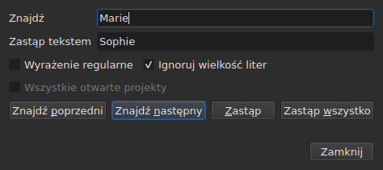
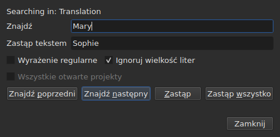

# Znajdowanie i zastępowanie

<!-- machine-translated -->
> Ta strona jest tłumaczeniem maszynowym i nie została jeszcze sprawdzona przez osobę władającą tym językiem.

`Edycja ▸ Znajdź i zamień…` lub `Ctrl+F` otwiera okno dialogowe wyszukiwania.




**Okno dialogowe nie jest modalne**: pozostaje otwarte, gdy patrzysz na tabelę,
edytujesz komórkę, szukasz ponownie. `Close` je zamyka; ponowne otwarcie
oddaje je w stanie, w jakim je zostawiłeś, razem ze wzorcem i zamiennikiem.

| Pole | Co zawiera |
| :--- | :--------- |
| `Find` | szukany wzorzec |
| `Replace with` | to, czym go zastąpić |
| `Regular expression` | wzorzec jest wyrażeniem regularnym, a nie zwykłym tekstem |
| `Ignore case` | „marie” znajduje „Marie” |
| `All open projects` | wyszukiwanie obejmuje wszystkie karty — [zobacz niżej](#we-wszystkich-otwartych-projektach) |

Pozycja jest wyłączona w pustym dokumencie: nie ma czego szukać.

## Cztery gesty

| Przycisk | Co robi |
| :------- | :------ |
| `Find Previous` | znajduje poprzednie dopasowanie, a tabela przechodzi do niego |
| `Find Next` | znajduje następne — to przycisk, który naciska `Enter` |
| `Replace` | zastępuje znalezione dopasowanie, a potem znajduje następne |
| `Replace All` | zastępuje wszystkie dopasowania w celu |

Wszystkie cztery są wyłączone, dopóki `Find` jest puste.

**Tabela przechodzi do dopasowania**, zaznaczając jego wiersz. Po dojściu do
ostatniego `Find Next` zaczyna od pierwszego; `Find Previous` robi to samo w
przeciwnym kierunku.

**`Replace` bez znalezionego dopasowania najpierw wyszukuje**: pierwsze naciśnięcie
pokazuje, co zostanie zastąpione, następne to zastępuje. Tak robi
Gaupol.

## Co obejmuje wyszukiwanie

**Zaznaczenie albo cały dokument, jeśli nic nie jest zaznaczone** — reguła menu
`Tools`. Zobacz [Operacje](operations.md#na-czym-działają).

**Cel jest przyjmowany przy pierwszym geście i zachowywany**, dopóki wyszukiwanie
trwa: `Find Next` zaznacza wiersz dopasowania, a to
zaznaczenie nie zawęża celu. **Samodzielne zaznaczenie innych wierszy
zmienia cel** dla następnego gestu.

Wyszukiwanie obejmuje tekst napisów; nie przeszukuje się ani pozycji, ani
numeru.

### We wszystkich otwartych projektach

Pole wyboru **`All open projects`** poszerza zakres na każdą kartę. **Wyłączone przy
jednym otwartym projekcie** — nie ma czego poszerzać —, staje się dostępne, gdy tylko otworzy się
druga karta, i samo się odznacza, gdy została tylko jedna.

**Po zaznaczeniu zaznaczenie przestaje się liczyć**: każdy projekt jest przeszukiwany w całości,
w **dokumencie docelowym** — tym z bieżącej kolumny, głównym albo
tłumaczeniu, tak jak w przypadku jednego projektu.

- **`Find Next` i `Find Previous` przechodzą od karty do karty, w kolejności
  kart.** Najpierw projekt pokazany; gdy nie ma w nim więcej dopasowań, następny,
  którego kartę okno wyświetla i którego wiersz zaznacza.
- **Runda kończy się tam, gdzie się zaczęła**: gdy wyszukiwanie przekracza ostatnią
  kartę, by wrócić do pierwszej — albo odwrotnie przy wchodzeniu w górę —, linia okna
  dialogowego mówi o tym, zamiast zaczynać od nowa bez słowa:

  ```text
  Search wrapped around
  ```

  Następny krok jest krokiem zwyczajnym, a linia się czyści.
- **`Replace` zastępuje tam, gdzie jest wyszukiwanie**, a potem przechodzi do następnego
  dopasowania, które może być na innej karcie.
- **`Replace All` przechodzi przez wszystkie projekty** i **tworzy jeden wpis w historii
  na każdy dotknięty projekt**: cofnięcie na karcie cofa tylko to, co ta karta
  otrzymała. Liczba mówi, ile projektów się zmieniło, a nie tylko ile
  zamian:

  ```text
  replaced 4 matches in 3 projects
  ```

  Projekt, w którym nie ma wzorca, nie jest dotykany i nie ma czego cofać.
  **Żadna karta nie wychodzi na pierwszy plan**: każdy projekt otrzymuje swoje zamiany
  za swoją kartą, która dostaje gwiazdkę, a karta, od której gest
  się zaczął, pozostaje pokazana, razem ze swoim filmem.

### W którym tekście

**Przy tłumaczeniu wyszukiwanie obejmuje tylko jeden z dwóch tekstów: ten z
kolumny bieżącej komórki** — tłumaczenie, jeśli bieżąca komórka jest
w kolumnie `Translation`, tekst główny w pozostałych przypadkach. To
reguła wszystkich operacji na tekście i nie ma dodatkowego ustawienia:
zobacz [Tekst, na którym działają operacje](table.md#tekst-na-którym-działają-operacje).

**Okno dialogowe mówi, w którym tekście szuka**, w linii nad
`Find`, i zmienia to, gdy zmienia się kolumna bieżąca — nawet gdy jest otwarte:




| Bieżąca komórka jest w | Linia mówi |
| :--------------------- | :--------- |
| kolumnie `Translation` | `Searching in: Translation` |
| dowolnej innej kolumnie | `Searching in: Main` |
| — projekt nie ma tłumaczenia albo kolumna jest usunięta | nic: linii nie ma |

**Zastępowanie zapisuje w tym tekście i tylko w nim.** `Replace` i `Replace
All` na tłumaczeniu zostawiają tekst główny bez zmian, i
odwrotnie; `Undo` oddaje to, co zapisały. **Znaczniki są znacznikami formatu
pliku tego tekstu**: tłumaczenie w Advanced SSA jest czytane ze swoimi
`{\i1}`, nawet gdy tekst główny jest w SubRip. `Replace with` jest tam zapisywane
w tych samych znacznikach.

**Tabela pozostaje w kolumnie, w której była.** `Find Next` zaznacza wiersz
dopasowania, nie przenosząc bieżącej komórki z jednej kolumny do drugiej:
wyszukiwanie rozpoczęte w tłumaczeniu trwa w tłumaczeniu.

**Wyszukiwanie w obu tekstach naraz nie istnieje**: każde dopasowanie
byłoby parą (napis, tekst), a tabela przechodząca do niego nie miałaby
jasnego miejsca, dokąd pójść. Szukasz w jednym, potem zmieniasz kolumnę.

**Co zaczyna się od nowa od zera**:

| Gest | Co jest zapominane |
| :--- | :----------------- |
| zmiana `Find`, `Replace with` lub opcji | bieżące dopasowanie i linia stanu |
| samodzielne zaznaczenie innych wierszy | cel i dopasowanie |
| przeniesienie bieżącej komórki z jednego tekstu do drugiego — z `Text` do `Translation` lub odwrotnie | dopasowanie: jest miejscem w tekście |
| otwarcie innego pliku | cel i dopasowanie; okno dialogowe pozostaje otwarte, ze wzorcem |

## Przeszukiwany jest tekst widoczny

**Znaczniki nie są tekstem.** Szukanie `<i>` niczego nie znajduje, a szukanie
`Bonjour` znajduje `<i>Bon</i>jour` przecięte znacznikiem.

**Zamiana jest wykonywana w tekście pliku, bez psucia znaczników**:

| Tekst | Szukane → wstawiane na to miejsce | Co jest zapisywane |
| :---- | :-------------------------------- | :----------------- |
| `<i>Bonjour</i>` | `Bonjour` → `Salut` | `<i>Salut</i>` |
| `<i>Bon</i>jour` | `Bonjour` → `Salut` | `<i>Salut</i>` |
| `<i>Bonjour</i> Marie` | `Bonjour Marie` → `Salut Sophie` | `<i>Salut Sophie</i>` |

Znacznik, który przecina wyraz, obejmuje cały wyraz, a każdy styl, który dotyka
dopasowania, obejmuje zamiennik. **Znaczniki, których dopasowanie nie
dotyka, zostają tam, gdzie są**, nawet taki, który przecina inny wyraz tego samego
napisu: zamiana `Marie` w `<i>Bon</i>jour Marie` daje
`<i>Bon</i>jour Sophie`. Wyraz składa się z liter i cyfr — twarda
spacja czy cudzysłów nie są jego częścią. **`Replace with` jest czytane w znacznikach
tekstu docelowego**: wpisanie tam `<b>Salut</b>` w SubRip pogrubia wyraz.

## Dwie opcje

| Opcja | Domyślnie | Co zmienia |
| :---- | :-------- | :--------- |
| `Regular expression` | niezaznaczone | `.` nie szuka już kropki, lecz dowolnego znaku |
| `Ignore case` | zaznaczone | wielkość liter się nie liczy, także liter z akcentem: `élise` znajduje `Élise` |

To są wartości domyślne Gaupola. **Obie są zapamiętywane** od jednego otwarcia do
następnego i od jednej sesji do następnej, w opcjach `search.regex` i
`search.ignore-case` [pliku preferencji](preferences.md#plik).

### Wyrażenie regularne

Wzorzec jest odczytywany przez ICU. Tak jak w Gaupolu, `.` przekracza podział wiersza, a `^`
i `$` obowiązują na początku i końcu **każdej linii** napisu:
zamiana `^` na `- ` wstawia myślnik przed każdą linią.

W `Replace with`, i tylko dla wyrażenia regularnego:

| Zapisane | Co wstawia |
| :------- | :--------- |
| `$1` do `$9` | grupę o tym numerze; nieobecna grupa nie wstawia niczego |
| `$0` | całe dopasowanie |
| `\n` | podział wiersza |
| `\$`, `\\` | znak `$`, odwrotny ukośnik |
| `\` po którym następuje inny znak | ten znak: `\t` wstawia `t` |

**`\1` nie jest grupą** i wstawia `1`. To składnia Gaupola, który czyta
swoje wyrażenia w Pythonie; tutejsza jest składnią ICU, które czyta wzorzec.

## Co mówi okno dialogowe

Pod przyciskami linia mówi, czego wyszukiwanie nie mogło zrobić, albo co zrobiło
`Replace All`:

| Sytuacja | Co jest pokazane |
| :------- | :--------------- |
| brak dopasowania w celu | `"Sophie" not found` |
| wyrażenie regularne, którego nie da się odczytać | `not a regular expression (U_REGEX_MISMATCHED_PAREN)` |
| `Replace All` zastąpiło | `replaced 3 matches` |
| `Replace All` znalazło wzorzec, ale zamiennik nie zmienia żadnego tekstu | `nothing to change` |

**Wyszukiwanie, które niczego nie znajduje, niczego nie rusza**: zaznaczenie zostaje tam,
gdzie było, i nic nie trafia do historii.

**`not found` i `nothing to change` nie mówią tego samego.** `not found`
mówi, że wzorca nie ma nigdzie w celu. `nothing to change` mówi, że
jest, ale zamiennik zostawia każdy tekst bez zmian — na przykład zamiana
`Marie` na `Marie`. W obu przypadkach nic nie trafia do
historii. Liczba w `replaced N matches` liczy dopasowania w
napisach, których tekst się zmienił.

## Co mówi o tym akcja cofania

| Gest | Co odczytuje `Undo` |
| :--- | :------------------ |
| `Replace` | `Undo: replacing` — po jednym na zamianę |
| `Replace All` | `Undo: replacing all` — **jeden wpis**, niezależnie od liczby dopasowań |

Zobacz [Cofanie i ponawianie](undo.md).
