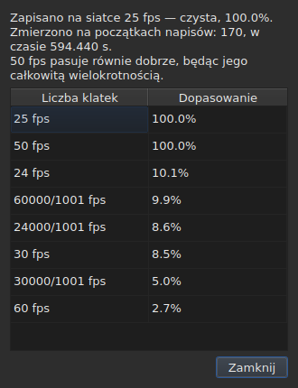

# Siatka klatek

<!-- machine-translated -->
> Ta strona jest tłumaczeniem maszynowym i nie została jeszcze sprawdzona przez osobę władającą tym językiem.

Plik napisów **nie deklaruje** liczby klatek na sekundę, względem której obliczono jego pozycje:
SubRip nie ma nagłówka, a nagłówek WebVTT to tekst dowolny. Okno **wnioskuje** ją z samych pozycji
przy otwieraniu pliku i pokazuje w dwóch miejscach, które nie odpowiadają na to samo
pytanie.

| Interfejs | Co podaje |
| :-------- | :-------- |
| pasek stanu | **odpowiedź**, stale i bez pytania |
| `Narzędzia ▸ Analiza liczby klatek…` | **uzasadnienie**, gdy chcesz je zobaczyć |

## Co pokazuje pasek stanu

Po prawej stronie, między informacją o
[kodowaniu](files.md#kodowanie-na-pasku-stanu) odczytanego pliku a informacją o
[powiązanym wideo](video.md#co-pokazuje-pasek-stanu):

| Sytuacja | Co jest zapisane |
| :------- | :--------------- |
| pozycje leżą na siatce | `Grid: 24 fps` |
| tylko niektóre z nich | `Grid: 29.97 fps (partial)` |
| żadna znana siatka nie pasuje | `No grid` |

**`No grid` nie podaje żadnej liczby klatek na sekundę i tak ma być.** Zbiór
kandydatów jest zamknięty — to osiem wartości, które oferuje okno konwersji — a
podanie najmniej błędnej z nich oznaczałoby udzielenie błędnej odpowiedzi tam, gdzie
właściwa jest odpowiedź „nie wiem”.

**`No grid` ma dwie przyczyny i nie są to te same odpowiedzi.** Albo żadna siatka nie
pasuje, albo plik ma zbyt mało napisów, by cokolwiek o nim powiedzieć — dwa początki
zawsze wyglądają na idealnie wyrównane i niczego to nie dowodzi. Pasek stanu mówi to samo w obu przypadkach;
**analiza je rozróżnia**, a w pierwszym przypadku podaje, o ile
najlepszy kandydat się myli.

Wiersz **aktualizuje się po każdej operacji**. Dopasowanie pliku do innej
liczby klatek na sekundę zmienia siatkę, a pasek stanu nie może dalej
ogłaszać starej.

### Dokument liczony w klatkach nie ma siatki, ma liczbę klatek na sekundę

**MicroDVD jest jedynym z dziewięciu formatów, który liczy w klatkach.** Każdy jego wiersz
zawiera dwa numery klatek i nic więcej, a plik **nie mówi**, przy jakiej liczbie klatek
na sekundę je odczytywać. To samo miejsce paska stanu zapisuje wtedy:

| Sytuacja | Co jest zapisane |
| :------- | :--------------- |
| dokument jest liczony w klatkach | `Frames: 24000/1001 fps` |

**To nie jest siatka, a siatka byłaby tu kołowa.** Pozycje dokumentu
MicroDVD zostały obliczone *na podstawie* jego klatek przy właśnie tej
liczbie klatek na sekundę; wywnioskowanie z nich siatki dałoby z powrotem tę samą wartość, czyli daną
przebraną za pomiar.

**Skąd się ona bierze, mówi się jeden raz** — przy odczycie, w
[liście komunikatów diagnostycznych](files.md#komunikaty-diagnostyczne-odczytu):
`counts in frames and states no rate; it was read at ("24000/1001")`. Wiersz paska
stanu mówi natomiast, jak jest, stale.

**Błędna liczba klatek na sekundę przesuwa cały plik**, a okno
[`Convert Frame Rate…`](operations.md#convert-frame-rate) służy do jej poprawienia:
otwiera się na liczbie klatek użytej przy odczycie i mówi, że to właśnie ta.

## Co pokazuje analiza

`Narzędzia ▸ Analiza liczby klatek…` **niczego nie zmienia.** Otwiera się na podsumowaniu
i rankingu ośmiu kandydatów wraz z ich wynikiem.




Podsumowanie podaje odpowiedź, a potem to, co ją uściśla — każde zdanie pojawia się
tylko wtedy, gdy ma coś do powiedzenia:

| Co można tam przeczytać | Kiedy |
| :---------------------- | :---- |
| na ilu początkach i na jakim odcinku czasu opiera się wynik | zawsze |
| o ile plik jest przesunięty względem swojej siatki | jego pozycje leżą na niej z dokładnością do stałej |
| że inna liczba klatek na sekundę pasuje równie dobrze | jest całkowitą wielokrotnością wybranej |
| że odcinek czasu nie pozwala rozróżnić dwóch liczb klatek na sekundę | plik jest zbyt krótki, by je rozdzielić |
| ile początków leży poza siatką, **i w ilu seriach** | plik jest częściowy |

**Liczba serii pozwala odróżnić dwie historie**, które sam
procent myli. Wiele serii po jednym początku to pozycje
poprawiane ręcznie, jedna po drugiej. Kilka długich serii to ponownie
zsynchronizowany fragment albo plik złożony z dwóch innych.

**Pokazywany jest pełny ranking, a nie jedna odpowiedź.** Plik, który
pasuje do 25 w stu procentach i do 50 w stu procentach, mówi coś, co
sam werdykt by ukrył.

## Gdy konwersja była błędna

Plik, który nie leży na żadnej siatce, bywa plikiem **przekonwertowanym przy błędnej
liczbie klatek na sekundę**: leży wtedy na całkiem rzeczywistej siatce, lecz przesuniętej o stosunek, który nie jest stosunkiem
żadnej z ośmiu. Gdy wnioskowanie zwraca `none` lub `partial`, analiza przeszukuje
**pięćdziesiąt sześć uporządkowanych par ośmiu standardowych liczb klatek na sekundę** — to zbiór zamknięty — w poszukiwaniu tej,
której konwersja przywraca pozycje na siatkę. Każdy stosunek jest stosowany do pozycji, a
**wynik ocenia samo wnioskowanie**: pewność to ta, którą by ono podało, nigdy
liczba wymyślona. Dwie pary dające ten sam stosunek, takie jak 30 na 25 i 60 na 50, to jedna
konwersja.

Do podsumowania dodawane jest zdanie:

```text
converting from 24 to 25 fps puts the positions on a 24 fps grid: 99.9%, against 11.8% as they are and 14.9% for the next best conversion
```

Podaje ono konwersję, siatkę, na której leżałyby pozycje, i jak dobrze na niej leżą,
**a następnie różnicę względem pozycji w obecnym stanie i względem najlepszej z pozostałych
konwersji.** Przycisk `Convert Frame Rate…` zamyka analizę i otwiera [okno
konwersji](operations.md#convert-frame-rate) **wypełnione znalezioną parą** — nic nie jest stosowane,
dopóki okno nie zostanie zaakceptowane, a anulowanie wystarcza, by wrócić. Wideo, otwarte obok,
pozwala ocenić na obrazie, czy odpowiedź jest właściwa.

**Gdy dwie pary pasują równie dobrze, żadna nie jest proponowana, i zdanie to mówi:**

```text
converting from 30 to 25 fps and converting from 25 to 24 fps fit equally well (99.7% and 99.6%), so none is proposed
```

To przypadek zwykły, a nie wyjątkowy: siatka o 28,8 klatki na sekundę wraca
na 24 równie dobrze jak na 30, a plik, w którym wszystkie czasy są podwojone, zostaje na siatce 25.
Gest, który ma jedną naprawę, to konwersja pliku **już** przy docelowej liczbie klatek na sekundę. W
przypadku remisu decyduje wideo: samodzielnie otwierasz `Convert Frame Rate…` na jednej z dwóch par.

**Nic nie jest mówione** o pliku już leżącym na siatce, o pliku zbyt krótkim, by
werdykt cokolwiek znaczył, ani o pliku, którego żadna konwersja ze zbioru nie przywraca na siatkę — dryf,
stosunek spoza ośmiu liczb klatek na sekundę, pozycje bez struktury.

## Czego tabela nie pokazuje

**Żaden wiersz tabeli nie jest oznaczany z powodu siatki**, nigdy.

Gdy poprawisz pozycję ręcznie, przestaje ona być wyrównana. Automatyczne
oznaczanie zgłaszałoby więc pracę użytkownika jako
anomalię, i to w pliku, który właśnie poprawia. Wnioskowanie
mówi o **dokumencie**, a analiza jest jedynym wyjątkiem — bo
otwierasz ją właśnie po to.

Oznaczenia tabeli dotyczą natomiast tego, co do siebie nie pasuje: koniec
przed początkiem, nakładanie się, zaburzona kolejność. Zobacz [Tabela](table.md).
