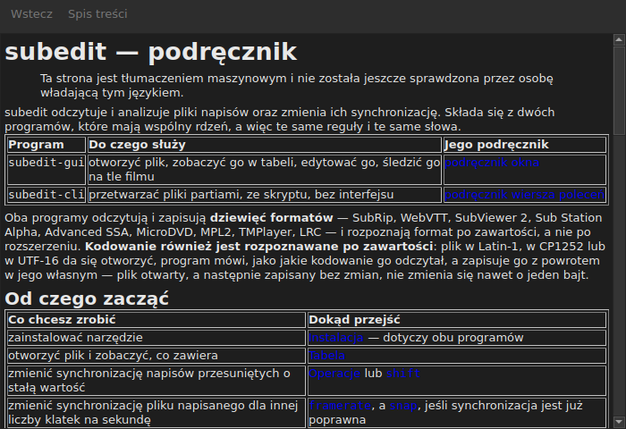

# Podręcznik w oknie

<!-- machine-translated -->
> Ta strona jest tłumaczeniem maszynowym i nie została jeszcze sprawdzona przez osobę władającą tym językiem.

`Pomoc ▸ Podręcznik`, czyli `F1`, otwiera **ten właśnie podręcznik** we własnym oknie.




## Co otwiera i dlaczego nie adres

**Podręcznik zainstalowany obok programu**, a nie strona w Internecie.

Adres opisywałby wersję rozwijaną, a nie tę, którą masz pod ręką.
Użytkownik czytający podręcznik wersji, której nie ma, jest gorzej obsłużony niż
użytkownik bez żadnego podręcznika — dlatego okno czyta pliki umieszczone
przez instalację, w `<prefix>/share/subedit/manual`. Zob.
[Instalacja](../subedit-cli/installation.md).

Otwiera się na [stronie głównej](../index.md), tej, która mówi, od czego zacząć.

## W jakim języku

**W języku okna.** Podręcznik otwiera się w języku, którym mówi
interfejs: w tym wybranym w `Edycja ▸ Preferencje…` albo, w przeciwnym razie, w języku
środowiska — zob.
[Język interfejsu](preferences.md#język-interfejsu).

| Okno mówi | Podręcznik otwiera się w |
| :---------------- | :------------------ |
| po angielsku | języku angielskim |
| w języku, którego podręcznik jest zainstalowany — kataloński, czeski, niemiecki, hiszpański, fiński, francuski, galicyjski, hebrajski, węgierski, interlingue, islandzki, włoski, niderlandzki, polski, portugalski, brazylijski portugalski | tym języku |
| w języku, którego podręcznik nie jest zainstalowany | języku angielskim |

**Strona po stronie, a nie wszystko albo nic**: strona, której tłumaczenie nie ma,
otwiera się po angielsku, a każda inna strona pozostaje w języku okna. Odnośnik
prowadzi z jednej do drugiej w ten sam sposób.

Tłumaczenia są zainstalowane obok angielskiego podręcznika, każde w katalogu
nazwanym od swojego języka: `<prefix>/share/subedit/manual/fr` dla francuskiego.
Język jest tym, w którym okno się uruchomiło, więc język wybrany w
preferencjach obowiązuje także dla podręcznika, przy następnym uruchomieniu.

## Poruszanie się

| Co robisz | Co się dzieje |
| :---------- | :----------- |
| klikasz odnośnik w podręczniku | strona otwiera się w tym samym oknie |
| klikasz odnośnik prowadzący do sekcji | strona otwiera się, a okno przewija się do niej |
| klikasz odnośnik prowadzący tylko do sekcji | okno przewija się do niej, bez zmiany strony |
| `Back` | wraca do poprzedniej strony; wyłączony na pierwszej |
| `Contents` | wraca do strony głównej; wyłączony, gdy się na niej jest |

Okno **nie jest modalne**: pozostaje otwarte w trakcie pracy, a po to właśnie
ma się podręcznik pod ręką. Ponowny wybór tej pozycji nie tworzy
drugiego okna, tylko wysuwa to na wierzch.

## Czego nie może otworzyć i mówi o tym

Podręcznik odwołuje się czasem do **planu rozwoju** albo do **decyzji
architektonicznej**. Są to dokumenty repozytorium, a nie pakietu: nie są
instalowane, a okno mówi o tym wprost, zamiast zostawiać kliknięcie
bez skutku.

```
../../feuille-de-route.md is not part of the installed manual;
it lives in the project's repository.
```

Można je przeczytać w repozytorium, którego adres znajduje się w `Pomoc ▸ O programie subedit`.

## Gdy pozycja jest wyłączona

**`Pomoc ▸ Podręcznik` jest wyłączone, gdy obok programu nie ma podręcznika.** Dwa
przypadki, i żaden nie jest usterką:

| Przypadek | Dlaczego |
| :--- | :-- |
| plik binarny jest uruchamiany z drzewa budowania | nic tam nie zainstalowano, więc nie ma czego czytać |
| instalacja jest częściowa | podręcznik usunięto albo nigdy go nie skopiowano |

Najechanie na pozycję mówi, który z dwóch: „Obok tego programu nie zainstalowano podręcznika”.

Brakująca strona, gdy podręcznik jest na miejscu — ręcznie usunięty plik — nie
zamyka okna: wskazuje plik, którego nie mogła odczytać, i zachowuje na ekranie to,
co pokazywała.

## Gdzie szuka się podręcznika

**Obok pliku wykonywalnego**, w `../share/subedit/manual` — układ, który tworzy każda
instalacja, niezależnie od prefiksu. Dzięki temu instalacja w `~/.local` znajduje swój
podręcznik tak samo jak pakiet zainstalowany w `/usr`.
