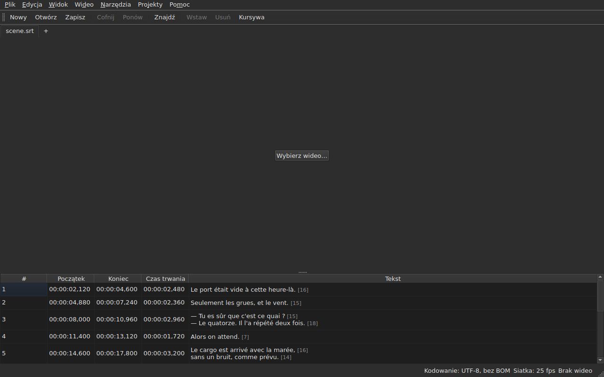

# subedit-gui — podręcznik

<!-- machine-translated -->
> Ta strona jest tłumaczeniem maszynowym i nie została jeszcze sprawdzona przez osobę władającą tym językiem.

Okno programu subedit: otwórz plik napisów i oglądaj go w tabeli. O drugim
programie i o tym, od czego zacząć, przeczytasz w [podręczniku](../index.md).

> **Stan obecny.** Okno **otwiera kilka plików, każdy na osobnej karcie**, bez względu
> na ich kodowanie — przez `Open…` albo przez upuszczenie ich na okno —, **wyświetla je**,
> **edytuje ich komórki**, **wstawia i usuwa linie**,
> **cofa zmiany**, **zapisuje — z wyborem kodowania, końców linii i
> znacznika kolejności bajtów** — i **oznacza napisy, których pozycje
> do siebie nie pasują**. **Łączy i dzieli** linie, **wycina,
> kopiuje i wkleja** teksty oraz **znajduje i zastępuje** w widocznym tekście
> bez psucia znaczników, w jednym projekcie lub we wszystkich. **Otwiera tłumaczenie
> obok pliku głównego**, dopasowane według pozycji lub według numeru, w jednej dodatkowej kolumnie,
> i zapisuje je osobno. Menu `Tools` zawiera szesnaście operacji i dwie pozycje sprawdzania pisowni —
> przesuwanie, przekształcanie, zmianę liczby klatek na sekundę, dostosowanie czasów trwania,
> **dołączanie pliku, podział projektu na dwa**, pochylanie
> tekstu, dodawanie myślników dialogowych, zmianę wielkości liter na cztery sposoby,
> usuwanie opisów dla niesłyszących, **poprawianie tekstów za pomocą
> kreatora wielostronicowego**, **sprawdzanie pisowni słowo po słowie**, dopasowanie do liczby klatek, powrót
> na siatkę — oraz analizę siatki, która niczego nie zmienia. Menu `Projects`
> **zapisuje i zamyka wszystko** jednym gestem. **Wiąże wideo
> z dokumentem**, wybrane lub odgadnięte, i **odtwarza je w oknie**, a bieżąca
> linia jest rysowana na obrazie; **ustawia początek, koniec lub
> napis na podstawie pozycji w filmie**, **przechodzi klatka po klatce** i **przesuwa krawędź o jedną klatkę**. Pasek odtwarzania **przewija, ustawia
> głośność i pozycję**, tabela **podąża za odtwarzaniem**, nie cofając ręcznego przewinięcia, pozycje
> można wyświetlać **w klatkach**, a menu `Video` **wybiera ścieżkę dźwiękową**. Dwa wykrywania
> **tylko proponują, niczego nie stosując**: tłumaczenie przesunięte o stałą wartość, które można **otworzyć ponownie
> z przesunięciem**, oraz zmiana liczby klatek na sekundę, która przywraca plik na siatkę. Okno **pamięta swoją geometrię, kolejność, szerokość i obecność
> kolumn oraz swoje ustawienia** z jednej
> sesji do następnej i występuje w wersji **jasnej lub ciemnej**, jak sobie wybierzesz. `Pomoc ▸ Podręcznik`
> otwiera **ten podręcznik** w oknie. Podręcznik opisuje to, co istnieje, nigdy to,
> co jest planowane; dalsze plany znajdują się w
> [planie rozwoju](../../../../feuille-de-route.md).

> **Obrazy w tym podręczniku są generowane, tekst — nie.** Przykłady
> z `subedit-cli` są generowane przez uruchomienie polecenia; zrzuty ekranu
> są generowane przez zbudowanie prawdziwego okna i sfotografowanie go — robi to jedno `make
> manual`. Obraz nie może więc opisywać interfejsu, który
> już nie istnieje, a zmianę interfejsu widać w różnicach w
> repozytorium. Bez siatki bezpieczeństwa pozostaje tekst wokół nich, którego
> poprawność zależy od przeglądu.

**Każdy ekran jest pokazany dwukrotnie, w obu paletach, które ustawia
aplikacja** — `Light` i `Dark`, tych, które
[preferencje](preferences.md#motyw) oferują. Na pulpicie, w którym
rządzi motyw systemowy, `System` daje jedną lub drugą, zależnie od wyboru pulpitu.

## Menu

`File`, `Edit`, `View`, `Video`, `Tools`, `Projects`, `Help` — w kolejności,
w jakiej się z nich korzysta: dokument, to, co się z nim robi, jak się go ogląda, to, co
mu towarzyszy, to, co go bada, to, co dotyczy wszystkich otwartych projektów, to, co
go wyjaśnia.

`View` zawiera podmenu `Columns` z jedną pozycją do zaznaczania na kolumnę, z wyjątkiem `Text`
— zob. [Tabela](table.md#ukrywanie-i-przesuwanie-kolumn) — oraz ustawienie `Positions in Frames`, które pokazuje
`Start` i `End` jako numery klatek — zob. [Pozycje w klatkach](table.md#pozycje-w-klatkach).

`Projects` zawiera dwie pozycje, `Save All` i `Close All` — zob.
[Menu Projekty](files.md#menu-projekty).

`Edit` zawiera pięć bloków, każdy oddzielony separatorem: cofanie; schowek
— wycinanie, kopiowanie, wklejanie tekstów; `Find and Replace…`;
wstawianie, usuwanie, łączenie i dzielenie linii; wreszcie
`Preferences…`. Cofanie to coś, co robi się *z* edycją, przeniesienie tekstu
nie dodaje ani nie usuwa żadnej linii, cztery pozycje następnego bloku zmieniają liczbę
linii, a ustawienie motywu w ogóle nie jest edycją.

**Klawisze są nazywane tak, jak wyświetla je menu**, po angielsku jak reszta
interfejsu: `Ins`, `Del`, `Ctrl+Shift+Z`. Klawisz, który się naciska, a
którego żadne menu nie nazywa, zachowuje angielską nazwę: `Enter`, `Esc`, `Shift`.

`Help` zawiera dwie pozycje, w kolejności, w jakiej pokazuje je menu. `Manual`, czyli
`F1`, otwiera ten podręcznik w oknie — zob.
[Podręcznik w oknie](help.md). `About subedit` podaje wersję,
licencję oraz biblioteki, z którymi działa okno, wraz z ich wersjami — zob.
[`--version`](invocation.md#--version).

## Pasek narzędzi

Pod menu pasek zawiera **najczęstsze gesty**, pogrupowane.
Każdy przycisk nosi krótkie słowo; menu zachowuje pełną nazwę pozycji, a
skrót jest ten sam.

| Przycisk | Pozycja menu | Skrót |
| :----- | :--------- | :------- |
| Nowy | Plik ▸ Nowy projekt | `Ctrl+N` |
| Otwórz | Plik ▸ Otwórz… | `Ctrl+O` |
| Zapisz | Plik ▸ Zapisz | `Ctrl+S` |
| Cofnij | Edycja ▸ Cofnij | `Ctrl+Z` |
| Ponów | Edycja ▸ Ponów | `Ctrl+Shift+Z` |
| Znajdź | Edycja ▸ Znajdź i zamień… | `Ctrl+F` |
| Wstaw | Edycja ▸ Wstaw napisy… | `Ins` |
| Usuń | Edycja ▸ Usuń napisy | `Del` |
| Kursywa | Narzędzia ▸ Kursywa | `Ctrl+I` |

**Wyłączony przycisk jest wyłączony z tego samego powodu co jego pozycja w menu**: `Undo`, gdy
nie ma czego cofać, `Remove`, gdy nie wybrano żadnej linii. Pozycje dotyczące tłumaczenia
oraz operacje menu `Tools`, z wyjątkiem `Italic`, zostają w swoich
menu: używa się ich rzadziej albo nie wszyscy.

## Sekcje

| Sekcja | Zawartość |
| :------ | :------- |
| [Instalacja](../subedit-cli/installation.md) | budowanie i instalacja — strona dotyczy obu programów |
| [Uruchamianie](invocation.md) | uruchamianie okna, argumenty, kody wyjścia |
| [Otwieranie i zapisywanie](files.md) | polecenia, karty, menu `Projects`, upuszczanie plików, tłumaczenie i jego ponowne otwarcie z przesunięciem, komunikaty diagnostyczne, kodowanie na pasku stanu, obieg w obie strony, zamykanie |
| [Tabela](table.md) | co pokazuje każda kolumna, ich ukrywanie i przesuwanie, pozycje w klatkach, kolumna tłumaczenia i tekst, na którym działają operacje |
| [Edycja komórki](editing.md) | które komórki można edytować i jak |
| [Wycinanie, kopiowanie i wklejanie tekstów](clipboard.md) | trzy pozycje, co jest przenoszone, dodane linie, przetłumaczone znaczniki |
| [Znajdowanie i zastępowanie](find-and-replace.md) | okno dialogowe, cztery gesty, dwie opcje, co obejmuje wyszukiwanie, we wszystkich otwartych projektach |
| [Wstawianie, usuwanie, łączenie i dzielenie napisów](lines.md) | cztery pozycje, ich skróty, dokąd trafiają nowe linie |
| [Cofanie i ponawianie](undo.md) | historia, dwie akcje, znacznik modyfikacji |
| [Siatka klatek](frame-grid.md) | liczba klatek na sekundę wywnioskowana z pozycji, analiza i zmiana, która przywraca plik na siatkę |
| [Operacje](operations.md) | przesuwanie, przekształcanie, konwersja, dostosowanie czasów trwania, dołączanie pliku, podział projektu, pochylanie, wielkość liter, myślniki, usuwanie opisów, dopasowanie, powrót na siatkę oraz to, co wykracza poza koniec filmu |
| [Popraw teksty…](correct-texts.md) | kreator poprawek: cel i zadania, strona każdego zadania, postęp, potwierdzenie |
| [Sprawdź pisownię…](check-spelling.md) | sprawdzanie pisowni: jego ustawienia, przejście po wyrazach, zamknięcie w środku, brak słownika |
| [Powiązane wideo](video.md) | wybór wideo, automatyczna propozycja, ścieżka dźwiękowa, pasek stanu, `ffmpeg` |
| [Odtwarzacz](player.md) | widok wideo, pasek odtwarzania, odtwarzanie, poruszanie się, głośność, tabela podążająca za odtwarzaniem, narysowana linia |
| [Synchronizacja na podstawie wideo](timing.md) | ustawianie początku lub końca napisu, wstawianie, zaznaczanie na podstawie pozycji w filmie, przechodzenie klatka po klatce, przesuwanie krawędzi |
| [Preferencje](preferences.md) | motyw, plik preferencji, jego opcje i to, co się dzieje z nieczytelną wartością |
| [Podręcznik w oknie](help.md) | `Pomoc ▸ Podręcznik`, co otwiera i jak się w nim poruszać |
