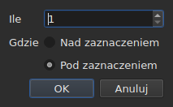

# Wstawianie, usuwanie, łączenie, dzielenie, sortowanie napisów i usuwanie nakładania się ich zakresów

<!-- machine-translated -->
> Ta strona jest tłumaczeniem maszynowym i nie została jeszcze sprawdzona przez osobę władającą tym językiem.

Osiem pozycji menu `Edit`, pod separatorem, który oddziela je od
`Find and Replace…`. Cztery z nich mają wspólną cechę: zmieniają liczbę wierszy, podczas gdy
wycinanie, kopiowanie i wklejanie, opisane wyżej, przenoszą teksty; `Sort Subtitles` zmienia
tylko **kolejność** wierszy, `Join Repeated Subtitles` ponownie tworzy jeden
napis z następujących po sobie kawałków tego samego tekstu, a `Make Ranges Disjoint…`
tnie je na nowo tam, gdzie się nakładają.

| Pozycja | Skrót | Co robi |
| :------ | :---- | :------ |
| Wstaw napisy… | `Ins` | otwiera okno dialogowe, a potem dodaje puste wiersze |
| Usuń napisy | `Del` | usuwa zaznaczenie, o nic nie pytając |
| Połącz napisy | brak | tworzy jeden wiersz z bloku sąsiednich wierszy |
| Podziel napis | brak | tnie wiersz na dwa w połowie jego czasu trwania |
| Scal powtarzające się napisy | brak | tworzy jeden napis z następujących po sobie kawałków tego samego tekstu |
| Posortuj napisy | brak | ustawia wiersze z powrotem w kolejności ich początków, w całym projekcie |
| Rozłącz przedziały… | brak | przycina nakładające się wiersze tak, by żaden zakres nie nakładał się już na inny |
| Napraw napisy… | brak | łączy trzy poprzednie pozycje — scalanie powtórzeń, sortowanie, cięcie zakresów — za jednym razem |

Wszystkie osiem pozycji trafia do historii: `Ctrl+Z` cofa je tak jak resztę.

## Wstawianie

| Pole | Co zawiera | Domyślnie |
| :--- | :--------- | :-------- |
| `How many` | liczba całkowita od 1 do 99 999 | `1` |
| `Where` | `Above the selection` lub `Below the selection` | ostatni wybór, przy pierwszym uruchomieniu `Below` |

`OK` dodaje wiersze, `Cancel` niczego nie dodaje.

### Gdzie trafiają

**Przy ostatnim zaznaczonym**, nie przy pierwszym. Zaznaczenie wierszy 1 i 3,
a następnie wstawienie poniżej umieszcza nowy wiersz na pozycji 4 — nie na
pozycji 2. Tak robi Gaupol od dwudziestu lat i tego oczekuje ręka
po przejechaniu od góry do dołu.

Wybór `Above the selection` umieszcza go tuż przed tym samym wierszem.

### Jak długo trwają

Pusty wiersz nie ma tekstu, ale ma pozycje. Wylicza się je
z dostępnego miejsca:

| Sytuacja | Początek | Czas trwania |
| :------- | :------- | :----------- |
| między dwoma napisami | koniec poprzedniego | odstęp do następnego, podzielony po równo |
| po ostatnim | koniec ostatniego | po trzy sekundy każdy |
| na początku pliku | początek osi czasu | odstęp do pierwszego, podzielony |
| w pustym pliku | początek osi czasu | po trzy sekundy każdy |

Gdy plik w wybranym miejscu ma nakładanie, **nie ma miejsca do
podziału**: wiersze dostają zerowy czas trwania, który tabela pokazuje, zamiast
wymyślonego czasu trwania, który wszedłby na sąsiada.

### Pusty dokument

**Zaznaczenie nie jest wymagane** i jest to jedyny sposób na rozpoczęcie
nowego pliku: wiersze trafiają pod indeks zero. Wybór strony jest wtedy wyłączony
w oknie dialogowym — nie ma zaznaczenia, względem którego można by je umieścić.

Gdy tylko dokument zawiera wiersz, pozycja `Insert Subtitles…` **jest wyłączona, dopóki
nic nie jest zaznaczone**: bez zaznaczenia indeks musiałby być zgadywany.

### Potem

Dodane wiersze są **zaznaczone**, a tabela przechodzi do nich. Ponowne naciśnięcie
`Ins` wstawia więc wiersze za nimi, bez konieczności klikania pomiędzy
jednym a drugim.

### Strona jest zapamiętywana

`Above` lub `Below` jest zapamiętywane **od jednego wstawiania do następnego i od jednej sesji do
następnej**: to opcja `edit.insert-placement` w
[pliku preferencji](preferences.md#plik). Nie wstawia się jednego wiersza,
wstawia się dziesięć wierszy pod rząd, zawsze po tej samej stronie.

## Usuwanie

`Remove Subtitles` lub `Del` usuwa zaznaczone wiersze — także przy zaznaczeniu
nieciągłym, a każdy wiersz wraca na swoje miejsce, jeśli cofniesz operację.

**Nie jest pytane o potwierdzenie** i nie jest to przeoczenie:
operację cofa się klawiszami `Ctrl+Z`. Okno modalne przed gestem, który można cofnąć,
kosztowałoby każdorazowo jedno kliknięcie, by oszczędzić od czasu do czasu jedno `Ctrl+Z`.

**Pozycja jest wyłączona, gdy nic nie jest zaznaczone.** W innych miejscach okna
„nic nie zaznaczono” oznacza „cały plik” — dzięki temu
przesunięcie da się zastosować bez zaznaczania czterech tysięcy wierszy. Tutaj taka
interpretacja opróżniłaby dokument przy pechowym `Del`, więc nie jest oferowana.

Po usunięciu **zaznaczany jest wiersz, który zajął miejsce pierwszego usuniętego**
— albo ostatni pozostały, jeśli usunięcie objęło koniec
pliku. Kilkukrotne naciśnięcie `Del` pod rząd usuwa więc wiersze jeden
po drugim.

Całkowicie opróżniony plik pozostawia okno w stanie używalnym: `Insert Subtitles…`
znów staje się dostępne, ponieważ do pustego dokumentu wstawia się bez zaznaczenia.

## Łączenie

`Merge Subtitles` tworzy **jeden wiersz** z zaznaczonych wierszy:

| Co otrzymuje połączony wiersz | Skąd pochodzi |
| :---------------------------- | :------------ |
| jego początek | początek pierwszego |
| jego koniec | koniec ostatniego |
| jego tekst | teksty wszystkich, po kolei, z podziałem wiersza między dwoma |
| jego tłumaczenie | tłumaczenia, połączone w ten sam sposób |
| to, co format przenosi poza tym — styl, warstwa, współrzędne | pierwszego |

**Pusty tekst nie zostawia pustej linii**: połączenie `Un.`, wiersza bez
tekstu i `Trois.` daje dwie linie tekstu, nie trzy.

Połączone wiersze znikają, a wiersz, który je zastępuje, zajmuje miejsce
pierwszego.

**Pozycja jest wyłączona**, dopóki zaznaczenie nie jest **blokiem co najmniej
dwóch sąsiednich wierszy**. Pojedynczy wiersz nie ma z czym się łączyć; wiersze
1 i 3 bez 2 również nie, ponieważ wynik wszedłby na 2 i
by go przykrył.

Po połączeniu **zaznaczony jest połączony wiersz**: `Split Subtitle` jest
gotowe, by przeciąć go z powrotem.

## Dzielenie

`Split Subtitle` tnie zaznaczony wiersz **w połowie jego czasu trwania**, z dokładnością
do milisekundy:

| Połowa | Początek | Koniec | Tekst |
| :----- | :------- | :----- | :---- |
| pierwsza | pierwotny początek | środek | **cały** tekst i tłumaczenie |
| druga | środek | pierwotny koniec | pusta |

**Tekst nie jest dzielony na jego podziale wiersza.** Byłoby to słuszne dla
napisu dwuliniowego i błędne dla napisu jednoliniowego lub trzyliniowego;
cały tekst zostaje w pierwszej połowie, a to, co ma trafić do
drugiej, przenosisz sam.

Pierwsza połowa zachowuje to, co format przenosił poza tekstem; druga
powstaje jak wstawiony wiersz, bez niczego.

**Pozycja jest wyłączona**, dopóki zaznaczenie nie obejmuje **dokładnie jednego
wiersza**. Brak zaznaczenia nie oznacza tutaj „całego pliku”.

Po podziale **zaznaczone są obie połowy** — tak robi Gaupol
po każdym wstawieniu, a `Merge Subtitles` jest wtedy gotowe, by cofnąć
ten gest.

## Sortowanie

`Sort Subtitles` ustawia **cały projekt** z powrotem w kolejności początków. Nigdy
samo zaznaczenie: kolejność jest właściwością dokumentu, a sortowanie połowy
pliku nic nie znaczy. Sortowanie jest **stabilne**: dwa napisy, które
zaczynają się razem, zachowują kolejność nadaną im przez plik.

**Podczas sortowania na pasku stanu biegnie pasek, a kursor zmienia się w
klepsydrę**: w długim pliku okno przez jakiś czas nie reaguje — tabela
odbudowuje się wiersz po wierszu —, a bez tego nie wiadomo, czy coś
trwa. Pasek nie pokazuje ułamka, sortowanie go nie zgłasza,
i znika razem z nim.

Pasek stanu mówi, ile wierszy zmieniło miejsce — `3 subtitles moved`
— albo, gdy wszystko było w porządku, `already in order`. **Projekt już posortowany
nie trafia do historii**: operacja, która niczego nie zmienia, nie jest
operacją do cofania. Pozycja jest wyłączona dla projektu z jednym napisem.

Plik, **w którym przy otwarciu jest coś do poprawienia**, sam to proponuje,
[w jednym oknie](#przy-otwarciu-jedno-pole): zobacz niżej. Źle umieszczone
napisy są także [wliczone do komunikatów diagnostycznych](files.md#komunikaty-diagnostyczne-odczytu),
dzięki czemu znajdziesz je bez przewijania tabeli.

W wierszu poleceń [`sort`](../subedit-cli/sort.md) robi to samo na
plikach, a `--sort` robi to przy okazji w
[`convert`](../subedit-cli/convert.md#sortowanie-przy-zapisie),
[`append`](../subedit-cli/append.md#sortowanie-wyniku) i
[`split-file`](../subedit-cli/split-file.md#cięcie-w-kolejności-czasowej).

## Łączenie powtórzonych napisów

`Join Repeated Subtitles` tworzy **jeden napis** z napisów, które pokazują
to samo pod rząd: tekst pocięty na kolejne kawałki, tak jak
zostawiają go niektóre narzędzia do segmentacji. Działa na **cały projekt**.

**Powtórzenie** ma ten sam tekst, to samo tłumaczenie i te same ustawienia formatu
(styl, pozycję, ustawienia cue) co inny napis, **i zaczyna się najpóźniej
wtedy, gdy tamten się kończy**. Ciąg powtórzeń zamienia się w ten, który zaczyna się
najwcześniej, z największym końcem ciągu; pozostałe znikają.
`Alpha [1, 2]`, `Alpha [2, 4]` i `Alpha [4, 6]` dają `Alpha [1, 6]`.

- **Kolejność w pliku nie ma tu znaczenia i nie jest zmieniana**: zachowany napis
  to ten, który zaczyna się najwcześniej, gdziekolwiek są pozostałe.
- **Nic nie jest łączone przez pomyłkę**: inny tekst, inne ustawienia, przerwa
  między dwoma kawałkami, napis bez tekstu lub taki, którego koniec poprzedza początek,
  pozostają osobno.
- Pasek stanu mówi, co zrobiono — `2 repeated subtitles joined` albo
  `no repeated subtitles`.

**Do wykonania przed sortowaniem i cięciem**, które lepiej czytają czysty ciąg:
tekst w trzech kawałkach, plus inny tekst na całym zakresie, podane
w złej kolejności, sortuje się i tnie na linie, które przeskakują z jednego kawałka na drugi; scalony
najpierw, układa się w porządek i łączy czysto. Okno otwarcia, poniżej, robi
wszystkie trzy w tej kolejności.

## Usuwanie nakładania się zakresów

`Make Ranges Disjoint…` przycina nakładające się napisy tak, by **żaden
zakres `[start, end]` nie nakładał się już na inny**. Działa na **cały
projekt**, nigdy na zaznaczenie: grupa nakładających się napisów
jest cięta tam, gdzie się nakładają, a połowa grupy nic nie znaczy.

**Nic nie jest skracane ani wydłużane.** W każdej chwili okno pokazuje te
same teksty co przedtem. Zmienia się to, jak pocięta jest oś czasu:
tnie się ją na każdym początku i każdym końcu grupy; przedział pokryty
jednym napisem pozostaje tym napisem; przedział pokryty kilkoma
staje się **jednym** napisem, którego linie są ich liniami, **najwcześniejszy w linii 1**.
`A [0, 5]` i `B [3, 8]` dają `[0, 3] A`, `[3, 5] A / B`, `[5, 8] B`.

Okno dialogowe pyta o trzy ustawienia, zapamiętywane od jednego razu do następnego:

| Pole | Co zawiera | Domyślnie |
| :--- | :--------- | :-------- |
| `Shortest interval kept` | od 0 do 10 000 ms: krótszy przedział jest przejmowany przez sąsiada | `80 ms` (około dwóch klatek) |
| `Most lines in a subtitle` | od 0 do 10; `No limit` przy 0 | `2` |
| `Put a dash before each subtitle's text` | myślnik przed tym, co każdy napis wnosi do napisu scalonego | niezaznaczone |

`OK` tnie, `Cancel` nic nie robi. **Zapisane wiersze są potem zaznaczone**,
a pasek stanu mówi, co zrobiono: `2 subtitles split, 1 merged`.
Drugie przejście niczego nie zmienia i mówi o tym: `already disjoint`.

- **Linia nigdy nie jest powielana.** Dwa napisy z tym samym tekstem dają
  jedną linię tam, gdzie się nakładają, a dwa sąsiednie kawałki, które pokazują to
  samo, tworzą tylko jeden napis. Tekst napisu pociętego na kilka
  kawałków jest poza tym powtórzony w każdym: to, co jest na ekranie w danej chwili.
- **Bardzo krótki przedział jest przejmowany przez sąsiada**: ten, którego linie
  już zawierają jego własne, a w przeciwnym razie najdłuższy, rozszerza swój zakres, by go pokryć.
  Cały napis krótszy niż próg nigdy nie jest przejmowany.
- **Więcej linii niż limit: okna.** Trzy linie w ciągu trzech sekund
  dają dwie połowy, pierwsze dwie linie, potem ostatnie dwie;
  cztery linie, trzy trzecie, i tak dalej. Nic nie jest obcinane.
- Tłumaczenie podąża za tymi samymi cięciami; styl i pozycja pierwszego
  pokrywającego napisu są zachowywane.

**To, czego nie dało się wykonać w całości, jest powiedziane w oknie zamykanym**, nie
na pasku stanu: okna, przejęte przedziały, zbyt krótkie napisy
pozostawione w całości, różniące się style, napisy, których koniec poprzedza ich
początek (pozostawione tam, gdzie są).

**Pozycja jest odrzucana, z podaniem powodu, gdy napisy nie są w
kolejności początków**: grupy to ciągi sąsiadów, a rdzeń nigdy
sam nie sortuje. Najpierw `Sort Subtitles` — albo okno otwarcia, które
robi jedno i drugie w tej kolejności.

### Wszystko naraz: `Repair Subtitles…`

`Repair Subtitles…` wykonuje trzy poprzednie pozycje **jedna po drugiej**, w jedynej kolejności, która działa: powtórzenia
są scalane, napisy ustawiane w kolejności początków, a potem zakresy rozłączane. To pozycja
dla pliku źle podzielonego, źle uporządkowanego i z nakładaniem, gdy wiesz, że chcesz wszystkich trzech. Okno dialogowe pyta o
ustawienia cięcia (te same co w `Make Ranges Disjoint…`, zapamiętywane od jednego razu do następnego) i mówi, że najpierw scala i sortuje.
Pasek stanu — albo okno zamykane, gdy czegoś nie dało się wykonać w całości — podaje **jedno sprawozdanie**
ze wszystkich trzech: `2 repeated subtitles joined; already in order; 2 subtitles split, 1 merged`. Każda poprawka to osobny
wpis w historii: `Ctrl+Z` cofa je jedna po drugiej. W wierszu poleceń: [`repair`](../subedit-cli/repair.md).

### Przy otwarciu jedno pole

Plik, który otwiera się z czymś, co umiemy poprawić, **proponuje to w
jednym oknie**, `Problems found in this file`, zamiast otwierać po jednym na
problem. Każdy znaleziony problem to wiersz z polem wyboru, zaznaczonym:

- `Join the repeated subtitles` — napisy powtarzają inny napis, z którym
  się stykają, wraz z ich liczbą;
- `Sort the subtitles` — napisy nie są w kolejności początków,
  wraz z ich liczbą;
- `Make the ranges disjoint` — napisy zaczynają się przed końcem poprzedniego,
  liczone **po uporządkowaniu pliku**, bo właśnie tam są poprawiane.

**Każdy problem jest liczony tam, gdzie jest poprawiany**, na kopii, na której
poprawki go poprzedzające zostały już wykonane: tekst pocięty na kawałki jest
przyczyną części nieporządku, a jego wcześniejsze scalenie może nie zostawić żadnego — okno
nie proponuje wtedy sortowania.

Problem, który nie został znaleziony, nie ma wiersza. Odznaczenie sortowania **wyszarza i
odznacza** drugie pole: zakresy rozłącza się tylko w porządku.
`Fix` stosuje to, co zaznaczone — scalanie, potem sortowanie, potem cięcie, z
ustawieniami ostatniego `Make Ranges Disjoint…` — i podaje **jedno sprawozdanie**;
`Keep as is` niczego nie rusza. **Nic nie jest robione bez zgody**, każda poprawka
to wpis w historii, a plik bez niczego do poprawienia nie
jest przedmiotem żadnego pytania.

W wierszu poleceń [`disjoint`](../subedit-cli/disjoint.md) robi to samo na plikach, a `--disjoint`
robi to przy okazji w [`convert`](../subedit-cli/convert.md#usuwanie-nakładania-się-zakresów),
[`append`](../subedit-cli/append.md#usuwanie-nakładania-się-zakresów) i
[`split-file`](../subedit-cli/split-file.md#usuwanie-nakładania-się-zakresów).

### Dlaczego nie skróty Gaupola

Gaupol łączy klawiszem `M` i dzieli klawiszem `S`. Gołą literę przejęłaby
tabela, zanim dotarłaby do edytowanej komórki, a `Ctrl+S`
już zapisuje: obie pozycje są dostępne przez menu.

## Co mówi o tym akcja cofania

**Jeden wpis w historii na gest.** Połączenie pięciu wierszy cofa się jednym
`Ctrl+Z` i przywraca pięć wierszy takimi, jakie były — pozycje, teksty i
wszystko, co przenosił format.

| Operacja | Co odczytuje `Undo` |
| :------- | :------------------ |
| wstawianie | `Undo: inserting` |
| usuwanie | `Undo: removing` |
| łączenie | `Undo: merging` |
| dzielenie | `Undo: splitting` |
| scalenie powtórzeń | `Undo: joining repeated subtitles` |
| cięcie zakresów | `Undo: making the ranges disjoint` |

Poprawka zaproponowana przy otwarciu to jeden wpis w historii na poprawkę: scalanie, sortowanie, a potem cięcie są cofane jedno po drugim.

Zobacz [Cofanie i ponawianie](undo.md).

## Skróty przy otwartej komórce

`Ins` i `Del` należą do pola wprowadzania, dopóki edytor komórki
jest otwarty: klawisz usuwania kasuje tam znak, a nie
napis. Zamknięcie edytora — `Enter` lub `Esc` — przywraca im ich znaczenie. Uruchomione
z menu, `Remove Subtitles` najpierw zatwierdza wpisywany tekst, tak jak inne
gesty opisane w [Edycja komórki](editing.md).

Ten podręcznik nazywa klawisze tak, jak wyświetla je menu — zobacz
[Menu](index.md#menu).
