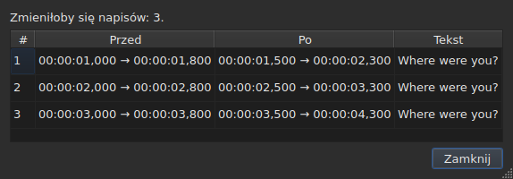
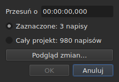
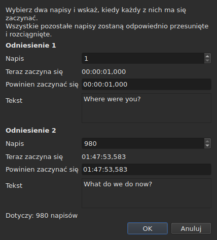
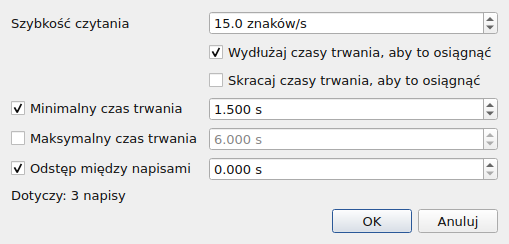
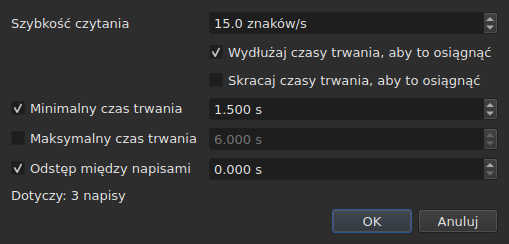
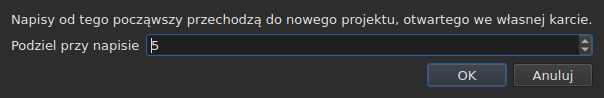

# Operacje

<!-- machine-translated -->
> Ta strona jest tłumaczeniem maszynowym i nie została jeszcze sprawdzona przez osobę władającą tym językiem.

Menu **Narzędzia** zawiera szesnaście operacji, jedną analizę i dwie pozycje sprawdzania pisowni. Każdą z
szesnastu cofa się przez `Ctrl+Z`; analiza niczego nie zmienia. `Check Spelling…` też się cofa, a `Spell-Check Settings…` nie dotyka żadnego tekstu.

| Pozycja | Okno dialogowe | Co robi |
| :---- | :----- | :----------- |
| `Shift Positions…` | tak | przesuwa cel o czas trwania |
| `Transform Positions…` | tak | poprawia cel na podstawie dwóch znaczników |
| `Convert Frame Rate…` | tak | zmienia synchronizację celu z jednej liczby klatek na sekundę na inną |
| `Adjust Durations…` | tak | przesuwa końce, aby zachować szybkość czytania, czasy trwania i przerwę |
| `Append File…` | okno wyboru pliku | dołącza plik na końcu projektu |
| `Split Project…` | tak | dzieli projekt na dwa, reszta trafia na nową kartę |
| `Italic` | **nie** | pochyla cel albo to cofa |
| `Dialogue` | **nie** | wstawia myślnik dialogowy na początku każdej linii albo go usuwa |
| `Wielkość liter ▸ Jak w tytule` | **nie** | każdy wyraz dostaje wielką literę |
| `Wielkość liter ▸ Jak w zdaniu` | **nie** | pierwsza litera tekstu, i tylko ona |
| `Wielkość liter ▸ WIELKIE LITERY` | **nie** | wszystko wielkimi literami |
| `Wielkość liter ▸ małe litery` | **nie** | wszystko małymi literami |
| `Remove Hearing-Impaired Mentions…` | tak, bez ustawień | usuwa opisy dla niesłyszących |
| `Correct Texts…` | tak, kreator wielostronicowy | proponuje poprawki — opisy, łączenie i dzielenie wyrazów, typowe błędy, wielkie litery, łamanie linii — i stosuje je po zaakceptowaniu, zob. [Popraw teksty…](correct-texts.md) |
| `Check Spelling…` | tak, przejście słowo po słowie | przechodzi po wyrazach nieznanych słownikowi i stosuje to, co poprawiono, zob. [Sprawdź pisownię…](check-spelling.md) |
| `Spell-Check Settings…` | tak | wybiera język, cel i dokument sprawdzania oraz podkreślanie w trakcie pisania, zob. [Sprawdź pisownię…](check-spelling.md#ustawienia-sprawdzania-pisowni) |
| `Snap to Frame Rate…` | tak | przywraca każdy kod czasowy na najbliższą klatkę |
| `Shift Whole File onto Grid (…)` | **nie** | przywraca cały plik na jego siatkę |
| `Frame Rate Analysis…` | tak, bez ustawień | **niczego nie zmienia** — zob. [Siatka klatek](frame-grid.md) |

**To, co operacja zrobiła, jest podawane w oknie informacyjnym, które trzeba
zamknąć, z wyjątkiem `Italic`, `Case` i `Dialogue`**: te trzy nie otwierają
okna dialogowego, a ich raport — także „nic do zmiany” — jest wyświetlany
na pasku stanu, bez niczego do zamknięcia. `Split Project…` także podaje swój własny
na pasku stanu: jego wynik jest już przed oczami, na nowej karcie. Komunikaty są cytowane w
sekcji każdej operacji.

Wstawianie, usuwanie, łączenie i dzielenie linii nie są tutaj, lecz w menu
`Edit`, ponieważ zmieniają liczbę linii. Zob.
[Wstawianie, usuwanie, łączenie i dzielenie napisów](lines.md).

## Na czym działają

**Na zaznaczonych liniach, a jeśli nie ma zaznaczenia — na całym pliku.** To ta sama
reguła dla wszystkich, a okna dialogowe, gdy jest okno, przypominają ją
prostymi słowami:

```
Applies to: 4 subtitles
```

Zaznaczenie wszystkich linii jest tym samym co niezaznaczenie żadnej.

**Gdy zaznaczona jest tylko część linii, okno dialogowe pyta,
na czym działać.** Wyświetlane są dwa wybory, z ich liczbą, a **zaznaczone jest
to, co obejmuje zaznaczenie**:

```
(•) Selected: 2 subtitles
( ) Whole project: 4 subtitles
```

Zaznaczenie `Whole project` poszerza operację na cały plik bez konieczności
wcześniejszej zmiany zaznaczenia. Gdy nie ma czego wybierać — nic nie jest
zaznaczone albo wszystko —, sam wiersz `Applies to:` powyżej pozostaje.

Okna dialogowe `Shift Positions…`, `Transform Positions…`,
`Convert Frame Rate…`, `Adjust Durations…`, `Snap to Frame Rate…` i
`Remove Hearing-Impaired Mentions…` oferują ten wybór.

### Podgląd przed zastosowaniem

`Shift Positions…`, `Transform Positions…`, `Convert Frame Rate…`,
`Adjust Durations…` i `Snap to Frame Rate…` mają przycisk **`Preview changes…`**.
Otwiera on małe okno, które mówi, ile napisów operacja
zmieniłaby **z tym, co wpisano w tej chwili, na zaznaczonym celu**, i
wymienia pierwszych dwanaście: ich numer, ich pozycję przed, ich pozycję
po oraz pierwszą linię ich tekstu. **Nic nie jest stosowane**: zamknięcie
okna wraca do okna dialogowego, w którym możesz zmienić wartość i spojrzeć
jeszcze raz.




Otwiera się wystarczająco duże, by pokazać wszystkie kolumny, i można zmienić jego rozmiar
ręcznie.

Jeśli operacja niczego by nie zmieniła, okno to mówi (`Nothing would change.`).
Dopóki to, co wpisano, nie określa operacji — nieczytelny czas trwania, dwa
znaczniki na tym samym napisie —, podgląd jest pusty z tego samego powodu, dla którego
przycisk `OK` jest wyszarzony. `Remove Hearing-Impaired Mentions…` nie ma podglądu: to,
co zmienia, jest tekstem, a raport, który podaje potem,
to mówi.

**Z tłumaczeniem, który tekst?** Operacje na pozycjach i strukturze
działają na cały napis — jego dwa teksty podążają razem. Te, które
przepisują tekst — `Italic`, `Case`, `Dialogue`,
`Remove Hearing-Impaired Mentions…` — celują w **tekst kolumny bieżącej komórki**:
tłumaczenie w jego kolumnie, tekst główny gdzie indziej. Drugi pozostaje nietknięty, a
pasek stanu mówi, który jest celem. Zob. [Tabela](table.md#tekst-na-którym-działają-operacje).

**Jeden wyjątek, a jego etykieta go zdradza**: `Shift Whole File onto Grid`
ignoruje zaznaczenie. Siatka jest własnością dokumentu, a pół
dokumentu nie ma własnej siatki; pozycja mówi to więc w swojej nazwie, a nie
tylko w tym podręczniku.

**`Append File…` także ignoruje zaznaczenie**, z innego powodu: nie jest to
cel, który przepisuje, tylko koniec, który odsuwa. Zob. jego
[własną sekcję](#append-file). **Tak samo `Split Project…`**: tnie tam, gdzie mu
powiedziano. Zob. [jego własną](#split-project).

**`Correct Texts…` wybiera swój cel na własnej stronie**, zamiast podążać za
bieżącym zaznaczeniem: zaznaczenie, bieżący projekt albo wszystkie otwarte
projekty. Zob. [Popraw teksty…](correct-texts.md). **`Check Spelling…` wybiera go w
`Spell-Check Settings…`** i go zapamiętuje: zob. [Sprawdź pisownię…](check-spelling.md).

**Dwie operacje na siatce nie mówią o tym samym co siatka.**
Operacja działa na zaznaczeniu; analiza i pasek stanu mówią o **całym
dokumencie**. Dopasowanie pięciu linii ze stu siedemdziesięciu sześciu zmienia te
pięć — tabela to pokazuje — bez ruszenia żadnej z nich, co
wygląda na pominięte odświeżenie. Tak nie jest: nie mają nic do
powiedzenia. Zob. [`Snap to Frame Rate…`](#snap-to-frame-rate) i
[Siatka klatek](frame-grid.md).

### Co znaczy „nic nie zaznaczono”, pozycja po pozycji

Reguła dotyczy menu `Tools` i wyszukiwania. Pozycje menu
`Edit`, które dotykają linii albo je opróżniają, czytają ją inaczej — w przeciwnym razie
pechowe `Del` lub `Ctrl+X` opróżniłoby dokument.

| Pozycja | Bez zaznaczenia | Czego wymaga |
| :---- | :------------------ | :--------------- |
| operacje menu `Tools` | cały plik | niepusty dokument |
| `Shift Whole File onto Grid` | cały plik, **zawsze** | znaleziona siatka |
| `Find and Replace…` | cały plik | niepusty dokument |
| `Cut Texts`, `Copy Texts`, `Paste Texts` | **wyłączone** | co najmniej jedna zaznaczona linia |
| `Remove Subtitles` | **wyłączone** | co najmniej jedna zaznaczona linia |
| `Merge Subtitles` | **wyłączone** | blok co najmniej dwóch sąsiednich linii |
| `Split Subtitle` | **wyłączone** | dokładnie jedna linia |
| `Insert Subtitles…` | wyłączone, z wyjątkiem pustego dokumentu | linia, względem której je umieścić |

Każda strona podaje powód: [schowek](clipboard.md#na-czym-działają),
[linie](lines.md), [wyszukiwanie](find-and-replace.md#co-obejmuje-wyszukiwanie).

Pozycje są **wyłączone na pustym pliku**: nie byłoby czego
przesuwać. `Italic` ma drugi warunek, który opisuje jego sekcja: otwarty
format musi umieć zapisać styl. Wielkość liter i myślniki go nie mają — tekst
jest tekstem we wszystkich dziewięciu formatach.

## `Shift Positions…`

Przesuwa cel o czas trwania, do przodu lub do tyłu. Obie granice
każdego napisu przesuwają się o tę samą wartość: żaden nie pozostaje na ekranie dłużej ani krócej
niż przedtem.

Czas trwania zapisuje się **jak kod czasowy, ze znakiem** — `00:00:02,500` przesuwa do przodu,
`-00:00:01,250` przesuwa do tyłu. **Pole się nadpisuje, nie wpisuje się w nie**: zaczyna się od `00:00:00,000`, cyfra zastępuje cyfrę pod kursorem, a kursor sam pomija `:` i `,`, więc postać nigdy się nie zmienia. Przyjmowane są tylko cyfry oraz `-` (lub `+`) do zmiany znaku; `Backspace` i `Delete` przywracają zero. To samo pole służy wszędzie tam, gdzie ustawia się czas: w oknie przekształcenia, w komórkach pozycji tabeli i w zakresie transkrypcji.




| Odmowa | Dlaczego |
| :------ | :-- |
| nieczytelny czas trwania | przycisk pozostaje wyłączony; nic nie jest przesuwane na chybił trafił |
| przesunięcie o zero | nie ma operacji do zapisania |
| napis znalazłby się przed początkiem wideo | **żaden plik nie może przenosić takiej pozycji** |

Trzeci przypadek wskazuje winowajcę — „subtitle 1 would start before the origin” —
i to na niego trzeba spojrzeć, by zobaczyć, o ile się pomyliłeś. Nic
nie jest stosowane.

## `Transform Positions…`

Poprawka pliku zsynchronizowanego z innym montażem. Mówisz, gdzie **dwa**
napisy naprawdę się zaczynają, a cała reszta podąża za nimi proporcjonalnie.

Okno dialogowe dwa razy prosi o to samo: numer napisu i
pozycję, w której jego początek powinien być. Dla każdego znacznika pokazuje, **co
ten numer wskazuje** — jego tekst (`Text`) i czas, w którym zaczyna się
**teraz** (`Now starts`), jako zwykłe etykiety — i podążają one za numerem,
gdy go zmieniasz. Tekst zachowuje **trzy linie miejsca** bez względu na to, co mówi
napis: dłuższy, albo długi adres, przewija się wewnątrz, a
okno dialogowe zachowuje rozmiar, gdy znacznik się zmienia. **Dla każdego znacznika wpisuje się jedno pole:
`Should start`**, czas, w którym ten napis ma się zaczynać. Nie trzeba szukać w tabeli, która to linia `980`.

`Should start` jest **proponowane z bieżącą wartością**: dopóki go nie
dotkniesz, znacznik mówi „ten napis jest już tam, gdzie ma być”. Zmieniasz tylko
to, co chcesz zmienić. Drugi znacznik jest wstępnie wypełniony na ostatnim
napisie pliku — dwa odległe znaczniki dają pewniejszą poprawkę
niż dwa sąsiednie.




**Oba znaczniki lądują dokładnie tam, gdzie o to poproszono.** To nie jest
przybliżenie: obliczenie jest zrobione tak, by to była prawda.

| Odmowa | Dlaczego |
| :------ | :-- |
| dwa znaczniki na tym samym napisie | nie określają żadnej poprawki |
| nieczytelna pozycja | ten sam powód co przy przesunięciu |

Numeru spoza pliku nie da się wpisać: pole jest ograniczone liczbą
napisów.

## `Convert Frame Rate…`

Zmienia synchronizację celu, gdy pozycje obliczono względem jednej liczby klatek na sekundę,
a mają być względem innej.

Obie listy oferują osiem standardowych wartości liczby klatek na sekundę.

> **Pomyłka w wejściowej liczbie klatek na sekundę przesuwa cały plik, nie zgłaszając
> niczego.** To najgorszy sposób awarii tej operacji i dlatego
> okno dialogowe mówi, skąd pochodzą proponowane wartości, zamiast
> ustawiać je po cichu.

### Dwa źródła i co odpowiadają

Okno dialogowe zawiera do dwóch dodatkowych wierszy, z których każdy pojawia się, gdy ma
coś do powiedzenia:

| Wiersz | Co mówi | Co wypełnia wstępnie |
| :--- | :----------- | :---------------- |
| `The positions say` | [siatka klatek](frame-grid.md) wywnioskowana z pozycji pliku | `Timed against` |
| `The video declares` | liczba klatek na sekundę, którą ogłasza kontener, na przykład `24000/1001` | `Should play at` |
| `The file was read at` | liczba klatek na sekundę, z którą odczytano plik **liczony w klatkach** | `Timed against` |

**Każda propozycja trafia do pola, na które odpowiada.** Siatka mówi, względem czego
plik był *zapisany* — to górna lista. To, co ogłasza kontener, to
liczba klatek na sekundę, z którą film *biegnie*, a więc ta, z którą napisy
muszą dotrzeć — to dolna lista.

**Tylko czysta siatka wypełnia wejście wstępnie.** Siatka częściowa to
wskazówka, którą samo wnioskowanie określa jako częściową, a to pole decyduje o
operacji na całym pliku. [Pasek stanu](frame-grid.md) i analiza
obsługują ten przypadek; to okno nie.

**Plik liczony w klatkach zastępuje siatkę, zamiast się do niej dodawać.**
MicroDVD niesie numery klatek, a pozycje dokumentu obliczono
z nich przy odczytanej liczbie klatek na sekundę: siatka wywnioskowana z tych pozycji
może znaleźć tylko ten sam numer. `The positions say` znika więc, a
`The file was read at` zajmuje jego miejsce — to ten sam wybór, który robi
[pasek stanu](frame-grid.md#dokument-liczony-w-klatkach-nie-ma-siatki-ma-liczbę-klatek-na-sekundę).

**W ten sposób zmienia się liczbę klatek na sekundę pliku MicroDVD.** Ustawienie odczytanej liczby klatek
jako wejścia, a prawdziwej jako wyjścia, przelicza każdą pozycję z klatek
pliku — bez ponownego odczytu czegokolwiek, a operację cofa się tak jak
pozostałe.

### Niezgodność to nie sprzeczność

Oba wiersze mogą być wyświetlone razem i ogłaszać różne liczby.
**To nie błąd do rozstrzygnięcia**: film biegnie z jedną liczbą klatek na sekundę, a
plik zapisano na innej siatce. Plik na 24 dla filmu na 25 to
dokładnie przypadek, do obsługi którego służy dopasowanie — `snap` w wierszu poleceń.

Nic nie jest więc wybierane za użytkownika: obie listy pozostają
edytowalne i jest to zamierzone. Źródło, które się narzuca, uniemożliwia weryfikację krzyżową.

Wiersze nie pojawiają się, gdy nie ma nic do powiedzenia: brak powiązanego
wideo, brak `ffprobe` albo brak czystej siatki. Okno dialogowe jest wtedy takie, jak
opisane powyżej, a **żadna operacja nie odmawia z tego powodu** —
liczba klatek na sekundę pochodzi od użytkownika. Zob.
[Powiązane wideo](video.md#ffmpeg-nie-jest-wymagany).

Liczba klatek na sekundę, którą film ogłasza, a która nie jest jedną z ośmiu standardowych,
jest **wyświetlana bez wybierania**: wiedza, że film biegnie z
nietypową liczbą klatek, jest informacją, a nie ma tu na co jej przeliczyć.

Przeliczenie liczby klatek na samą siebie niczego nie zmienia: przycisk pozostaje wyłączony.

## `Adjust Durations…`

Wydłuża lub skraca czas trwania napisów celu **przesuwając ich
koniec, nigdy początek**. Przesunięcie początku przesunęłoby napis, a to
zadanie [`Shift Positions…`](#shift-positions).





### Cztery ograniczenia

| Pole | O co prosi | Wartości | Domyślnie |
| :---- | :--------------- | :----- | :------ |
| `Reading speed` | czas potrzebny na przeczytanie tekstu | od 1 do 99 znaków na sekundę, z dokładnością do dziesiątej części | 15 znaków/s |
| `Lengthen durations to match it` | wydłuż to, co za krótkie, by je przeczytać | zaznaczone lub nie | zaznaczone |
| `Shorten durations to match it` | skróć to, co pozostaje wyświetlane dłużej, niż trzeba | zaznaczone lub nie | niezaznaczone |
| `Minimum duration` | dolny czas trwania | od 0 do 99 s, z dokładnością do milisekundy | zaznaczone, 1,5 s |
| `Maximum duration` | górny czas trwania | od 0 do 99 s, z dokładnością do milisekundy | niezaznaczone, 6 s |
| `Gap between subtitles` | przerwa do zostawienia przed następnym napisem | od 0 do 99 s, z dokładnością do milisekundy | zaznaczone, 0 s |

Są to wartości domyślne Gaupola.

**Niezaznaczone ograniczenie jest nieobecne**: jego pole jest wyszarzone i nie jest czytane.
Ograniczenie zaznaczone na zero znaczy zero — przerwa 0 s zabrania
napisowi nakładania się na następny. Szybkość czytania jest czytana tylko wtedy, gdy
zaznaczono `Lengthen` lub `Shorten`.

**Gdy wszystko jest niezaznaczone, `OK` jest wyłączone**: nie ma o co prosić.

Okno dialogowe otwiera się z wartościami ostatniego dostosowania **i zachowuje je z jednej
sesji do następnej** — tak jak dwie opcje wyszukiwania. **Niezaznaczone pole
zachowuje swoją wartość**: odznaczenie `Minimum duration` po ustawieniu 2 s nie przywraca
1,5 s, a ponowne zaznaczenie znajduje 2 s. Dziewięć ustawień jest w
[pliku preferencji](preferences.md#plik), pod `duration-adjust.`.

**Wiersz poleceń je współdzieli.** [`subedit-cli adjust`](../subedit-cli/adjust.md) domyślnie czyta te
same dziewięć ustawień, więc ustawiona tutaj szybkość jest szybkością, której używa, chyba że jego własne opcje
mówią co innego; [`subedit-cli config`](../subedit-cli/config.md) je pokazuje i zmienia. Zob.
[Dwa bloki, jeden wspólny z wierszem poleceń](preferences.md#dwa-bloki-jeden-wspólny-z-wierszem-poleceń).

### W jakiej kolejności i które wygrywa

Każdy napis celu przechodzi przez cztery ograniczenia **w tej kolejności** i
każde po kolei ustawia koniec:

| Ranga | Ograniczenie | Co ustawia |
| ---: | :--------- | :----------- |
| 1 | szybkość czytania | `end = start + length ÷ speed`, jeśli napis jest za krótki (`Lengthen`) lub za długi (`Shorten`) |
| 2 | minimalny czas trwania | `end = start + minimum`, jeśli czas trwania jest krótszy |
| 3 | maksymalny czas trwania | `end = start + maximum`, jeśli czas trwania jest dłuższy |
| 4 | przerwa | `end = next start − gap`, jeśli koniec jest zbyt blisko — nigdy przed początkiem |

**Wygrywa ostatnie zastosowane.** Przerwa jest ostatnia i może sprowadzić
czas trwania poniżej właśnie ustawionego minimum: dwa napisy na ekranie w tym samym
czasie to błąd, który widz widzi, a trochę za krótki napis
nie.

**Długość tekstu jest liczona bez znaczników**, w znakach, łamania linii
wliczone: `<i>été</i>` liczy trzy znaki. Szybkość czytania mówi o tym,
co widz czyta.

**Następny to następny napis pliku**, bez względu na to, czy jest w celu, czy
nie. **Ostatni napis pliku nie ma następnego**: przerwa go
nie ogranicza.

### To, czego żaden koniec nie może spełnić, jest powiedziane

Po zakończeniu dostosowania okno mówi, ile końców się przesunęło, i **czego
nie dało się utrzymać** — ograniczenie pojawia się tylko wtedy, gdy
zostało poświęcone dla co najmniej jednego napisu:

```text
adjusted the durations of 12 subtitles; could not satisfy the reading speed in 9 subtitles, the minimum duration in 4 subtitles
```

Trzy możliwe wzmianki to `the reading speed`, `the minimum duration` i
`the gap`. **Maksymalny czas trwania jest zawsze utrzymany**: następuje po szybkości
i minimum, a po nim jest tylko przerwa, która może jedynie skracać. Minimum
większe od maksimum ustępuje mu i to minimum jest liczone. Przerwa
jest poświęcana tylko wtedy, gdy następny zaczyna się przed początkiem samego
napisu.

Liczba obejmuje cały cel, **także napisy, których koniec się
nie przesunął**: napis już ustawiony względem następnego i za krótki jak na
minimum jest liczony. Gdy żaden koniec się nie przesuwa, okno to mówi —
`no duration to adjust` — i nic nie trafia do historii.

## `Append File…`

Dołącza plik na końcu otwartego projektu. **Nic nie jest wstawiane między
nimi**: wybrany plik jest przesuwany o koniec ostatniego napisu
projektu, dokładnie tak, jak robi to Gaupol.

**Wyłączone na pustym dokumencie**: nie byłoby końca, od którego przesuwać. Otwiera się
okno wyboru pliku, bez wyboru kodowania — jak `Open…`.

**Dołączany plik przechodzi konwersję**, słowami `Save As…` i
[wklejania z innego formatu](clipboard.md#znaczniki-innego-formatu-są-tłumaczone):
jego znaczniki są tłumaczone na format projektu, a to, czego ten format nie może
zapisać, jest powiedziane:

```text
appended 12 subtitles; Advanced SSA into SubRip: 1 tag dropped
```

**To, co niósł dołączany plik, nie przetrwa w całości.** Jego pozycje
podążają za nim, ze znacznikami; jego nagłówek, pola właściwe formatowi — nazwa
stylu, marginesy — i to, czym znacznik nie może się stać w formacie projektu,
nie podążają i mówią o tym. **Nie ma on tłumaczenia**: tłumaczenie pozostaje
właściwe dokumentowi, który je otrzymał, a dołączany plik przychodzi sam.

**Zaznaczone potem**, jak linie, które wklejenie zapisało poza
końcem. Gdy nic nie jest tracone, liczba jest wyświetlana na pasku stanu, a nie
w oknie do zamknięcia — ta sama reguła co przy
[otwieraniu tłumaczenia](files.md#otwieranie-tłumaczenia).

**Jeden wpis w historii**, bez względu na liczbę dołączonych
napisów: `Ctrl+Z` usuwa je wszystkie naraz.

**Plik już otwarty można dołączyć do niego samego**: nic tego nie zabrania, tak
jak w Gaupolu.

**W wierszu poleceń** [`append`](../subedit-cli/append.md) robi to samo dla kilku plików
naraz, w jednym wyniku.

## `Split Project…`

Dzieli projekt na dwa: **dokładna odwrotność `Append File…`**. Okno
pyta, od którego napisu ciąć — od drugiego do ostatniego, numerowanego
jak w tabeli — i otwiera się na bieżącej linii.

**Tabela pokazuje, gdzie tniesz, zanim utniesz**: każdy numer, który
przyjmuje okno, zaznacza swoją linię. `Cancel` przywraca poprzednie zaznaczenie.




**Wyłączone przy mniej niż dwóch napisach**: cięcie wymaga napisu po każdej
stronie.

**Reszta jest kopiowana do nowego projektu, otwartego na nowej karcie, i
usuwana z projektu pierwotnego.** Nowy projekt jest **przesunięty o minus koniec
ostatniego napisu, który został**: podział, a potem dołączenie przywraca projekt wyjściowy.
Jego dwa teksty, główny i tłumaczenie, podążają za swoimi napisami, a on
zachowuje format i kodowanie pierwotnego — **bez ścieżki**: żaden plik
go jeszcze nie przechowuje. Jego karta jest więc zapisana jako `untitled*` od narodzin, a
zamknięcie jej bez zapisu zadaje pytanie, które zadaje się o wszystko, co nie jest
zapisane.

**Pasek stanu mówi, ile napisów odeszło**, bez okna do
zamknięcia — nowa karta już pokazuje wynik:

```text
split 12 subtitles into a new project
```

**Jeden wpis w historii**, w projekcie pierwotnym:
`Undo: splitting the project` oddaje mu resztę. Nowy projekt ma własną
historię, pustą; cofnięcie jej nie dotyka, i pozostaje otwarty.

**Odmowa, gdy żaden plik nie mógłby zapisać wyniku.** Jeśli obie
połowy nakładają się przy cięciu, przesunięcie przeniosłoby napis przed
początek wideo — pozycja ujemna, której żaden format nie zapisuje. Okno,
które odmawia, **wskazuje napis** i sugeruje cięcie gdzie indziej:

```text
Cannot split at subtitle 3: subtitle 3 would fall before the start of the video. Cut somewhere else.
```

Dojście dokładnie do początku jest dozwolone: zero jest pozycją.

**W wierszu poleceń** [`split-file`](../subedit-cli/split-file.md) tnie plik w ten sam sposób, na dwa
nazwane pliki.

## `Snap to Frame Rate…`

Przywraca **każdy kod czasowy** — początek i koniec — na najbliższą klatkę
wybranej liczby klatek na sekundę. Jedna lista i na tym polega cała różnica
z konwersją: konwersja potrzebuje dwóch liczb klatek na sekundę, bo skaluje
plik z jednej na drugą; dopasowanie potrzebuje tylko
siatki, na którą ma trafić.

| | `Convert Frame Rate…` | `Snap to Frame Rate…` |
| :--- | :-------------------- | :-------------------- |
| ruch | proporcjonalny do czasu — **kilka sekund** w filmie pełnometrażowym | co najwyżej pół klatki, **wszędzie** |
| dla jakiego pliku | pliku, którego **synchronizacja jest zła** | pliku, którego synchronizacja jest **dobra**, a siatka zła |

**Przypadek użycia**, wprost: film na 25 klatek na sekundę,
napisy zapisane na siatce 24, linie już mniej więcej na swoim
miejscu z dokładnością do kilku milisekund. Nie ma niczego do ponownej synchronizacji — jedynie
do przywrócenia kodów czasowych na właściwe klatki.

Lista **otwiera się na tym, co deklaruje wideo**, a nie na tym, co
mówią pozycje: celem jest dołączenie do siatki filmu, a
wnioskowanie wskazuje tę, którą się opuszcza. Bez wideo albo bez `ffprobe` otwiera się
na liczbie klatek na sekundę projektu.

Dopasowanie pliku do siatki, którą już zajmuje, go nie zmienia i nie jest to
błąd: operacja się stosuje, niczego nie przesuwa i jest cofana jak
każda inna.

**Dopasowanie części pliku mówi o tym po wykonaniu.** Uwaga jest wyświetlana,
gdy zaznaczenie nie obejmuje wszystkiego, a dokument jest nadal odczytywany na innej
siatce:

```
5 of 176 subtitles aligned to 25 fps; the document is still read on a 24 fps grid
```

Łączy gest z jego skutkiem i wyjaśnia, dlaczego pasek stanu i
analiza się nie zmieniły: mówią o dokumencie, a operacja działała na
pięciu liniach. Nic nie jest zabronione — dopasowanie części pliku może być
zamierzone.

**Prawie zawsze jest niezamierzone i jest to zmierzone.** W ośmiu plikach
z siatką w repozytorium dopasowanie całego pliku przenosi wywnioskowaną liczbę klatek na sekundę na
docelową, a jej koncentrację na 100 %; dopasowanie pięciu linii nigdy nie zmienia
wywnioskowanej liczby klatek na sekundę i **obniża** koncentrację w siedmiu przypadkach z ośmiu — dopasowane
linie opuściły siatkę, na której żyje reszta pliku. Ósmy to
50 do 25, gdzie siatka docelowa dzieli siatkę pliku i gdzie pozycje już
na niej były.

Uwaga nie jest wyświetlana, gdy zaznaczenie obejmuje cały plik, gdy
nie wywnioskowano siatki albo gdy dokument jest teraz odczytywany na
żądanej liczbie klatek na sekundę — czyli gdy dopasowanie zrobiło to, o co proszono.

## `Shift Whole File onto Grid`

Przesuwa **cały plik** o wartość, która przywraca jego pozycje na siatkę,
którą opuściły. Plik, którego pozycje są na siatce z dokładnością do
stałej, został przesunięty, a tę stałą można zmierzyć.

**Pozycja menu niesie wartość i zakres** —
`Shift Whole File onto Grid (+0.001 s)`. Nie ma okna dialogowego:
operacja nie przyjmuje opcji, a pozycja, która ma przesunąć cały
plik, musi powiedzieć o ile i że zrobi to w całości, zanim zostanie wybrana.
To jedyna operacja menu, która ignoruje zaznaczenie.

**Jest wyłączona, gdy nie znaleziono siatki.** Nie ma wtedy czego
dołączać, a faza zmierzona na szumie przesunęłaby plik losowo.
„Nie ma do czego dołączać” i „dołącz o zero” nie mówią tego samego: to
drugie pozostaje oferowane, bo plik już na swojej siatce to
normalny jego przypadek.

**To nie jest `Snap to Frame Rate…`.** Ta pozycja przesuwa wszystko o tę samą wartość
i zachowuje względną synchronizację **dokładnie**; dopasowanie przesuwa każdą
pozycję niezależnie i przy okazji pochłania te, które poprawiono
ręcznie. Na czystym pliku oba dają ten sam wynik; na
pliku częściowym nie — a [szczegóły analizy](frame-grid.md) mówią, który z
dwóch masz przed sobą.

## `Italic`

Pochyla cel, zapisując znaczniki **otwartego formatu**, albo
je usuwa, jeśli jest już pochylony. Bez okna dialogowego: operacja nie ma ustawień, a
cofa się ją przez `Ctrl+Z` jak pozostałe.

| Akcja | Skrót | Gdzie |
| :----- | :------- | :---- |
| Kursywa | `Ctrl+I` | menu **Narzędzia**, pasek narzędzi |

To jedyna operacja menu `Tools`, która ma przycisk na
[pasku narzędzi](index.md#pasek-narzędzi).

### Co zapisuje, format po formacie

Tekst napisu jest tekstem jego pliku, ze znacznikami — zob.
[Edycja komórki](editing.md). Każdy format ma własne, a tego właśnie
ta pozycja oszczędza ci wiedzieć:

| Format | Co jest zapisywane |
| :----- | :-------------- |
| SubRip, WebVTT, SubViewer 2 | `<i>text</i>` |
| Sub Station Alpha, Advanced SSA | `{\i1}text{\i0}` |
| MicroDVD | `{Y:i}text` — znacznik biegnie do końca napisu, nie ma czego zamykać |
| MPL2 | `/` na początku **każdej** linii, znacznik dotyczy tylko własnej |
| TMPlayer, LRC | nic: te dwa formaty nie zapisują stylu |

**Pozycja jest wyłączona dla TMPlayer i LRC, a nie ukryta.** Nieobecna
pozycja niczego nie uczy; wyszarzona odpowiada na pytanie „dlaczego nie
mogę?”.

**Format odczytu to format tekstu będącego celem.** Z tłumaczeniem tekst główny
może być w SubRip, a tłumaczenie w Advanced SSA: `Italic` zapisuje `<i>` w
pierwszym i `{\i1}` w drugim. Pozycja jest podobnie wyłączona, gdy
tekst będący celem jest w formacie, który nie zapisuje stylu, nawet jeśli drugi zapisuje.

### W którą stronę idzie

Jedna pozycja dla obu kierunków, a decyduje o tym cel:

- **wystarczy jeden napis bez pochylenia**, by cały cel został pochylony;
- cel przestaje być pochylony tylko wtedy, gdy jest pochylony **w całości**.

To reguła Gaupola i jedyna, która sprawia, że jeden przycisk
jest użyteczny: mieszane zaznaczenie idzie jako jeden blok, zamiast być odwracane
linia po linii, a dwukrotne naciśnięcie przywraca je do pierwotnego stanu.

Raport mówi, co zrobiono, w kierunku, w którym zrobiono:

```
2 subtitles put in italics
2 subtitles taken out of italics
```

**Pusta linia nigdy nie dostaje znaczników** — `<i></i>` wokół niczego
byłoby widoczne w tabeli. Cel zawierający tylko takie linie niczego więc nie zmienia i
mówi o tym: „nic do zmiany”. Żaden wpis nie trafia wtedy do historii.

### Czego nie dotyka

**Pozostałe znaczniki zostają dokładnie tam, gdzie są**: kolor,
czcionka, `{\pos(x,y)}` z Advanced SSA przechodzą przez operację bez ruszania się.
Ustawiane i usuwane są tylko znaczniki kursywy.

Znacznik, który mówi kilka rzeczy naraz, nie jest usuwany w całości:
`{\b1\i1}` staje się `{\b1}`, a `{Y:bi}` staje się `{Y:b}`. Pogrubienie zostaje, a
tekst naprawdę przestaje być pochylony.

## `Case` i `Dialogue`

Dwa przekształcenia **widocznego tekstu**, a znaczniki nie są ruszane: napis
zamieniony na małe litery zachowuje swoje `<I>` bez zmian, a myślnik jest wstawiany
przed tekstem, nie przed znacznikiem otwierającym. **Żaden znacznik nie zmienia
miejsca**: `<i>bon</i>jour` wielkimi literami daje `<i>BON</i>JOUR`, podczas gdy
[zastąpienie](find-and-replace.md#przeszukiwany-jest-tekst-widoczny) rozciągnęłoby
kursywę na cały wyraz.

| Pozycja | Skrót | Co robi |
| :---- | :------- | :----------- |
| Wielkość liter ▸ Jak w tytule | — | `bonjour marie` staje się `Bonjour Marie` |
| Wielkość liter ▸ Jak w zdaniu | — | `BONJOUR MARIE` staje się `Bonjour marie` |
| Wielkość liter ▸ WIELKIE LITERY | — | wszystko wielkimi literami |
| Wielkość liter ▸ małe litery | — | wszystko małymi literami |
| Myślnik dialogowy | — | dodaje lub usuwa myślniki |

### Czego wielkość liter nie dotyka

**To, co poprzedza pierwszą literę lub pierwszą cyfrę, pozostaje bez zmian.**
Myślnik dialogowy, cudzysłów otwierający, nawias przetrwają:
`- bonjour` zamienione na zapis jak w zdaniu daje `- Bonjour`, a nie `- bonjour` z
wielką literą myślnika, co nie miałoby sensu.

**Zapis jak w zdaniu przywraca resztę do małych liter.** `BONJOUR MARIE` staje się
`Bonjour marie`: tak robi Gaupol i dzięki temu można złagodzić
napis wpisany wielkimi literami.

**Akcenty i alfabety niełacińskie są obsługiwane poprawnie.** `éléonore`
daje `ÉLÉONORE`, a apostrof nie przecina wyrazu: `l'été` zamienione na zapis jak w tytule daje `L'été`, a nie `L'Été`. Litera, która zmienia długość, zachowuje swoje
znaczniki wokół siebie: `fi <i>x</i>` wielkimi literami daje `FI <i>X</i>`.

**Wielkość liter nie zależy od języka systemu.** Podąża za regułami wspólnymi
dla wszystkich języków: `istanbul` wielkimi literami daje `ISTANBUL`, niezależnie od tego, czy komputer
jest ustawiony na francuski, czy na turecki.

### W którą stronę idzie `Dialogue`

Jedna pozycja dla obu kierunków, a decyduje o tym cel:

- **wystarczy jedna linia bez myślnika**, by cały cel go dostał;
- cel traci je tylko wtedy, gdy **wszystkie** jego linie je mają.

Dwukrotne naciśnięcie przywraca cel do pierwotnego stanu. To reguła
[`Italic`](#italic) i jedyna, która sprawia, że jeden przycisk jest użyteczny.

**Rozpoznawane są trzy myślniki** — łącznik z klawiatury i dwa myślniki
typograficzne, `–` i `—` — a zapisywany jest łącznik.
Nadmiarowe spacje po myślniku znikają. Pusta linia
go nie dostaje.

### Co mówią

```
2 subtitles recased
2 subtitles dashed
2 subtitles undashed
```

A gdy nic się nie zmienia — cel już w żądanej wielkości liter — „nic do
zmiany”, bez wpisywania czegokolwiek do historii.

## `Remove Hearing-Impaired Mentions…`

Usuwa opisy przeznaczone dla widzów niesłyszących lub niedosłyszących —
opisy dźwięków w nawiasach kwadratowych. **Nawiasy okrągłe zostają**: służą też do
szeptanych linii, a usuwa je `Correct Texts…` przez swoje pole wyboru `Sound in parentheses`.
**Nic więcej**: teksty piosenek
między znakami kratki i imię mówiącego przed dwukropkiem są usuwane wyłącznie przez
[`Correct Texts…`](correct-texts.md), strona `Mentions`.

Okno dialogowe o nic nie pyta: operacja nie ma ustawień, a okno służy tylko do
potwierdzenia i przypomnienia, na czym działa.

**To jedyna operacja menu `Tools`, która sprawia, że linie znikają**, i jedyna
w całym programie, która sprawia, że znikają, choć nikt o to nie prosił. Napis,
który był *tylko* opisem, po oczyszczeniu nie ma już tekstu, a
napis bez tekstu nie ma racji bytu: jest usuwany z pliku. Pozostałe
są przepisywane bez swojego opisu.

**Znaczniki formatu nie liczą się jako tekst**: `<i>[SOUPIR]</i>` z
SubRip i `{\i1}[SOUPIR]{\i0}` z Advanced SSA są usuwane tak samo.
`<i>` w TMPlayer lub LRC, które nie zapisują znaczników, jest tekstem.

**Skierowana na tłumaczenie, nie usuwa żadnej linii.** Tłumaczenie, które
reguła opróżnia — tekst, który był tylko opisem — jest **opróżniane**, a napis
zostaje: ma tekst główny, w który operacja nie celowała, a jego usunięcie
by go zniszczyło. Raport liczy go jako oczyszczony:

```text
1 subtitle cleaned, 0 removed
```

Czytane znaczniki są znacznikami formatu tłumaczenia, który może nie być formatem
pliku głównego.

Raport mówi o obu:

```
1 subtitle cleaned, 1 removed
```

**Gdy nic nie pasuje, nic się nie dzieje** — i okno dialogowe to mówi: „no mention
to remove”. Żaden wpis nie trafia do historii, ponieważ operacja, która
niczego nie zmienia, nie jest operacją do cofnięcia.

**Cofnięcie przywraca wszystko**, usunięte napisy tak samo jak przepisane
teksty, każdy z tekstem, który miał. Napis opróżniony przez regułę
nigdy nie jest przepisywany przed usunięciem, właśnie po to, by wrócił
w całości.

> **Zaznaczenie przepada przy tej okazji**: usunięcie linii zmienia
> strukturę tabeli, która jest budowana od nowa. Wszystkie pozostałe operacje menu
> `Tools` je zachowują, `Italic`, `Case` i `Dialogue` także. Cztery
> pozycje struktury menu `Edit` — wstawianie, usuwanie, łączenie, dzielenie —
> zmieniają strukturę również, i oddają zaznaczenie w miejsce tego,
> które zabrały — zob.
> [Wstawianie, usuwanie, łączenie i dzielenie napisów](lines.md).

Odwołanie czysto numeryczne — „See [1] the note” — nie jest opisem
i zostaje bez zmian.

## Poza końcem filmu

Gdy wideo jest otwarte, operacja, która **przesuwa napisy poza
koniec filmu**, zgłasza to po zakończeniu:

```
shifting leaves 3 subtitles past the end of the video, by 4.200 s at most
```

Zdanie nazywa operację — `shifting`, `transforming`,
`converting the frame rate`, `adjusting durations`,
`aligning on the frame rate` —, podaje, ile napisów wykracza, i o ile
najdalszy. `Shift Whole File onto Grid` jest przesunięciem i nazywa się
`shifting`.

| Co jest liczone | Co nie |
| :-------------- | :---------- |
| to, czego operacja właśnie dotknęła, czyli cel | napis, którego nikt nie przesunął |
| napis, który kończy się **po** końcu | napis, który kończy się dokładnie z nim |

**To ostrzeżenie i nic więcej.** Nic nie jest odrzucane, nic nie jest
poprawiane: napis, który wypada po napisach końcowych, może być
dokładnie tym, czego chciałeś, a błędna odmowa kosztuje więcej niż
ostrzeżenie, które ignorujesz. Operacja jest w historii, a `Undo`
cofa ją jak każdą inną.

**Jedno okno na operację.** `Adjust Durations…` i `Align` mają już
coś do powiedzenia — czego dostosowanie nie mogło utrzymać, co częściowe
dopasowanie pominęło. Gdy dodatkowo przesuwają napis poza koniec,
okno niesie oba zdania, jedno pod drugim, najpierw zdanie operacji:

```
adjusted the durations of 2 subtitles
adjusting durations leaves 1 subtitle past the end of the video, by 1.000 s at most
```

Komunikat nie pojawia się, jeśli żadne wideo nie jest otwarte: czas trwania pochodzi z
odtwarzacza, a bez filmu nie ma końca, który można przekroczyć. Dotyczy to tylko pięciu operacji
wymienionych powyżej — także `Adjust Durations…`, który może
wydłużyć koniec poza film. Wszystkie pozostałe nie: te z menu
`Tools`, które przepisują tekst, oraz w menu `Edit` wstawianie,
łączenie, dzielenie, wklejanie, zastępowanie i edytowane komórki —
koniec wpisany ręcznie poza film nie jest zgłaszany.
