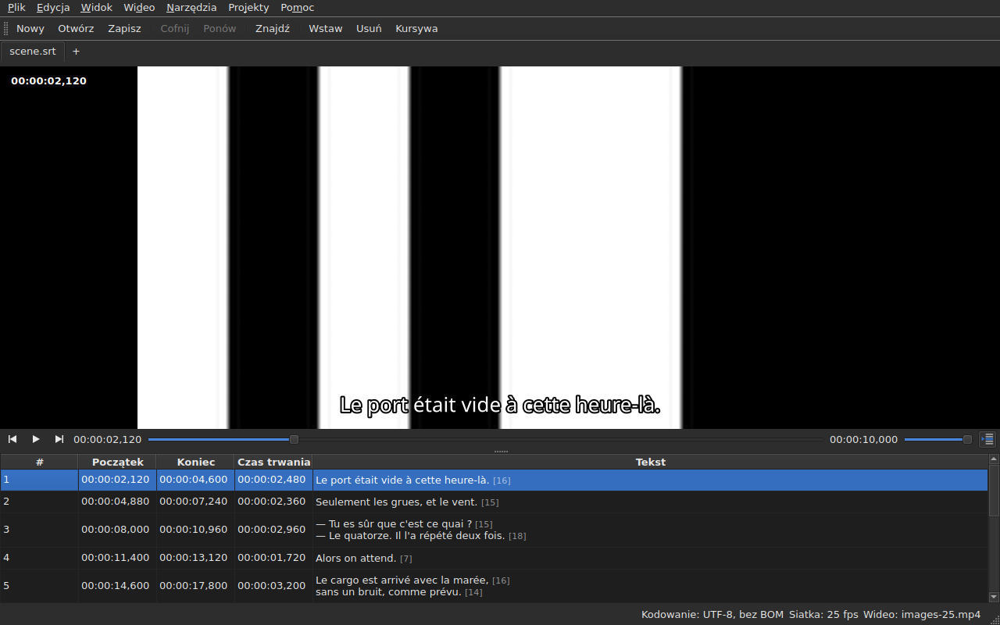

# Odtwarzacz

<!-- machine-translated -->
> Ta strona jest tłumaczeniem maszynowym i nie została jeszcze sprawdzona przez osobę władającą tym językiem.

Powiązane wideo ogląda się **w oknie**, z bieżącą linią
narysowaną na obrazie. Dzięki temu można sprawdzić na filmie wynik
przesunięcia, przekształcenia lub zmiany liczby klatek na sekundę.

Jak powiązać film, opisuje [Powiązane wideo](video.md); ta
strona opisuje, co się dzieje, gdy już jest powiązany.

## Widok wideo

| Sytuacja | Co pokazuje okno |
| :------- | :--------------- |
| wideo jest powiązane i się otwiera | obraz zajmuje górę, tabela jest poniżej |
| brak powiązanego wideo | brak obrazu, tabela zajmuje całe okno |
| wideo się nie otwiera | brak obrazu, komunikat, a okno pozostaje używalne |

Podział między obrazem a tabelą **przesuwa się myszą**. Obraz nie
schodzi poniżej 180 pikseli wysokości. Powiększenie okna oddaje zyskane miejsce
tabeli, nie obrazowi: przy edycji brakuje wierszy.

Pod obrazem **pasek odtwarzania**: gdzie jest film, ile trwa,
odtwarzanie i pauza oraz głośność. Zobacz [Pasek odtwarzania](#pasek-odtwarzania).

## Odtwarzanie i zatrzymywanie

| Polecenie | Skrót | Co robi |
| :-------- | :---- | :------ |
| Wideo ▸ Odtwórz / Pauza | `Ctrl+P` | odtwarza, jeśli odtwarzanie jest zatrzymane, w przeciwnym razie zatrzymuje |

Polecenie jest **wyłączone, dopóki żadne wideo nie jest otwarte**. Wideo, które
właśnie zostało powiązane, otwiera się **zatrzymane**: otwarcie filmu to nie
jego oglądanie.

`Ctrl+P` tam, gdzie Gaupol ma zwykłe `P`: skrót jednoliterowy w
zasięgu okna jest przejmowany, zanim zobaczy go widżet z fokusem,
więc `P` zostałoby pochłonięte w drodze do edytora komórki. Nic tu
nie wypisuje znaku, kombinacja jest wolna.

## Pasek odtwarzania

Pod obrazem, od lewej do prawej — trzy przyciski to **ikony**, z motywu pulpitu, jeśli je ma, a w przeciwnym razie ze stylu Qt:

| Element | Co robi |
| :------ | :------ |
| dwa przyciski kroku | przesuwają film do tyłu i do przodu **o jeden krok w klatkach** — zobacz [Klatka po klatce](timing.md#klatka-po-klatce) |
| odtwarzanie / pauza | odtwarza lub zatrzymuje, tak jak `Ctrl+P` — przycisk pokazuje, **co zrobi**: trójkąt, gdy zatrzymane, dwie kreski, gdy odtwarza; podpowiedź mówi to zwykłymi słowami |
| pozycja | `HH:MM:SS,mmm`, zapisana tak, jak tabela zapisuje pozycję — **jako numer klatki**, gdy zaznaczone jest [`Widok ▸ Pozycje w klatkach`](table.md#pozycje-w-klatkach) |
| suwak | **odczytuje i przesuwa**: przeciągasz uchwyt, klikasz w rowek, używasz strzałek |
| czas trwania | ten, który deklaruje wideo, zapisany jak pozycja |
| głośność | od 0 do 100, zobacz [Głośność](#głośność) |
| podążanie tabeli | wciśnięty, dopóki tabela podąża za odtwarzaniem, a po naciśnięciu przywraca ją na odtwarzaną linię — zobacz [Tabela podąża za odtwarzaniem](#tabela-podąża-za-odtwarzaniem) |

**Suwak nie przekazuje każdego piksela.** Przeciąganie uchwytu żąda dziesiątek
pozycji na sekundę, a każda kosztuje zdekodowaną klatkę: pierwsza pozycja wychodzi od
razu, kolejne czekają dwudziestą część sekundy, a **ostatnia żądana pozycja jest
zawsze tą, która zostaje osiągnięta** — najpóźniej po puszczeniu uchwytu. Obraz zatem nie
pozostaje w tyle za ręką i nie zaczyna rysować drogi, na którą nikt nie patrzy.

**Suwak przesuwa się sam podczas odtwarzania**, i nie liczy się to jako gest:
film przesuwa tylko to, co robisz. Gdy trzymasz uchwyt, odtwarzanie go nie zabiera.

## Kod czasowy

**Pozycja jest zapisana na obrazie**, w lewym górnym rogu, na półprzezroczystym tle, które czyni ją
czytelną na każdej scenie. Rysuje ją okno, jego czcionką, i nie wymaga
od odtwarzacza niczego poza pozycją, którą już podaje; odświeża się przy każdym geście,
bez czekania na następną rundę śledzenia.

## Poruszanie się po filmie

W menu **Wideo** są **gesty Gaupola**, pod jego nazwami. Wszystkie są **wyłączone bez wideo**, tak jak
odtwarzanie; trzy, które działają na zaznaczenie, są wyłączone także dopóki nic nie jest zaznaczone.

| Polecenie | Skrót | Co robi |
| :-------- | :---- | :------ |
| Wideo ▸ Odtwórz zaznaczenie | `Ctrl+Shift+P` | odtwarza od miejsca **trochę przed początkiem** zaznaczenia **do końca jego ostatniego napisu** i zatrzymuje się na obrazie |
| Wideo ▸ Przeskocz do poprzedniego | `Ctrl+Left` | ustawia odtwarzanie na początku ostatniego napisu, który **skończył się** przed pozycją |
| Wideo ▸ Przeskocz do następnego | `Ctrl+Right` | ustawia odtwarzanie na początku pierwszego napisu, który **zaczyna się** po pozycji |
| Wideo ▸ Przewiń do tyłu | `Ctrl+Shift+Left` | cofa o jeden skok — domyślnie trzydzieści sekund |
| Wideo ▸ Przewiń do przodu | `Ctrl+Shift+Right` | przesuwa do przodu o jeden skok |
| Wideo ▸ Idź na początek zaznaczenia | `Ctrl+Up` | ustawia odtwarzanie na początku zaznaczenia, **z wyprzedzeniem** |
| Wideo ▸ Idź na koniec zaznaczenia | `Ctrl+Down` | ustawia odtwarzanie na końcu zaznaczenia, **z wyprzedzeniem** |

**Skróty są skrótami Gaupola**, z jednym wyjątkiem: `Play Selection` to tam `O`, a
gołą literę okno przejmuje, zanim zobaczy ją edytowana komórka — wpisanie
`o` w tekście uruchomiłoby film. `Ctrl+P` jest odpowiedzią dla odtwarzania, `Ctrl+Shift+P` dla
zaznaczenia. Strzałki klawiatury pozostają przy edytorze komórki, gdy jest
otwarty: `Ctrl+Left` przesuwa tam kursor o jedno słowo, a nie odtwarzanie.

- **Skok** wynosi 30 sekund i można go ustawić od 1 sekundy do godziny — zobacz
  [Preferencje](preferences.md#odtwarzacz). Nie przekracza ani początku filmu, ani jego końca.
- **Wyprzedzenie** wynosi jedną sekundę: ogląda się trochę **przed** napisem, by zobaczyć jego nadejście.
  Można je ustawić od 0 do 60 sekund, a odtwarzanie nie schodzi poniżej zera.
- **Sąsiad, który nie istnieje** — nic przed pierwszym napisem, nic po ostatnim —
  nic nie robi i niczego nie mówi: odtwarzanie zostaje tam, gdzie jest.
- **Każdy gest widać od razu**: pasek, kod czasowy i narysowana linia są
  aktualne po jego zakończeniu, bez czekania na następną rundę.

## Głośność

Głośność jest głośnością **odtwarzacza**, od 0 do 100, a nie systemu. Ustawia się ją suwakiem
paska albo dwoma gestami w podmenu `Wideo ▸ Audio`, krokami po pięć:

| Polecenie | Skrót | Co robi |
| :-------- | :---- | :------ |
| Wideo ▸ Audio ▸ Zmniejsz głośność | `Ctrl+-` | zmniejsza głośność o pięć |
| Wideo ▸ Audio ▸ Zwiększ głośność | `Ctrl++` lub `Ctrl+=` | zwiększa ją o pięć — drugi dla klawiatur, na których plus wymaga klawisza shift |

**Jest zapamiętywana od jednej sesji do następnej** i przekazywana każdemu otwieranemu wideo. Wartość spoza
zakresu od 0 do 100 w pliku ustawień nie psuje otwarcia: jest ignorowana, a okno o tym mówi.
**Ścieżka dźwiękowa natomiast nie jest zapamiętywana** — numer ścieżki jest numerem jej pliku; zobacz
[Ścieżka dźwiękowa](video.md#ścieżka-dźwiękowa).

## Zaznaczenie i odtwarzanie

Oba działają w obie strony.

| Co robisz | Co się dzieje |
| :-------- | :------------ |
| zaznaczasz wiersz | odtwarzanie przechodzi **na początek tego napisu** |
| rozszerzasz zaznaczenie w dół | nic więcej: liczy się pierwszy wiersz zaznaczenia |
| odtwarzanie idzie dalej | **bieżący wiersz** podąża za napisem na ekranie, **zabarwiony**, a tabela go **wyśrodkowuje** — zobacz [Tabela podąża za odtwarzaniem](#tabela-podąża-za-odtwarzaniem) |

Bieżący wiersz i zaznaczenie to dwie odrębne rzeczy. Odtwarzanie
przesuwa pierwszy i **nigdy nie dotyka drugiego**: zaznaczenie jest tym, na czym
działa operacja, a film odtwarzany w rogu nie ma prawa
przepisywać wiersz po wierszu celu użytkownika.

Odcień podlega tej samej regule: jest znacznikiem, nie zaznaczeniem. **Anomalia
ma nad nim pierwszeństwo** — wiersz, który ma obie, zachowuje kolor
swojej wady, bo wada jest po to, by ją naprawić, podczas gdy pokazywany wiersz jest nim tylko
przez czas jednej kwestii dialogu. Zobacz [Tabela](table.md).

### Tabela podąża za odtwarzaniem

**Tabela wyśrodkowuje odtwarzaną linię** — pośrodku tego, co pokazuje, a nie na brzegu, gdzie wystarczyłoby, by
była widoczna. Robi to **przy zmianie linii**, a nie przy każdym takcie śledzenia: kwestia dialogu trwa
sekundy, a ponowne wyśrodkowywanie co dziesiątą część sekundy byłoby przewijaniem bez celu.

**Ręczne przewinięcie zawiesza śledzenie.** Kółko, pasek przewijania i kliknięcie w tabeli
je zawieszają: tabela zostaje tam, gdzie ją ustawisz, podczas gdy bieżąca linia, narysowana linia i pasek
nadal podążają za filmem. Przycisk śledzenia — **ikona wierszy tabeli, jeden oznaczony strzałką**, po prawej stronie paska
odtwarzania; jego podpowiedź mówi „Podążaj za odtwarzaniem” — **jest wciśnięty, dopóki tabela podąża**, a potem się podnosi.

**Śledzenie wznawia gest odtwarzacza**: rozpoczęcie odtwarzania, skok, krok, ustawienie znacznika,
wstawienie w pozycji lub przesunięcie paska — tabela wyśrodkowuje się wtedy od razu na
odtwarzanej linii, nawet jeśli była już tą samą. **Albo na żądanie**: naciśnięcie przycisku je przywraca, a
zwolnienie go zawiesza. Nie ma zegara: śledzenie zawsze wznawia gest.

Przejście do innej karty wznawia śledzenie na filmie tej karty.

**Trwająca edycja nie jest przerywana.** Dopóki edytor komórki
jest otwarty, bieżąca linia zostaje tam, gdzie jest; linia narysowana na
obrazie natomiast nadal podąża, ponieważ nikomu nie przeszkadza.

## Narysowana linia

To, co wyświetla się na obrazie, pochodzi z **otwartego dokumentu**, nigdy z pliku:
**to, co widać na obrazie, jest tym, co właśnie wpisano**, bez przechodzenia przez
dysk. Tekst pojawia się wyśrodkowany, na dole obrazu, i znika między dwoma
napisami.

**Przy tłumaczeniu linia pochodzi z tekstu docelowego**: z tłumaczenia, gdy
bieżąca komórka jest w kolumnie `Translation`, z tekstu głównego
w pozostałych przypadkach. To reguła wszystkich operacji na tekście — zobacz [Tekst,
na którym działają operacje](table.md#tekst-na-którym-działają-operacje) —
i **nie ma ustawienia**: przejście z jednej kolumny do drugiej zmienia to, co
pokazuje obraz, najwyżej o jedną dziesiątą sekundy później. Bez tłumaczenia lub
po usunięciu kolumny nic się nie zmienia: to tekst główny.

Napis, którego tłumaczenie jeszcze nie dogoniło, nie pokazuje **niczego**, dopóki
bieżącą kolumną jest tłumaczenie: nie tekst główny
zajmuje jego miejsce.

**Znaczniki formatu są rozumiane, nigdy rysowane takie, jakie są.** Model przenosi
tekst tak, jak zapisuje go plik, i to pivot znaczników — ten sam co przy konwersji
formatu — odczytuje go, zanim przekaże obrazowi:

| W pliku | Na obrazie |
| :------ | :--------- |
| pogrubienie, kursywa, podkreślenie | zastosowane: `<i>no</i>` wyświetla się jako *no*, bez znaczników |
| kolor | zastosowany |
| czcionka, rozmiar | usunięte, tekst zostaje |
| pozycja, wyrównanie, mówca, wszystko bez odpowiednika na ekranie | usunięte, tekst zostaje |
| `{` i `}` w tekście | rysowane: „{laughs}” wyświetla się jako „{laughs}” |

Plik Advanced SSA jest czytany tak samo: jego `{\i1}` działają, a jego
`{\an8}` jest usuwane — linia zostaje na dole obrazu. Każdy tekst jest czytany **w formacie
własnego pliku**, tłumaczenie tak samo jak tekst główny.

**Sąsiedni plik napisów nie jest ładowany** przez odtwarzacz, nawet jeśli nosi nazwę
filmu. Byłby to ten, który jest edytowany, a obraz pokazywałby wtedy stan dysku,
podczas gdy tabela pokazuje coś innego.

## Podgląd zmiany

**Nie trzeba robić niczego szczególnego**: stosujesz operację, oglądasz
film i wybierasz `Undo: shifting` — albo odpowiednią operację — jeśli
wynik nie odpowiada. Zobacz [Cofanie i ponawianie](undo.md).

Nie istnieje osobny tryb podglądu i jest to zamierzone: to, co
się ogląda, to dokument taki, jaki jest, a nie niewidoczny stan tymczasowy.

## Gdy obraz się nie pojawia

Dwa możliwe komunikaty, oba poprzedzone ścieżką pliku:

| Komunikat | Co się stało |
| :-------- | :----------- |
| `<file>: <reason>` | odtwarzacz odrzucił plik — nieznany format, brak pliku, katalog |
| `<file>: no video player is available` | nie udało się zbudować żadnego odtwarzacza |

W obu przypadkach **wideo pozostaje powiązane** — trzeba przecież zobaczyć, jaki
to plik, by wybrać inny — a **okno pozostaje używalne**:
dokument jest otwarty, operacje działają, zapisywanie też.

**Obraz jest rysowany w samym oknie**: `libmpv` wypełnia bufor o
rozmiarze widoku, w prawdziwych pikselach, a okno go maluje. Nic z tego nie zależy od
platformy graficznej — ten sam obraz pod X11, pod Wayland i bez wyświetlacza — i
podąża za zmianą rozmiaru: proporcje filmu są zachowane, reszta
widoku jest czarna.

Drugi komunikat pojawia się zatem tylko wtedy, gdy biblioteka `libmpv` odmawia uruchomienia,
choć jest wymagana przy budowaniu.

Renderowanie odbywa się przez procesor, ale **dekodowanie może wykonać karta graficzna**: ona
dekoduje, obraz jest kopiowany z powrotem do pamięci, a potem rysowany jak wcześniej. Maszyna bez
użytecznej karty dekoduje na procesorze, bez komunikatu. Przy filmie 1080p w H.264 odtwarzanie nadąża za
czasem rzeczywistym z zapasem. **Film 4K w ciężkim HEVC może nie nadążać**: zmierzone na dwóch
rdzeniach, dekoduje się z szybkością 0,6 czasu rzeczywistego bez karty, a krok o jedną klatkę zajmuje tam kilka
sekund, gdy klatka kluczowa jest daleko. Karta skraca ten czas — o jedną trzecią do dwóch trzecich zależnie od filmu
— nie usuwając go. **Nie zmienia wyświetlanego obrazu**: krok lub przeskok trafiają na tę
samą klatkę z kartą i bez niej. Aby ją wyłączyć, odznacz `Decode on the graphics card` w
[`Preferences…`](preferences.md#odtwarzacz).

## Czego tu nie ma

**Ustawianie znacznika, przechodzenie klatka po klatce i przesuwanie krawędzi o jedną klatkę** opisano w
[Synchronizacja na podstawie wideo](timing.md), nie tutaj. Czego nie ma i nie warto tego szukać:

- przebiegu fali dźwiękowej;
- automatycznego odtwarzania po otwarciu filmu;
- stylu narysowanej linii (czcionka, kolor, pozycja, tło): zachowuje styl okna;
- dekodowania sprzętowego bez kopiowania: zobacz „Gdy obraz się nie pojawia” powyżej.

Ten podręcznik opisuje to, co istnieje: to, co nadejdzie, i w jakiej kolejności, znajduje się w
[planie rozwoju](../../../../feuille-de-route.md).
