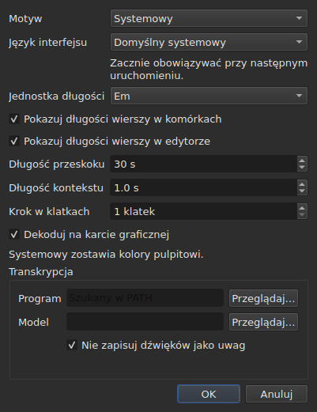

# Preferencje

<!-- machine-translated -->
> Ta strona jest tłumaczeniem maszynowym i nie została jeszcze sprawdzona przez osobę władającą tym językiem.

Okno zapamiętuje to, co ustawisz myszą — **gdzie się znajdowało**, **czy było
zmaksymalizowane**, **szerokość kolumn**, **położenie
uchwytu** między filmem a tabelą — oraz **miejsce, w którym pracujesz**, aby
`Open…` otwierało się we właściwym miejscu. Nic z tego nie jest ustawiane w oknie dialogowym:
przesuwasz, przeciągasz, i to zostaje zapamiętane.

**Sześć preferencji ma własne okno dialogowe**, `Edycja ▸ Preferencje…`, i to jest
kryterium: preferencja, która ma już swój gest, nie potrzebuje pola. Motyw
go nie ma, jednostka długości linii także nie, ani dwa pola wyboru, które
je pokazują, ani skok i wyprzedzenie odtwarzacza. Zob. [Motyw](#motyw),
[Długości linii](#długości-linii) i [Odtwarzacz](#odtwarzacz).

**Język interfejsu jest w tym samym oknie i to on musi poczekać**: zaczyna obowiązywać przy
następnym uruchomieniu, nie od razu. Zob. [Język interfejsu](#język-interfejsu).

**Głośność nie ma okna**: ustawiają ją pasek pod obrazem i dwa gesty, i jest zapamiętywana.

**Inna jest ustawiana tam, gdzie jest używana**: strona, na którą `Insert Subtitles…` wstawia
linie, jest polem tego okna dialogowego, a ostatni wybór jest zapamiętywany. Zob.
[Wstawianie, usuwanie, łączenie, dzielenie napisów i usuwanie nakładania się ich zakresów](lines.md#strona-jest-zapamiętywana).

**Tak samo dwie opcje wyszukiwania**: `Regular expression` i
`Ignore case` pozostają zaznaczone lub nie od jednego otwarcia okna do
następnego i od jednej sesji do następnej. Zob.
[Znajdowanie i zastępowanie](find-and-replace.md#dwie-opcje).

**Tak samo ustawienia `Adjust Durations…`**: szybkość czytania, jej dwa
kierunki oraz trzy czasy trwania z polami wyboru — każde zachowuje swoją wartość, zaznaczone
lub nie. Zob. [`Adjust Durations…`](operations.md#adjust-durations).

**Oraz ostatnie kodowanie wybrane w `Save As…`**, wraz ze znacznikiem kolejności
bajtów. Zob. [plik](#plik).

**Oraz to, co ustawiają kreator `Correct Texts…` i `Spell-Check Settings…`**: zaznaczone
zadania i ich kod, pola wyboru wzorców, ustawienia łamania linii, język,
cel sprawdzania i podkreślanie w trakcie pisania. Zob. [Popraw teksty…](correct-texts.md) i
[Ustawienia sprawdzania pisowni…](check-spelling.md#ustawienia-sprawdzania-pisowni). **Cel i
dokument `Correct Texts…` nie są zapamiętywane.**

**Czego nie zapamiętuje się:** ostatniego otwartego pliku — zob.
[Zapamiętany katalog](#zapamiętany-katalog).

## Odtwarzacz

Cztery pola. **Seek length** i **Context length** pochodzą z Gaupola i mają jego wartości; **Frame step** i **Decode on the graphics card** są własne dla subedit:

| Pole | Co ustawia | Domyślnie | Granice |
| :---- | :----------- | ------: | :----- |
| `Seek length` | skok `Seek Backward` i `Seek Forward` | 30 s | od 1 s do godziny |
| `Context length` | wyprzedzenie przed zaznaczeniem, dla `Seek Selection Start`, `Seek Selection End` i `Play Selection` | 1 s | od 0 do 60 s, z dokładnością do dziesiątej części |
| `Frame step` | krok, **w klatkach**, `Step Backward` i `Step Forward` oraz przesuwania krawędzi | 1 klatka | od 1 do 1000 klatek |
| `Decode on the graphics card` | pozwala karcie graficznej dekodować film, gdy komputer ją ma; bez karty nic się nie zmienia | zaznaczone | zaznaczone lub nie |

Obowiązują **od razu**, bez czekania na ponowne uruchomienie, i są zapamiętywane z jednej sesji do następnej
pod kluczami `video.seek-length` (w sekundach), `video.context-length-ms` (w milisekundach) `video.step-frames` (w klatkach) i `video.hardware-decoding` (`true` lub `false`).
**Wartość spoza granic albo niebędąca liczbą** nie przeszkadza w otwarciu okna: jest
ignorowana, pozostaje wartość domyślna, a okno mówi o tym przy otwarciu. **Krok w klatkach nigdy nie jest w milisekundach**: krok N klatek to zawsze N klatek, bez względu na liczbę klatek na sekundę filmu — zob. [Synchronizacja na podstawie wideo](timing.md#klatka-po-klatce). Głośność jest zapamiętywana w `video.volume`,
od 0 do 100, z taką samą tolerancją.

## Plik

```
~/.config/subedit/settings.conf
```

Dokładniej `$XDG_CONFIG_HOME/subedit/settings.conf`, gdy ta zmienna
jest ustawiona. Jest zapisywany **przy zamykaniu okna** i odczytywany przy jego otwieraniu.
Program przerwany — zabity albo zatrzymany przez awarię — niczego nie zapisuje, a
następna sesja zastaje to, co zostawiła poprzednia.

Plik jest tekstowy i można go edytować ręcznie. To właściwość, a nie
efekt uboczny: dzięki niej ustawienie da się poprawić, nawet gdy interfejs,
który je ustawia, jest właśnie zepsuty.

### Dwa bloki, jeden wspólny z wierszem poleceń

Plik jest zapisany w **dwóch blokach**, każdy pod komentarzem-nagłówkiem:

| Blok | Klucze | Czytany przez |
| :---- | :--- | :------ |
| `# Operation settings: shared by the window and the command line` | klucze `duration-adjust.*` i `correction.*` | okno **oraz** `subedit-cli` |
| `# Display preferences: the window's own` | każdy inny klucz — geometria, kolumny, motyw, język interfejsu, wyszukiwanie, sprawdzanie pisowni, edytor, wideo, ostatni katalog, kodowanie zapisu | tylko okno |

**`subedit-cli` domyślnie czyta blok operacji**: to, co `Adjust Durations…` i
`Correct Texts…` zapamiętują tutaj, jest też punktem wyjścia dla [`subedit-cli adjust`](../subedit-cli/adjust.md)
i części [`subedit-cli correct`](../subedit-cli/correct.md), chyba że opcja
wiersza poleceń mówi co innego. **Nigdy nie czyta preferencji wyświetlania.** Jego
polecenie [`config`](../subedit-cli/config.md) wyświetla klucze operacji, pokazuje ich wartości i
je zmienia — `subedit-cli config set duration-adjust.speed 12` — a okno widzi zmianę
przy następnym otwarciu. **Zmiana dokonana, gdy okno jest otwarte, nie przetrwa jego zamknięcia**:
okno przepisuje cały plik tym, co przechowuje. `--no-config` sprawia, że wiersz poleceń ignoruje
plik. Zob.
[Plik ustawień](../subedit-cli/invocation.md#plik-ustawień).

Czytnik przyjmuje klucze w dowolnej kolejności, z nagłówkami lub bez: plik zapisany, zanim
pojawiły się dwa bloki, jest czytany bez zmian i przepisany w dwóch blokach przy następnym zamknięciu.

| Opcja | Co zawiera | Domyślnie |
| :----- | :------------ | :------ |
| `window.geometry` | `x,y,width,height`, w pikselach; szerokość i wysokość różne od zera | okno dobiera rozmiar samo |
| `window.maximised` | `true` lub `false` | `false` |
| `table.columns` | cztery szerokości w pikselach, oddzielone przecinkami — `#`, `Start`, `End`, `Duration`, także ukryte | tabela dobiera rozmiar sama |
| `table.order` | sześć kolumn, **każda raz**, w kolejności, w jakiej pokazuje je tabela: `number`, `start`, `end`, `duration`, `text`, `translation` | `number,start,end,duration,text,translation` |
| `table.hidden` | usunięte kolumny, spośród `number`, `start`, `end` i `duration`; puste — żadna | brak |
| `window.table-share` | część wysokości przyznana tabeli, w procentach, od 1 do 99 | okno dzieli tak jak zawsze |
| `file.directory` | **bezwzględna** ścieżka katalogu | brak: `Open…` otwiera się tam, gdzie uruchomiono program |
| `general.theme` | `system`, `light` lub `dark` | `system` |
| `interface.language` | `system` albo nazwa języka tak, jak nazwany jest jego katalog: dwie lub trzy małe litery, potem opcjonalnie `_` i dwie wielkie — `fr`, `pt_BR`; `en` dla angielskiego | `system` |
| `edit.insert-placement` | `above` lub `below` | `below` |
| `file.write-encoding` | nazwa kodowania, które ICU potrafi zapisać i którego konwerter nie zapisuje własnego znacznika | brak |
| `file.write-bom` | `true` lub `false` | `false` |
| `search.regex` | `true` lub `false` — wzorzec jest wyrażeniem regularnym | `false` |
| `search.ignore-case` | `true` lub `false` — wielkość liter jest ignorowana | `true` |
| `duration-adjust.speed` | szybkość czytania, w znakach na sekundę, ściśle dodatnia; liczba dziesiętna jest zapisywana jak najkrócej (`15`, `12.5`) | `15` |
| `duration-adjust.lengthen` | `true` lub `false` — wydłużaj to, co za krótkie, by je przeczytać | `true` |
| `duration-adjust.shorten` | `true` lub `false` — skracaj to, co pozostaje wyświetlane dłużej, niż trzeba | `false` |
| `duration-adjust.minimum-enabled` | `true` lub `false` — wymagany jest minimalny czas trwania | `true` |
| `duration-adjust.minimum-ms` | minimalny czas trwania, w milisekundach, liczba całkowita nieujemna | `1500` |
| `duration-adjust.maximum-enabled` | `true` lub `false` — wymagany jest maksymalny czas trwania | `false` |
| `duration-adjust.maximum-ms` | maksymalny czas trwania, w milisekundach, liczba całkowita nieujemna | `6000` |
| `duration-adjust.gap-enabled` | `true` lub `false` — wymagana jest przerwa do następnego napisu | `true` |
| `duration-adjust.gap-ms` | przerwa, w milisekundach, liczba całkowita nieujemna | `0` |
| `correction.mentions.enabled`, `correction.common-errors.enabled`, `correction.capitalization.enabled`, `correction.line-break.enabled` | `true` lub `false` — zadanie jest zaznaczone na pierwszej stronie `Correct Texts…` | `false`, `true`, `true`, `false` |
| `correction.mentions.code`, `correction.common-errors.code`, `correction.capitalization.code`, `correction.line-break.code` | kod wzorców zadania: `Zyyy` albo `Script[-language[-COUNTRY]]` — `Latn-en-US`; niepusty | `Zyyy` |
| `correction.human`, `correction.ocr` | `true` lub `false` — klasy typowych błędów | `true`, `true` |
| `correction.sound-in-brackets`, `correction.sound-in-parentheses` | `true` lub `false` — dwa pola wyboru strony `Mentions` | `false`, `false` |
| `correction.line-break.max-length` | maksymalna długość linii, dziesiętna; okno dialogowe ogranicza ją od 1 do 1000 | `24` |
| `correction.line-break.max-lines` | maksymalna liczba linii, całkowita; okno dialogowe ogranicza ją od 1 do 100 | `3` |
| `correction.line-break.in-ems` | `true`: długość jest mierzona w *emach*; `false`: w znakach | `true` |
| `correction.line-break.skip-on-length`, `correction.line-break.skip-on-lines` | `true` lub `false` — wymagane są dwa warunki pominięcia | `true`, `true` |
| `correction.line-break.skip-max-length`, `correction.line-break.skip-max-lines` | dwa progi pominięcia, w wybranej jednostce | `24`, `3` |
| `correction.join-split.enabled` | `true` lub `false` — zadanie `Join or Split Words` jest zaznaczone | `false` |
| `correction.join-split.join`, `correction.join-split.split` | `true` lub `false` — łącz, dziel | `true`, `false` |
| `correction.join-split.language` | kod ustawień regionalnych — `fr`, `en_US`, `sr@Latn` —; puste: język systemu | puste |
| `correction.remove-blank` | `true` lub `false` — `Remove all blank subtitles` | `true` |
| `transcription.engine` | nazwa silnika: małe litery, cyfry, `.`, `-` i `_` | `whisper.cpp` |
| `transcription.executable`, `transcription.model` | ścieżka bezwzględna; puste: silnik jest szukany w `PATH`, a model nie jest ustawiony | puste |
| `transcription.language` | dwie małe litery, kod ISO 639-1; puste: język jest wykrywany | puste |
| `transcription.merge-gap-ms` | fragmenty jednego zdania położone bliżej niż ta wartość są łączone, w milisekundach, liczba całkowita nieujemna | `400` |
| `transcription.max-duration-ms` | najdłuższy czas, przez jaki przetranskrybowany napis pozostaje na ekranie, w milisekundach, od 1 do 3600000 | `7000` |
| `transcription.max-characters` | największa liczba znaków przetranskrybowanego napisu, od 1 do 1000 | `84` |
| `correction.activations` | pola wyboru wzorców, które użytkownik zmienił, `<type>:<code>:<name>:<0\|1>`, oddzielone przecinkami; **przecinek lub ukośnik odwrotny w nazwie jest zapisywany z poprzedzającym ukośnikiem odwrotnym** (`\,` i `\\`), a nieczytelny wpis traci tylko własne ustawienie — jest zgłaszany, pozostałe zostają zachowane | puste |
| `spell-check.language` | kod ustawień regionalnych, taki jak `fr_FR`; puste: język systemu | puste |
| `spell-check.target` | `selection`, `current-project` lub `all-projects` | `current-project` |
| `spell-check.document` | `main` lub `translation` | `main` |
| `spell-check.inline` | `true` lub `false` — podkreślaj nieznane wyrazy w trakcie pisania w edytorze komórki | `false` |
| `editor.length-unit` | `em` lub `characters` — jednostka długości linii pokazywanych przez tabelę i edytor | `em` |
| `editor.show-lengths-cell` | `true` lub `false` — po każdej linii komórki z tekstem następuje jej długość | `true` |
| `editor.show-lengths-edit` | `true` lub `false` — edytor komórki pokazuje długość każdej linii na marginesie | `true` |

**Plik przyjmuje więcej niż okno dialogowe.** Czytnik przyjmuje każdą ściśle
dodatnią szybkość i każdy nieujemny czas trwania; okno dialogowe `Adjust
Durations…` ogranicza natomiast szybkość od 1 do 99 znaków na sekundę, a każdy
czas trwania od 0 do 99 s. Wartość z pliku spoza tych granic jest sprowadzana do
granicy, gdy okno dialogowe się otwiera, i plik zachowuje ją w takiej postaci, gdy
okno dialogowe zostanie zaakceptowane, a okno zamknięte. Anulowane okno dialogowe niczego nie zmienia w tym, co
jest zapamiętane.

**`file.write-encoding` zapamiętuje ostatnie kodowanie wybrane w `Save As…` i
nigdy nie narzuca się plikowi.** Otwarty dokument ma swoje własne kodowanie,
i to ono jest proponowane w oknie: przepisanie go w innym tylko dlatego, że
ustawienie sprzed trzech tygodni tak mówi, utraciłoby to, co zachował odczyt.
To, co to ustawienie zapamiętuje, służy dokumentowi, który nie ma pliku — temu
właśnie utworzonemu.

**To zamierzone „nie”, a nie przeoczenie.** Ktoś, kto zawsze dostarcza w
tym samym kodowaniu, a otwiera odziedziczone pliki w innym, wybiera je ponownie dla
każdego pliku; okno mu je proponuje, a gwarancja obiegu w obie strony obowiązuje
wszystkich.

**`file.write-bom` niesie znacznik tego samego kodowania**, i rzeczywiście potrzebne są dwa
wiersze: nazwa kodowania nie mówi, czy poprzedza je znacznik, tak samo
jak `--encoding` nie mówi tego, co `--bom`. Oba są czytane razem, w
dowolnej kolejności, a `file.write-bom` bez zapamiętanego kodowania niczego nie ustawia.

**Część, a nie wysokości uchwytu**, i to właśnie czyni ją
użyteczną: trzy wysokości w pikselach przestają cokolwiek znaczyć, gdy tylko okno
otworzy się w innym rozmiarze, a okno często otwiera się w innym rozmiarze.
Część można odtworzyć wszędzie. Jest **sprowadzana do tego, co okno przyjmuje**, jeśli
jest za mała — pas z filmem ma minimalną wysokość.

**Cztery szerokości dla sześciu kolumn**, i to nie przeoczenie: są to szerokości
`#`, `Start`, `End` i `Duration`, w tej kolejności, niezależnie od kolejności
w tabeli, a **ukryta kolumna zachowuje swoją własną** — odnajduje ją, gdy znów
zostanie pokazana. Ostatnia pokazana kolumna zajmuje to, co zostawiają inne, a nadanie jej
szerokości nic by nie zmieniło; szerokości tekstu i tłumaczenia nie są więc
zapamiętywane.

## Co się dzieje, gdy plik nie mówi tego, czego się oczekuje

Konfiguracja to wygoda. **Jej awaria kosztuje wygodę i nic więcej**:
okno otwiera się w każdym przypadku.

| Przypadek | Co się dzieje |
| :--- | :----------- |
| plik nie istnieje | wszystkie wartości domyślne i nic nie jest mówione — to pierwsze uruchomienie |
| plik istnieje, ale nie da się go odczytać | wszystkie wartości domyślne, a powód jest zapisywany na wyjściu błędów |
| brakuje opcji | jej wartość domyślna |
| klucz jest nieznany | ignorowany bez słowa i nieobecny w przepisanym pliku |
| wartości nie da się odczytać | zostaje jej wartość domyślna, a opcja jest wskazana na wyjściu błędów |

```console
$ subedit-gui film.srt
subedit-gui: /home/vous/.config/subedit/settings.conf: window.geometry: "plus tard" cannot be read, keeping the default
```

**Komunikat trafia na wyjście błędów i nigdzie indziej.** Okno modalne
przy uruchomieniu z powodu nieczytelnej preferencji zatrzymywałoby użytkownika z powodu
usterki, która niczemu mu nie przeszkadza, i zanim o cokolwiek poprosił.

## Opcje w komentarzach

Przepisany plik zawiera **wszystkie** znane opcje, a te pozostawione
na wartości domyślnej są zapisane jako komentarze:

```
#window.geometry = 0,0,1280,800
#window.maximised = false
#table.columns = 60,110,110,110
#table.order = number,start,end,duration,text,translation
#table.hidden = start,end
```

To nie jest przypisanie. Bez tego opcja, której nigdy nie dotknięto, pozostawałaby
zamrożona na wartości z dnia zapisu, a **ulepszona wartość domyślna
nigdy by do nikogo nie dotarła**. Dzięki temu zmiana wartości domyślnej zmienia
zachowanie każdego, kto jej nie nadpisał — a to dokładnie to,
co wartość domyślna ma robić.

Aby nadpisać opcję: usuń `#` i zmień wartość. Aby wrócić
do wartości domyślnej: usuń wiersz albo ponownie zamień go na komentarz.

Geometria, szerokości i usunięte kolumny pokazują **kształt**, a
nie obowiązującą wartość: wartością domyślną geometrii i szerokości jest
„to, co wybiera okno”, czego nie da się zapisać liczbami, a wartością domyślną
`table.hidden` jest „żadna”, czego nie da się odczytać. Mówi o tym też
nagłówek pliku. `table.order` natomiast pokazuje domyślną kolejność.

## Zapamiętany katalog

`Open…` otwiera się w katalogu **ostatnio otwartego lub zapisanego pliku**,
a nie w tym z okna, które anulowano: liczy się to, gdzie
pracujesz, a nie gdzie zaglądałeś.

**Sam ostatni plik nie jest zapamiętywany.** Zapamiętanie go oznaczałoby
ponowne otwieranie przy uruchomieniu dokumentu, o który nikt nie prosił. Zapamiętanie katalogu
*wskazuje* okno dialogowe; zapamiętanie pliku otwierałoby go.

## Motyw

`Edycja ▸ Preferencje…` otwiera się od motywu, preferencji bez gestu, nad
[długościami linii](#długości-linii).

| Wartość | Co robi |
| :---- | :----------- |
| `System` | **nic** — kolory pozostają kolorami pulpitu |
| `Light` | ustawia jasną paletę |
| `Dark` | ustawia ciemną paletę |

Wybrany motyw obowiązuje **natychmiast**, bez ponownego uruchamiania.

**„System” nic nie robi i nie jest to brak.** Wersja Qt, na
której zbudowano subedit, nie ma sposobu, by zapytać pulpit, czy chce być
jasny, czy ciemny, ani by dowiedzieć się, kiedy zmieni zdanie. Zamiast
wymyślać odczyt, którego nie umiemy wykonać, narzędzie dostarcza dwa motywy,
o które można poprosić, a trzeci pozostawia do decyzji toolkitowi —
tak samo robi Gaupol w tych samych warunkach.

Na pulpicie, którego motyw jest już ciemny, `System` daje więc ciemne
okno; na jasnym pulpicie — jasne okno. `Light` i `Dark` go nadpisują,
bez względu na pulpit.

**Odcienie anomalii pozostają czytelne w obu paletach** — zob.
[Tabela](table.md#anomalie). To nie założenie: kontrast
tekstu na każdym z odcieni jest sprawdzany testem, na obu tłach.

## Język interfejsu

`Edycja ▸ Preferencje…` wybiera język okna, pod motywem.

| Pole | Wartości | Domyślnie |
| :---- | :----- | :------ |
| `Interface language` | `System default`; `English`; potem każdy język zainstalowany z programem, pod własną nazwą — `Français` | `System default` |

**Zaczyna obowiązywać przy następnym uruchomieniu**, a okno dialogowe mówi o tym pod polem: okno jest
tłumaczone w trakcie budowania, a działające okno zachowuje język, w którym się uruchomiło. Wybór jest
zapisany w pliku ustawień, pod `interface.language`, i odczytywany przy następnym otwarciu okna.

| Wybór | Okno uruchamia się w |
| :----- | :------------------- |
| `System default` | języku środowiska, tak jak przed jakimkolwiek wyborem — `LANGUAGE`, `LC_ALL`, `LC_MESSAGES`, `LANG`; zob. [Język](invocation.md#język) |
| `English` | angielskim, cokolwiek mówi środowisko |
| zainstalowany język | tym języku, **cokolwiek mówi środowisko**, także `LC_ALL=C`: wybór dokonany tutaj jest jawny |

Lista zawiera języki, których katalog jest zainstalowany w `<prefix>/share/subedit/locale`;
angielski jest zawsze, ponieważ jest to język, w którym napisano program. Język jest pokazywany
pod własną nazwą, której żaden katalog nie tłumaczy, aby czytelnik znalazł ten, w którym czyta.

**Wartość, której program nie może uwzględnić, kosztuje tylko wybór:**

| Co mówi plik | Co się dzieje |
| :----------------- | :----------- |
| nazwa języka bez zainstalowanego katalogu — plik przyniesiony z innego komputera | okno podąża za środowiskiem, bez słowa; `Preferences…` pokazuje ten język, pod nazwą lub kodem, i zachowuje go, dopóki nie wybierze się innego |
| coś, co nie jest nazwą języka — `French`, `fr_FR.UTF-8` | `system`, wartość domyślna, a opcja jest wskazana na wyjściu błędów, jak każda nieczytelna wartość |

```console
$ subedit-gui film.srt
subedit-gui: /home/vous/.config/subedit/settings.conf: interface.language: "French" cannot be read, keeping the default
```

**Wiersz poleceń nigdy go nie czyta**: `subedit-cli` wybiera język wyłącznie ze środowiska,
a `subedit-cli config set interface.language fr` jest odrzucane jako preferencja wyświetlania.

## Długości linii




`Edycja ▸ Preferencje…` ustawia także **to, co tabela i edytor pokazują z
długości linii** — linijka i margines znane z Gaupola.

| Pole | Co robi | Domyślnie |
| :---- | :----------- | :------ |
| `Length unit` | jednostka długości: `Ems` lub `Characters` | `Ems` |
| `Show line lengths in cells` | po każdej linii komórki z tekstem następuje jej długość | zaznaczone |
| `Show line lengths in the editor` | edytor komórki pokazuje długość każdej linii na marginesie po prawej | zaznaczone |

**`Length unit` jest wyszarzone, gdy żadne z pól wyboru nie jest zaznaczone**: skoro nie ma
długości do pokazania, jednostka niczego nie ustawia. Wybór obowiązuje **od razu** w
tabeli, a edytory otwierane później go uwzględniają. Trzy wartości są
zapamiętywane z jednej sesji do następnej: `editor.length-unit`, `editor.show-lengths-cell`
i `editor.show-lengths-edit`, w tabeli [pliku](#plik). Zob.
[Długość linii](table.md#długość-linii) i
[w edytorze](editing.md#długość-linii).

**To nie jest limit kreatora.** Jednostka `Correct Texts…` — długość,
przy której łamie linie — to osobne ustawienie, w jego
kreatorze: możesz czytać emy w tabeli, a łamać w znakach.

## Czego nie można ustawić

**Dziewięć zapamiętywanych ustawień wybiera się w oknie dialogowym** — nie licząc tych
z kreatora poprawek i ze sprawdzania pisowni, które mają każde
swoje — i każde w tym, w którym jest używane: motyw i trzy ustawienia długości linii, tutaj; strona wstawiania, w oknie wstawiania;
dwie opcje wyszukiwania, w oknie wyszukiwania; kodowanie i
znacznik kolejności bajtów, w `Save As…`; szybkość czytania, czasy trwania
i przerwa dostosowania czasów trwania, w jego własnym oknie. Nie ma
żadnego innego: nic nie da się ustawić dla komunikatów diagnostycznych, głośności odtwarzacza
ani domyślnego formatu zapisu — ten pochodzi z otwartego pliku.

I **żadna liczba należąca do dokumentu nie jest zachowywana z jednej sesji do
następnej**: wartość przesunięcia, dwa znaczniki przekształcenia są prawdziwe dla jednego
pliku i fałszywe dla następnego. Okna dialogowe pytają o nie ponownie przy każdym uruchomieniu,
celowo. Ustawienia `Adjust Durations…` są wyjątkiem w ten sam sposób co
dwie opcje wyszukiwania: szybkość czytania, minimalny czas trwania czy
przerwa są wyborami metody, a nie pomiarami pliku, i
z tego powodu przetrwają z jednej sesji do następnej.

Podręcznik opisuje to, co istnieje: dalsze plany znajdują się w
[planie rozwoju](../../../../feuille-de-route.md).
