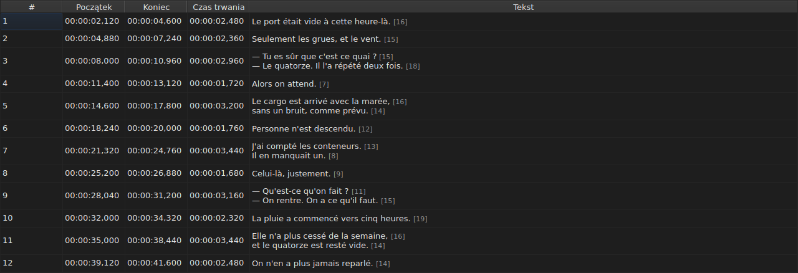
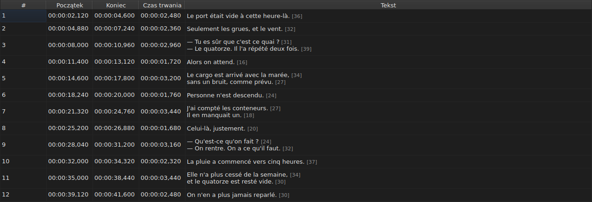
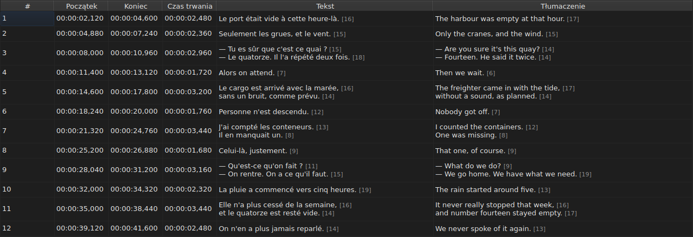
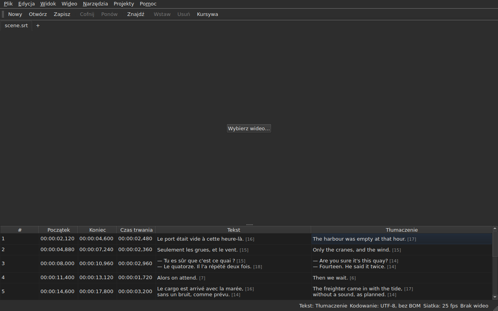

# Tabela

<!-- machine-translated -->
> Ta strona jest tłumaczeniem maszynowym i nie została jeszcze sprawdzona przez osobę władającą tym językiem.

Okno pokazuje napisy otwartego pliku, po jednym w wierszu, w pięciu
kolumnach — w sześciu, gdy projekt zawiera tłumaczenie.

**Ten podręcznik cytuje nagłówki okna tak, jak wyświetla je okno
angielskie**, podobnie jak w przypadku wiersza poleceń; okno przetłumaczone pokazuje je
we własnym języku.

| Kolumna | Co pokazuje |
| :------ | :---------- |
| `#` | numer napisu, od 1 |
| `Start` | pozycja, w której się pojawia, `HH:MM:SS,mmm` |
| `End` | pozycja, w której znika |
| `Duration` | `End − Start` |
| `Text` | tekst napisu |
| `Translation` | tłumaczenie napisu — **nieobecna, dopóki projekt go nie ma** |




## Długość linii




**Po każdej linii komórki tekstowej następuje jej długość**, `[N]`, mniejsza
i jaśniejsza — w kolumnie `Text`, tak samo jak w kolumnie `Translation`.
Tak robi Gaupol.

| Co się liczy | Co robi tabela |
| :----------- | :------------- |
| **znaczniki** | nie liczą się: `<i>Bonjour</i>` daje `[7]`, tak jak `Bonjour` |
| **zaokrąglanie** | w dół: linia o długości 12,9 em wyświetla się jako `[12]` |
| **pusta linia** | nie ma długości; pusty tekst również |
| **jednostka** | domyślnie *em*, albo znaki — `Edycja ▸ Preferencje…` |
| **linia zbyt długa na kolumnę** | jest ucinana przez `…` **przed** liczbą, która pozostaje widoczna |

**Em jest emem Gaupola, a nie typografii**: alfabet małych liter
jest wart 0,55 em na literę, w czcionce tabeli. Długość w *em* zależy więc
od czcionki; długość w znakach liczy punkty kodowe, litera
z akcentem za jeden.

**Tabela nie oznacza zbyt długiej linii.** Pokazuje liczbę, a to oko ma
ją porównać z limitem, który sam sobie wyznaczysz — tak jak w Gaupolu. To nie jest
limit kreatora `Correct Texts…`, który ma własne ustawienie.

**Aby ich nie widzieć:** odznacz `Show line lengths in cells` w
`Edycja ▸ Preferencje…`. Zobacz [Długości linii](preferences.md#długości-linii).

## Ukrywanie i przesuwanie kolumn

**`Widok ▸ Kolumny`** ma po jednej pozycji do zaznaczania na kolumnę, **z wyjątkiem `Text`**:
bez tekstu głównego nie byłoby już czego edytować.

| Pozycja | Kolumna |
| :------ | :------ |
| `Widok ▸ Kolumny ▸ Nr` | `#` |
| `Widok ▸ Kolumny ▸ Początek` | `Start` |
| `Widok ▸ Kolumny ▸ Koniec` | `End` |
| `Widok ▸ Kolumny ▸ Czas trwania` | `Duration` |
| `Widok ▸ Kolumny ▸ Tłumaczenie` | `Translation` — zobacz [Kolumna tłumaczenia](#kolumna-tłumaczenia) |

Odznaczenie pozycji usuwa jej kolumnę, ponowne zaznaczenie przywraca ją, w szerokości,
jaką miała. **Ustawienie dotyczy całego okna**, wszystkich kart
łącznie: jest jedna tabela, której projekt zmienia się wraz z kartą.

**Bieżąca komórka opuszcza usuwaną kolumnę**: przechodzi do `Text`,
w tym samym wierszu, a zaznaczenie się nie przesuwa. Bieżąca komórka w
kolumnie, której nikt nie widzi, byłaby komórką, którą naciśnięcie klawisza edytowałoby
na ślepo.

**Kolumny przesuwa się, przeciągając ich nagłówek**, każdej z nich, `Text`
także. Ostatnia pokazana kolumna zajmuje miejsce, które zostawiają pozostałe.

**Kolejność i usunięte kolumny są zapamiętywane od jednej sesji do następnej**, razem z
szerokościami, w [pliku preferencji](preferences.md) — `table.order`
i `table.hidden`. Kolumny tłumaczenia tam nie ma: podlega własnej
regule i wraca przy każdym otwartym tłumaczeniu.

**Numer nie jest daną pliku**, lecz numerem wiersza. Wstawienie lub usunięcie
przenumerowuje więc wszystko, co następuje, bez przepisywania czegokolwiek.

**Separator dziesiętny podąża za formatem pliku**: przecinek dla SubRip,
kropka dla ośmiu pozostałych. SubRip jest jedynym z dziewięciu, który zapisuje przecinek.

**Podąża separator, a nie cały zapis.** Tabela zawsze zapisuje
godziny i zawsze trzy miejsca po przecinku; plik WebVTT pomija
godziny poniżej jednej godziny, SubViewer 2 i oba Sub Station Alpha liczą w
setnych, MPL2 w dziesiątych, TMPlayer w sekundach, MicroDVD w klatkach.
Kolumna, której szerokość podążałaby za formatem, byłaby bardziej uciążliwa w czytaniu niż
kolumna, która po prostu nie jest dokładnym zapisem pliku.

Tabela gwarantuje więc **wartość i separator**, a nie liczbę
miejsc po przecinku. To, co format docelowy by zaokrąglił, jest powiedziane w chwili
zapisu — zobacz
[Czego format nie przenosi](files.md#czego-format-nie-przenosi-powiedziane-przed-zapisem).

**Czas trwania (`Duration`) jest obliczany**, nigdy zapisywany: jego wpisanie przesuwa
koniec. Napis, którego koniec poprzedza
początek, wyświetla ujemny czas trwania, a nie zero: to anomalia
pliku, a jej ukrycie uniemożliwiłoby jej znalezienie.

**Początek, koniec, czas trwania, tekst i tłumaczenie edytuje się w miejscu**;
numeru nie. Zobacz [Edycja komórki](editing.md).

**Zaznaczenie wskazuje, na czym działa operacja** — zobacz
[Operacje](operations.md).

**Wysokość wiersza podąża za niesionym napisem**: napis z
dwiema liniami zajmuje dwie, z trzema — trzy. Tekst jest pokazywany w
całości, tak jak zostanie zapisany.

**Ucięta pozostaje linia zbyt długa na swoją kolumnę**, i kończy się wtedy
wielokropkiem. Poszerzenie kolumny `Text` lub okna pokazuje ją
w całości; otwarcie komórki również. Linie tekstu nie są nigdy
zawijane: linię tworzy tylko prawdziwy podział wiersza, dzięki czemu wysokość
wiersza tabeli nie zmienia się, gdy przeciągasz krawędź kolumny.

## Pozycje w klatkach

**`Widok ▸ Pozycje w klatkach`** — pozycja do zaznaczania, jedno ustawienie dla okna — pokazuje kolumny
`Start` i `End` **jako numery klatek** zamiast kodów czasowych i **przyjmuje numer klatki jako dane wejściowe**. Mówią
o tym nagłówki: `Start (frames)` i `End (frames)`.

| Co się zmienia | Co się nie zmienia |
| :------------- | :----------------- |
| to, co `Start` i `End` zapisują i co przyjmują | kolumna `Duration`, która pozostaje czasem |
| nagłówki tych dwóch kolumn | dokument: nic nie jest modyfikowane, historia nie ma nowego wpisu, a **to, co plik zapisuje, jest tym, co zapisywał** |

**Liczba klatek na sekundę, która liczy klatki**, jest, w tej kolejności:

1. **liczbą pliku**, gdy jest liczony w klatkach — MicroDVD, który niesie numery, a nie
   liczbę klatek na sekundę: **okno pokazuje wtedy liczby ze swojego pliku**, niezależnie od wideo;
2. **liczbą, którą deklaruje powiązane wideo**;
3. **siatką, którą rysują pozycje**, gdy ją rysują.

Podpowiedź pozycji mówi, która została przyjęta: *Pozycje to numery klatek, liczone przy 25 fps, liczba zadeklarowana przez
wideo*. **Gdy nie ma żadnej z trzech, pozycja jest wyłączona, a jej podpowiedź mówi dlaczego**: plik
nie jest liczony w klatkach, wideo nie deklaruje liczby klatek na sekundę, a pozycje nie leżą na żadnej siatce.

- **Numer to numer klatki, w której leży pozycja**, zaokrąglony do najbliższej klatki. **Wpisany,
  daje chwilę, w której ta klatka się zaczyna**, zaokrągloną **tylko raz** z dokładnego ilorazu
  ([ADR 0013](../../../../adr/0013-mise-a-l-echelle-exacte-des-positions.md)): klatka 37 przy 23,976 klatki na sekundę
  zaczyna się w 1543,04 ms, czyli `00:00:01,543`.
- **Przyjmowane są tylko liczby całkowite** — ze znakiem minus, ponieważ początek może poprzedzać film. Kod
  czasowy wpisany w trybie klatek albo liczba, która nią nie jest, pozostawia komórkę taką, jaka była.
- **Pasek odtwarzania podlega temu samemu ustawieniu**: pozycja i czas trwania po obu stronach suwaka
  są zapisane jako numery klatek, tak jak `Start` i `End`, w tej samej chwili — zobacz
  [Pasek odtwarzania](player.md#pasek-odtwarzania). Zegar narysowany u góry obrazu pozostaje
  kodem czasowym.
- **To ustawienie nie jest zapamiętywane** od jednej sesji do następnej: jest ustawieniem okna, a nie
  dokumentu, i włącza się je z powrotem jednym gestem.

## Anomalie

Napis, którego pozycje do siebie nie pasują, jest **zabarwiony w swoich
kolumnach czasu**, a najechanie na niego mówi, co jest nie tak.

| Odcień | Co zgłasza | Co robić |
| :----- | :--------- | :------- |
| czerwony | `ends before it starts` | popraw jego koniec albo jego początek |
| niebieski | `starts before the previous one starts` | ustaw go z powrotem na jego miejscu w kolejności |
| bursztynowy | `starts before the previous one ends` | dostosuj jego synchronizację |


Zabarwione są tylko kolumny `Start`, `End` i `Duration`: anomalia
mówi tylko o czasie, a zabarwienie tekstu sugerowałoby, że ma on z nią
coś wspólnego.

**Napis może mieć kilka**, a podpowiedź nazywa je wszystkie. Odcień
jest odcieniem pierwszej do naprawienia: napis zepsuty sam w sobie
jest zepsuty niezależnie od tego, co robią jego sąsiedzi; źle umieszczony napis wraca na miejsce,
a jego nakładanie znika razem z tym.

> To nie przypadek, że nieporządek prawie zawsze wygrywa z
> nakładaniem: zaczynać się przed początkiem poprzedniego to zaczynać się
> przed jego końcem — chyba że poprzedni jest sam zepsuty.

**Oznaczenie jest obliczane na nowo po każdej zmianie pozycji**, niezależnie od tego, czy pochodzi
z edytowanej komórki, operacji czy cofnięcia. Mówi, jaki
plik jest teraz, a nie jaki był przy otwarciu.

Nie opiera się na żadnej siatce klatek: gdy tylko pozycja zostanie poprawiona
ręcznie, opuszcza ją, a oznaczenie oparte na niej zgłaszałoby
pracę użytkownika.

## Kolumna tłumaczenia

Napis niesie **dwa teksty i jedną parę pozycji**:
tłumaczenie nie ma własnej synchronizacji, jest przypięte do synchronizacji napisu.
Tabela pokazuje je w szóstej kolumnie, `Translation`, na prawo od `Text`.




**Kolumna jest tylko wtedy, gdy projekt ma tłumaczenie.** Bez niego tabela
zachowuje swoje pięć kolumn, a okno zachowuje się tak, jakby tłumaczenie
nie istniało — nic nie jest wyszarzone ani dodane. `Plik ▸ Otwórz tłumaczenie…` otwiera
je: zobacz [Otwieranie tłumaczenia](files.md#otwieranie-tłumaczenia).

**Pozycja menu `View` pokazuje je lub usuwa**:

| Pozycja | Co robi |
| :------ | :------ |
| `Widok ▸ Kolumny ▸ Tłumaczenie` | zaznaczona: kolumna jest pokazana; odznaczona: jest usunięta |

Pozycja jest **wyłączona, gdy projekt nie ma tłumaczenia** — nie ma czego
pokazywać — i zaznaczona przy starcie. **Wybór jego usunięcia należy do
użytkownika**: obowiązuje od jednego pliku do następnego, dopóki pozycja nie zostanie zaznaczona
ponownie. Usunięcie kolumny nie usuwa tłumaczenia: zostaje w
projekcie i wraca razem z pozycją. Otwarcie pliku, który go nie ma, usuwa
kolumnę.

**W komórkach tłumaczenia pisze się tak jak w komórkach tekstu** — zobacz
[Edycja komórki](editing.md).

### Tekst, na którym działają operacje

Gdy w wierszu są dwa teksty, operacje na tekście muszą wiedzieć, który z nich
przepisują. **Jest to tekst kolumny bieżącej komórki**:
tłumaczenie, jeśli bieżąca komórka jest w kolumnie `Translation`, tekst
główny w pozostałych przypadkach — w kolumnie czasu tak samo jak w `Text`.

| Operacja | Na co działa |
| :------- | :----------- |
| `Italic`, `Case`, `Dialogue`, `Remove Hearing-Impaired Mentions…` | tekst bieżącej kolumny |
| `Cut Texts`, `Copy Texts`, `Paste Texts` | tekst bieżącej kolumny |
| `Find and Replace…` | tekst bieżącej kolumny — zobacz [Znajdowanie i zastępowanie](find-and-replace.md#w-którym-tekście) |
| operacje na pozycjach, wstawianie, usuwanie, łączenie, dzielenie | **oba teksty**: napis jest całością |

**Pasek stanu mówi o tym, gdy są dwa teksty**, po lewej stronie innych
wskazań:

```text
Text: Translation
```

albo `Text: Main` dla tekstu głównego. Milczy, gdy kolumna nie jest
pokazana: jest wtedy tylko jeden tekst i nie ma po co o tym mówić.




**Linia narysowana na obrazie podlega tej samej regule**: jest tekstem
bieżącej kolumny. Zobacz [Odtwarzacz](player.md#narysowana-linia).

**Nic nie jest wyszarzone.** Operacje na tekście pozostają dostępne niezależnie od
bieżącej kolumny, a bez kolumny tłumaczenia działają na tekst
główny, jak wcześniej.

## Dodawanie i usuwanie wierszy

`Edycja ▸ Wstaw napisy…` i `Edycja ▸ Usuń napisy` dodają i usuwają
wiersze, `Edycja ▸ Połącz napisy` i `Edycja ▸ Podziel napis` je łączą i
dzielą; tabela sama się przenumerowuje. Zobacz
[Wstawianie, usuwanie, łączenie i dzielenie napisów](lines.md).

## Czego tabela nie robi

**Sortowanie według kolumny nie istnieje.** Wyświetlana kolejność jest kolejnością pliku, a
jest to jedyna, która ma sens dla napisów: numer wiersza *jest*
jego miejscem w czasie.
