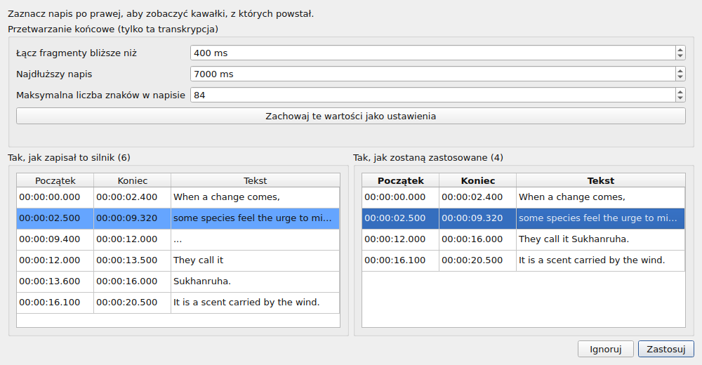
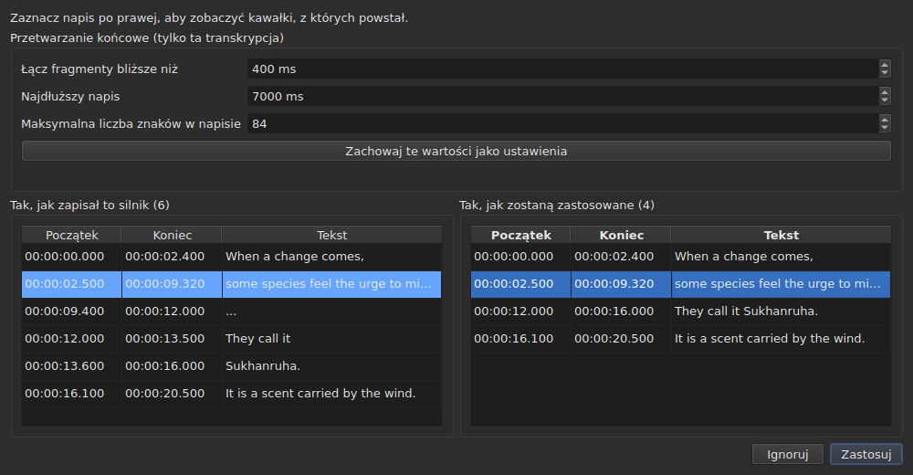

# Powiązane wideo

<!-- machine-translated -->
> Ta strona jest tłumaczeniem maszynowym i nie została jeszcze sprawdzona przez osobę władającą tym językiem.

Menu **Wideo** zawiera najpierw trzy polecenia oraz gesty sterujące filmem
— zobacz [Odtwarzacz](player.md#poruszanie-się-po-filmie).

| Polecenie | Skrót | Co robi |
| :-------- | :---- | :------ |
| Wybierz wideo… | brak | wybiera plik wideo, z którym związany jest dokument |
| Transkrybuj dźwięk… | brak | transkrybuje dźwięk filmu na napisy, które zastępują napisy projektu — zobacz [Transkrypcja dźwięku](#transkrypcja-dźwięku) |
| Odtwórz / Pauza | `Ctrl+P` | odtwarza lub zatrzymuje wideo — zobacz [Odtwarzacz](player.md#odtwarzanie-i-zatrzymywanie) |

Powiązane wideo jest **właściwością otwartego dokumentu**, a nie ustawieniem
aplikacji: otwarcie innego pliku napisów zaczyna od zera. Nie
jest zapisywane w żadnym pliku i znika wraz z oknem.

## Ścieżka dźwiękowa

Film może zawierać kilka ścieżek dźwiękowych — wersję oryginalną, dubbing, komentarz. Podmenu
**`Wideo ▸ Audio ▸ Język`** wymienia je, **jedna pozycja na ścieżkę**, i **zaznacza tę, która jest odtwarzana**:

| Co podaje plik | Co mówi pozycja |
| :------------- | :-------------- |
| język i tytuł | `1: fra — Original` |
| sam język | `2: eng` |
| sam tytuł | `3: Commentary` |
| żadne z nich | `1` |

Numer to **miejsce ścieżki w filmie**, kolejno, w porządku pliku: dwie ścieżki
mogą mówić `eng`, a plik, który nie podaje opisów, i tak ma pierwszą i drugą ścieżkę.

**Wybranie pozycji odtwarza tę ścieżkę.** Zaznaczenie to odpowiedź odtwarzacza, a nie kliknięcie: pokazuje
ścieżkę, która jest odtwarzana.

- **Podmenu jest wyłączone**, gdy nie ma wideo ani żadnej ścieżki dźwiękowej. Przy jednej ścieżce pozostaje włączone i
  pokazuje ją zaznaczoną: mówi, w jakim języku jest film. Dwa gesty głośności, które są obok, pozostają
  w każdym razie włączone: zobacz [Głośność](player.md#głośność).
- **Ścieżka nie jest zapamiętywana** ani między jednym wideo a drugim, ani między sesjami: numer ścieżki
  należy do swojego pliku, a przeniesienie go na następny film wybrałoby to, co tam nosi ten numer.
  Powrót do karty otwiera jej film na ścieżce, którą odtwarzacz wybiera samodzielnie.
- Brak skrótu: język zmienia się rzadko, a menu wystarcza.

## Wybór wideo

Okno dialogowe otwiera się w katalogu pliku napisów i filtruje według
rozpoznawanych rozszerzeń plików wideo:

    .avi .flv .m2ts .mkv .mov .mp4 .ogg .ogv .vob .webm

Oferuje też pokazanie wszystkich plików. Anulowanie okna niczego
nie zmienia.

Wybrany plik jest **otwierany od razu**: obraz pojawia się w oknie,
zatrzymany na swojej pierwszej chwili. Zobacz [Odtwarzacz](player.md).

**Upuszczenie pliku wideo na okno robi to samo** — zobacz
[Upuszczanie plików na okno](files.md#upuszczanie-plików-na-okno).

**Wideo należy do projektu bieżącej karty.** Każda karta zachowuje
własne; zmiana karty zmienia film. **Powrót do karty wznawia jej
film w miejscu, w którym go zostawiono**, zatrzymany, jak przy każdym otwarciu. Inny film
wybrany w międzyczasie dla tego projektu zaczyna się natomiast od początku.

## Automatyczna propozycja

Gdy plik napisów jest otwierany, **jeśli nie wybrano żadnego wideo**,
okno szuka go w tym samym katalogu: pliku wideo, którego nazwa
bez rozszerzenia jest przedrostkiem naszej, aż do kropki.

| Plik napisów | Znalezione wideo | Dlaczego |
| :----------- | :--------------- | :------- |
| `film.fr.srt` | `film.mkv` | `film` jest przedrostkiem `film.fr` |
| `film.en.forced.srt` | `film.mkv` | tak samo, niezależnie od liczby segmentów |
| `film.fr.srt` | `film.fr.mkv` zamiast `film.mkv` | wygrywa najdłuższa nazwa |
| `film.fr.srt` | brak, jeśli są `film.mkv` **i** `film.mp4` | nie da się rozróżnić dwóch kandydatów |
| `film.fr.srt` | brak, jeśli jest tylko `fil.mkv` | `fil` nie kończy się na kropce |

**Propozycja nie jest wyborem.** Pozwala się zastąpić inną
propozycją — otwarciem innego pliku, zapisem pod inną nazwą. Wybór
jawny nie jest natomiast nigdy nadpisywany: po użyciu `Select Video…`
automatyczna propozycja już za nim nie wraca.

Dzięki temu zgadywanie jest do przyjęcia: można je poprawić, a poprawka obowiązuje.

## Co pokazuje pasek stanu

Po prawej stronie paska stanu wiersz mówi, z czym związany jest dokument. To
ostatni z trzech: najpierw idzie [kodowanie](files.md#kodowanie-na-pasku-stanu)
odczytanego pliku, potem [siatka klatek](frame-grid.md) wywnioskowana z
pozycji.

| Sytuacja | Co jest zapisane |
| :------- | :--------------- |
| wideo jest powiązane | `Video: film.mkv` |
| … i `ffprobe` podaje jego liczbę klatek na sekundę | `Video: film.mkv, 24000/1001 fps` |
| brak | `No video` |

**Liczba klatek na sekundę idzie razem z filmem, a nie obok niego.** To jeden fakt — z czym
związany jest ten dokument — a trzecia wzmianka stawiałaby go w jednym rzędzie z
[siatką wywnioskowaną z pozycji](frame-grid.md), która jest czym innym.

## Transkrypcja dźwięku

**`Transcribe Audio…`** zapisuje mowę z filmu jako napisy. Jest wyłączone, dopóki film nie zostanie otwarty: to
dźwięk **filmu projektu**, nigdy plik, który się wybiera — aby transkrybować plik
dźwiękowy, użyj [`transcribe`](../subedit-cli/transcribe.md) w wierszu poleceń.

Okno dialogowe pyta o cztery rzeczy i mówi, czy może zacząć:

- **ścieżkę dźwiękową**, wymienioną tak, jak wymienia ją menu [`Audio`](#ścieżka-dźwiękowa), z językiem
  i tytułem, które deklaruje plik;
- **język**, wybierany z **listy**: najpierw pozycja, która go wykrywa, „Wykryj z pierwszych 30 sekund dźwięku”, potem języki, które
  silnik oferuje dla modelu, pod nazwą w języku okna i z dopiskiem kodu — „francuski (fr)”. Lista jest listą
  silnika: około stu przy modelu wielojęzycznym; przy modelu tylko dla angielskiego ma jedną pozycję, angielski, i nie można jej
  zmienić, a wiersz mówi, że film wyjdzie po angielsku, niezależnie od tego, w jakim języku mówi. Lista zaczyna od języka wybranej
  ścieżki, gdy plik go deklaruje, a silnik go oferuje, podąża za ścieżką, dopóki nie wybierzesz własnego, a
  **wiersz pod nią mówi, skąd on pochodzi**. Gdy plik nie deklaruje języka dla ścieżki, wiersz to mówi i ostrzega:
  model wykryje go wtedy z pierwszych trzydziestu sekund dźwięku, a **film, który zaczyna się muzyką lub ciszą, może zostać wzięty za inny język, a jego mowa
  przetłumaczona na ten język**. Wybierz język, jeśli go znasz;
- **dźwięki zapisywane jako uwagi**: pole wyboru, „Nie zapisuj dźwięków jako uwag”, domyślnie zaznaczone. Silnik ma wtedy polecenie, by nie zapisywać dźwięków jako
  uwag, takich jak `(phone ringing)` lub `[MUSIC PLAYING]`; tam, gdzie nie ma mowy do zapisania, zapisuje `...`, a kawałki, które nie mają ani litery, ani cyfry,
  są odrzucane przez przetwarzanie końcowe. Odznacz pole, aby zachować uwagi, na potrzeby napisów dla niesłyszących. Pole jest wyszarzone, z podaniem przyczyny,
  dla silnika, któremu nie można tego polecić. To ustawienie `transcription.suppress-notes`, które zawierają także [preferencje](preferences.md#transkrypcja);
- **fragment filmu**, od jednego czasu do drugiego — zobacz [Najpierw wypróbuj fragment](#najpierw-wypróbuj-fragment). Oba pola
  puste oznaczają cały film.

**Mówi także, czego brakuje.** Trzy wiersze mówią, czy silnik, `ffmpeg` i model są na miejscu, i
gdzie; gdy któregoś brak, `OK` pozostaje wyłączony, a okno mówi o tym, odsyłając do
[Instalowanie narzędzi do transkrypcji](../subedit-cli/install-transcription.md). Przycisk `Preferences…` otwiera
[preferencje](preferences.md#transkrypcja), w których ustawia się program i model — to fakty
o maszynie, a nie wybory do powtarzania przy każdej transkrypcji — a okno sprawdza ponownie, gdy się zamkną.

Język jest zapamiętywany na następny raz. Sam silnik i limity napisów to
[ustawienia](preferences.md) (`transcription.*`).

**Gdy projekt zawiera już napisy, okno pyta przed ich zastąpieniem** i mówi, ile ich zniknie.
Pyta przed pracą, aby odmowa nic nie kosztowała. Gdy projekt jest pusty, nie ma
o co pytać.

Praca przebiega **w tle**, z oknem i przyciskiem `Cancel`; okno główne pozostaje używalne. **Okno
mówi, na jakim etapie jest praca**, abyś wiedział, że żyje, i ile potrwa:

- **etap**: najpierw „Wyodrębnianie dźwięku…” — okno jest wtedy zajęte, bez liczby, bo wyodrębnianie nic nie mówi o tym, jak daleko
  doszło —, potem „Transkrypcja dźwięku…”, z paskiem;
- **pozostały czas**, „zostało około 38 min”: na początku nieobecny, pokazywany, gdy silnik zgłosił dość postępu, by ekstrapolować, i
  liczony z jego tempa od początku, aż do ostatniej minuty; to dokładność rzędu kilku minut, nie obietnica;
- **upłynięty czas**, „upłynęło: 0:05:12”, który biegnie, nawet gdy nic innego się nie rusza;
- **pozycja**, „0:12:30 z 0:50:00”: jak daleko w filmie doszedł silnik, gdy tylko wytworzy pierwszy tekst, pokazana **tuż nad ostatnim tekstem**, któremu odpowiada;
- **ostatni tekst**, który uzyskano, abyś widział, że praca ma sens.

Na długim filmie z dużym modelem na procesorze pierwsze minuty mogą być długie: silnik ładuje model i pracuje nad pierwszymi
oknami po trzydzieści sekund. Pozycja i ostatni tekst ruszają, zanim ruszy własny procent silnika, który przychodzi tylko co 5 % filmu.

### Podgląd

**Nic nie zastępuje napisów projektu, dopóki ich nie zobaczysz.** Gdy praca się kończy — a także gdy ją anulujesz albo gdy się nie powiedzie
po wytworzeniu czegoś — okno pokazuje wynik w dwóch tabelach obok siebie, każda z **własnym początkiem i końcem**:

- **po lewej „Tak, jak zapisał to silnik”**: wszystko, co zwrócił silnik, tak jak je pociął, bez żadnego przetwarzania końcowego — to, co
  zapisałoby [`--raw`](../subedit-cli/transcribe.md) —, łącznie z zapychaczami (`...`);
- **po prawej „Tak, jak zostaną zastosowane”**: napisy po przetwarzaniu końcowym, dokładnie to, co trafi do projektu. Odbywa się ono w trzech krokach, każdy na całej transkrypcji, zanim zacznie się następny: kawałki bez litery i bez cyfry (`...`) są odrzucane; bliskie kawałki jednego zdania są scalane; zbyt długie są cięte — **najpierw na końcu zdania (`. ? ! …`), potem na przecinku, średniku lub dwukropku, a w środku zdania tylko wtedy, gdy nie ma znaku interpunkcyjnego, na którym można ciąć**. Cięcia, które zostawiłoby napis zbyt mały, by go przeczytać (kilka znaków, ułamek sekundy), unika się, gdy istnieje inne. Napis, który zaczyna kawałek, zachowuje jego początek, a ten, który go kończy, zachowuje koniec: czasy słów służą tylko do cięć wewnątrz kawałka.

Nad tabelami **„Przetwarzanie końcowe (tylko ta transkrypcja)”** zawiera trzy limity przetwarzania końcowego: „Łącz fragmenty bliższe niż”, „Najdłuższy napis” i „Maksymalna liczba znaków w napisie” — ustawienia `transcription.merge-gap-ms`, `transcription.max-duration-ms` i `transcription.max-characters`. **Zmiana jednego z nich od razu przelicza prawą tabelę**, bez udziału silnika, a zaznaczony napis pozostaje zaznaczony. Wpisane wartości obowiązują tylko dla **tej transkrypcji**: niezależnie od tego, czy ją zastosujesz, czy zignorujesz, ustawienia aplikacji pozostają takie, jakie były. **„Zachowaj te wartości jako ustawienia”** przekazuje te trzy wartości do ustawień aplikacji — tych z [preferencje](preferences.md#transkrypcja), zapisanych razem z nimi —, a okno o tym informuje; samo zamknięcie okna tego nie robi.

Obie nie pokrywają się wiersz w wiersz, dlatego każda ma własne czasy. **Zaznaczenie napisu po prawej podświetla po lewej kawałki, z których
powstał**, i przewija lewą stronę do nich; jeden napis naraz i tylko w tym kierunku. Żadnej z tabel nie można edytować: to, czego żadne ustawienie nie poprawi, edytuje się potem w tabeli projektu, jak każdy napis.

Dwa przyciski zamykają okno. **„Zastosuj”** zastępuje napisy projektu **jedną operacją**: jedno `Undo` przywraca to, co było, łącznie z tekstami
tłumaczenia. **„Ignoruj”** odrzuca wynik, który jest wtedy stracony. „Zastosuj” jest wyłączone, gdy nie ma
czego stosować.

**Gdy pracę przerwano**, okno to mówi — „Wynik częściowy: praca zatrzymała się na …” — i oferuje to, co uzyskano do tego miejsca, do zastosowania
lub zignorowania, aby długie uruchomienie zatrzymane późno nie traciło swojej pracy bez pytania. Te kawałki nie mają słów ze znacznikami czasu (silnik zapisuje je na
końcu), a przetwarzanie końcowe tnie na własnych granicach kawałków. Niepowodzenie jest najpierw podawane w oknie, jak każde niepowodzenie; anulowanie nie mówi nic takiego.

### Najpierw wypróbuj fragment

Zakres pozwala **ocenić model lub język na dwóch minutach, zanim zobowiążesz się do dwóch godzin**. Pola „Fragment filmu” przyjmują początek i koniec, każdy zapisany jako `HH:MM:SS`, jak mówią pola (`2:00` i liczba sekund, `90`,
też są odczytywane); dozwolone jest tylko jedno (stąd do końca albo od początku do tego miejsca). `OK` pozostaje wyłączony, dopóki pole
nie jest czasem lub koniec nie następuje po początku, a wiersz pod polami mówi, które.

- **Napisy zachowują czas filmu**: to, co powiedziano w 2:10, jest w wyniku w `0:02:10`.
- **Przechodzi przez podgląd jak każda transkrypcja** i zastępuje napisy projektu po zastosowaniu; jedno `Undo` je przywraca.
  Aby wypróbować zakres, nie ruszając swojej pracy, zignoruj podgląd albo najpierw zapisz.

**To, czego potrzebuje, nie jest dostarczane**: silnik (whisper.cpp), model i `ffmpeg` do wyodrębnienia dźwięku.
Zobacz [Instalowanie narzędzi do transkrypcji](../subedit-cli/install-transcription.md).

## Gdy nie ma filmu

Okno pokazuje przycisk **`Select Video…`** tam, gdzie byłby obraz, zamiast
niczego. To to samo polecenie co w menu `Video`, w zasięgu
myszy: nieobecności, na którą nie można wpłynąć, trudno odróżnić od
usterki.

Przycisk znika, gdy tylko film zostanie otwarty, a obraz zajmuje **całe** swoje
miejsce: wysokość, którą zostawia nad nim tabela — tę, którą
[`window.table-share`](preferences.md) zapamiętało między sesjami —, i
nigdy mniej niż minimalna wysokość obrazu, którą tabela w razie potrzeby ustępuje.
Gdy film znika, przycisk wraca na to samo miejsce.

**Nazwa pliku, nigdy jego ścieżka.** Ścieżka licząca dwieście znaków
wypchnęłaby z paska wszystko inne; pełna ścieżka to ta, którą pokazało
okno dialogowe.

## `ffmpeg` nie jest wymagany

`subedit-gui` odpytuje `ffprobe` — dostarczany razem z `ffmpeg` — o jedną
jedyną rzecz: **liczbę klatek na sekundę, którą deklaruje kontener**. Jest ona odczytywana raz
na film, przy jego powiązaniu.

| Z `ffprobe` | Bez |
| :---------- | :-- |
| pasek stanu zapisuje liczbę klatek na sekundę obok nazwy filmu | zapisuje tylko nazwę |
| okno konwersji proponuje liczbę klatek na sekundę filmu w dolnym polu | nie proponuje niczego i otwiera się jak dawniej |
| okno dopasowania otwiera się na niej | otwiera się na liczbie klatek na sekundę projektu |

**Nic innego od niego nie zależy i żadna operacja nie odmawia.** Odtwarzacz
w ogóle nie potrzebuje `ffprobe`: opiera się na `libmpv`, która jest
zależnością czasu budowania. Czas trwania filmu, ten używany do zgłaszania tego, co
wykracza poza koniec, pochodzi z odtwarzacza, a nie z `ffprobe`.

**Transkrypcja jest jedyną rzeczą, która potrzebuje `ffmpeg`**: wyodrębnia dźwięk filmu. Zobacz
[Instalowanie narzędzi do transkrypcji](../subedit-cli/install-transcription.md).

Nie jest to więc tryb ograniczony, lecz **normalne działanie** komputera,
na którym nigdy nie zainstalowano `ffmpeg`: dane pochodzą od użytkownika, a `ffprobe`
je proponuje, gdy jest dostępny.

Odczytana liczba klatek na sekundę to **dokładny ułamek** — `24000/1001`, a nie `23.976`.
Dlatego `ffprobe` zachowano dla tej odpowiedzi: odtwarzacz
zna tę samą wartość jako liczbę zmiennoprzecinkową, a przybliżona liczba klatek na sekundę
zsynchronizowałaby cały plik nieco błędnie.
