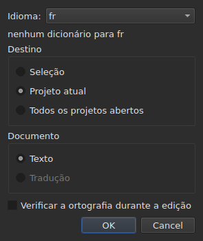
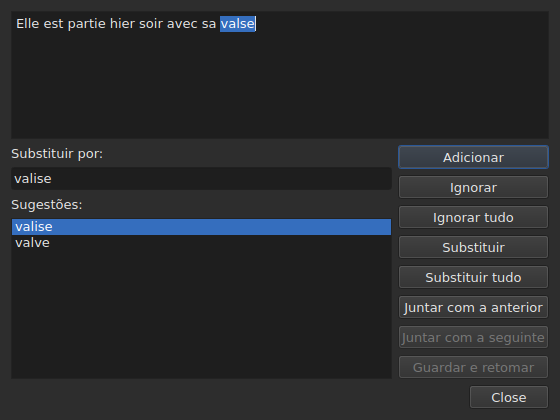

# Verificar ortografia…

<!-- machine-translated -->
> Esta página é uma tradução automática e ainda não foi revista por nenhum leitor do idioma.

`Ferramentas ▸ Verificar ortografia…` percorre as palavras que o dicionário não conhece,
uma a uma, ao modelo do corretor ortográfico do Gaupol. Tem um complemento,
`Ferramentas ▸ Definições do corretor ortográfico…`, que define o idioma, o destino e o documento, e o sublinhado enquanto se escreve.
Ambos se apoiam nos dicionários do sistema, através do Enchant.

Na janela em inglês, a etiqueta do primeiro escreve-se `Chec&k Spelling…`: `C` já é
o acelerador de `Correct Texts…`, e `k` está livre no menu `Tools`.
Nenhum dos dois tem atalho.

**Ambos ficam desativados num documento sem legendas**, como
[`Correct Texts…`](correct-texts.md): não há nada a verificar. `Check Spelling…`
fica também desativada sem dicionário para o idioma definido, ver
[Sem dicionário](#sem-dicionário).

## Definições da verificação ortográfica…




| Grupo | Escolhas | Predefinição |
| :---- | :------- | :----------- |
| `Language` | os códigos de idioma que o sistema oferece, e o que já está escolhido | o idioma do sistema, se estiver entre eles |
| `Target` | `Selection`, `Current Project`, `All Open Projects` | `Current Project` |
| `Document` | `Text`, `Translation` | `Text` |
| `Check spelling while editing` | uma caixa de seleção, ver [Sublinhar enquanto se escreve](#sublinhar-enquanto-se-escreve) | desmarcada |

`Selection` fica desativada se não houver nenhuma linha escolhida no separador mostrado; `Translation`
fica desativada enquanto nenhum projeto aberto tiver uma tradução. Uma definição
memorizada que já não está disponível — uma seleção vazia, uma tradução ausente —
abre em `Current Project` ou `Text`. `OK` conserva as definições, `Cancel` não altera
nada.

**Esta janela não depende do dicionário**: fica ativada enquanto o
documento tiver legendas, mesmo sem dicionário para o idioma definido, e é
ela que permite sair de um idioma que não tem nenhum. O idioma para o qual não existe
dicionário continua editável e aparece na lista, com, por baixo
dele, a frase `no dictionary for` seguida do seu código.

**As quatro definições são memorizadas** de uma sessão para a seguinte, no
ficheiro de definições do `subedit` — ver [As preferências](preferences.md) para a sua
localização:

| Chave | Valores | Predefinição |
| :---- | :------ | :----------- |
| `spell-check.language` | um código de idioma, como `fr_FR`; vazio: o idioma do sistema | vazio |
| `spell-check.target` | `selection`, `current-project`, `all-projects` | `current-project` |
| `spell-check.document` | `main`, `translation` | `main` |
| `spell-check.inline` | `true` ou `false` — sublinhar as palavras desconhecidas no editor de uma célula | `false` |

Um valor que a chave não aceita é ignorado, aplica-se a predefinição, e a opção
é nomeada na saída de erros quando a janela abre — ver
[As preferências](preferences.md#o-que-acontece-quando-o-ficheiro-não-diz-o-que-se-espera).

## Sublinhar enquanto se escreve


A caixa de seleção `Check spelling while editing` de `Spell-Check Settings…` sublinha,
**com uma linha ondulada vermelha e enquanto se escreve**, cada palavra desconhecida no editor de uma
célula de texto — tanto a da coluna `Text` como a da coluna
`Translation`. O sublinhado acompanha a escrita: aparece, move-se e
desaparece com a palavra. **Está desmarcada por predefinição**, como no Gaupol: sem
ela, nada muda no editor.

**O idioma é o de `Language:`**, na mesma janela, e as palavras desconhecidas
são as que `Check Spelling…` encontraria: os mesmos casos de inglês coloquial
(`goin'`, `we'd`, `1st`), a mesma divisão em palavras. Uma palavra sublinhada não é corrigida
a partir de um menu: a caixa de seleção apenas a assinala.

**Sem dicionário para o idioma definido, o editor fica em silêncio**: nada é
sublinhado e nada falha, e a frase `no dictionary for` da janela explica
porquê. A caixa de seleção aplica-se aos editores abertos depois dela; um editor já
aberto conserva o que tinha.

## O percurso




A janela mostra o texto da legenda onde parou, com a palavra desconhecida
selecionada nele. **A cada palavra desconhecida, o separador do projeto volta à frente e a
linha da legenda é selecionada na tabela.** O percurso avança legenda
a legenda, depois projeto a projeto quando o destino designa vários.

Sob o texto: a caixa `Replace with:`, preenchida com a primeira sugestão, e a
lista `Suggestions:`. Escolher uma sugestão copia-a para a caixa; escrever na
caixa renova a lista.

| Botão | O que faz |
| :---- | :-------- |
| `Add` | acrescenta a palavra ao dicionário pessoal do utilizador e passa à seguinte |
| `Ignore` | deixa esta palavra e passa à seguinte |
| `Ignore All` | deixa esta palavra, e todas as suas outras ocorrências durante este percurso |
| `Replace` | substitui a palavra pelo conteúdo de `Replace with:`; desativado enquanto a caixa estiver vazia |
| `Replace All` | faz o mesmo para as suas outras ocorrências; desativado enquanto a caixa estiver vazia |
| `Join with Previous` | une a palavra à palavra que a precede; desativado se não houver nenhuma, ou se não estiverem separadas por um espaço |
| `Join with Next` | une a palavra à palavra que a segue, nas mesmas condições |
| `Save and Resume` | conserva o texto tal como a área de texto o tem, e retoma a leitura **deste texto desde o início** |
| `Close` | fecha a janela |

**A área de texto é editável.** Logo que se escreve nela, só `Save and Resume`
fica ativado: os outros gestos atuam sobre a palavra escolhida, que já não é
a do texto.

**O percurso termina sozinho** quando já não resta nenhuma palavra desconhecida: os
botões ficam desativados, o texto esvazia-se. Um destino sem nenhuma palavra desconhecida
não mostra nenhuma janela.

### Fechar a meio

`Close`, ou a cruz da janela, **aplica o que foi feito**, como o fim
do percurso: os textos já deixados, **e** os gestos — substituir,
substituir tudo, unir — já feitos no texto atual. É um desvio em relação ao
Gaupol, que perde o texto atual. O que não conta é o que resta do percurso, nem
os retoques escritos na área de texto que `Save and Resume` não
confirmou.

**Uma única entrada do histórico por projeto tocado**, qualquer que seja o número de
substituições: `Undo` anula de uma vez todas as correções desse projeto.
O menu chama-lhe `Undo: correcting texts`. A barra de estado dá então a
contagem:

```text
Edited 2 and removed 0 subtitles
```

**A lista de substituições** — o que o utilizador substituiu, e pelo quê —
é escrita ao fechar em `spell-check/<language>.repl`, sob a pasta de
configuração do `subedit`, e não na do Gaupol, que nunca é lida.
Conta então entre as sugestões do corretor ortográfico, aqui como em
[`Correct Texts…`](correct-texts.md#juntar-ou-dividir-palavras--voltar-a-juntar-e-dividir-pelo-corretor-ortográfico).
Se não puder ser escrita, uma caixa de erro di-lo, `Could not save the
replacements for` seguido do idioma e do motivo, sem cancelar as
correções.

## Sem dicionário

Quando o idioma definido — o do sistema, se nenhum foi escolhido — não tem
dicionário, **`Check Spelling…` fica desativada**, e a sua dica de ferramenta, bem como a barra
de estado, quando a entrada é sobrevoada, dizem porquê:

```text
no dictionary for fr
```

`Spell-Check Settings…` continua disponível, para escolher um idioma que tenha um. Uma janela
construída sem nenhum fornecedor de dicionários diz o mesmo e não verifica
nada.

## As mensagens

| Mensagem | Onde | O que a desencadeia |
| :------- | :--- | :------------------ |
| `no dictionary for fr` | dica de ferramenta e barra de estado | nenhum dicionário para o idioma definido |
| `Nothing to check.` | barra de estado | o destino não designa nenhum texto — uma seleção vazia, por exemplo |
| `Edited N and removed M subtitles` | barra de estado | no fim ou ao fechar; `M` continua a `0` |
| `Could not save the replacements for fr: …` | caixa de erro | a lista de substituições não foi escrita |

## Um exemplo

Um ficheiro aberto tem `Elle est partie hier soir avec sa valse`. O dicionário
francês está presente: `Ferramentas ▸ Verificar ortografia…` pára em `valse`, seleciona a
linha na tabela e propõe `valise`, já em `Replace with:`. `Replace`
e depois `Close`: a linha passa a `Elle est partie hier soir avec sa valise`, e a
barra de estado diz:

```text
Edited 1 and removed 0 subtitles
```
