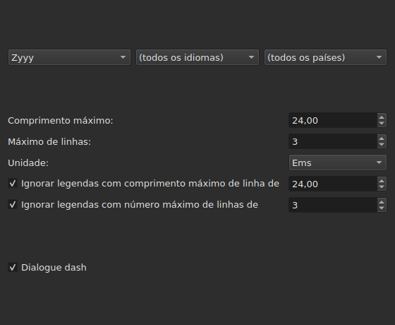
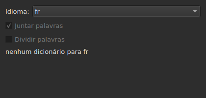

# Corrigir textos…

<!-- machine-translated -->
> Esta página é uma tradução automática e ainda não foi revista por nenhum leitor do idioma.

`Ferramentas ▸ Corrigir textos…` abre um assistente de várias páginas, ao modelo do
do Gaupol: uma página de destino e tarefas, uma página por tarefa marcada,
uma página de progresso e uma página de confirmação que propõe as
alterações sem nunca as impor.

**Desativado num documento vazio**: não há nada a corrigir.

**A linha de comandos faz o mesmo** para todas as tarefas: [`subedit-cli correct`](../subedit-cli/correct.md), com os
mesmos padrões e as mesmas contagens — e em carateres onde a janela mede em ems.
**Lê por predefinição quatro das definições memorizadas deste assistente** — as duas classes de
erros comuns (`Human`, `OCR`), `Remove all blank subtitles` e o número máximo de linhas de
`Line Break` — e recebe tudo o resto (as tarefas, o seu código, o comprimento da linha, o idioma,
as caixas de padrões) da sua própria linha. Ver
[Dois blocos, um partilhado com a linha de comandos](preferences.md#dois-blocos-um-partilhado-com-a-linha-de-comandos)
e [`subedit-cli config`](../subedit-cli/config.md).

## Tarefas e destino — a primeira página

| Grupo | Escolhas | Predefinição |
| :---- | :------- | :----------- |
| `Target` | `Selection`, `Current Project`, `All Open Projects` | `Current Project` |
| `Document` | `Text`, `Translation` | `Text` |
| `Tasks` | `Mentions`, `Join or Split Words`, `Common Errors`, `Capitalization`, `Line Break` — a marcar, uma ou várias | `Common Errors` e `Capitalization` marcadas, as outras três não |

`Selection` fica desativada se não houver nenhuma linha escolhida no separador mostrado; `Translation`
fica desativada enquanto nenhum projeto aberto tiver uma tradução.

**O destino e o documento não são memorizados**: o assistente volta sempre a abrir
em `Current Project` e `Text`. As tarefas marcadas, essas, são memorizadas.

**O que cada destino designa**:

| Destino | Atua sobre |
| :------ | :--------- |
| `Selection` | as linhas escolhidas no separador mostrado |
| `Current Project` | o ficheiro inteiro do separador mostrado |
| `All Open Projects` | o ficheiro inteiro de cada separador aberto |

**`All Open Projects` em `Translation` salta os projetos sem tradução**:
um projeto que não tem nenhuma não tem nada a propor numa coluna vazia, e
o assistente não o conta.

**As páginas das tarefas seguem-se pela ordem do Gaupol — `Mentions`,
`Join or Split Words`, `Common Errors`, `Capitalization`, `Line Break` — e nunca por aquela em que as caixas
foram marcadas.** Uma tarefa desmarcada não tem página; as suas definições
memorizadas não mudam por isso. **Nenhuma página de tarefa tem a sua própria caixa
“ativa”**: é a desta primeira página, e só ela, que
decide se a tarefa corre.

## As páginas das tarefas

Cada uma das quatro páginas de padrões — todas exceto `Join or Split Words`, que não tem nenhum — tem a mesma base: três
menus pendentes em cascata — escrita, idioma, país — para escolher o código dos padrões a
aplicar, e depois a lista dos padrões desse código, um a marcar por nome. **Os
três menus oferecem apenas o que o catálogo de padrões
contém realmente** — os que acompanham o programa e os que um utilizador
lá largou (ver [Padrões descartados](#padrões-descartados)) — e nunca uma lista
de idiomas ou de países lida noutro sítio. `Zyyy` (“qualquer escrita”) é o código
inicial de `Common Errors`, que dá os padrões válidos em toda a parte. **Os outros três
tipos só têm padrões sob uma escrita**: a sua página abre na
primeira que o catálogo oferece, `Latn` com os padrões fornecidos, e não em `Zyyy`.

**A descrição de cada padrão é a dica de ferramenta da sua caixa.** Os nomes e as descrições seguem o
idioma da janela para os padrões fornecidos com o programa; um padrão próprio é mostrado tal como
o seu ficheiro o escreve ([Idioma](invocation.md#idioma)).

**Um padrão desmarcado continua desmarcado até ser marcado de novo**, incluindo quando
se muda de código e se volta a ele, e essa escolha é memorizada de uma abertura
do assistente para a seguinte. Marcado de novo, volta simplesmente a encontrar a sua
definição de origem, e a escolha memorizada desaparece.

| Página | O que acrescenta à base |
| :----- | :---------------------- |
| `Mentions` | duas caixas de seleção, `Sound in brackets` e `Sound in parentheses`, desmarcadas por predefinição |
| `Common Errors` | duas caixas de seleção, `Human` e `OCR`, marcadas por predefinição |
| `Capitalization` | nada mais |
| `Line Break` | um comprimento máximo (`24`, por predefinição), um número máximo de linhas (`3`), uma unidade — `Characters` ou `Ems`, `Ems` por predefinição — e duas condições de exceção, descritas abaixo |

**As duas caixas de `Mentions` não designam nenhum padrão compilado**: comandam
uma análise do texto no núcleo, a que
[`Remove Hearing-Impaired Mentions…`](operations.md#remove-hearing-impaired-mentions)
já faz num gesto direto. Basta uma **ou** a outra marcada para a lançar. **A lista de padrões da página não as repete**: esses dois nomes só aparecem aí uma vez, como caixas de seleção.

**`Common Errors` filtra por classe**: um padrão que tem as duas classes
aplica-se logo que uma das duas caixas esteja marcada; as outras três páginas não
conhecem esta distinção.

### Quebra de linha — a unidade e a exceção




| Definição | O que faz | Predefinição |
| :-------- | :-------- | :----------- |
| `Maximum length` | o comprimento de uma linha, na unidade escolhida; de `1` a `1000` | `24` |
| `Maximum lines` | o número de linhas pretendido; de `1` a `100` | `3` |
| `Unit` | `Characters` conta carateres; `Ems` mede a largura com o tipo de letra da janela, em que uma letra minúscula média vale `0.55` — a unidade do Gaupol | `Ems` |
| `Skip subtitles with maximum line length of` | deixa como está uma legenda cuja linha mais longa cabe neste comprimento, na unidade escolhida | marcada, `24` |
| `Skip subtitles with maximum line amount of` | deixa como está uma legenda cujo número de linhas cabe neste número | marcada, `3` |

**A exceção tem os seus próprios limiares**, distintos dos limites pretendidos: é
a regra do Gaupol. Uma legenda é deixada como está se cabe em **todos os
limiares cuja caixa está marcada**; caso contrário, é quebrada, e a quebra só é
conservada se aproximar a legenda de um limiar que excedia — menos
comprimento, ou menos linhas. Nenhuma caixa marcada: todas as legendas são quebradas,
quer já caibam quer não.

**Mudar a unidade muda o que é proposto**: o comprimento de cada linha é
medido a cada cálculo, na unidade da página nesse momento, e nada
resta de uma medição anterior. Um texto de vinte e nove carateres, metade
dos quais letras estreitas, excede `24` em `Characters` e cabe nele com folga
em `Ems`.

**As sete definições são memorizadas** de uma sessão para a seguinte, unidade incluída.

### Juntar ou dividir palavras — voltar a juntar e dividir pelo corretor ortográfico




Uma página à parte, entre `Mentions` e `Common Errors`, para reparar o que
o software de reconhecimento de texto faz aos espaços. Não tem lista de
padrões: apoia-se nos dicionários do sistema, através do Enchant.

| Definição | O que faz | Predefinição |
| :-------- | :-------- | :----------- |
| `Language` | o idioma do dicionário; os códigos que o sistema oferece, e o que já está escolhido | o idioma do sistema, se estiver entre eles |
| `Join words` | une uma palavra mal escrita à palavra vizinha | marcada |
| `Split words` | corta uma palavra mal escrita em duas | desmarcada |

**Juntar**: uma palavra mal escrita é unida à palavra que a precede ou à que
a segue **se, e só se, apenas uma das duas direções der uma palavra bem
escrita**. Quando as duas dão uma, ou nenhuma, não se faz nada.
`bon jour` torna-se `bonjour`; dois espaços seguidos são primeiro reduzidos a
um, mas um texto em que nada é unido é devolvido como estava, espaços
incluídos.

**Dividir**: uma palavra mal escrita é cortada se, entre as sugestões do
corretor ortográfico, **apenas uma** for essa palavra com um espaço — as mesmas
letras, pela mesma ordem. Duas sugestões desse tipo, ou nenhuma: não se faz
nada. Uma palavra cuja inicial é a única maiúscula (`Bonjourtous`) nunca
é dividida: é muitas vezes um nome, e os dicionários não os têm.

**A lista de substituições do utilizador** (`spell-check/<language>.repl`,
na pasta de configuração do programa) conta entre as sugestões do corretor
ortográfico; o assistente lê-a e não a escreve.

**Sem dicionário para o idioma escolhido, a página fica e aparece a cinzento**: as
duas caixas ficam desativadas e a página diz `no dictionary for` seguido do código do
idioma. O idioma continua editável — pode haver um dicionário para outro — e a tarefa, marcada ou não na primeira página, não faz então nada e
não comunica nenhum erro.

**O idioma, as duas caixas e a caixa da primeira página são memorizados** de uma
abertura do assistente para a seguinte.

### Padrões descartados

Um padrão que um utilizador largou na sua própria pasta de padrões
é acrescentado aos fornecidos com o programa, no mesmo catálogo e sob os
mesmos menus — nada os distingue depois de carregados.

| Padrões | Onde |
| :------ | :--- |
| fornecidos | `<prefix>/share/subedit/patterns`, ao lado de `<prefix>/bin` |
| do utilizador | `$XDG_DATA_HOME/subedit/patterns`, ou `~/.local/share/subedit/patterns` se a variável não estiver definida ou não for um caminho absoluto |

**O formato é o do Gaupol, lido tal como está**: um ficheiro `<Code>.<type>` por escrita,
idioma e país — `Latn-en.common-error` —, com a sua ativação `.conf` ao lado. Os tipos
são `common-error`, `capitalization`, `hearing-impaired` e `line-break`. Os ficheiros
fornecidos servem de modelo. **Os padrões são lidos uma só vez, no arranque**: um ficheiro
largado enquanto a janela está aberta só é visto no arranque seguinte.

## Progresso

Depois de premir `Next` na última página de tarefa marcada (ou na
primeira página, se nenhuma tarefa estiver marcada), o assistente calcula as correções
propostas num fio de execução em segundo plano, com uma barra de progresso indeterminada
no ecrã. Terminado o cálculo, a página de confirmação abre-se por si própria.

**`Cancel` neste passo abandona o cálculo sem o interromper**: nada
é aplicado, mas o assistente espera, antes de fechar, que o cálculo em
curso termine — uma espera limitada pelo tempo-limite que o motor de
padrões impõe a cada pesquisa.

**`Back` neste passo volta à página anterior sem esperar**: o cálculo
termina em segundo plano e o seu resultado é descartado — o assistente não salta
sozinho para a confirmação. `Next` inicia um novo cálculo.

## Confirmação — a última página


Uma linha por texto que o assistente alteraria — nunca uma linha para um
texto que uma tarefa deixou como está.

| Coluna | O que mostra |
| :----- | :----------- |
| `Accept` | uma caixa de seleção, marcada por predefinição: a correção será aplicada ou não |
| `Original` | o texto tal como está, a parte que seria alterada **a negrito** |
| `Corrected Text` | o texto proposto, a parte alterada a negrito, **editável** — retocá-lo altera o que será escrito, sem alterar a caixa `Accept` |

**A alteração é marcada a negrito, nunca a cor**: a mesma comparação lê-se
nas duas paletas sem depender de nenhum tom.

**Uma linha cuja proposta é uma remoção** — a legenda ficaria sem
texto — mostra a coluna `Corrected Text` vazia e todo o seu `Original` a
negrito.

| Botão | O que faz |
| :---- | :-------- |
| `Mark All` | marca `Accept` em todas as linhas |
| `Unmark All` | desmarca `Accept` em todas as linhas |
| `Preview` | põe o reprodutor integrado na legenda da linha escolhida, se o projeto tiver um filme — nada se não tiver |
| `Finish` | aplica as linhas marcadas e fecha o assistente |

`Remove all blank subtitles`, marcada por predefinição, remove as legendas
que uma correção deixaria sem nenhum texto em vez de as manter vazias.

**Um padrão que o cálculo não pôde aplicar é nomeado sob a tabela**, com
o motivo:

```text
Not applied: some pattern (will not compile)
```

Um padrão nomeado assim é nomeado **uma vez por motivo**, qualquer que seja o número de
textos ou de projetos em que falhou: o ecrã não diz quais.

| Motivo | O que o desencadeia |
| :----- | :------------------ |
| `cannot be translated` | a expressão usa o que a tradução da sintaxe do Python recusa |
| `will not compile` | o motor recusa a expressão |
| `has an invalid replacement` | a substituição não se lê como o Python a lê |
| `timed out` | uma pesquisa excedeu o tempo que o motor lhe concede num texto |
| `never settled` | `Repeat` ainda alterava o texto após cem passagens |
| `grew the text too long` | o texto excedeu 16 384 bytes enquanto o padrão trabalhava nele |

**Um padrão que falha num texto deixa-o como estava antes dele**: uma substituição
feita a meio vale menos do que nenhuma substituição. Os outros padrões aplicam-se.

**Uma linha de um ficheiro de padrões que não pode ser lida é nomeada no mesmo
sítio**, pelo seu ficheiro, a sua linha e o motivo — a cada abertura do
assistente, já que os padrões só são lidos uma vez, no arranque:

```text
Could not be read: Zyyy.common-error, line 8 (malformed line)
```

| Motivo | O que o desencadeia |
| :----- | :------------------ |
| `directory cannot be read` | não foi possível percorrer a pasta dos padrões fornecidos |
| `file cannot be read` | não foi possível ler um ficheiro de padrões |
| `malformed line` | uma linha que não é nem um cabeçalho, nem um comentário, nem `Key=Value` |
| `field outside any pattern` | um `Key=Value` antes do primeiro cabeçalho de padrão |
| `unknown field` | uma chave de que este tipo de padrão não precisa — o padrão é conservado |
| `missing field` | uma chave sem a qual este tipo de padrão não pode fazer nada — o padrão é descartado |
| `invalid value` | um valor que a chave não aceita — o padrão é descartado |
| `malformed activation` | um elemento `<pattern>` de um `.conf` que não designa nada |

Os outros padrões, os que foram lidos e aplicados corretamente, não são
afetados.

## O que diz o anular, e o que `Cancel` nunca faz

**`Finish` faz uma entrada do histórico por projeto tocado**, nunca uma por
correção: `Undo` anula de uma vez todas as correções aceites nesse
projeto, cada uma com o texto que tinha. O menu chama-lhe
`Undo: correcting texts`.

A barra de estado dá a contagem, primeiro os textos alterados, depois as legendas
removidas:

```text
Edited 3 and removed 1 subtitles
```

**`Cancel`, em qualquer página, não aplica nada nem memoriza nada** — nem
as definições escolhidas durante esta abertura, nem a mínima correção. A
abertura seguinte do assistente recomeça a partir das definições de antes.

## Um exemplo

Um ficheiro aberto tem dois espaços entre duas palavras de uma linha e uma
menção entre parênteses retos sem mais texto. `Ferramentas ▸ Corrigir textos…`,
`Common Errors` já marcada, `Next` até à confirmação: a linha com os dois espaços
mostra `Bonjour  Marie` à esquerda, `Bonjour Marie` à direita, a correção a
negrito e já aceite. `Finish` aplica-a, e a barra de estado diz:

```text
Edited 1 and removed 0 subtitles
```
