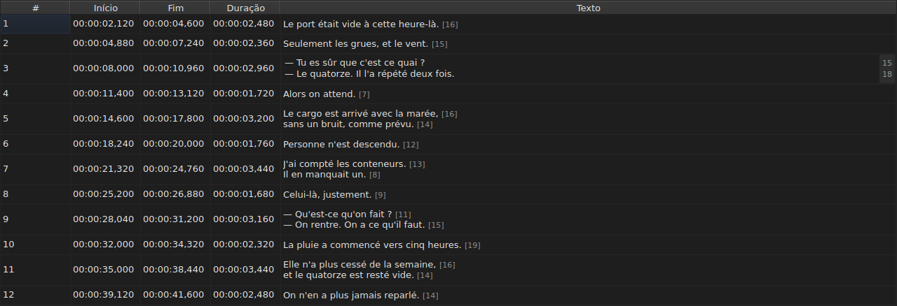

# Editar uma célula

<!-- machine-translated -->
> Esta página é uma tradução automática e ainda não foi revista por nenhum leitor do idioma.

Quatro colunas são editadas no próprio local: `Start`, `End`, `Duration` e `Text` — cinco
com a coluna `Translation`, quando o projeto tem uma tradução. `#` não pode
ser editada — o número é a ordem da linha, não um dado do ficheiro.

**Abrir o editor de uma célula:** fazer duplo clique nela, ou selecioná-la
e premir `F2`.

## O texto

**A tradução é editada como o texto**, com o mesmo campo de várias linhas e as
mesmas regras; só a célula muda, e o texto principal fica como
estava. Uma confirmação que nada altera não faz nada, tanto numa como na
outra — ver [abaixo](#uma-confirmação-que-nada-altera-não-faz-nada).

O editor é um campo de **várias linhas**, e abre-se à altura da legenda:
uma legenda de duas linhas escreve-se nele tal como será escrita, com as suas duas linhas
legíveis e sem barra de deslocação. Um `Shift+Enter` que acrescente uma aumenta
o editor; a linha da tabela ajusta-se ao confirmar.

| Tecla | Efeito |
| :---- | :----- |
| `Enter` | confirma e fecha o editor |
| `Shift+Enter` | insere uma quebra de linha no texto |
| `Esc` | fecha o editor; a célula conserva o que tinha |
| `Tab` | confirma e passa à célula seguinte |

Clicar noutro sítio também confirma: perder o foco equivale a um `Enter`.

**Onze gestos sem caixa de diálogo confirmam do mesmo modo** antes de calcular o seu alvo:
`Italic`, `Case ▸ …`, `Dialogue`, `Merge Subtitles`, `Split Subtitle`,
`Cut Texts`, `Paste Texts`, `Copy Texts`, `Remove Subtitles`, `Undo` e `Redo`.
Lançados a partir do menu, da barra de ferramentas ou de um atalho da janela,
tomam o texto tal como o editor acabou de o confirmar, como após um clique
noutro sítio. `Ctrl+X`, `Ctrl+C` e `Ctrl+V` ficam, no entanto, com o editor enquanto
este estiver aberto — ver [Cortar, copiar e colar](clipboard.md): é então o
menu que lança `Cut Texts`, `Copy Texts` e `Paste Texts`.

`Undo` e `Redo` leem o histórico e não o documento: ver
[Anular e refazer](undo.md). Um gesto que abre uma caixa de diálogo não
precisa desta regra, já que a caixa de diálogo toma o foco ao abrir-se, o que
já confirma a entrada.

### As etiquetas são as do ficheiro

O texto mostrado e escrito é **o do ficheiro, etiquetas incluídas**: um
`<i>…</i>` de um SubRip escreve-se assim, e um `{\i1}…{\i0}` de um Advanced SSA
também. Nada é convertido para a apresentação — a tabela de
[`Italic`](operations.md#italic) diz o que cada formato escreve.

Para o itálico, não há, portanto, nada a saber: `Ctrl+I` coloca a etiqueta certa
para o documento aberto, e um formato que não tem nenhuma — TMPlayer, LRC —
desativa a entrada em vez de deixar que se procure. O negrito e o sublinhado são
escritos à mão, como no Gaupol.

**E as etiquetas não acompanham as operações sobre o texto**: pôr uma legenda
em minúsculas não transforma o seu `<I>` em `<i>`, e um hífen de diálogo é
posto antes do texto e não antes de uma etiqueta de abertura. Ver
[`Case` e `Dialogue`](operations.md#case-e-dialogue).

## O comprimento das linhas

**O editor de texto mostra, numa margem à direita, o comprimento de cada
linha**, alinhado com a primeira fila dessa linha. A margem tem a largura
do maior número, atualiza-se **à medida que se escreve** e acompanha o deslocamento da vista.
Um texto vazio não mostra nada. Os comprimentos são os da tabela — sem as
etiquetas, arredondados por defeito, na unidade definida — e retiram-se com a
caixa de seleção `Show line lengths in the editor` de `Editar ▸ Preferências…`. Ver
[Comprimentos das linhas](preferences.md#comprimentos-das-linhas).

## O início e o fim

O editor é um campo de uma só linha, **limitado à forma de um carimbo de tempo**:
recusa, enquanto se escreve, o que nunca poderia ser um.

As formas aceites são as que a leitura de um ficheiro já aceita:

| Elemento | O que passa |
| :------- | :---------- |
| campos | `MM:SS` ou `HH:MM:SS`, com um ou dois algarismos cada |
| decimais | de um a três, depois de uma vírgula ou de um ponto, ou nenhum |
| sinal | um `-` à cabeça, para uma posição anterior ao início do vídeo |
| limites | minutos e segundos abaixo de 60 |

`00:01:02,500`, `1:02.5` e `-0:01,000` são, portanto, três entradas válidas.

**Uma entrada que a leitura recusa deixa a célula inalterada.** É o caso
de `00:70:00,000`, cuja forma está certa mas cujos minutos estão fora dos
limites: o editor fecha-se e nada se moveu. Nenhuma posição é inventada
— errar uma posição é silencioso, nada no ecrã distingue uma legenda
mal sincronizada de uma bem sincronizada.

Alterar um início ou um fim atualiza logo a `Duration`.

## A duração

**Escrever uma duração move o fim, e nunca o início**: o fim passa a ser
`Start + Duration`. Mover o início moveria a legenda inteira, o que é
o trabalho de [`Shift Positions…`](operations.md), e a coluna `Start` já
pode ser escrita diretamente.

A duração escreve-se **na forma de um carimbo de tempo**, a que a coluna
mostra, e aplicam-se as formas da tabela acima — com uma diferença:

| Elemento | Início, fim | Duração |
| :------- | :---------- | :------ |
| forma | a de um carimbo de tempo | a mesma |
| sinal `-` à cabeça | aceite | **recusado enquanto se escreve** |

`0:02.5` e `00:00:02,500` são, portanto, duas entradas válidas de uma duração de dois
segundos e meio; `-0:01,000` não se pode escrever. Uma duração nula é aceite:
a legenda desaparece então no instante em que aparece.

**Um fim que ultrapassa a legenda seguinte é permitido.** A
sobreposição é realçada na tabela, com a sua dica de ferramenta — ver
[As anomalias](table.md#as-anomalias) — um aviso, não uma recusa: pode ser o que
se queria. A [lista de diagnósticos](files.md#os-diagnósticos-de-uma-leitura)
também a inclui, e retira-a quando a tiver corrigido.

**Um fim escrito para além do fim do filme não é assinalado**, ao contrário de
uma operação do menu `Tools` que o empurrasse para lá — ver
[As operações](operations.md#para-além-do-fim-do-filme). Uma célula já mostra
o valor que acabou de escrever.

Uma entrada ilegível deixa a célula inalterada, como para uma posição, e
uma duração idêntica à mostrada não entra no histórico.

## Uma confirmação que nada altera não faz nada

Abrir uma célula, não escrever nada, premir `Enter`: nada acontece.
Nenhuma modificação é registada, e o ficheiro continua a ser considerado idêntico ao
que está no disco.

A comparação faz-se sobre a **posição**, não sobre a cadeia de carateres: escrever `0:01.0`
numa célula que mostra `00:00:01,000` designa o mesmo instante e,
portanto, também não altera nada.

## O que acontece a uma célula editada

**Pode ser anulada** — uma célula, uma entrada. Ver
[Anular e refazer](undo.md).

**É guardada**, e fechar a janela sem o ter feito pede
confirmação. Ver [Abrir e guardar](files.md).
