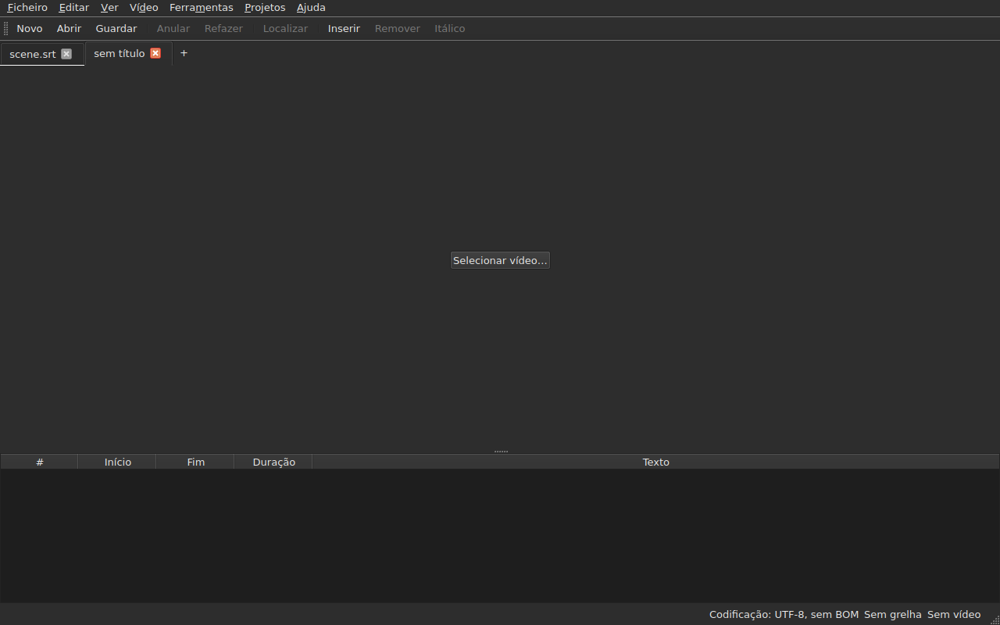
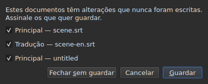
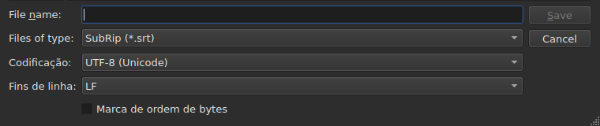
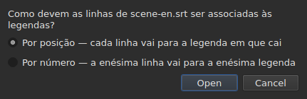
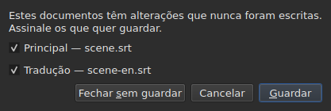

# Abrir e guardar

<!-- machine-translated -->
> Esta página é uma tradução automática e ainda não foi revista por nenhum leitor do idioma.

O menu **Ficheiro** reúne os três comandos, dois para os separadores e mais
três para a tradução; o menu **Projetos** atua sobre todos os separadores de uma só vez.

| Comando | Atalho | O que faz |
| :------ | :------- | :----------- |
| Novo projeto | `Ctrl+N` | um projeto vazio, num novo separador — também o botão `+` depois do último separador |
| Abrir… | `Ctrl+O` | escolhe um ficheiro e abre-o num novo separador — ou no lugar de um projeto em branco |
| Abrir tradução… | — | escolhe um ficheiro de tradução e alinha-o com o ficheiro principal do separador atual |
| Guardar | `Ctrl+S` | reescreve o ficheiro aberto |
| Guardar como… | `Ctrl+Shift+S` | escolhe um caminho e um formato, e depois escreve |
| Guardar tradução | — | reescreve o ficheiro da tradução |
| Guardar tradução como… | — | escolhe um caminho e um formato para a tradução, e depois escreve |
| Fechar | `Ctrl+W` | fecha o separador atual — desativado se só existir um |

`New Project`, `Open…` e `Save` encontram-se também na
[barra de ferramentas](index.md#a-barra-de-ferramentas), sob as palavras `New`, `Open` e
`Save`. **As três entradas da
tradução não estão na barra**: só servem a quem tem uma
tradução, e a barra é de todos.

## Vários projetos, em separadores

**Cada projeto aberto tem o seu separador**, acima da imagem e da tabela:
a sua etiqueta é o nome do ficheiro, ou `untitled` para um projeto que ainda não
tem nenhum. Clicar num separador muda para ele; `Ctrl+PageDown` e `Ctrl+PageUp` fazem
o mesmo, sem o rato, e voltam ao primeiro separador depois do último.
**O botão `+`, logo a seguir ao último separador**, abre um projeto vazio num
novo separador, como `New Project`.




**`Open…` nunca lhes toca.** Abrir um ficheiro já não substitui o que a
janela mostrava: o ficheiro chega a um novo separador, ao lado, e o separador que estava
a ver antes mantém tudo o que tinha — o seu histórico, a sua seleção, o seu
vídeo associado. É também por isso que abrir já não pergunta nada: não há
nada a perder, pois não há nada a substituir.

**Uma exceção: o projeto em branco cede o seu lugar.** Lançada sem ficheiro, ou
depois de `New Project`, a janela mostra um projeto `untitled` sem nada dentro.
Um ficheiro aberto — através de `Open…` como por um largar — **ocupa então o seu separador,
no mesmo lugar da barra**, em vez de abrir outro ao lado de um
projeto inútil. Um projeto está em branco quando **não tem ficheiro, nem legenda,
nada para anular ou refazer, nem filme, e nunca foi modificado**: basta
uma destas coisas para que conserve o seu separador. Um projeto em branco que não é
o separador atual não é tocado.

**Um ficheiro já aberto não é aberto uma segunda vez.** `Open…` sobre um
ficheiro que outro separador já contém devolve o foco a esse separador, e di-lo
na barra de estado:

```text
premier.srt: already open
```

**Cada separador é um projeto completo, independente dos outros**: o seu
histórico, a sua seleção, o seu vídeo associado e o que a sua última leitura
encontrou só se mostram quando esse separador é o atual, e não
mudam enquanto outro o for. **Uma exceção, que consta do ADR
0033**: o reprodutor de vídeo é único para toda a janela — um único
processo mpv — e o seu filme muda com o separador; **cada separador recorda onde
estava o seu filme**, e retoma-o aí, em pausa, quando se volta a ele. A área de transferência, por seu lado, pertence à janela: copiar
num separador e colar noutro é para isso que se abrem dois.

**`Close` fecha o separador atual**, colocando, se for caso disso,
[a pergunta das alterações não guardadas](#alterações-não-guardadas) —
só a deste separador, não dizendo os outros respeito à questão. **Desativado quando
só existe um separador**: a janela mantém sempre pelo menos um, e fechá-lo
seria fechar a janela — o que o botão do sistema já faz.

**Cada separador tem também uma cruz**, que fecha o **seu** projeto, com a mesma
pergunta. A cruz de um separador que não é o atual fecha esse, e o separador
que está a ver continua apresentado; se esse projeto tiver alterações, o seu
separador passa para a frente durante o tempo da pergunta. **Nenhuma cruz quando só
resta um separador**, pela mesma razão por que `Close` está desativado.

**Um separador diz que está modificado**: um asterisco segue o seu nome, `premier.srt*`,
enquanto um dos seus documentos diferir do seu ficheiro — tal como o título da janela
o diz do projeto que está a ver. Desaparece ao guardar.

## O menu Projetos

Dois comandos atuam sobre todos os projetos de uma só vez.

| Comando | Atalho | O que faz |
| :------ | :------- | :----------- |
| Guardar tudo | `Ctrl+Shift+L` | escreve cada documento modificado, separador a separador |
| Fechar tudo | `Ctrl+Shift+W` | fecha todos os projetos — ou seja, a janela |

**`Save All` segue a ordem dos separadores**, o documento principal antes da tradução.
Um documento que tem ficheiro é reescrito aí **sem que o seu separador passe para a frente**;
**um documento que não tem nenhum abre `Save As…`, um de cada vez**, no seu separador —
o único caso em que `Save All` muda de separador, para que a caixa mostre a que
projeto diz respeito. **Cancelar um `Save As…`, ou uma
gravação que falha, interrompe o resto**: os projetos seguintes não são
tocados, e uma caixa diz o que foi escrito.

```text
Save All stopped: 1 of 3 documents saved
```

Quando tudo está escrito, a barra de estado di-lo — `2 documents saved`, ou
`Nothing to save` quando nada foi modificado. Se um `Save As…` trouxe
um separador para a frente, a janela volta depois àquele em que o comando foi
lançado.

**`Close All` e a cruz da janela são uma e a mesma coisa**: a janela
mantém sempre um projeto, e fechá-los todos é fechá-la. Fazem, por isso,
**uma única pergunta para todos os projetos**, a mesma que com
[dois documentos modificados](#fechar-com-dois-documentos-modificados), com uma caixa de seleção
por documento modificado de cada separador:




**`Cancel` não fecha nada**, e não deixa nada escrito. `Save` escreve os
documentos assinalados como `Save All`: por trás do seu separador, exceto um documento sem
nome, cujo separador passa para a frente para o seu `Save As…`. Com um único documento
modificado em todos os projetos, é a pergunta simples que sempre
existiu, feita no seu separador. `Save All As…` não existe: seria uma sequência de
`Save As…`, que `Save All` já pede, um de cada vez, para os documentos sem nome.

## Abrir

A caixa de diálogo filtra **os nove formatos lidos**, uma entrada cada, e uma primeira
entrada que os mostra todos. O formato é depois reconhecido **pelo conteúdo, não pela
extensão**: um `.txt` que contenha SubRip abre, e o filtro não decide
nada — apenas esconde ficheiros.

| Entrada do filtro | Extensão |
| :----------- | :-------- |
| `SubRip` | `.srt` |
| `WebVTT` | `.vtt` |
| `SubViewer 2` | `.sub` |
| `Sub Station Alpha` | `.ssa` |
| `Advanced SSA` | `.ass` |
| `MicroDVD` | `.sub` |
| `MPL2` | `.txt` |
| `TMPlayer` | `.txt` |
| `LRC` | `.lrc` |

**Duas extensões designam dois formatos cada uma** — `.sub` é SubViewer 2 e
MicroDVD, `.txt` é MPL2 e TMPlayer. Não tem consequência ao abrir,
uma vez que o conteúdo decide; ao guardar, é o **nome** da
entrada escolhida que dá o formato, nunca o seu padrão.

**Um ficheiro ilegível não abre nada.** Em falta, recusado pelo sistema, escrito
numa codificação em que os seus bytes não se decodificam, ou de nenhum formato
conhecido: uma caixa modal **nomeia a causa**, nenhum separador é aberto, e os que
já existiam não se movem.

| Mensagem | O que aconteceu |
| :------ | :------------ |
| `does not exist` | o caminho não designa nenhum ficheiro |
| `cannot be opened: permission denied` | o sistema recusa abri-lo |
| `cannot be read` | o sistema recusou por outro motivo |
| `cannot be decoded in the chosen encoding` | os bytes não se leem na codificação retida |
| `is in no format this tool knows` | nenhum formato reconhece o conteúdo |
| `holds nothing recognisable as a subtitle` | o formato é reconhecido, mas nada nele é uma legenda |

A mensagem é precedida do caminho: `notes.txt: is in no format this tool knows`.
São as palavras da linha de comandos, e não é por acaso — as duas
interfaces leem um ficheiro pela mesma receita.

### Largar ficheiros na janela

**Largar ficheiros em qualquer ponto da janela abre-os**, a partir do
gestor de ficheiros: a tabela, a barra de separadores, o
botão `Select Video…`, e **a própria imagem do filme**, em reprodução ou parada.
A imagem é uma janela separada, desenhada pelo reprodutor, e nada garantia
que transmitisse um largar; isto foi verificado à mão num ambiente de trabalho real,
numa sessão Wayland. O `subedit-gui` é lançado aí sob X11 para poder mostrar
o filme, pelo que o largar passa pelo protocolo X11 — o de uma
sessão X11, onde não foi experimentado em separado.

- **Cada ficheiro de legendas abre o seu separador**, pela ordem em que
  foram largados — exatamente como `Open…`. Um ficheiro **já aberto** não é
  lido de novo: o seu separador passa para a frente, e a barra de estado di-lo
  (`premier.srt: already open`).
- **Um vídeo largado é associado ao separador atual**, como por
  `Select Video…`. Largado com legendas, vai para o último separador que
  elas abriram, qualquer que seja a ordem do largar. Um vídeo é reconhecido pela
  sua extensão — a mesma lista que a que propõe um filme ao lado do
  ficheiro.
- **Dois vídeos ou mais de uma vez não são abertos**: um projeto observa um
  único filme. As legendas do mesmo largar, por seu lado, abrem.
- **Um ficheiro que não abre não impede os outros.** Uma única caixa diz então
  o que não pôde ser feito, uma linha por ficheiro, com as palavras
  de `Open…`:

  ```text
  /films/notes.txt: is in no format this tool knows
  /films/absent.srt: does not exist
  ```

Só são aceites ficheiros locais: uma ligação arrastada de um navegador
não designa nada que a janela possa ler.

Abrir a partir da linha de comandos continua a funcionar: `subedit-gui film.srt`.
Aí, o mesmo motivo é escrito na saída de erros, e a janela abre
vazia — veja-se [Invocação](invocation.md#quando-a-abertura-falha).

## Os diagnósticos de uma leitura

Um ficheiro real raramente é perfeito, e a leitura recupera em vez de
desistir: um número em falta, uma linha que não leva a lado nenhum, fins de
linha misturados. **O que encontrou cabe num botão da barra de estado**
— `2 diagnostics`, à esquerda do que a barra já diz sobre o documento —, e **a lista abre com um clique
numa janela flutuante** acima do botão. Nenhuma linha da janela lhe é cedida:
a tabela mantém a sua altura total, quer a leitura tenha tido algo a dizer ou não. A lista
fecha com um clique noutro ponto ou com `Esc`.

```
a SubRip block without its number, settled by the reader: 5
```

**Cada linha conta**: o que foi encontrado, o que foi feito a respeito, e
quantas vezes. Um ficheiro mal feito encontra centenas, e saber
quantas de cada tipo é o que permite agir; o número de linha de cada ocorrência no
ficheiro, por seu lado, lê-se na linha de comandos, ao nível de verbosidade `-vvv`. O
botão conta estas linhas — uma por tipo —, não as ocorrências.

**A codificação adivinhada aparece também aí**, uma vez: foi proposta pesando os
bytes, antes de existir uma única linha do ficheiro.

```
an encoding nothing declared, settled by the reader: 1
```

Só é apresentada quando a codificação foi **adivinhada e não é
UTF-8** — um ficheiro UTF-8 lido como tal não é um acontecimento, e dizê-lo
a cada abertura poria um botão na barra de estado de todos os documentos
comuns. Um ficheiro que traga uma marca de ordem de bytes também não a
desencadeia: declarou a sua codificação, nada foi adivinhado.

**A mesma lista conta também o que está errado nas próprias legendas**: uma
legenda que começa antes de a anterior ter terminado, um fim antes do seu
início, um início anterior ao da legenda de cima. A tabela tinge-as, mas
um tom encontra-se a deslocar a vista, e num ficheiro de duas mil linhas
facilmente se deixa escapar uma; aqui os tipos estão todos juntos, **um por
linha e com o seu número**, nas palavras do relatório de `inspect`:

```
subtitle starts before the previous one ends: 12
subtitle starts before the previous one starts: 3
```

**Um clique numa delas leva à primeira legenda em causa**, selecionada na
tabela. Estas linhas **acompanham as correções** — ordenar ou corrigir uma duração
remove algumas, ou baixa o seu número —, sem fechar a lista que
está a ler. Uma legenda pode ser contada duas vezes: começar antes do fim da
anterior e antes do seu início são dois achados, corrigidos de duas
maneiras. Para os nomear um a um, `subedit-cli inspect --detail`.

O botão **não aparece** quando não há nada a comunicar, nem na leitura nem nas
legendas, e **acompanha o separador**: cada projeto guarda os
diagnósticos da sua própria leitura, e o botão mostra os do projeto apresentado.

## A codificação na barra de estado

**A barra de estado dá sempre a codificação do documento aberto**, à esquerda do que
diz sobre a [grelha de fotogramas](frame-grid.md) e o
[vídeo associado](video.md):

| Situação | O que é escrito |
| :-------- | :-------------- |
| o ficheiro foi lido como UTF-8, sem marca | `Encoding: UTF-8, no BOM` |
| … com marca | `Encoding: UTF-8, BOM` |
| um ficheiro em Latin-1 | `Encoding: ISO-8859-1, no BOM` |

**O diagnóstico e esta linha não respondem à mesma pergunta**, e é por isso
que ambos existem. O diagnóstico diz o que a leitura **fez** — adivinhou,
e pode querer verificar; por isso só é apresentado quando houve
um palpite. A barra de estado diz o que o documento **é**,
de forma permanente, incluindo para um ficheiro que declara ele próprio a sua codificação e sobre o
qual a leitura nada tem a dizer.

**De onde vem a resposta não aparece aí.** `inspect` di-lo — `detected`,
`from its byte order mark`, `as asked for` — porque um relatório tem espaço para
o dizer; uma linha da barra de estado não, e a lista de diagnósticos já o contém quando
interessa.

## Guardar

`Save` reescreve o ficheiro aberto **na sua forma original**: o seu formato, a sua
codificação, os seus fins de linha, a sua marca de ordem de bytes e o seu cabeçalho. Um
ficheiro aberto e depois guardado sem modificação não se move um byte — veja-se
a garantia exata mais abaixo.

A escrita é **atómica**: passa por um ficheiro temporário renomeado
por cima dele. Uma gravação interrompida a qualquer momento deixa a versão anterior
intacta.

Guardar um documento que nunca esteve em disco equivale a `Save As…`.

**Uma escrita que falha di-lo e não perde nada**: um disco cheio, um
ficheiro só de leitura, uma pasta em falta — ou **um caráter que a codificação do ficheiro
não consegue escrever**, um `ł` num ficheiro Latin-1. A mensagem é
então `holds a character the chosen encoding cannot write`, e nada é
escrito: substituir o caráter por um `?` perderia texto diante de quem
acabou de o escrever. A mensagem nomeia o ficheiro e o motivo, a janela mantém
as suas modificações, e a marca do título permanece.

## Guardar como

`Save As…` pede um caminho, um formato, **e a forma dos bytes escritos**:
a codificação, os fins de linha, a marca de ordem de bytes. O documento **passa então a viver
aí**: o título muda, `Save` visa o novo ficheiro e escreve na
forma escolhida, e o ficheiro original fica como estava.

**Os nove formatos são oferecidos**, e a entrada selecionada quando a caixa
abre é **a do documento**. Guardar com outro nome sem tocar no
filtro não muda, portanto, o formato.




**As imagens mostram apenas a parte inferior da caixa**, não a lista de ficheiros
de cima: essa depende da máquina — as suas pastas, as suas datas, os seus
atalhos laterais —, pelo que a sua fotografia nunca seria a mesma duas vezes.
Esta faixa, essa, é estável, e é aí que tudo se passa.

| Campo | O que oferece | Predefinição |
| :---- | :------------- | :------ |
| `Encoding` | catorze codificações que um ficheiro de legendas usa na prática, mais `Other…` | **a do ficheiro lido** |
| `Other…` | um campo onde escrever qualquer codificação que o ICU consiga escrever, **com completação** — `cp1257`, `EUC-KR` | — |
| `Line endings` | `LF`, `CRLF` ou `CR` | os do ficheiro lido |
| `Byte order mark` | a marca, **desativada para uma codificação que não tem nenhuma** | a do ficheiro lido |

**As predefinições são as do ficheiro lido, e isso é uma garantia e não uma
comodidade**: um ficheiro aberto e guardado de novo sem tocar nestes três
campos devolve os mesmos bytes.

**A lista é curta, e não é um teto.** O ICU conhece duzentas
e vinte e uma; o que o menu oferece é o que um ficheiro de legendas usa
na prática, porque um menu de duzentas entradas não ajuda ninguém. `Other…`
abre as restantes.

**O campo completa sobre as duzentas e vinte e uma**, pelo que não é preciso
saber o nome exato: escrever `1252` propõe `windows-1252`, escrever `koi`
propõe `KOI8-R` e `KOI8-U`. A completação atua sobre o que o nome **contém**
e não sobre aquilo com que começa — o nome canónico do Windows Western é
`windows-1252`, e `cp1252` é aquele em que as pessoas pensam. Ambos podem
também escrever-se por inteiro sem completação: o ICU aceita os seus próprios aliases.

**Um nome que ninguém conhece não escreve nada.** Escrever `klingon-1` não
recorre ao UTF-8: nada é escrito, e a mensagem di-lo.

**Nem um nome que não indica a sua ordem de bytes.** `UTF-16` e `UTF-32` são
nomes que o ICU conhece, cujo conversor escreve **a sua própria marca**: a
caixa de seleção `Byte order mark` deixaria então de decidir fosse o que fosse. Ambos
são recusados, e a mensagem remete para `UTF-16LE` ou `UTF-16BE`, que escrevem
os mesmos bytes sob o controlo da caixa de seleção. É a mesma recusa, nas
mesmas palavras, que a da linha de comandos.

**Um caráter que a codificação escolhida não consegue escrever interrompe a gravação**
— um `ł` em Latin-1. A mensagem é
`holds a character the chosen encoding cannot write`, a janela mantém as suas
modificações, e o ficheiro de destino não é tocado.

**O documento também não se move**: continua no seu ficheiro, no seu
formato e na sua codificação, e o `Save` seguinte reescreve o que foi aberto.
Uma gravação que não teve lugar não altera nada — nem no disco,
nem na janela.

Mudar de formato muda o que a tabela mostra — o separador decimal segue o
formato, uma vírgula para SubRip, um ponto para WebVTT, e **as etiquetas são reescritas
no vocabulário do formato de destino**: um `<i>` torna-se `{\i1}` em Sub
Station Alpha, `{Y:i}` em MicroDVD, `/` à cabeça de uma linha em MPL2. O documento
**tornou-se** esse ficheiro, pelo que a tabela mostra o que o ficheiro contém.

**Não é um comando, e `Ctrl+Z` não o anula.** Um documento cujo
formato dissesse LRC e cujos textos ainda dissessem `<i>` seria um documento
incoerente; não há metade para anular.

## O que um formato não pode conter, dito antes de escrever

**Uma caixa modal avisa, e ainda se pode responder que não.** Enumera o que o
formato de destino não conterá, item a item, nas palavras que a linha
de comandos escreve depois:

```
ends are not carried by LRC, line breaks were joined in 2 subtitles, 1 tag dropped
```

| Botão | Efeito |
| :----- | :----- |
| `Save` | escreve na mesma, com a perda aceite |
| `Cancel` | não escreve nada; o documento não se move, nem o ficheiro nem o formato |

`Cancel` é o botão predefinido: uma tecla Enter premida sem ler mantém o
ficheiro como está.

**Nada é perguntado quando nada se perde.** Uma caixa que anunciasse “nada
será perdido” ensinaria a dispensar aquela que importa.

O que pode ser anunciado:

| Item | Quando |
| :--- | :--- |
| os fins | o formato de destino não tem nenhum — TMPlayer, LRC |
| as quebras de linha | o formato de destino não tem nenhuma — LRC |
| as etiquetas | uma etiqueta da origem não tem equivalente no destino, ou o formato pivô não a conhece |
| o cabeçalho | o ficheiro lido trazia um, e este não passa para o outro formato |
| os campos declarados | a ordem das colunas SSA, a forma do tempo do TMPlayer |
| a precisão | o formato de destino conta com menos finura — o décimo do MPL2, o segundo do TMPlayer |

**O que pertence ao outro formato fica de lado.** Um ficheiro WebVTT
tem identificadores de cue e definições de posicionamento; o SubRip tem coordenadas
de apresentação. Escrever no outro formato ignora-os em vez de os
traduzir ao acaso — nem por isso se perdem, simplesmente
não são escritos.

## A garantia de ida e volta

Tem duas metades, e ambas são necessárias:

- **fiel byte a byte** num ficheiro que já esteja na disposição que o
  `subedit` escreve — a do Gaupol, linha vazia final incluída —, e **seja qual for
  a sua codificação**: um ficheiro em CP1252 ou em UTF-16 é reescrito na
  sua própria, marca incluída;
- **idempotente** nos outros casos: a primeira gravação normaliza a disposição,
  nenhuma depois toca em mais nada.

Concretamente, um ficheiro cujo último bloco não é seguido de uma linha vazia
ganha uma, uma só vez. É a única alteração que uma gravação sem
modificação pode produzir.

## Abrir uma tradução

`File ▸ Open Translation…` coloca um **segundo ficheiro** ao lado do principal.
A entrada fica desativada enquanto não houver legendas às quais dar as linhas da
tradução.

**Duas perguntas, uma depois da outra.** O seletor de ficheiros, o de
`Open…` — o mesmo filtro, a mesma pasta de partida, a codificação reconhecida como para o
ficheiro principal — e depois **o método de alinhamento**:




| Método | O que faz |
| :----- | :----------- |
| `By position` (predefinido) | cada linha vai para a legenda onde cai o seu ponto médio |
| `By number` | a n-ésima linha vai para a n-ésima legenda, sem olhar para as posições |

**A posição é a predefinição**, porque uma única linha em falta a meio faz
deslizar *todas* as seguintes por número, enquanto por posição uma única
legenda fica sem tradução.

**O que se faz, o que se escreve:**

- os textos das linhas associadas entram na coluna `Translation`, que
  aparece;
- **uma linha que não encontra legenda dá origem a uma**, com **as
  posições dessa linha** — pelos dois métodos;
- **nada é ordenado**, nem o ficheiro nem o documento: as linhas são percorridas
  pela ordem do tempo, e é dada a contagem das que não estavam nessa ordem;
- **uma tradução já aberta é substituída**, apagando primeiro todos os seus textos.

**O que aconteceu é dito.** Quando cada linha encontrou a sua legenda e
nenhuma ficou sozinha, a barra de estado di-lo; caso contrário, **uma caixa a fechar**,
como para qualquer gesto que tenha algo a dizer:

```text
translation: 3 lines attached
translation: 2 lines attached; 1 subtitle left without a translation
translation: 3 lines attached; 1 subtitle born of a line; 2 lines out of order
```

Os itens só são escritos se não forem zero: as linhas associadas, as
legendas nascidas de uma linha, aquelas que nenhuma linha alcançou, as linhas fora
de ordem. Um ficheiro sem nenhuma linha di-lo
(`translation: the file holds no line`) em vez de culpar as
legendas por isso.

**Uma tradução desfasada é reconhecida, e reaberta com o desfasamento corrigido.** Uma tradução temporizada dois
segundos demasiado tarde alinha com as legendas erradas sem que nada a distinga de uma
associação correta. Quando a abertura **por posição** não é limpa, a janela procura
**um desvio constante**: as diferenças entre o início de cada linha e o das legendas
à volta dão candidatos, agrupados aos dez milissegundos, e **cada um
é julgado pela própria associação da abertura**. Se um único desvio torna a abertura
limpa, a caixa di-lo depois da sua contagem e **propõe reabrir com o desvio**:

```text
translation: 4 subtitles born of a line; 4 subtitles left without a translation
the lines sit 2.000 s later than the subtitles; moved back, 4 lines would attach instead of 0
```

`Yes` anula a abertura e refá-la com as linhas trazidas de volta por esse desvio; `No`, a
resposta predefinida, deixa a abertura como está. **O resultado é uma única entrada
do histórico**: anulá-la devolve tudo, como para qualquer abertura.

**Nada é proposto quando o desvio não é constante** — uma deriva, um desvio que
só toca parte do ficheiro —, quando dois desvios tornariam a abertura igualmente
limpa, ou quando nenhum a torna limpa: a frase não diz então que existe um. Nem
por número, onde as posições não são consideradas. Não há **linha de comandos** para
isto.

**Abrir uma tradução é uma única entrada do histórico**, `Undo: opening a translation`,
e anulá-la devolve tudo: os textos, as legendas nascidas removidas,
o ficheiro da tradução desassociado — a coluna desaparece com ele. Para a abrir pelo
outro método, anula-se primeiro.

**A tradução que acabou de ser aberta não está modificada**: nada foi escrito,
e fechá-la não propõe guardá-la. Se nasceram legendas, é o
documento principal que fica modificado.

**Uma tradução modificada é proposta para gravação antes de ser
substituída**, com os três desfechos da secção sobre
[alterações não guardadas](#alterações-não-guardadas).

| Mensagem | O que aconteceu |
| :------ | :------------ |
| `the file is already open as the main document` | o ficheiro escolhido é o próprio documento principal, seja como for que o seu caminho esteja escrito |
| `does not exist`, `cannot be decoded in the chosen encoding`, … | as mesmas causas que para `Open…` |

A mensagem é precedida do caminho, e **nada muda**: a janela mantém o seu
histórico e as suas modificações.

**Os problemas que a leitura encontrou**, se os houver — uma linha reparada,
um campo ignorado —, vão para a lista de diagnósticos, a da
[última leitura](#os-diagnósticos-de-uma-leitura).

**O que a tradução não conserva**: as definições **por legenda** do seu
ficheiro — um estilo SSA, a posição de uma legenda WebVTT. Uma legenda
só tem um conjunto, o do documento principal; não são lidas de volta nem reescritas.

## Guardar a tradução

**Cada documento é guardado em separado**, no seu ficheiro, no seu formato, na sua
codificação e com os seus fins de linha: uma tradução em `.ass` sob um ficheiro principal em
`.srt`, em Windows-1252 sob um ficheiro principal em UTF-8, volta tal como está.

| Entrada | O que faz |
| :---- | :----------- |
| `Save Translation` | reescreve o ficheiro da tradução — aquele de onde vem |
| `Save Translation As…` | o seletor de `Save As…`, aberto sobre o ficheiro **da tradução**, com o seu formato e a sua codificação |

Ambas ficam **desativadas enquanto o projeto não tiver tradução**.
`Save Translation As…` é `Save As…` sobre o outro documento: os mesmos campos, o mesmo
[aviso de perda](#o-que-um-formato-não-pode-conter-dito-antes-de-escrever), que
conta **o que o ficheiro escrito perderia** — as etiquetas do texto principal
não são as da tradução, e um formato que não escreve itálicos
só se queixa disso se a tradução os tiver.

**Cada documento tem o seu próprio estado de modificação.** Guardar o documento principal deixa a
tradução modificada, e vice-versa; **o título da janela fica modificado se um dos
dois o estiver**, e tem apenas um asterisco.

**Nada de um toca no outro**: guardar a tradução não escreve o
documento principal, e não altera o seu ficheiro, nem o seu formato, nem os seus textos.

## Fechar com dois documentos modificados

Fechar o separador atual, ou a janela, enquanto **dois documentos** ou mais
diferirem dos seus ficheiros faz **uma única pergunta**, uma caixa de seleção por
documento:




| Botão | O que acontece |
| :----- | :----------- |
| `Save` | escreve os documentos cuja caixa de seleção está assinalada, e depois prossegue — desativado quando nenhuma o está |
| `Close Without Saving` | perde ambos, sejam quais forem as caixas de seleção |
| `Cancel` | nada acontece; a janela fica como estava |

**Desassinalar um documento é perdê-lo**: `Save` escreve os outros e
prossegue. **Se uma gravação falha, a ação não prossegue.** Fechar a
caixa sem responder vale `Cancel`.

**Com um único documento modificado, a pergunta é a que sempre existiu**,
descrita mais abaixo, e a frase di-lo: `The translation has changes that were never written.`
ou `The document has …`.

**Um ficheiro desaparecido do disco conta como modificado**, e a lista di-lo —
`(file is gone from the disk)`: o que a janela contém é então **a única
cópia**, e fechar sem escrever destruí-la-ia. Com um único documento nesse caso,
a frase é `The document is no longer where it was read from.`

## Alterações não guardadas

Fechar a janela, o separador atual, ou abrir uma tradução que substituiria
a que já lá está, enquanto o documento difere do que está no disco **pede
confirmação**, com três desfechos:

| Resposta | O que acontece |
| :----- | :----------- |
| `Save` | o documento é escrito, e depois a ação prossegue |
| `Discard` | as modificações são perdidas, e a ação prossegue |
| `Cancel` | nada acontece; a janela fica como estava |

Fechar a caixa sem responder vale `Cancel`.

**Se a gravação falha**, a ação não prossegue: o trabalho não é nem
escrito nem perdido.
