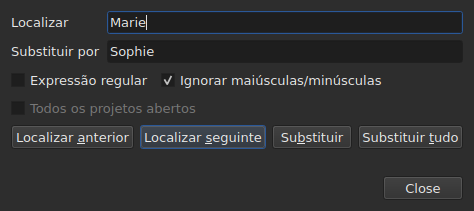
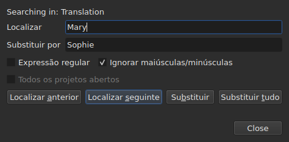

# Localizar e substituir

<!-- machine-translated -->
> Esta página é uma tradução automática e ainda não foi revista por nenhum leitor do idioma.

`Editar ▸ Localizar e substituir…`, ou `Ctrl+F`, abre a caixa de diálogo de pesquisa.




**A caixa de diálogo não é modal**: fica aberta enquanto se olha para a tabela,
se edita uma célula, se pesquisa de novo. `Close` fecha-a; voltar a abri-la
devolve-a como foi deixada, padrão e substituição incluídos.

| Campo | O que contém |
| :---- | :----------- |
| `Find` | o padrão procurado |
| `Replace with` | o que o substitui |
| `Regular expression` | o padrão é uma expressão regular e não texto simples |
| `Ignore case` | “marie” encontra “Marie” |
| `All open projects` | a pesquisa percorre todos os separadores — [ver abaixo](#em-todos-os-projetos-abertos) |

A entrada fica desativada num documento vazio: não há nada a pesquisar.

## Os quatro gestos

| Botão | O que faz |
| :---- | :-------- |
| `Find Previous` | encontra a correspondência anterior, e a tabela vai até ela |
| `Find Next` | encontra a seguinte — é o botão que `Enter` prime |
| `Replace` | substitui a correspondência encontrada e depois encontra a seguinte |
| `Replace All` | substitui todas as do destino |

Os quatro ficam desativados enquanto `Find` estiver vazio.

**A tabela vai até à correspondência** selecionando a sua linha. Chegado à
última, `Find Next` recomeça na primeira; `Find Previous` faz o mesmo no
outro sentido.

**`Replace` sem correspondência encontrada pesquisa primeiro**: a primeira pressão
mostra o que vai ser substituído, a seguinte substitui-o. É o que o
Gaupol faz.

## O que a pesquisa abrange

**A seleção, ou o documento inteiro se nada estiver selecionado** — a regra do
menu `Tools`. Ver [As operações](operations.md#sobre-o-que-atuam).

**O destino é tomado no primeiro gesto e conservado** enquanto a pesquisa
continuar: `Find Next` seleciona a linha de uma correspondência, e essa
seleção não reduz o destino. **Selecionar outras linhas por conta própria
muda o destino** para o gesto seguinte.

A pesquisa abrange o texto das legendas; nem as posições nem o número
são pesquisados.

### Em todos os projetos abertos

A caixa de seleção **`All open projects`** alarga o âmbito a todos os separadores. **Desativada com
um único projeto aberto** — não há nada a alargar —, passa a ficar ativada logo que se abre um
segundo separador, e desmarca-se sozinha quando só resta um.

**Marcada, a seleção deixa de contar**: cada projeto é pesquisado na íntegra,
no **documento visado** — o da coluna atual, o principal ou a
tradução, como para um único projeto.

- **`Find Next` e `Find Previous` vão de separador em separador, pela ordem dos
  separadores.** Primeiro o projeto mostrado; quando este já não tem correspondências, o
  seguinte, cujo separador a janela apresenta e cuja linha seleciona.
- **A volta termina onde começou**: quando a pesquisa ultrapassa o último
  separador para voltar ao primeiro — ou o inverso, a subir —, a linha da
  caixa de diálogo di-lo, em vez de recomeçar sem uma palavra:

  ```text
  Search wrapped around
  ```

  O passo seguinte é um passo vulgar, e a linha apaga-se.
- **`Replace` substitui onde a pesquisa está**, e depois passa à correspondência
  seguinte, que pode estar noutro separador.
- **`Replace All` percorre todos os projetos**, e **faz uma entrada do histórico
  por projeto tocado**: anular num separador anula apenas o que esse separador
  recebeu. A contagem diz quantos projetos mudaram, e não apenas quantas
  substituições houve:

  ```text
  replaced 4 matches in 3 projects
  ```

  Um projeto em que o padrão está ausente não é tocado, e não tem nada a anular.
  **Nenhum separador passa para a frente**: cada projeto recebe as suas substituições
  por trás do seu separador, que ganha o seu asterisco, e o separador de onde o gesto
  partiu continua mostrado, com o seu filme.

### Em que texto

**Com uma tradução, a pesquisa abrange apenas um dos dois textos: o da
coluna da célula atual** — a tradução se a célula atual está
na coluna `Translation`, o texto principal em todos os outros casos. É a
regra de todas as operações sobre textos, e não há nenhuma definição adicional:
ver [O texto a que as operações se destinam](table.md#o-texto-a-que-as-operações-se-destinam).

**A caixa de diálogo diz em que texto pesquisa**, numa linha acima de
`Find`, e muda-a quando a coluna atual muda — mesmo estando aberta:




| A célula atual está | A linha diz |
| :------------------ | :---------- |
| na coluna `Translation` | `Searching in: Translation` |
| em qualquer outra coluna | `Searching in: Main` |
| — o projeto não tem tradução, ou a coluna foi removida | nada: a linha não existe |

**Substituir escreve nesse texto, e só nele.** `Replace` e `Replace
All` sobre a tradução deixam o texto principal como estava, e
o inverso; `Undo` devolve o que escreveram. **As etiquetas são as do formato
do ficheiro desse texto**: uma tradução em Advanced SSA é lida com os seus
`{\i1}`, mesmo quando o texto principal é SubRip. `Replace with` é escrito aí
com as mesmas etiquetas.

**A tabela fica na coluna onde estava.** `Find Next` seleciona a linha
de uma correspondência sem mover a célula atual de uma coluna para a outra:
uma pesquisa iniciada na tradução continua na tradução.

**Pesquisar os dois textos de uma só vez não existe**: cada correspondência
seria um par (legenda, texto), e a tabela, ao ir até ela, não teria
um sítio claro para onde ir. Pesquisa-se num, depois muda-se de coluna.

**O que recomeça do zero**:

| Gesto | O que é esquecido |
| :---- | :---------------- |
| mudar `Find`, `Replace with` ou uma opção | a correspondência atual e a linha de estado |
| selecionar outras linhas por conta própria | o destino e a correspondência |
| mover a célula atual de um texto para o outro — de `Text` para `Translation`, ou o inverso | a correspondência: é um lugar num texto |
| abrir outro ficheiro | o destino e a correspondência; a caixa de diálogo continua aberta, padrão incluído |

## O texto pesquisado é o texto visível

**As etiquetas não são texto.** Pesquisar `<i>` não encontra nada, e pesquisar
`Bonjour` encontra um `<i>Bon</i>jour` cortado por uma etiqueta.

**A substituição faz-se no texto do ficheiro, sem partir as etiquetas**:

| Texto | Pesquisado → posto no seu lugar | O que é escrito |
| :---- | :------------------------------ | :-------------- |
| `<i>Bonjour</i>` | `Bonjour` → `Salut` | `<i>Salut</i>` |
| `<i>Bon</i>jour` | `Bonjour` → `Salut` | `<i>Salut</i>` |
| `<i>Bonjour</i> Marie` | `Bonjour Marie` → `Salut Sophie` | `<i>Salut Sophie</i>` |

Uma etiqueta que corta uma palavra engloba a palavra inteira, e qualquer estilo que toque na
correspondência cobre a substituição. **As etiquetas que a correspondência não
toca ficam onde estão**, mesmo uma que corte outra palavra da mesma
legenda: substituir `Marie` em `<i>Bon</i>jour Marie` dá
`<i>Bon</i>jour Sophie`. Uma palavra é feita de letras e dígitos — um espaço
inseparável ou umas aspas não fazem parte dela. **`Replace with` é lido nas etiquetas do
texto visado**: escrever aí `<b>Salut</b>` num SubRip põe a palavra a negrito.

## As duas opções

| Opção | Predefinição | O que altera |
| :---- | :----------- | :----------- |
| `Regular expression` | desmarcada | `.` já não procura um ponto mas qualquer carater |
| `Ignore case` | marcada | as maiúsculas e minúsculas não contam, letras acentuadas incluídas: `élise` encontra `Élise` |

Estas são as predefinições do Gaupol. **Ambas são memorizadas** de uma abertura para
a seguinte e de uma sessão para a seguinte, nas opções `search.regex` e
`search.ignore-case` do [ficheiro de preferências](preferences.md#o-ficheiro).

### Uma expressão regular

O padrão é lido pelo ICU. Tal como no Gaupol, `.` atravessa uma quebra de linha, e `^`
e `$` aplicam-se ao início e ao fim **de cada linha** de uma legenda:
substituir `^` por `- ` põe um hífen antes de cada linha.

Em `Replace with`, e apenas para uma expressão regular:

| Escrito | O que põe |
| :------ | :-------- |
| `$1` a `$9` | o grupo desse número; um grupo ausente não põe nada |
| `$0` | a correspondência inteira |
| `\n` | uma quebra de linha |
| `\$`, `\\` | um `$`, uma barra invertida |
| `\` seguida de qualquer outro carater | esse carater: `\t` põe um `t` |

**`\1` não é um grupo**, e põe um `1`. É a sintaxe do Gaupol, que lê
as suas expressões em Python; a daqui é a do ICU, que lê o padrão.

## O que a caixa de diálogo diz

Sob os botões, uma linha diz o que a pesquisa não pôde fazer, ou o que um
`Replace All` fez:

| Situação | O que é mostrado |
| :------- | :--------------- |
| nenhuma correspondência no destino | `"Sophie" not found` |
| uma expressão regular que não se lê | `not a regular expression (U_REGEX_MISMATCHED_PAREN)` |
| `Replace All` substituiu | `replaced 3 matches` |
| `Replace All` encontrou o padrão, mas a substituição não altera nenhum texto | `nothing to change` |

**Uma pesquisa que não encontra nada não toca em nada**: a seleção fica onde
estava, e nada entra no histórico.

**`not found` e `nothing to change` não dizem a mesma coisa.** `not found`
diz que o padrão não está em lado nenhum do destino. `nothing to change` diz que
está lá, mas que a substituição deixa cada texto como estava — substituir
`Marie` por `Marie`, por exemplo. Nos dois casos nada entra no
histórico. O número de `replaced N matches` conta as correspondências das
legendas cujo texto mudou.

## O que a ação de anular diz sobre isto

| Gesto | O que `Undo` indica |
| :---- | :------------------ |
| `Replace` | `Undo: replacing` — um por substituição |
| `Replace All` | `Undo: replacing all` — **uma única entrada**, qualquer que seja o número de correspondências |

Ver [Anular e refazer](undo.md).
