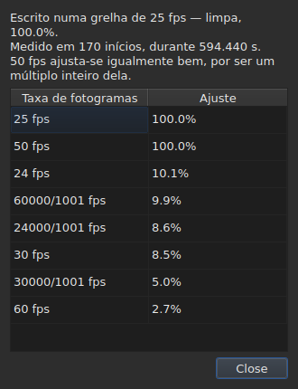

# A grelha de fotogramas

<!-- machine-translated -->
> Esta página é uma tradução automática e ainda não foi revista por nenhum leitor do idioma.

Um ficheiro de legendas **não declara** a taxa de fotogramas a partir da
qual as suas posições foram calculadas: o SubRip não tem cabeçalho, o do
WebVTT é texto livre. A janela **deduz** essa taxa das próprias posições,
ao abrir, e mostra-a em dois sítios que não respondem à mesma
pergunta.

| Superfície | O que dá |
| :--------- | :------- |
| a barra de estado | **a resposta**, de forma permanente e sem que seja pedida |
| `Ferramentas ▸ Análise da taxa de fotogramas…` | **o raciocínio**, quando se quer vê-lo |

## O que a barra de estado mostra

À direita, entre o que diz sobre a [codificação](files.md#a-codificação-na-barra-de-estado) do ficheiro lido e o que
diz sobre o [vídeo associado](video.md#o-que-a-barra-de-estado-mostra):

| Situação | O que é escrito |
| :------- | :-------------- |
| as posições estão numa grelha | `Grid: 24 fps` |
| só algumas | `Grid: 29.97 fps (partial)` |
| nenhuma grelha conhecida se ajusta | `No grid` |

**`No grid` não nomeia nenhuma taxa de fotogramas, e é de propósito.** O conjunto
de candidatas é fechado — as oito que a caixa de diálogo da conversão oferece — e
indicar a menos errada delas seria dar uma resposta errada onde
“não sei” é a resposta certa.

**`No grid` tem duas causas, e não são a mesma resposta.** Ou nenhuma
grelha se ajusta, ou o ficheiro tem poucas legendas para que se possa dizer
alguma coisa sobre ele — dois inícios parecem sempre perfeitamente alinhados, e isso não prova
nada. A barra de estado diz o mesmo nos dois casos;
**a análise distingue-os** e indica, no primeiro caso, por quanto
falha a melhor candidata.

A linha **atualiza-se após cada operação**. Alinhar um ficheiro por outra
taxa de fotogramas muda a grelha, e a barra de estado não deve continuar a
anunciar a antiga.

### Um documento contado em fotogramas não tem grelha, tem uma taxa de fotogramas

**O MicroDVD é o único dos nove que conta em fotogramas.** Cada uma das suas linhas
leva dois números de fotograma e mais nada, e o ficheiro **não diz** a que
taxa de fotogramas devem ser lidos. O mesmo lugar da barra de estado escreve então:

| Situação | O que é escrito |
| :------- | :-------------- |
| o documento é contado em fotogramas | `Frames: 24000/1001 fps` |

**Isto não é a grelha, e a grelha seria aqui circular.** As posições
de um documento MicroDVD foram calculadas *a partir* dos seus fotogramas a essa mesma
taxa; deduzir uma grelha delas devolveria esse número, isto é, um dado
disfarçado de medição.

**A origem é dita uma só vez**, pela leitura, na
[lista de diagnósticos](files.md#os-diagnósticos-de-uma-leitura):
`counts in frames and states no rate; it was read at ("24000/1001")`. A linha da barra de
estado, por seu lado, diz o que é, de forma permanente.

**Errar na taxa de fotogramas move o ficheiro inteiro**, e a caixa de diálogo
[`Convert Frame Rate…`](operations.md#convert-frame-rate) é onde se corrige:
abre-se na taxa de fotogramas de leitura e diz que é essa.

## O que a análise mostra

`Ferramentas ▸ Análise da taxa de fotogramas…` **não modifica nada.** Abre-se com um resumo e
a classificação das oito candidatas com a sua pontuação.




O resumo dá a resposta e depois o que a qualifica — cada frase aparece
apenas se tiver algo a dizer:

| O que se pode ler aí | Quando |
| :------------------- | :----- |
| sobre quantos inícios, e sobre que extensão | sempre |
| em quanto o ficheiro está desviado da sua grelha | as suas posições estão nela até uma constante |
| que outra taxa de fotogramas se ajusta igualmente bem | é um múltiplo inteiro da retida |
| que a extensão não permite distinguir duas taxas de fotogramas | o ficheiro é demasiado curto para as separar |
| quantos inícios saem da grelha, **e em quantas sequências** | o ficheiro é parcial |

**O número de sequências é o que distingue duas histórias** que a
percentagem sozinha confunde. Muitas sequências de um único início são posições
corrigidas à mão, uma a uma. Poucas sequências longas são uma secção
resincronizada, ou um ficheiro montado a partir de dois outros.

**Mostra-se a classificação completa em vez de uma única resposta.** Um ficheiro que
se ajusta a 25 a cem por cento e a 50 a cem por cento diz algo que um
veredicto sozinho esconderia.

## Quando a conversão estava errada

Um ficheiro que não cai em nenhuma grelha é por vezes um ficheiro **convertido com a taxa de
fotogramas errada**: está então numa grelha bem real, mas desviado por uma razão que não é a de
nenhuma das oito. Quando a dedução devolve `none` ou `partial`, a análise procura **entre os
cinquenta e seis pares ordenados das oito taxas de fotogramas normalizadas** — é esse o conjunto, fechado — aquele
cuja conversão repõe as posições numa grelha. Cada razão é aplicada às posições, e
**é a própria dedução que julga o resultado**: a confiança é o que ela diria, nunca um
número inventado. Dois pares que dão a mesma razão, como 30 para 25 e 60 para 50, são uma única
conversão.

A frase é acrescentada ao resumo:

```text
converting from 24 to 25 fps puts the positions on a 24 fps grid: 99.9%, against 11.8% as they are and 14.9% for the next best conversion
```

Dá a conversão, a grelha em que as posições cairiam e com que qualidade caem nela,
**depois a diferença em relação às posições tal como estão e à melhor das outras
conversões.** Um botão `Convert Frame Rate…` fecha a análise e abre [a caixa de diálogo
da conversão](operations.md#convert-frame-rate) **preenchida com o par encontrado** — nada é aplicado
enquanto a caixa de diálogo não for aceite, e basta cancelar para voltar atrás. O vídeo, aberto ao lado,
permite julgar pela imagem se a resposta é a certa.

**Quando dois pares são igualmente bons, nenhum é proposto, e a frase di-lo:**

```text
converting from 30 to 25 fps and converting from 25 to 24 fps fit equally well (99.7% and 99.6%), so none is proposed
```

É o caso corrente e não a exceção: uma grelha a 28,8 fotogramas por segundo volta
a cair tanto em 24 como em 30, e um ficheiro cujos tempos estão todos dobrados continua na grelha de 25.
O gesto que tem uma única reparação é converter um ficheiro **já** na taxa de fotogramas de destino. Para
um empate, o vídeo decide: é o utilizador quem abre `Convert Frame Rate…` num dos dois pares.

**Nada é dito** sobre um ficheiro já numa grelha, um ficheiro demasiado curto para que um veredicto
valha alguma coisa, nem um ficheiro que nenhuma conversão do conjunto repõe numa grelha — uma deriva, uma
razão fora das oito taxas de fotogramas, posições sem estrutura.

## O que a tabela não mostra

**Nenhuma linha da tabela é marcada por causa da grelha**, nunca.

Assim que se corrige uma posição à mão, ela deixa de estar alinhada. Uma
marcação automática comunicaria, portanto, o trabalho do utilizador como uma
anomalia, num ficheiro que está precisamente a corrigir. A dedução
fala do **documento**, e a análise é a única exceção — porque a
abriu para isso.

As marcas da tabela, por seu lado, dizem respeito ao que não se sustenta: um fim
antes do seu início, uma sobreposição, uma ordem quebrada. Ver [A tabela](table.md).
