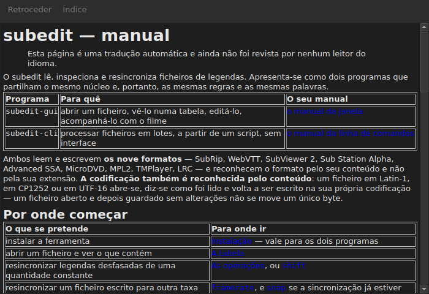

# O manual na janela

<!-- machine-translated -->
> Esta página é uma tradução automática e ainda não foi revista por nenhum leitor do idioma.

`Ajuda ▸ Manual`, ou `F1`, abre **este mesmo manual** numa janela própria.




## O que abre, e porque não um endereço

**O manual instalado ao lado do programa**, não uma página da Internet.

Um endereço descreveria a versão em desenvolvimento, não a que se tem à mão.
O utilizador que lê o manual de uma versão que não tem está pior servido do que um
utilizador sem manual nenhum — por isso a janela lê os ficheiros colocados
pela instalação, em `<prefix>/share/subedit/manual`. Veja-se
[Instalação](../subedit-cli/installation.md).

Abre na [página inicial](../index.md), a que diz por onde começar.

## Em que idioma

**No idioma da janela.** O manual abre no idioma que a
interface fala: o escolhido em `Editar ▸ Preferências…`, ou o do
ambiente, no caso contrário — veja-se
[O idioma da interface](preferences.md#o-idioma-da-interface).

| A janela fala | O manual abre em |
| :---------------- | :------------------ |
| inglês | inglês |
| um idioma cujo manual está instalado — catalão, checo, alemão, espanhol, finlandês, francês, galego, hebraico, húngaro, interlingue, islandês, italiano, neerlandês, polaco, português, português do Brasil, russo, sérvio, turco, chinês simplificado | esse idioma |
| um idioma cujo manual não está instalado | inglês |

**Página a página, não tudo ou nada**: uma página que a tradução não tem
abre em inglês, e todas as outras páginas continuam no idioma da janela. Uma
ligação leva de uma à outra da mesma maneira.

As traduções são instaladas ao lado do manual inglês, cada uma numa pasta
com o nome do seu idioma: `<prefix>/share/subedit/manual/fr` para o francês. O
idioma é aquele em que a janela arrancou, pelo que um idioma escolhido nas
preferências se aplica também ao manual no arranque seguinte.

## Navegar

| O que se faz | O que acontece |
| :---------- | :----------- |
| clicar numa ligação do manual | a página abre na mesma janela |
| clicar numa ligação que aponta para uma secção | a página abre, e a janela desloca-se até ela |
| clicar numa ligação que aponta apenas para uma secção | a janela desloca-se até ela, sem mudar de página |
| `Back` | volta à página anterior; desativado na primeira |
| `Contents` | volta à página inicial; desativado quando se está nela |

A janela **não é modal**: continua aberta enquanto se trabalha, que é toda a
razão de ter o manual à mão. Escolher de novo a entrada não cria uma
segunda janela, traz esta para a frente.

## O que não consegue abrir, e di-lo

O manual remete por vezes para o **roadmap** ou para uma **decisão de
arquitetura**. São documentos do repositório, não do pacote: não são
instalados, e a janela di-lo em palavras claras em vez de deixar o
clique sem efeito.

```
../../feuille-de-route.md is not part of the installed manual;
it lives in the project's repository.
```

Podem ser lidos no repositório, cujo endereço está em `Ajuda ▸ Sobre o subedit`.

## Quando a entrada está desativada

**`Ajuda ▸ Manual` está desativada quando não há nenhum manual ao lado do programa.** Dois
casos, e nenhum é uma falha:

| Caso | Porquê |
| :--- | :-- |
| o binário é executado a partir da sua árvore de compilação | aí nada foi instalado, pelo que não há nada para ler |
| a instalação é parcial | o manual foi removido, ou nunca foi copiado |

Passar o ponteiro sobre a entrada diz qual dos dois: “Não há nenhum manual instalado junto a
este programa”.

Uma página em falta enquanto o manual está presente — um ficheiro apagado à mão — não
fecha a janela: nomeia o ficheiro que não conseguiu ler e mantém no ecrã o que
estava a mostrar.

## Onde se procura o manual

**Ao lado do executável**, em `../share/subedit/manual` — a disposição que toda
instalação produz, seja qual for o prefixo. É isso que permite a uma instalação
em `~/.local` encontrar o seu manual tão bem como um pacote instalado em `/usr`.
