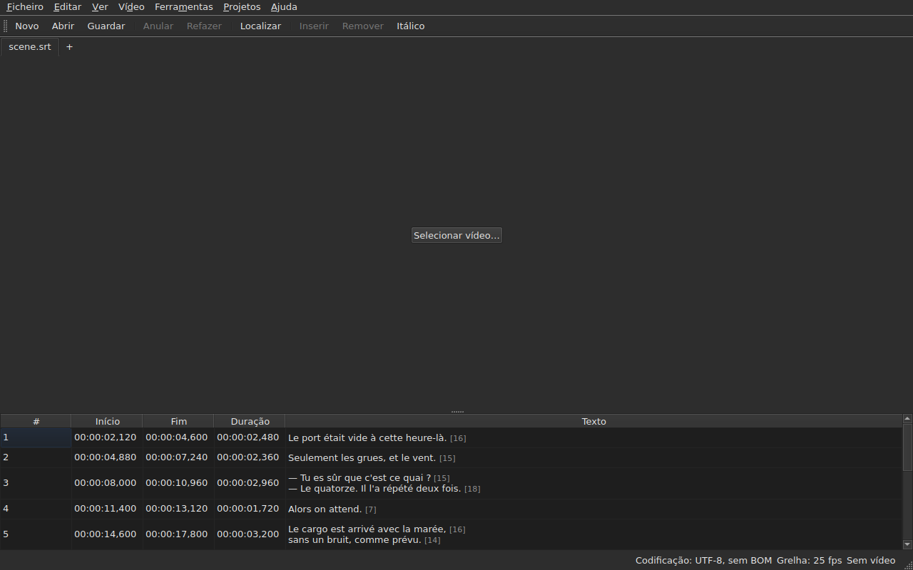

# subedit-gui — manual

<!-- machine-translated -->
> Esta página é uma tradução automática e ainda não foi revista por nenhum leitor do idioma.

A janela do subedit: abre-se um ficheiro de legendas e vê-se numa tabela. Para o
outro programa e para saber por onde começar, veja-se [o manual](../index.md).

> **Estado atual.** A janela **abre vários ficheiros, um separador cada**, seja qual
> for a sua codificação — através de `Open…` ou largando-os sobre ela —, **mostra-os**,
> **edita as suas células**, **insere e remove linhas**,
> **anula**, **guarda — escolhendo a codificação, os fins de linha e a
> marca de ordem de bytes** — e **assinala as legendas cujas posições
> não são coerentes entre si**. **Une e divide** linhas, **corta,
> copia e cola** textos, e **localiza e substitui** no texto visível
> sem estragar as etiquetas, num projeto ou em todos. **Abre uma tradução
> ao lado do ficheiro principal**, alinhada por posição ou por número, numa coluna a mais,
> e guarda-a em separado. O menu `Tools` reúne dezasseis operações e duas entradas de ortografia —
> deslocar, transformar, converter a taxa de fotogramas, ajustar durações,
> **anexar um ficheiro, dividir o projeto em dois**, pôr em
> itálico, acrescentar travessões de diálogo, mudar as maiúsculas e minúsculas de quatro maneiras,
> remover menções para deficientes auditivos, **corrigir textos através de um
> assistente de várias páginas**, **verificar a ortografia palavra a palavra**, alinhar por uma taxa de fotogramas, repor na
> grelha — e a análise da grelha, que não modifica nada. O menu `Projects`
> **guarda e fecha tudo** num só gesto. **Associa um vídeo
> ao documento**, escolhido ou adivinhado, e **reproduz-o na janela**, com a linha
> atual desenhada sobre a imagem; **define um início, um fim ou uma
> legenda a partir da posição do filme**, **avança fotograma a fotograma** e **desloca uma extremidade de um fotograma**. A barra de reprodução **procura, regula o
> volume e a posição**, a tabela **acompanha a reprodução** sem anular um deslocamento manual, as posições
> podem ser mostradas **em fotogramas**, e o menu `Video` **escolhe a faixa de áudio**. Duas deteções
> **propõem sem nunca aplicar**: uma tradução desfasada de uma quantidade constante, que pode ser **reaberta
> com o desfasamento corrigido**, e a conversão da taxa de fotogramas que repõe um ficheiro numa grelha. **Recorda a sua geometria, a ordem, a largura e a presença das suas
> colunas, e as suas definições** de uma
> sessão para a seguinte, e apresenta-se **clara ou escura** à escolha. `Ajuda ▸ Manual`
> abre **este manual** numa janela. Este manual descreve o que existe, nunca
> o que está planeado; o que vem a seguir está no
> [roadmap](../../../../feuille-de-route.md).

> **As imagens deste manual são geradas, o texto não.** Os exemplos de
> `subedit-cli` são gerados executando o comando; as capturas de ecrã
> são geradas construindo a janela real e fotografando-a — `make
> manual` faz ambas as coisas. Uma imagem não pode, portanto, descrever uma interface que
> já não existe, e uma interface que muda vê-se no diff
> do repositório. O que fica sem rede de segurança é o texto que as rodeia, cuja
> exatidão assenta na revisão.

**Cada ecrã é mostrado duas vezes, com as duas paletas que a
aplicação define** — `Light` e `Dark`, as que
[as preferências](preferences.md#o-tema) oferecem. Num ambiente de trabalho cujo
tema manda, `System` dá uma ou outra consoante o que o ambiente de trabalho escolheu.

## Os menus

`File`, `Edit`, `View`, `Video`, `Tools`, `Projects`, `Help` — pela ordem em
que se usam: o documento, o que se lhe faz, como se olha para ele, o que
o acompanha, o que o examina, o que se aplica a todos os projetos abertos, o que
o explica.

`View` contém um submenu, `Columns`, com uma entrada assinalável por coluna exceto `Text`
— veja-se [A tabela](table.md#ocultar-e-mover-colunas) — e uma definição, `Positions in Frames`, que mostra
`Start` e `End` como números de fotograma — veja-se [Posições em fotogramas](table.md#posições-em-fotogramas).

`Projects` contém duas entradas, `Save All` e `Close All` — veja-se
[O menu Projetos](files.md#o-menu-projetos).

`Edit` contém cinco blocos, cada um sob um separador: anular; a
área de transferência — cortar, copiar, colar textos; `Find and Replace…`;
inserir, remover, unir e dividir linhas; por fim
`Preferences…`. Anular é o que se faz *a* uma edição, mover um texto
não acrescenta nem remove nenhuma linha, as quatro do bloco seguinte mudam o número de
linhas, e definir o tema não é de todo uma edição.

**As teclas são nomeadas como o menu as apresenta**, em inglês como o resto
da interface: `Ins`, `Del`, `Ctrl+Shift+Z`. Uma tecla que se prime e
que nenhum menu nomeia conserva o seu nome inglês: `Enter`, `Esc`, `Shift`.

`Help` contém duas entradas, pela ordem em que o menu as mostra. `Manual`, ou
`F1`, abre este manual numa janela — veja-se
[O manual na janela](help.md). `About subedit` indica a versão, a
licença, e as bibliotecas com que a janela funciona, com as suas versões — veja-se
[`--version`](invocation.md#--version).

## A barra de ferramentas

Sob os menus, uma barra reúne **os gestos mais frequentes**, em grupos.
Cada botão tem uma palavra curta; o menu conserva a entrada completa, e o
atalho é o mesmo.

| Botão | Entrada do menu | Atalho |
| :----- | :--------- | :------- |
| Novo | Ficheiro ▸ Novo projeto | `Ctrl+N` |
| Abrir | Ficheiro ▸ Abrir… | `Ctrl+O` |
| Guardar | Ficheiro ▸ Guardar | `Ctrl+S` |
| Anular | Editar ▸ Anular | `Ctrl+Z` |
| Refazer | Editar ▸ Refazer | `Ctrl+Shift+Z` |
| Localizar | Editar ▸ Localizar e substituir… | `Ctrl+F` |
| Inserir | Editar ▸ Inserir legendas… | `Ins` |
| Remover | Editar ▸ Remover legendas | `Del` |
| Itálico | Ferramentas ▸ Itálico | `Ctrl+I` |

**Um botão desativado está-o pela mesma razão que a sua entrada**: `Undo` sem
nada para anular, `Remove` sem nenhuma linha escolhida. As entradas da tradução
e as operações do menu `Tools`, exceto `Italic`, ficam nos seus
menus: usam-se menos vezes, ou nem toda a gente as usa.

## Secções

| Secção | Conteúdo |
| :------ | :------- |
| [Instalação](../subedit-cli/installation.md) | compilar e instalar — a página aplica-se aos dois programas |
| [Invocação](invocation.md) | lançar a janela, argumentos, códigos de saída |
| [Abrir e guardar](files.md) | os comandos, os separadores, o menu `Projects`, largar ficheiros, a tradução e a sua reabertura com o desfasamento corrigido, os diagnósticos, a codificação na barra de estado, a ida e volta, o fecho |
| [A tabela](table.md) | o que cada coluna mostra, ocultá-las e movê-las, as posições em fotogramas, a coluna de tradução e o texto a que as operações se destinam |
| [Editar uma célula](editing.md) | que células podem ser editadas, e como |
| [Cortar, copiar e colar textos](clipboard.md) | as três entradas, o que viaja, as linhas acrescentadas, as etiquetas traduzidas |
| [Localizar e substituir](find-and-replace.md) | a caixa de diálogo, os quatro gestos, as duas opções, o que a pesquisa abrange, em todos os projetos abertos |
| [Inserir, remover, unir e dividir linhas](lines.md) | as quatro entradas, os seus atalhos, onde vão parar as linhas novas |
| [Anular e refazer](undo.md) | o histórico, as duas ações, a marca de modificação |
| [A grelha de fotogramas](frame-grid.md) | a taxa de fotogramas deduzida das posições, a análise, e a conversão que repõe um ficheiro numa grelha |
| [As operações](operations.md) | deslocar, transformar, converter, ajustar durações, anexar um ficheiro, dividir o projeto, pôr em itálico, as maiúsculas e minúsculas, os travessões, remover menções, alinhar, repor na grelha, e o que ultrapassa o fim do filme |
| [Corrigir textos…](correct-texts.md) | o assistente de correção: o alvo e as tarefas, a página de cada tarefa, o progresso, a confirmação |
| [Verificar ortografia…](check-spelling.md) | a verificação ortográfica: as suas definições, o percurso, o fecho a meio, a ausência de dicionário |
| [O vídeo associado](video.md) | escolher um vídeo, a proposta automática, a faixa de áudio, a barra de estado, `ffmpeg` |
| [O reprodutor](player.md) | a vista do vídeo, a barra de reprodução, reproduzir, deslocar-se, o volume, a tabela que acompanha, a linha desenhada |
| [Sincronização a partir do vídeo](timing.md) | definir o início ou o fim de uma legenda, inserir, selecionar a partir da posição do filme, avançar fotograma a fotograma, deslocar uma extremidade |
| [As preferências](preferences.md) | o tema, o ficheiro de preferências, as suas opções, e o que acontece a um valor ilegível |
| [O manual na janela](help.md) | `Ajuda ▸ Manual`, o que abre e como navegar nele |
