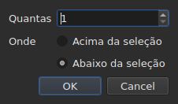

# Inserir, remover, unir, dividir e ordenar linhas e tornar os intervalos disjuntos

<!-- machine-translated -->
> Esta página é uma tradução automática e ainda não foi revista por nenhum leitor do idioma.

Oito entradas do menu `Edit`, sob um separador que as afasta de
`Find and Replace…`. Quatro têm em comum o facto de alterarem o número de linhas, ao passo que
cortar, copiar e colar, acima, movem textos; `Sort Subtitles` altera
apenas **a ordem** das linhas, `Join Repeated Subtitles` volta a fazer uma única
legenda dos pedaços consecutivos de um mesmo texto, e `Make Ranges Disjoint…`
volta a cortá-los onde se sobrepõem.

| Entrada | Atalho | O que faz |
| :------ | :----- | :-------- |
| Inserir legendas… | `Ins` | abre uma caixa de diálogo e depois acrescenta linhas em branco |
| Remover legendas | `Del` | remove a seleção, sem perguntar nada |
| Unir legendas | nenhum | faz uma única linha de um bloco de linhas vizinhas |
| Dividir legenda | nenhum | corta uma linha em duas a meio da sua duração |
| Juntar legendas repetidas | nenhum | faz uma única legenda dos pedaços consecutivos de um mesmo texto |
| Ordenar legendas | nenhum | repõe as linhas na ordem do seu início, em todo o projeto |
| Tornar intervalos disjuntos… | nenhum | corta as linhas que se sobrepõem para que nenhum intervalo se sobreponha a outro |
| Reparar legendas… | nenhum | encadeia as três entradas anteriores — juntar as repetições, ordenar, cortar os intervalos — de uma só vez |

Todas as oito entram no histórico: `Ctrl+Z` anula-as como as restantes.

## Inserir

| Campo | O que contém | Predefinição |
| :---- | :----------- | :----------- |
| `How many` | um número inteiro de 1 a 99 999 | `1` |
| `Where` | `Above the selection` ou `Below the selection` | a última escolha, `Below` no primeiro arranque |

`OK` acrescenta as linhas, `Cancel` não acrescenta nada.

### Onde ficam

**Na última linha selecionada**, não na primeira. Selecionar as linhas 1 e 3
e inserir abaixo coloca a nova linha na posição 4 — não na
posição 2. É o que o Gaupol faz há vinte anos, e o que a mão
espera depois de percorrer a tabela de cima para baixo.

`Above the selection` coloca-a imediatamente antes dessa mesma linha.

### Quanto duram

Uma linha em branco não tem texto, mas tem posições. Estas são deduzidas
do espaço disponível:

| Situação | Início | Duração |
| :------- | :----- | :------ |
| entre duas legendas | o fim da anterior | o espaço até à seguinte, repartido em partes iguais |
| depois da última | o fim da última | três segundos cada uma |
| à cabeça de um ficheiro | a origem | o espaço até à primeira, repartido |
| num ficheiro vazio | a origem | três segundos cada uma |

Quando o ficheiro tem sobreposições no local escolhido, **não há espaço
para repartir**: as linhas recebem uma duração nula, que a tabela mostra, em vez
de uma duração inventada que ultrapassaria a vizinha.

### O documento vazio

**Não é necessária nenhuma seleção**, e é a única maneira de começar um
novo ficheiro: as linhas vão para o índice zero. A escolha do lado fica então desativada
na caixa de diálogo — não há seleção em relação à qual as colocar.

Assim que o documento tem uma linha, a entrada `Insert Subtitles…` **fica desativada enquanto
nada estiver selecionado**: sem seleção, o índice teria de ser adivinhado.

### Depois

As linhas acrescentadas ficam **selecionadas**, e a tabela vai até elas. Premir
`Ins` uma segunda vez insere, portanto, a seguir a elas, sem ser preciso clicar entre os
dois gestos.

### O lado é memorizado

`Above` ou `Below` é memorizado **de uma inserção para a seguinte e de uma sessão para
a seguinte**: é a opção `edit.insert-placement` do
[ficheiro de preferências](preferences.md#o-ficheiro). Não se insere uma só vez,
inserem-se dez linhas seguidas, sempre do mesmo lado.

## Remover

`Remove Subtitles`, ou `Del`, remove as linhas selecionadas — incluindo uma
seleção descontínua, voltando cada linha ao seu lugar se se anular.

**Não é pedida nenhuma confirmação**, e não é um esquecimento:
a operação anula-se com `Ctrl+Z`. Uma janela modal antes de um gesto anulável
custaria um clique de cada vez para poupar um `Ctrl+Z` de vez em quando.

**A entrada fica desativada quando nada está selecionado.** No resto da janela,
“nada selecionado” significa “o ficheiro inteiro” — é isso que permite
usar um deslocamento sem selecionar quatro mil linhas. Aqui, essa leitura
esvaziaria um documento com um `Del` infeliz, pelo que não é oferecida.

Depois da remoção, **fica selecionada a linha que ocupou o lugar da primeira removida**
— ou a última que resta, se a remoção levou o fim do
ficheiro. Premir `Del` várias vezes seguidas remove, portanto, as linhas uma
a uma.

Um ficheiro totalmente esvaziado deixa a janela utilizável: `Insert Subtitles…`
volta a ficar ativada, uma vez que num documento vazio se insere sem seleção.

## Unir

`Merge Subtitles` faz **uma única linha** das linhas selecionadas:

| O que a linha unida recebe | De onde vem |
| :------------------------- | :---------- |
| o seu início | o início da primeira |
| o seu fim | o fim da última |
| o seu texto | os textos de todas, por ordem, com uma quebra de linha entre dois |
| a sua tradução | as traduções, unidas da mesma forma |
| o que o formato contém além disso — um estilo, uma camada, coordenadas | o da primeira |

**Um texto vazio não deixa nenhuma linha vazia**: unir `Un.`, uma linha sem
texto e `Trois.` dá duas linhas de texto, não três.

As linhas unidas desaparecem, e a linha que as substitui ocupa o lugar
da primeira.

**A entrada fica desativada** enquanto a seleção não for **um bloco de pelo menos
duas linhas vizinhas**. Uma única linha não tem com quem unir-se; as linhas
1 e 3 sem a 2 também não, pois o resultado passaria por cima da 2 e
cobri-la-ia.

Depois da união, **fica selecionada a linha unida**: `Split Subtitle` está
pronta para a cortar de novo.

## Dividir

`Split Subtitle` corta a linha selecionada **a meio da sua duração**, ao
milissegundo:

| Metade | Início | Fim | Texto |
| :----- | :----- | :-- | :---- |
| a primeira | o início original | o meio | **todo** o texto, e a tradução |
| a segunda | o meio | o fim original | vazio |

**O texto não é cortado na sua quebra de linha.** Isso estaria certo para uma
legenda de duas linhas e errado para uma legenda de uma linha ou de três;
todo o texto fica na primeira metade, e é a pessoa que move o que deve
passar para a segunda.

A primeira metade conserva o que o formato continha além do texto; a segunda
nasce como uma linha inserida, sem nada.

**A entrada fica desativada** enquanto a seleção não contar **exatamente uma
linha**. Aqui, nada selecionado não significa “o ficheiro inteiro”.

Depois da divisão, **ficam selecionadas as duas metades** — é o que o Gaupol
faz depois de qualquer inserção, e `Merge Subtitles` fica então pronta para desfazer o
gesto.

## Ordenar

`Sort Subtitles` repõe **o projeto inteiro** na ordem dos inícios. Nunca a
seleção: uma ordem é uma propriedade do documento, e ordenar metade de um
ficheiro não faz sentido. A ordenação é **estável**: duas legendas que
começam em simultâneo conservam a ordem que o ficheiro lhes deu.

**Durante a ordenação, corre uma barra na barra de estado e o cursor passa a ser uma
ampulheta**: num ficheiro longo, a janela deixa de responder durante algum tempo — a
tabela reconstrói-se linha a linha — e, sem isso, não se sabe se algo está
em curso. A barra não mostra nenhuma fração, a ordenação não a comunica,
e desaparece com ela.

A barra de estado diz quantas linhas mudaram de lugar — `3 subtitles moved`
— ou, quando tudo estava em ordem, `already in order`. **Um projeto já ordenado
não entra no histórico**: uma operação que nada altera não é
uma operação a anular. A entrada fica desativada para um projeto de uma só legenda.

Um ficheiro **com algo a corrigir ao abrir** propõe-no por si próprio,
[numa única caixa](#ao-abrir-uma-única-caixa): ver abaixo. As legendas mal
colocadas são também [contadas com os diagnósticos](files.md#os-diagnósticos-de-uma-leitura),
para que se encontrem sem percorrer a tabela.

Na linha de comandos, [`sort`](../subedit-cli/sort.md) faz o mesmo em
ficheiros, e `--sort` fá-lo de passagem em
[`convert`](../subedit-cli/convert.md#ordenar-ao-escrever),
[`append`](../subedit-cli/append.md#ordenar-o-resultado) e
[`split-file`](../subedit-cli/split-file.md#cortar-por-ordem-cronológica).

## Unir legendas repetidas

`Join Repeated Subtitles` faz **uma única legenda** das legendas que mostram a
mesma coisa seguidas: um texto cortado em pedaços consecutivos, como
algumas ferramentas de segmentação o deixam. Atua sobre **o projeto inteiro**.

**Uma repetição** tem o mesmo texto, a mesma tradução e as mesmas definições de formato
(um estilo, uma posição, definições de cue) que outra, **e começa, o mais
tardar, quando essa termina**. Uma sequência de repetições torna-se aquela que começa
primeiro, com o maior fim da sequência; as outras desaparecem.
`Alpha [1, 2]`, `Alpha [2, 4]` e `Alpha [4, 6]` dão `Alpha [1, 6]`.

- **A ordem do ficheiro não altera nada nisto, e isto não a altera**: a legenda conservada
  é a que começa primeiro, onde quer que estejam as outras.
- **Nada é unido por engano**: outro texto, outras definições, um espaço
  entre dois pedaços, uma legenda sem texto ou cujo fim precede o início
  ficam separados.
- A barra de estado diz o que foi feito — `2 repeated subtitles joined`, ou
  `no repeated subtitles`.

**A fazer antes de ordenar e de cortar**, que leem melhor uma sequência limpa: um
texto em três pedaços, mais outro texto sobre todo o intervalo, dados
fora de ordem, ordena-se e corta-se em linhas que alternam de um pedaço para o outro; unido
primeiro, entra na ordem e une-se sem problemas. A caixa de abertura, abaixo, faz
as três coisas por essa ordem.

## Tornar os intervalos disjuntos

`Make Ranges Disjoint…` corta as legendas que se sobrepõem de modo que **nenhum
intervalo `[start, end]` se sobreponha a outro**. Atua sobre **o projeto
inteiro**, nunca sobre a seleção: um grupo de legendas que se sobrepõem
é cortado onde se sobrepõem, e metade de um grupo não faz sentido.

**Nada é encurtado nem alongado.** Em cada instante, a janela mostra os
mesmos textos que antes. O que muda é a forma como a linha do tempo é cortada:
corta-se em cada início e em cada fim de um grupo; um intervalo coberto
por uma única legenda continua a ser essa legenda; um intervalo coberto por várias
torna-se **uma** legenda cujas linhas são as delas, **a mais antiga na linha 1**.
`A [0, 5]` e `B [3, 8]` dão `[0, 3] A`, `[3, 5] A / B`, `[5, 8] B`.

A caixa de diálogo pede três definições, memorizadas de uma vez para a seguinte:

| Campo | O que contém | Predefinição |
| :---- | :----------- | :----------- |
| `Shortest interval kept` | de 0 a 10 000 ms: um intervalo mais curto é absorvido por uma vizinha | `80 ms` (cerca de dois fotogramas) |
| `Most lines in a subtitle` | de 0 a 10; `No limit` em 0 | `2` |
| `Put a dash before each subtitle's text` | um hífen antes do que cada legenda contribui para uma legenda unida | desmarcada |

`OK` corta, `Cancel` não faz nada. **As linhas escritas ficam selecionadas**
depois, e a barra de estado diz o que foi feito: `2 subtitles split, 1 merged`.
Uma segunda passagem não altera nada e comunica-o: `already disjoint`.

- **Uma linha nunca é duplicada.** Duas legendas com o mesmo texto dão uma
  única linha onde se sobrepõem, e dois pedaços vizinhos que mostram a
  mesma coisa fazem apenas uma legenda. O texto de uma legenda cortada em vários
  pedaços repete-se, de resto, em cada um: é o que está no ecrã nesse instante.
- **Um intervalo muito curto é absorvido por uma vizinha**: aquela cujas linhas
  já contêm as dele, ou, caso contrário, a mais longa, estende o seu intervalo para o cobrir.
  Uma legenda inteira mais curta do que o limiar nunca é absorvida.
- **Mais linhas do que o limite: janelas.** Três linhas ao longo de três segundos
  tornam-se duas metades, as duas primeiras linhas e depois as duas últimas;
  quatro linhas, três terços, e assim por diante. Nada é truncado.
- A tradução segue os mesmos cortes; o estilo e a posição da primeira
  legenda que cobre são conservados.

**O que não pôde ser feito por completo é dito numa caixa a fechar**, não na
barra de estado: janelas, intervalos absorvidos, legendas demasiado curtas
deixadas inteiras, estilos que diferem, legendas cujo fim precede o seu
início (deixadas onde estão).

**A entrada é recusada, com o motivo, quando as legendas não estão na
ordem do seu início**: os grupos são sequências de vizinhas, e o núcleo nunca
ordena por si próprio. Primeiro `Sort Subtitles` — ou a caixa de abertura, que
faz as duas coisas por essa ordem.

### Tudo de uma vez: `Repair Subtitles…`

`Repair Subtitles…` faz as três entradas anteriores **uma a seguir à outra**, na única ordem que funciona: as
repetições são unidas, as legendas postas na ordem do seu início, e depois os intervalos tornados disjuntos. É a entrada
para um ficheiro mal segmentado, mal ordenado e com sobreposições, quando se sabe que se querem as três coisas. A caixa de diálogo pede as
definições de corte (as mesmas de `Make Ranges Disjoint…`, memorizadas de uma vez para a seguinte) e diz que une e ordena
primeiro. A barra de estado — ou a caixa a fechar, quando algo não pôde ser feito por completo — dá **um único relato**
das três: `2 repeated subtitles joined; already in order; 2 subtitles split, 1 merged`. Cada correção é uma entrada própria do
histórico: `Ctrl+Z` anula-as uma a uma. Na linha de comandos: [`repair`](../subedit-cli/repair.md).

### Ao abrir, uma única caixa

Um ficheiro que abre com algo que se sabe corrigir **propõe-no numa
única caixa**, `Problems found in this file`, em vez de abrir uma por
problema. Cada problema encontrado é uma linha com a sua caixa de seleção, marcada:

- `Join the repeated subtitles` — há legendas que repetem outra com que
  se tocam, com o seu número;
- `Sort the subtitles` — as legendas não estão na ordem do seu início,
  com o seu número;
- `Make the ranges disjoint` — há legendas que começam antes do fim da anterior,
  contadas **depois de o ficheiro estar em ordem**, pois é aí que são corrigidas.

**Cada problema é contado onde é corrigido**, numa cópia à qual as
correções que o precedem já foram aplicadas: um texto cortado em pedaços é a
causa de alguma desordem, e uni-lo primeiro pode não deixar nenhuma — a caixa
não propõe então a ordenação.

Um problema que não foi encontrado não tem linha. Desmarcar a ordenação **desativa e
desmarca** a outra caixa: os intervalos só se tornam disjuntos por ordem.
`Fix` aplica o que está marcado — a junção, depois a ordenação, depois o corte, com as
definições do último `Make Ranges Disjoint…` — e dá **um único relato** disso;
`Keep as is` não toca em nada. **Nada é feito sem um sim**, cada correção
é uma entrada do histórico, e um ficheiro sem nada a corrigir não é
objeto de nenhuma pergunta.

Na linha de comandos, [`disjoint`](../subedit-cli/disjoint.md) faz o mesmo em ficheiros, e `--disjoint`
fá-lo de passagem em [`convert`](../subedit-cli/convert.md#tornar-os-intervalos-disjuntos),
[`append`](../subedit-cli/append.md#tornar-os-intervalos-disjuntos) e
[`split-file`](../subedit-cli/split-file.md#tornar-os-intervalos-disjuntos).

### Porque não os atalhos do Gaupol

O Gaupol une com `M` e divide com `S`. Uma letra isolada seria apanhada pela
tabela antes de chegar a uma célula em edição, e `Ctrl+S`
já guarda: as duas entradas alcançam-se pelo menu.

## O que a ação de anular diz sobre isto

**Uma entrada do histórico por gesto.** Unir cinco linhas anula-se com um único
`Ctrl+Z`, que devolve as cinco linhas como estavam — posições, textos e
tudo o que o formato continha.

| Operação | O que `Undo` indica |
| :------- | :------------------ |
| uma inserção | `Undo: inserting` |
| uma remoção | `Undo: removing` |
| uma união | `Undo: merging` |
| uma divisão | `Undo: splitting` |
| uma junção de repetições | `Undo: joining repeated subtitles` |
| um corte dos intervalos | `Undo: making the ranges disjoint` |

Uma correção proposta ao abrir é uma entrada do histórico por correção: a junção, a ordenação e depois o corte anulam-se uma a seguir à outra.

Ver [Anular e refazer](undo.md).

## Atalhos enquanto uma célula está aberta

`Ins` e `Del` pertencem ao campo de introdução enquanto um editor de célula
estiver aberto: a tecla de apagar elimina aí um carater, não uma
legenda. Fechar o editor — `Enter` ou `Esc` — devolve-lhes o seu significado. Lançada
a partir do menu, `Remove Subtitles` confirma primeiro a introdução, como os outros
gestos de [Editar uma célula](editing.md).

Este manual indica as teclas como o menu as apresenta — ver
[Os menus](index.md#os-menus).
