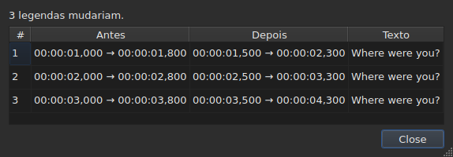
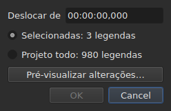
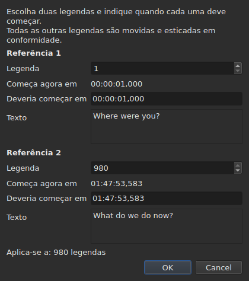
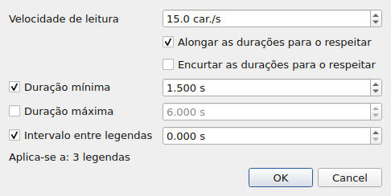
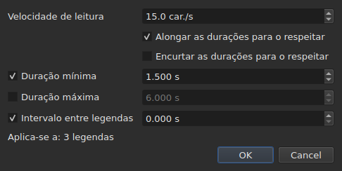
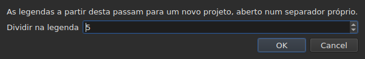

# As operações

<!-- machine-translated -->
> Esta página é uma tradução automática e ainda não foi revista por nenhum leitor do idioma.

O menu **Ferramentas** reúne dezasseis operações, uma análise e duas entradas de ortografia. Cada uma das
dezasseis é anulada com um `Ctrl+Z`; a análise não modifica nada. `Check Spelling…` também é anulada, e `Spell-Check Settings…` não toca em nenhum texto.

| Entrada | Caixa de diálogo | O que faz |
| :---- | :----- | :----------- |
| `Shift Positions…` | sim | desloca o alvo de uma duração |
| `Transform Positions…` | sim | corrige o alvo a partir de dois marcadores |
| `Convert Frame Rate…` | sim | reajusta o tempo do alvo de uma taxa de fotogramas para outra |
| `Adjust Durations…` | sim | desloca os fins para respeitar uma velocidade de leitura, durações e um espaço |
| `Append File…` | um seletor de ficheiros | anexa um ficheiro no fim do projeto |
| `Split Project…` | sim | corta o projeto em dois, o resto vai para um novo separador |
| `Italic` | **não** | põe o alvo em itálico, ou retira-o |
| `Dialogue` | **não** | põe um travessão de diálogo no início de cada linha, ou retira-o |
| `Case ▸ Title Case` | **não** | cada palavra leva uma maiúscula |
| `Case ▸ Sentence case` | **não** | a primeira letra do texto, e só ela |
| `Case ▸ UPPER CASE` | **não** | tudo em maiúsculas |
| `Case ▸ lower case` | **não** | tudo em minúsculas |
| `Remove Hearing-Impaired Mentions…` | sim, sem definições | remove as menções para deficientes auditivos |
| `Correct Texts…` | sim, um assistente de várias páginas | propõe correções — menções, união e divisão de palavras, erros comuns, maiúsculas, quebra de linhas — e aplica-as depois de aceites, veja-se [Corrigir textos…](correct-texts.md) |
| `Check Spelling…` | sim, um percurso palavra a palavra | percorre as palavras desconhecidas do dicionário e aplica o que foi corrigido, veja-se [Verificar ortografia…](check-spelling.md) |
| `Spell-Check Settings…` | sim | escolhe o idioma, o alvo e o documento da verificação, e o sublinhado enquanto se escreve, veja-se [Verificar ortografia…](check-spelling.md#definições-da-verificação-ortográfica) |
| `Snap to Frame Rate…` | sim | repõe cada marca de tempo no fotograma mais próximo |
| `Shift Whole File onto Grid (…)` | **não** | repõe o ficheiro inteiro na sua grelha |
| `Frame Rate Analysis…` | sim, sem definições | **não modifica nada** — veja-se [A grelha de fotogramas](frame-grid.md) |

**O que uma operação fez é dito numa caixa de informação que tem de ser
fechada, exceto para `Italic`, `Case` e `Dialogue`**: estas três não abrem
nenhuma caixa de diálogo, e o seu relatório — “nada a alterar” incluído — é apresentado
na barra de estado, sem nada para fechar. `Split Project…` também dá o seu próprio
na barra de estado: o seu resultado já está à sua frente, no novo separador. As mensagens são citadas na
secção de cada operação.

Inserir, remover, unir e dividir linhas não estão aqui mas no
menu `Edit`, porque alteram o número de linhas. Veja-se
[Inserir, remover, unir e dividir linhas](lines.md).

## Sobre o que atuam

**As linhas selecionadas, ou o ficheiro inteiro se não houver nenhuma.** É a mesma
regra para todas, e as caixas de diálogo, quando há uma, recordam-na em palavras
simples:

```
Applies to: 4 subtitles
```

Selecionar todas as linhas equivale a não selecionar nenhuma.

**Quando só parte das linhas está selecionada, a caixa de diálogo pergunta
sobre o que atuar.** São apresentadas duas escolhas, com a sua contagem, e **a seleção
é a que está assinalada**:

```
(•) Selected: 2 subtitles
( ) Whole project: 4 subtitles
```

Assinalar `Whole project` alarga a operação ao ficheiro inteiro sem ter primeiro
de alterar a seleção. Quando não há nada a escolher — nada
selecionado, ou tudo —, a linha `Applies to:` acima fica sozinha.

As caixas de diálogo de `Shift Positions…`, `Transform Positions…`,
`Convert Frame Rate…`, `Adjust Durations…`, `Snap to Frame Rate…` e
`Remove Hearing-Impaired Mentions…` oferecem esta escolha.

### Ver antes de aplicar

`Shift Positions…`, `Transform Positions…`, `Convert Frame Rate…`,
`Adjust Durations…` e `Snap to Frame Rate…` têm um botão **`Preview changes…`**.
Abre uma pequena janela que diz quantas legendas a operação
alteraria **com o que está escrito nesse momento, sobre o alvo assinalado**, e
enumera as primeiras doze: o seu número, a sua posição antes, a sua posição
depois, e a primeira linha do seu texto. **Nada é aplicado**: fechar a
janela volta à caixa de diálogo, onde se pode alterar um valor e olhar
de novo.




Abre com tamanho suficiente para mostrar todas as colunas, e pode ser redimensionada
à mão.

Se a operação não alterasse nada, a janela di-lo (`Nothing would change.`).
Enquanto o que está escrito não definir uma operação — uma duração ilegível, dois
marcadores na mesma legenda —, a pré-visualização está vazia pela mesma razão por que o botão
`OK` está esbatido. `Remove Hearing-Impaired Mentions…` não tem pré-visualização: o que
altera é texto, e o relatório que dá depois
di-lo.

**Com uma tradução, que texto?** As operações de posição e de estrutura
atuam sobre a legenda inteira — os seus dois textos acompanham-na. As que
reescrevem um texto — `Italic`, `Case`, `Dialogue`,
`Remove Hearing-Impaired Mentions…` — visam **o texto da coluna da célula atual**: a
tradução na sua coluna, o texto principal nas outras. O outro fica intacto, e a
barra de estado diz qual é o visado. Veja-se [A tabela](table.md#o-texto-a-que-as-operações-se-destinam).

**Uma exceção, e a sua etiqueta di-lo**: `Shift Whole File onto Grid`
ignora a seleção. Uma grelha é uma propriedade do documento, e meio
documento não tem grelha própria; a entrada di-lo, portanto, no seu nome em vez de
apenas neste manual.

**`Append File…` também ignora a seleção**, por outra razão: não é
um alvo que reescreve, é um fim que empurra para trás. Veja-se a sua
[própria secção](#append-file). **O mesmo acontece com `Split Project…`**: corta onde lhe é
dito. Veja-se [a sua](#split-project).

**`Correct Texts…` escolhe o seu alvo na sua própria página**, em vez de seguir
a seleção atual: a seleção, o projeto atual ou todos os projetos
abertos. Veja-se [Corrigir textos…](correct-texts.md). **`Check Spelling…` escolhe-o em
`Spell-Check Settings…`**, e memoriza-o: veja-se [Verificar ortografia…](check-spelling.md).

**As duas operações de grelha não falam da mesma coisa que a grelha.**
Uma operação atua sobre a seleção; a análise e a barra de estado falam do
**documento inteiro**. Alinhar cinco linhas de cento e setenta e seis altera de facto essas
cinco — a tabela mostra-o — sem que nenhuma delas se mova, o que
parece uma atualização falhada. Não é: não têm nada a
dizer. Veja-se [`Snap to Frame Rate…`](#snap-to-frame-rate) e
[A grelha de fotogramas](frame-grid.md).

### O que quer dizer “nada selecionado”, entrada a entrada

A regra aplica-se ao menu `Tools` e à pesquisa. As entradas do menu
`Edit` que tocam nas linhas ou as esvaziam leem-na de outra forma — de outro modo um
`Del` ou `Ctrl+X` infeliz esvaziaria o documento.

| Entrada | Sem seleção | O que exige |
| :---- | :------------------ | :--------------- |
| as operações do menu `Tools` | o ficheiro inteiro | um documento não vazio |
| `Shift Whole File onto Grid` | o ficheiro inteiro, **sempre** | uma grelha encontrada |
| `Find and Replace…` | o ficheiro inteiro | um documento não vazio |
| `Cut Texts`, `Copy Texts`, `Paste Texts` | **desativadas** | pelo menos uma linha selecionada |
| `Remove Subtitles` | **desativada** | pelo menos uma linha selecionada |
| `Merge Subtitles` | **desativada** | um bloco de pelo menos duas linhas vizinhas |
| `Split Subtitle` | **desativada** | exatamente uma linha |
| `Insert Subtitles…` | desativada, exceto num documento vazio | uma linha em relação à qual as colocar |

Cada página dá a razão: [a área de transferência](clipboard.md#sobre-o-que-atuam),
[as linhas](lines.md), [a pesquisa](find-and-replace.md#o-que-a-pesquisa-abrange).

As entradas ficam **desativadas num ficheiro vazio**: não haveria nada a
deslocar. `Italic` tem uma segunda condição, que a sua secção descreve: o
formato aberto tem de poder escrever um estilo. As maiúsculas e minúsculas e os travessões não têm nenhuma — um
texto é um texto nos nove formatos.

## `Shift Positions…`

Desloca o alvo de uma duração, para a frente ou para trás. Os dois limites de
cada legenda movem-se da mesma quantidade: nenhuma fica no ecrã mais ou menos tempo
do que antes.

A duração escreve-se **como uma marca de tempo, sinal incluído** — `00:00:02,500` desloca para a frente,
`-00:00:01,250` desloca para trás. **O campo escreve-se por cima, não se escreve nele**: começa como `00:00:00,000`, um dígito substitui o dígito que está sob o cursor e o cursor salta sozinho os `:` e a `,`, de modo que a forma nunca muda. Só são aceites dígitos, e `-` (ou `+`) para mudar o sinal; `Backspace` e `Delete` repõem um zero. O mesmo campo serve em todo o lado onde se indica um tempo: o diálogo de transformação, as células de posição da tabela e o intervalo de uma transcrição.




| Recusa | Porquê |
| :------ | :-- |
| uma duração ilegível | o botão fica desativado; nada é deslocado ao acaso |
| um deslocamento de zero | não há nenhuma operação a registar |
| uma legenda iria para antes do início do vídeo | **nenhum ficheiro pode conter tal posição** |

O terceiro caso nomeia o culpado — “a legenda 1 começaria antes da origem” —
e é o que convém ver para saber por quanto se enganou. Nada
é aplicado.

## `Transform Positions…`

A correção de um ficheiro temporizado contra outro corte. Diz-se onde **duas**
legendas começam realmente, e tudo o resto segue, proporcionalmente.

A caixa de diálogo pede duas vezes a mesma coisa: um número de legenda, e a
posição onde o seu início deve estar. Para cada marcador, mostra **o que esse
número designa** — o seu texto (`Text`) e a hora a que começa
**agora** (`Now starts`), como etiquetas simples — e acompanham o número
à medida que o altera. O texto reserva **três linhas de espaço** seja o que for que a
legenda diga: um mais longo, ou um endereço comprido, desloca-se lá dentro, e
a caixa de diálogo mantém o seu tamanho quando o marcador muda. **Só é preciso escrever um campo por marcador:
`Should start`**, a hora a que esta legenda deve começar. Não é preciso procurar na tabela qual é a linha `980`.

`Should start` é **proposto com o valor atual**: enquanto não lhe
tocar, o marcador diz “esta legenda já está onde deve estar”. Só se
altera o que se quer alterar. O segundo marcador vem preenchido com a última
legenda do ficheiro — dois marcadores afastados dão uma correção mais segura
do que dois vizinhos.




**Os dois marcadores caem exatamente onde foram pedidos.** Não é
uma aproximação: o cálculo é feito para que seja verdade.

| Recusa | Porquê |
| :------ | :-- |
| dois marcadores na mesma legenda | não definem nenhuma correção |
| uma posição ilegível | a mesma razão que para o deslocamento |

Não é possível escrever um número fora do ficheiro: o campo é limitado pelo
número de legendas.

## `Convert Frame Rate…`

Reajusta o tempo do alvo quando as posições foram calculadas contra uma taxa de
fotogramas e têm de o ser contra outra.

As duas listas oferecem as oito taxas de fotogramas padrão.

> **Enganar-se na taxa de fotogramas de entrada desloca o ficheiro inteiro sem comunicar
> nada.** É o pior modo de falha desta operação, e é por isso que
> a caixa de diálogo diz de onde vêm os valores que propõe em vez de
> os definir em silêncio.

### As duas fontes, e o que respondem

A caixa de diálogo tem até mais duas linhas, cada uma aparecendo quando tem
algo a dizer:

| Linha | O que diz | O que preenche |
| :--- | :----------- | :---------------- |
| `The positions say` | a [grelha de fotogramas](frame-grid.md) deduzida das posições do ficheiro | `Timed against` |
| `The video declares` | a taxa de fotogramas que o contentor anuncia, por exemplo `24000/1001` | `Should play at` |
| `The file was read at` | a taxa de fotogramas a que um ficheiro **contado em fotogramas** foi lido | `Timed against` |

**Cada proposta vai para o campo a que responde.** A grelha diz contra o que o
ficheiro foi *escrito* — é a lista de cima. O que o contentor anuncia é
a taxa de fotogramas a que o filme *corre*, e portanto aquela a que as legendas
têm de chegar — é a lista de baixo.

**Só uma grelha limpa preenche a entrada.** Uma grelha parcial é uma
pista que a própria dedução qualifica de parcial, e este campo decide uma
operação sobre o ficheiro inteiro. A [barra de estado](frame-grid.md) e a análise
tratam desse caso; esta não.

**Um ficheiro contado em fotogramas substitui a grelha em vez de a acrescentar.**
O MicroDVD traz números de fotograma, e as posições do documento foram
calculadas a partir deles à taxa de fotogramas de leitura: uma grelha deduzida dessas posições
só pode reencontrar esse número. `The positions say` desaparece, portanto, e
`The file was read at` toma o seu lugar — é a mesma escolha que
[a barra de estado](frame-grid.md#um-documento-contado-em-fotogramas-não-tem-grelha-tem-uma-taxa-de-fotogramas) faz.

**É assim que se muda a taxa de fotogramas de um MicroDVD.** Definir a taxa de fotogramas lida
como entrada e a verdadeira como saída recalcula cada posição a partir dos
fotogramas do ficheiro — sem ler nada de novo, e a operação é anulada como as
outras.

### Um desacordo não é uma contradição

As duas linhas podem ser apresentadas em conjunto e anunciar números diferentes.
**Não é um erro a arbitrar**: o filme corre a uma taxa de fotogramas, o
ficheiro foi escrito noutra grelha. Um ficheiro a 24 para um filme a 25 é
exatamente o caso que o alinhamento — `snap` na linha de comandos — existe para
tratar.

Nada é, portanto, escolhido no lugar do utilizador: as duas listas continuam
editáveis, e é deliberado. Uma fonte que se impõe impede a verificação cruzada.

As linhas não aparecem quando não há nada a dizer: nenhum vídeo
associado, nenhum `ffprobe`, ou nenhuma grelha limpa. A caixa de diálogo é então a
descrita acima, e **nenhuma operação se recusa por isso** — a
taxa de fotogramas vem do utilizador. Veja-se
[O vídeo associado](video.md#ffmpeg-não-é-necessário).

Uma taxa de fotogramas que o filme anuncia mas que não é uma das oito padrão
é **apresentada sem ser escolhida**: saber que o filme corre a uma taxa de fotogramas
invulgar é a informação, e não há aqui nada para onde a converter.

Converter uma taxa de fotogramas nela própria não altera nada: o botão fica desativado.

## `Adjust Durations…`

Alonga ou encurta a duração das legendas do alvo **deslocando o seu
fim, nunca o seu início**. Deslocar o início deslocaria a legenda, o que é
tarefa de [`Shift Positions…`](#shift-positions).





### As quatro restrições

| Campo | O que pede | Valores | Predefinição |
| :---- | :--------------- | :----- | :------ |
| `Reading speed` | o tempo necessário para ler o texto | de 1 a 99 carateres por segundo, ao décimo | 15 carateres/s |
| `Lengthen durations to match it` | alongar o que é demasiado curto para ser lido | assinalada ou não | assinalada |
| `Shorten durations to match it` | encurtar o que fica apresentado mais tempo do que o necessário | assinalada ou não | não assinalada |
| `Minimum duration` | uma duração mínima | de 0 a 99 s, ao milissegundo | assinalada, 1,5 s |
| `Maximum duration` | uma duração máxima | de 0 a 99 s, ao milissegundo | não assinalada, 6 s |
| `Gap between subtitles` | o espaço a deixar antes da legenda seguinte | de 0 a 99 s, ao milissegundo | assinalada, 0 s |

São os valores predefinidos do Gaupol.

**Uma restrição não assinalada está ausente**: o seu campo fica esbatido e não é lido.
Uma restrição assinalada a zero vale zero — um espaço de 0 s impede que uma
legenda se sobreponha à seguinte. A velocidade de leitura só é lida se
`Lengthen` ou `Shorten` estiver assinalada.

**Quando tudo está desassinalado, `OK` fica desativado**: não há nada a pedir.

A caixa de diálogo reabre com os valores do último ajuste, **e conserva-os de uma
sessão para a seguinte** — como as duas opções de pesquisa. **Uma caixa desassinalada
mantém o seu valor**: desassinalar `Minimum duration` depois de definir 2 s não repõe
1,5 s, e assinalá-la de novo encontra 2 s. As nove definições estão no
[ficheiro de preferências](preferences.md#o-ficheiro), sob `duration-adjust.`.

**A linha de comandos partilha-as.** [`subedit-cli adjust`](../subedit-cli/adjust.md) lê as
mesmas nove definições por predefinição, pelo que uma velocidade definida aqui é a velocidade que usa, a menos que as suas próprias opções
digam outra coisa; [`subedit-cli config`](../subedit-cli/config.md) mostra-as e altera-as. Veja-se
[Dois blocos, um partilhado com a linha de comandos](preferences.md#dois-blocos-um-partilhado-com-a-linha-de-comandos).

### Em que ordem, e qual prevalece

Cada legenda do alvo passa pelas quatro restrições **por esta ordem**, e
cada uma define o fim por sua vez:

| Posição | Restrição | O que define |
| ---: | :--------- | :----------- |
| 1 | velocidade de leitura | `end = start + length ÷ speed`, se a legenda for demasiado curta (`Lengthen`) ou demasiado longa (`Shorten`) |
| 2 | duração mínima | `end = start + minimum`, se a duração for mais curta |
| 3 | duração máxima | `end = start + maximum`, se a duração for mais longa |
| 4 | espaço | `end = next start − gap`, se o fim estiver demasiado perto dele — nunca antes do início |

**A última aplicada prevalece.** O espaço vem em último e pode fazer descer uma
duração abaixo do mínimo que acabou de ser definido: duas legendas no ecrã ao mesmo
tempo são uma falta que o espectador vê, uma legenda ligeiramente curta
não é.

**O comprimento do texto é contado sem etiquetas**, em carateres, quebras de linha
incluídas: `<i>été</i>` conta três carateres. A velocidade de leitura fala do
que o espectador lê.

**A seguinte é a legenda seguinte do ficheiro**, esteja ou não no alvo. **A última legenda do ficheiro não tem seguinte**: o espaço não a
condiciona.

### O que nenhum fim consegue satisfazer é dito

Depois de o ajuste estar feito, a janela diz quantos fins se moveram, e **o que
não pôde ser respeitado** — uma restrição só aparece se foi
sacrificada para pelo menos uma legenda:

```text
adjusted the durations of 12 subtitles; could not satisfy the reading speed in 9 subtitles, the minimum duration in 4 subtitles
```

As três menções possíveis são `the reading speed`, `the minimum duration` e
`the gap`. **A duração máxima é sempre respeitada**: vem depois da velocidade
e do mínimo, e só o espaço a segue, o qual só pode encurtar. Um mínimo
maior do que o máximo cede-lhe, e é o mínimo que é contado. O espaço
só é sacrificado quando a seguinte começa antes do início da própria
legenda.

A contagem abrange o alvo inteiro, **incluindo as legendas cujo fim não
se moveu**: uma legenda já colocada contra a sua seguinte e demasiado curta para o
mínimo é contada. Quando nenhum fim se move, a janela di-lo —
`no duration to adjust` — e nada entra no histórico.

## `Append File…`

Anexa um ficheiro no fim do projeto aberto. **Nada é inserido entre os
dois**: o ficheiro escolhido é deslocado pelo fim da última legenda do
projeto, exatamente como o Gaupol faz.

**Desativada num documento vazio**: não haveria fim a partir do qual deslocar. Abre-se um
seletor de ficheiros, sem codificação a escolher — como `Open…`.

**O ficheiro anexado passa pela conversão**, nas palavras de `Save As…` e de
[colar a partir de outro formato](clipboard.md#as-etiquetas-de-outro-formato-são-convertidas):
as suas etiquetas são convertidas para o formato do projeto, e o que esse formato não pode
escrever é dito:

```text
appended 12 subtitles; Advanced SSA into SubRip: 1 tag dropped
```

**O que o ficheiro anexado trazia não sobrevive por inteiro.** As suas posições
seguem, etiquetas incluídas; o seu cabeçalho, os seus campos próprios do formato — nome do
estilo, margens — e o que uma etiqueta não pode tornar-se no formato do projeto não
seguem, e di-lo. **Não tem tradução**: uma tradução continua
específica do documento que a recebeu, e o ficheiro anexado chega sozinho.

**Selecionadas depois**, como as linhas que uma colagem escreveu para além
do fim. Quando nada se perde, a contagem é apresentada na barra de estado em vez
de numa caixa a fechar — a mesma regra que para
[abrir uma tradução](files.md#abrir-uma-tradução).

**Uma única entrada do histórico**, seja qual for o número de legendas
anexadas: `Ctrl+Z` remove-as todas de uma vez.

**Um ficheiro já aberto pode ser anexado a si próprio**: nada o proíbe, como
no Gaupol.

**Na linha de comandos**, [`append`](../subedit-cli/append.md) faz o mesmo para vários ficheiros de
uma vez, num único resultado.

## `Split Project…`

Corta o projeto em dois: **o inverso exato de `Append File…`**. Uma caixa
pergunta a partir de que legenda cortar — da segunda à última, numerada
como na tabela — e abre na linha atual.

**A tabela mostra onde se corta antes de cortar**: cada número que a
caixa toma seleciona a sua linha. `Cancel` devolve a seleção anterior.




**Desativada com menos de duas legendas**: um corte quer uma legenda de cada
lado.

**O resto é copiado para um novo projeto, aberto num novo separador, e
removido do projeto original.** O novo projeto é **deslocado de menos o fim da
última legenda que ficou**: dividir e depois anexar devolve o projeto de partida.
Os seus dois textos, principal e tradução, acompanham as suas legendas, e
conserva o formato e a codificação do original — **sem caminho**: nenhum ficheiro
o contém ainda. O seu separador escreve-se, portanto, `untitled*` desde o nascimento, e
fechá-lo sem guardar faz a pergunta que se faz para tudo o que não está
escrito.

**A barra de estado diz quantas legendas saíram**, sem caixa a
fechar — o novo separador já mostra o resultado:

```text
split 12 subtitles into a new project
```

**Uma única entrada do histórico**, no projeto original:
`Undo: splitting the project` devolve-lhe o resto. O novo projeto tem um histórico
próprio, vazio; anular não lhe toca, e continua aberto.

**Recusada quando nenhum ficheiro poderia escrever o resultado.** Se as duas
metades se sobrepuserem no corte, o deslocamento levaria uma legenda para antes do
início do vídeo — uma posição negativa, que nenhum formato escreve. A caixa
que recusa **nomeia a legenda** e sugere cortar noutro sítio:

```text
Cannot split at subtitle 3: subtitle 3 would fall before the start of the video. Cut somewhere else.
```

Chegar exatamente ao início é permitido: zero é uma posição.

**Na linha de comandos**, [`split-file`](../subedit-cli/split-file.md) corta um ficheiro da mesma maneira, em dois
ficheiros com nome.

## `Snap to Frame Rate…`

Põe **cada marca de tempo** — início e fim — no fotograma mais próximo da
taxa de fotogramas escolhida. Uma única lista, e é toda a diferença para a
conversão: uma conversão precisa de duas taxas de fotogramas porque altera a escala do
ficheiro de uma para a outra; um alinhamento só precisa da
grelha sobre a qual aterrar.

| | `Convert Frame Rate…` | `Snap to Frame Rate…` |
| :--- | :-------------------- | :-------------------- |
| movimento | proporcional ao tempo — **vários segundos** ao longo de um filme | meio fotograma no máximo, **em todo o lado** |
| para que ficheiro | um ficheiro cuja **temporização está errada** | um ficheiro cuja temporização está **certa** e cuja grelha está errada |

**O caso de uso**, explicitado: um filme a 25 fotogramas por segundo,
legendas escritas numa grelha a 24, linhas já aproximadamente no seu
lugar com uma diferença de alguns milissegundos. Não há nada a reajustar no tempo — apenas
a repor as marcas de tempo nos fotogramas certos.

A lista **abre com o que o vídeo declara**, e não com o que as
posições dizem: a intenção é juntar-se à grelha do filme, e a
dedução nomeia aquela que se abandona. Sem vídeo ou sem `ffprobe`, abre
com a taxa de fotogramas do projeto.

Alinhar um ficheiro na grelha que já ocupa não o altera, e não é
um erro: a operação aplica-se, não move nada, e é anulada como
qualquer outra.

**Alinhar parte do ficheiro di-lo, depois de feito.** É apresentado um aviso
quando a seleção não cobre tudo e o documento continua a ser lido noutra
grelha:

```
5 of 176 subtitles aligned to 25 fps; the document is still read on a 24 fps grid
```

Liga o gesto ao seu efeito, e explica porque é que a barra de estado e
a análise não se moveram: falam do documento, a operação atuou sobre
cinco linhas. Nada é impedido — alinhar parte de um ficheiro pode ser
intencional.

**É quase sempre não intencional, e está medido.** Sobre os oito ficheiros
de grelha do repositório, alinhar o ficheiro inteiro traz a taxa de fotogramas deduzida para o
alvo e a sua concentração para 100 %; alinhar cinco linhas nunca move a taxa de fotogramas
deduzida e **baixa** a concentração em sete casos em oito — as linhas
alinhadas saíram da grelha em que vive o resto do ficheiro. O oitavo é
50 para 25, onde a grelha alvo divide a do ficheiro e onde as posições já
estavam nela.

O aviso não é apresentado quando a seleção cobre o ficheiro inteiro, quando
nenhuma grelha é deduzida, ou quando o documento é agora lido na
taxa de fotogramas pedida — é então que o alinhamento fez o que se lhe pediu.

## `Shift Whole File onto Grid`

Desloca **o ficheiro inteiro** da quantidade que repõe as suas posições na grelha
de que saíram. Um ficheiro cujas posições estão numa grelha a menos de uma
constante foi deslocado, e essa constante pode ser medida.

**A entrada do menu traz a quantidade e o âmbito** —
`Shift Whole File onto Grid (+0.001 s)`. Não há caixa de diálogo:
a operação não aceita opção, e uma entrada que vai deslocar um ficheiro
inteiro tem de dizer de quanto, e que o fará por inteiro, antes de ser escolhida.
É a única operação do menu que ignora a seleção.

**Está desativada quando não foi encontrada nenhuma grelha.** Não há então nada a
que se juntar, e uma fase medida sobre ruído deslocaria o ficheiro ao acaso.
“Nada a que se juntar” e “juntar-se com zero” não dizem o mesmo: a
segunda continua oferecida, porque um ficheiro já na sua grelha é um
caso normal dela.

**Isto não é `Snap to Frame Rate…`.** Esta entrada desloca tudo da mesma quantidade
e preserva a temporização relativa **exatamente**; o alinhamento move cada
posição de forma independente e absorve de passagem as que tinham sido corrigidas à
mão. Num ficheiro limpo ambos dão o mesmo resultado; num ficheiro
parcial, não — e o [detalhe da análise](frame-grid.md) diz qual dos
dois se tem à frente.

## `Italic`

Põe o alvo em itálico escrevendo as etiquetas do **formato aberto**, ou
retira-as se já estiver em itálico. Sem caixa de diálogo: a operação não tem definições, e
é anulada com um `Ctrl+Z` como as outras.

| Ação | Atalho | Onde |
| :----- | :------- | :---- |
| Itálico | `Ctrl+I` | menu **Ferramentas**, barra de ferramentas |

É a única operação do menu `Tools` que tem um botão na
[barra de ferramentas](index.md#a-barra-de-ferramentas).

### O que escreve, formato a formato

O texto de uma legenda é o do seu ficheiro, etiquetas incluídas — veja-se
[Editar uma célula](editing.md). Cada formato tem as suas, e é isso de que
esta entrada o dispensa de saber:

| Formato | O que é escrito |
| :----- | :-------------- |
| SubRip, WebVTT, SubViewer 2 | `<i>text</i>` |
| Sub Station Alpha, Advanced SSA | `{\i1}text{\i0}` |
| MicroDVD | `{Y:i}text` — a etiqueta vai até ao fim da legenda, não há nada a fechar |
| MPL2 | `/` no início de **cada** linha, aplicando-se o marcador apenas à sua própria |
| TMPlayer, LRC | nada: estes dois formatos não escrevem estilo |

**A entrada está desativada para um TMPlayer e um LRC, não oculta.** Uma entrada
ausente não ensina nada; uma entrada esbatida responde a “porque é que não
posso?”.

**O formato lido é o do texto visado.** Com uma tradução, o texto principal
pode estar em SubRip e a tradução em Advanced SSA: `Italic` escreve `<i>` na
primeira e `{\i1}` na segunda. A entrada fica igualmente desativada quando o
texto visado está num formato que não escreve estilo, mesmo que o outro escreva.

### Em que sentido vai

Uma única entrada para os dois sentidos, e é o alvo que decide:

- **basta uma única legenda fora de itálico** para o alvo inteiro passar a itálico;
- o alvo só sai dele quando está **inteiramente** nele.

É a regra do Gaupol, e é a única que torna utilizável um único botão:
uma seleção mista vai como um bloco em vez de ser invertida
linha a linha, e premir duas vezes devolve-a como estava.

O relatório diz o que foi feito, no sentido em que foi feito:

```
2 subtitles put in italics
2 subtitles taken out of italics
```

**Uma linha vazia nunca ganha etiquetas** — um `<i></i>` à volta de nada
apareceria na tabela. Um alvo que só contenha tais linhas não altera, portanto, nada, e
di-lo: “nada a alterar”. Nenhuma entrada entra então no histórico.

### O que não toca

**As outras etiquetas ficam exatamente onde estão**: uma cor, um
tipo de letra, um `{\pos(x,y)}` do Advanced SSA atravessam a operação sem se mover.
Só as etiquetas de itálico são definidas e removidas.

Uma etiqueta que diz várias coisas ao mesmo tempo não é retirada por inteiro:
`{\b1\i1}` torna-se `{\b1}`, e `{Y:bi}` torna-se `{Y:b}`. O negrito fica, e o
texto sai realmente do itálico.

## `Case` e `Dialogue`

Duas transformações do **texto visível**, e as etiquetas não são tocadas: uma
legenda posta em minúsculas conserva o seu `<I>` como está, e um travessão é posto
antes do texto, não antes de uma etiqueta de abertura. **Nenhuma etiqueta muda
de lugar**: `<i>bon</i>jour` em maiúsculas dá `<i>BON</i>JOUR`, onde
[uma substituição](find-and-replace.md#o-texto-pesquisado-é-o-texto-visível) teria
estendido o itálico à palavra inteira.

| Entrada | Atalho | O que faz |
| :---- | :------- | :----------- |
| Maiúsculas/minúsculas ▸ Título | — | `bonjour marie` torna-se `Bonjour Marie` |
| Maiúsculas/minúsculas ▸ Frase | — | `BONJOUR MARIE` torna-se `Bonjour marie` |
| Maiúsculas/minúsculas ▸ MAIÚSCULAS | — | tudo em maiúsculas |
| Maiúsculas/minúsculas ▸ minúsculas | — | tudo em minúsculas |
| Diálogo | — | acrescenta ou remove os travessões |

### O que as maiúsculas e minúsculas não tocam

**O que precede a primeira letra ou o primeiro algarismo fica como está.**
Um travessão de diálogo, umas aspas de abertura, um parêntese sobrevivem:
`- bonjour` posto em maiúscula de frase dá `- Bonjour`, e não `- bonjour` com um
travessão em maiúscula, o que não faria sentido.

**A maiúscula de frase repõe o resto em minúsculas.** `BONJOUR MARIE` torna-se
`Bonjour marie`: é o que o Gaupol faz, e é o que permite atenuar uma
legenda escrita em maiúsculas.

**Os acentos e os alfabetos não latinos são tratados corretamente.** `éléonore`
dá `ÉLÉONORE`, e um apóstrofo não corta uma palavra: `l'été` posto em
iniciais maiúsculas dá `L'été` e não `L'Été`. Uma letra que muda de comprimento mantém as suas
etiquetas à volta: `fi <i>x</i>` em maiúsculas dá `FI <i>X</i>`.

**As maiúsculas e minúsculas não dependem do idioma do sistema.** Seguem as regras comuns
a todos os idiomas: `istanbul` em maiúsculas dá `ISTANBUL`, quer a máquina
esteja configurada em francês ou em turco.

### Em que sentido vai `Dialogue`

Uma única entrada para os dois sentidos, e é o alvo que decide:

- **basta uma única linha sem travessão** para o alvo inteiro passar a tê-lo;
- o alvo só os perde quando **todas** as suas linhas o têm.

Premir duas vezes devolve o alvo como estava. É a regra de
[`Italic`](#italic), e a única que torna utilizável um único botão.

**Três travessões são reconhecidos** — o hífen do teclado e os dois
travessões do tipógrafo, `–` e `—` — e é o hífen que é escrito.
Os espaços a mais depois do travessão desaparecem. Uma linha vazia não ganha
nenhum.

### O que dizem

```
2 subtitles recased
2 subtitles dashed
2 subtitles undashed
```

E quando nada muda — um alvo já nas maiúsculas e minúsculas pedidas — “nada a
alterar”, sem pôr nada no histórico.

## `Remove Hearing-Impaired Mentions…`

Remove as menções destinadas aos espectadores surdos ou com dificuldades de audição — as
descrições de sons entre parênteses retos. **Os parênteses curvos ficam**: servem também para
falas sussurradas, e é `Correct Texts…` que os remove, através da sua caixa de seleção `Sound in parentheses`.
**Nada mais**: as letras de canções
entre cardinais e o nome do locutor antes de dois pontos só são removidos através de
[`Correct Texts…`](correct-texts.md), página `Mentions`.

A caixa de diálogo não pergunta nada: a operação não tem definições, e a caixa de diálogo só serve para
confirmar e para recordar sobre o que atua.

**É a única do menu `Tools` que faz desaparecer linhas**, e a única
de todo o programa que as faz desaparecer sem que se lhe peça. Uma
legenda que era *só* uma menção não tem texto depois de limpa, e uma
legenda sem texto não tem razão de ser: é removida do ficheiro. As outras
são reescritas sem a sua menção.

**As etiquetas do formato não contam como texto**: o `<i>[SOUPIR]</i>` de um
SubRip e o `{\i1}[SOUPIR]{\i0}` de um Advanced SSA são removidos da mesma forma.
Um `<i>` num TMPlayer ou num LRC, que não escrevem etiquetas, é texto.

**Visada na tradução, não remove nenhuma linha.** Uma tradução que a
regra esvazia — um texto que era só uma menção — é **esvaziada** e a legenda
fica: tem um texto principal, que a operação não visou, e removê-la
destruí-lo-ia. O relatório conta-a como limpa:

```text
1 subtitle cleaned, 0 removed
```

As etiquetas lidas são as do formato da tradução, que pode não ser o do
ficheiro principal.

O relatório diz ambas as coisas:

```
1 subtitle cleaned, 1 removed
```

**Quando nada morde, nada acontece** — e a caixa de diálogo di-lo: “nenhuma menção
a remover”. Nenhuma entrada entra no histórico, porque uma operação que
não altera nada não é uma operação a anular.

**Anular repõe tudo**, as legendas removidas tal como os textos
reescritos, cada uma com o texto que tinha. Uma legenda que a regra esvaziou
nunca é reescrita antes de ser removida, precisamente para que volte
inteira.

> **A seleção perde-se nesta ocasião**: remover linhas altera a
> estrutura da tabela, que é reconstruída. Todas as outras operações do
> menu `Tools` a mantêm, `Italic`, `Case` e `Dialogue` incluídas. As quatro
> entradas de estrutura do menu `Edit` — inserir, remover, unir, dividir —
> alteram também a estrutura, e devolvem uma seleção no lugar da que
> retiraram — veja-se
> [Inserir, remover, unir e dividir linhas](lines.md).

Uma referência puramente numérica — “Ver [1] a nota” — não é uma menção
e fica como está.

## Para além do fim do filme

Quando um vídeo está aberto, uma operação que **empurra legendas para além do
fim do filme** comunica-o, depois de feita:

```
shifting leaves 3 subtitles past the end of the video, by 4.200 s at most
```

A frase nomeia a operação — `shifting`, `transforming`,
`converting the frame rate`, `adjusting durations`,
`aligning on the frame rate` —, quantas legendas ultrapassam, e de quanto
vai a mais distante. `Shift Whole File onto Grid` é um deslocamento, e chama-se
`shifting`.

| O que é contado | O que não é |
| :-------------- | :---------- |
| o que a operação acabou de tocar, ou seja, o alvo | uma legenda que ninguém moveu |
| uma legenda que termina **depois** do fim | uma legenda que termina exatamente com ele |

**É um aviso, e nada mais.** Nada é recusado, nada é
corrigido: uma legenda que cai depois dos créditos finais pode ser
exatamente o que se queria, e uma recusa errada custa mais do que um
aviso que se ignora. A operação está no histórico, e `Undo`
anula-a como qualquer outra.

**Uma única caixa por operação.** `Adjust Durations…` e `Align` já têm
algo a dizer — o que um ajuste não pôde respeitar, o que um alinhamento
parcial deixou de lado. Quando também empurram uma legenda para além do fim,
a caixa traz as duas frases, uma sob a outra, a da operação
primeiro:

```
adjusted the durations of 2 subtitles
adjusting durations leaves 1 subtitle past the end of the video, by 1.000 s at most
```

A mensagem não aparece se nenhum vídeo estiver aberto: a duração vem do
reprodutor, e sem filme não há fim a ultrapassar. Só as cinco operações
acima nomeadas são abrangidas — `Adjust Durations…` incluída, que pode
alongar um fim para além do filme. Todas as outras não o são: as do
menu `Tools` que reescrevem um texto, e no menu `Edit` a inserção,
a união, a divisão, a colagem, a substituição e as células editadas — um
fim escrito à mão para além do filme não é comunicado.
