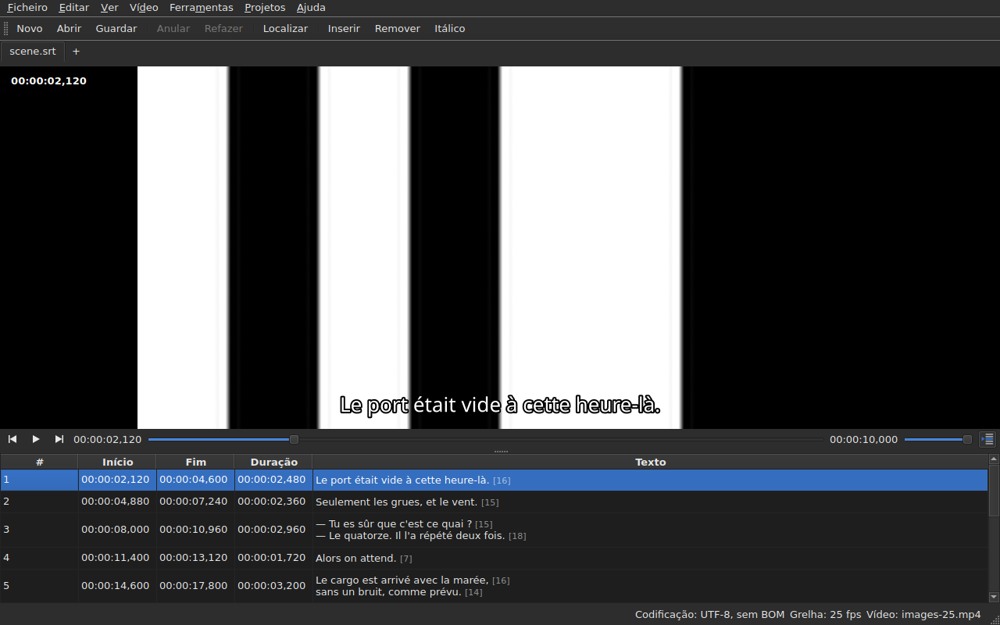

# O reprodutor

<!-- machine-translated -->
> Esta página é uma tradução automática e ainda não foi revista por nenhum leitor do idioma.

O vídeo associado vê-se **na janela**, com a linha atual
desenhada por cima. É isso que permite verificar no filme o resultado
de um deslocamento, de uma transformação ou de uma conversão da taxa de fotogramas.

Ver [O vídeo associado](video.md) para saber como associar um filme; esta
página descreve o que acontece depois de associado.

## A vista de vídeo

| Situação | O que a janela mostra |
| :------- | :-------------------- |
| um vídeo está associado e abre-se | a imagem ocupa a parte de cima, a tabela fica por baixo |
| nenhum vídeo associado | sem imagem, a tabela ocupa a janela inteira |
| o vídeo não abre | sem imagem, uma mensagem, e a janela continua utilizável |

A divisão entre a imagem e a tabela **move-se com o rato**. A imagem não
desce abaixo dos 180 píxeis de altura. Alargar a janela dá o espaço ganho
à tabela, não à imagem: o que falta quando se edita são linhas.

Sob a imagem, **uma barra de reprodução**: onde está o filme, quanto dura,
reproduzir e pausa, e o volume. Ver [A barra de reprodução](#a-barra-de-reprodução).

## Reproduzir e parar

| Comando | Atalho | O que faz |
| :------ | :----- | :-------- |
| Vídeo ▸ Reproduzir / Pausa | `Ctrl+P` | reproduz se a reprodução estiver parada, pára-a caso contrário |

O comando fica **desativado enquanto nenhum vídeo estiver aberto**. Um vídeo que
acabou de ser associado abre-se **parado**: abrir um filme não é
vê-lo.

`Ctrl+P` onde o Gaupol tem um simples `P`: um atalho de uma só letra ao
nível da janela é apanhado antes de o componente que tem o foco o ver,
pelo que um `P` seria engolido a caminho de um editor de célula. Nada
se imprime aqui, a combinação está livre.

## A barra de reprodução

Sob a imagem, da esquerda para a direita — os três botões são **ícones**, os do tema do ambiente de trabalho quando os tem, os do estilo do Qt caso contrário:

| Elemento | O que faz |
| :------- | :-------- |
| os dois botões de passo | recuam e avançam o filme **de um passo de fotograma** — ver [Fotograma a fotograma](timing.md#fotograma-a-fotograma) |
| reproduzir / pausa | reproduz ou pára, como `Ctrl+P` — o botão mostra **o que vai fazer**: um triângulo quando parado, duas barras durante a reprodução; a dica de ferramenta explica-o por palavras simples |
| a posição | `HH:MM:SS,mmm`, escrita como a tabela escreve uma posição — **como um número de fotograma** quando [`Ver ▸ Posições em fotogramas`](table.md#posições-em-fotogramas) está marcado |
| o cursor deslizante | **lê e move**: arrasta-se a pega, clica-se na ranhura, usam-se as setas |
| a duração | a que o vídeo declara, escrita como a posição |
| o volume | de 0 a 100, ver [O volume](#o-volume) |
| acompanhamento da tabela | premido enquanto a tabela acompanha a reprodução, e devolve-a à linha em reprodução quando se prime — ver [A tabela acompanha a reprodução](#a-tabela-acompanha-a-reprodução) |

**O cursor deslizante não transmite todos os píxeis.** Arrastar a pega pede dezenas de
posições por segundo, e cada uma custa um fotograma descodificado: a primeira posição sai
logo, as seguintes esperam um vigésimo de segundo, e **a última posição pedida é
sempre a que é alcançada** — o mais tardar quando se larga a pega. A imagem não
fica, portanto, atrás da mão, e não começa a desenhar um percurso que ninguém está a olhar.

**O cursor deslizante move-se sozinho durante a reprodução**, e isso não conta como um gesto:
só o que a pessoa faz move o filme. Enquanto se segura a pega, a reprodução não a leva de volta.

## O código de tempo

**A posição é escrita na imagem**, no canto superior esquerdo, sobre um fundo translúcido que a torna
legível em qualquer cena. É desenhada pela janela, no seu tipo de letra, e não pede
ao reprodutor nada além da posição que ele já dá; atualiza-se a cada gesto,
sem esperar pela volta de acompanhamento seguinte.

## Percorrer o filme

No menu **Vídeo**, **os gestos do Gaupol**, sob os seus nomes. Todos ficam **desativados sem vídeo**, como a
reprodução; os três que atuam sobre a seleção ficam também desativados enquanto nada estiver selecionado.

| Comando | Atalho | O que faz |
| :------ | :----- | :-------- |
| Vídeo ▸ Reproduzir seleção | `Ctrl+Shift+P` | reproduz desde **um pouco antes do início** da seleção **até ao fim da sua última legenda**, e pára na imagem |
| Vídeo ▸ Procurar anterior | `Ctrl+Left` | põe a reprodução no início da última legenda **terminada** antes da posição |
| Vídeo ▸ Procurar seguinte | `Ctrl+Right` | põe a reprodução no início da primeira legenda que **começa** depois da posição |
| Vídeo ▸ Procurar para trás | `Ctrl+Shift+Left` | recua um salto — trinta segundos por predefinição |
| Vídeo ▸ Procurar para a frente | `Ctrl+Shift+Right` | avança um salto |
| Vídeo ▸ Procurar início da seleção | `Ctrl+Up` | põe a reprodução no início da seleção, **a antecedência antes dele** |
| Vídeo ▸ Procurar fim da seleção | `Ctrl+Down` | põe a reprodução no fim da seleção, **a antecedência antes dele** |

**Os atalhos são os do Gaupol**, exceto um: `Play Selection` é `O` lá, e uma
letra isolada é apanhada pela janela antes de a célula em edição a ver — escrever um
`o` num texto iniciaria o filme. `Ctrl+P` é a resposta para a reprodução, `Ctrl+Shift+P` a da
seleção. As setas do teclado ficam com o editor de célula quando este está
aberto: `Ctrl+Left` move aí o cursor de uma palavra, não a reprodução.

- **O salto** é de 30 segundos, e pode ser definido de 1 segundo a uma hora — ver
  [As preferências](preferences.md#o-reprodutor). Não ultrapassa nem o início do filme nem o seu fim.
- **A antecedência** é de um segundo: vê-se um pouco **antes** da legenda, para a ver chegar.
  Pode ser definida de 0 a 60 segundos, e a reprodução não desce abaixo de zero.
- **Uma vizinha que não existe** — nada antes da primeira legenda, nada depois da última — não
  faz nada, e não diz nada: a reprodução fica onde está.
- **Cada gesto vê-se de imediato**: a barra, o código de tempo e a linha desenhada ficam
  atualizados quando termina, sem esperar pela volta seguinte.

## O volume

O volume é o do **reprodutor**, de 0 a 100, e não o do sistema. Define-se com o cursor deslizante da
barra, ou por dois gestos, no submenu `Vídeo ▸ Áudio`, em passos de cinco:

| Comando | Atalho | O que faz |
| :------ | :----- | :-------- |
| Vídeo ▸ Áudio ▸ Abaixar volume | `Ctrl+-` | baixa o volume em cinco |
| Vídeo ▸ Áudio ▸ Aumentar volume | `Ctrl++` ou `Ctrl+=` | sobe-o em cinco — o segundo para os teclados em que o mais precisa da tecla shift |

**É memorizado de uma sessão para a seguinte**, e dado a cada vídeo que se abre. Um valor fora
de 0 a 100 no ficheiro de definições não impede a abertura: é ignorado, e a janela indica-o.
**A faixa de áudio, em contrapartida, não é memorizada** — um número de faixa é o do seu ficheiro; ver
[A faixa de áudio](video.md#a-faixa-de-áudio).

## Seleção e reprodução

Ambas funcionam nos dois sentidos.

| O que se faz | O que acontece |
| :----------- | :------------- |
| selecionar uma linha | a reprodução move-se **para o início dessa legenda** |
| alargar a seleção para baixo | nada mais: é a primeira linha da seleção que conta |
| a reprodução avança | a **linha atual** segue a legenda no ecrã, **com um tom**, e a tabela **centra-a** — ver [A tabela acompanha a reprodução](#a-tabela-acompanha-a-reprodução) |

A linha atual e a seleção são duas coisas distintas. A reprodução
move a primeira e **nunca toca na segunda**: a seleção é aquilo a que
uma operação se aplica, e um filme a reproduzir-se num canto não tem de
reescrever o destino do utilizador linha após linha.

O tom segue esta mesma regra: é uma marca, não uma seleção. **Uma
anomalia prevalece sobre ele** — uma linha que tem ambos conserva a cor
da sua falha, uma falha estando lá para ser reparada, ao passo que uma linha mostrada só o é
durante uma fala de diálogo. Ver [A tabela](table.md).

### A tabela acompanha a reprodução

**A tabela centra a linha em reprodução** — a meio do que mostra, não na borda, onde bastaria para
a tornar visível. Fá-lo **quando a linha muda**, não a cada passo do acompanhamento: uma fala de diálogo dura
segundos, e voltar a centrar a cada décimo de segundo seria deslocar a vista sem propósito.

**Um deslocamento manual suspende o acompanhamento.** A roda, a barra de deslocamento e um clique na tabela
suspendem-no: a tabela fica onde a pessoa a pôs, enquanto a linha atual, a linha desenhada e a barra
continuam a seguir o filme. O botão de acompanhamento — **o ícone das linhas de uma tabela, uma delas marcada com uma seta**, à direita da barra de
reprodução; a sua dica de ferramenta diz “Acompanhar a reprodução” — **fica premido enquanto a tabela acompanha** e depois solta-se.

**O acompanhamento retoma-se com um gesto do reprodutor**: reprodução iniciada, um salto, um passo, uma marca definida, uma
inserção na posição, ou um movimento da barra — a tabela centra-se então de imediato na
linha em reprodução, mesmo que já fosse a mesma. **Ou a pedido**: premir o botão restabelece-o, e
largá-lo suspende-o. Não há nenhum temporizador: o que retoma o acompanhamento é sempre um gesto.

Mudar para outro separador retoma o acompanhamento no filme desse separador.

**Uma edição em curso não é interrompida.** Enquanto um editor de célula
estiver aberto, a linha atual fica onde está; a linha desenhada na
imagem, essa, continua a seguir, já que não incomoda ninguém.

## A linha desenhada

O que é apresentado na imagem vem do **documento aberto**, nunca de um ficheiro:
**o que se vê na imagem é o que acabou de ser escrito**, sem passar pelo
disco. O texto aparece centrado, na parte de baixo da imagem, e desaparece entre duas
legendas.

**Com uma tradução, a linha é a do texto visado**: a tradução quando
a célula atual está na coluna `Translation`, o texto principal
em todos os outros casos. É a regra de todas as operações sobre textos — ver [O
texto a que as operações se destinam](table.md#o-texto-a-que-as-operações-se-destinam) —
e **não há nenhuma definição**: passar de uma coluna para a outra muda o que
a imagem mostra, no máximo um décimo de segundo depois. Sem tradução, ou
com a coluna removida, nada muda: é o texto principal.

Uma legenda a que a tradução ainda não chegou não mostra **nada** enquanto
a coluna atual for a da tradução: não é o texto principal que
toma o seu lugar.

**As etiquetas do formato são compreendidas, nunca desenhadas tal como estão.** O modelo guarda o
texto como o ficheiro o escreve, e é o pivô de etiquetas — o da conversão de
formato — que o lê antes de o entregar à imagem:

| No ficheiro | Na imagem |
| :---------- | :-------- |
| negrito, itálico, sublinhado | aplicados: `<i>no</i>` apresenta-se como *no*, sem as suas etiquetas |
| cor | aplicada |
| tipo de letra, tamanho | removidos, o texto fica |
| posição, alinhamento, personagem, tudo o que não tem equivalente no ecrã | removidos, o texto fica |
| `{` e `}` no texto | desenhados: “{laughs}” apresenta-se como “{laughs}” |

Um ficheiro Advanced SSA é lido da mesma maneira: os seus `{\i1}` aplicam-se, e o seu
`{\an8}` é removido — a linha fica na parte de baixo da imagem. Cada texto é lido **no formato
do seu próprio ficheiro**, a tradução tal como o texto principal.

**O ficheiro de legendas vizinho não é carregado** pelo reprodutor, mesmo que tenha o nome do
filme. Seria o que está a ser editado, e a imagem mostraria então o estado do disco
enquanto a tabela mostra outra coisa.

## Pré-visualizar uma alteração

Não há **nada de especial a fazer**: aplica-se a operação, vê-se
o filme, e escolhe-se `Undo: shifting` — ou a operação em causa — se o
resultado não convier. Ver [Anular e refazer](undo.md).

Não existe nenhum modo de pré-visualização à parte, e é deliberado: o que se
vê é o documento tal como está, não um estado provisório invisível.

## Quando a imagem não aparece

Duas mensagens possíveis, ambas precedidas do caminho do ficheiro:

| Mensagem | O que aconteceu |
| :------- | :-------------- |
| `<file>: <reason>` | o reprodutor recusou o ficheiro — formato desconhecido, ficheiro em falta, pasta |
| `<file>: no video player is available` | não foi possível construir nenhum reprodutor |

Nos dois casos, **o vídeo continua associado** — é preciso ver de que
ficheiro se trata para escolher outro — e **a janela continua utilizável**:
o documento está aberto, as operações funcionam, e a gravação também.

**A imagem é desenhada na própria janela**: `libmpv` preenche uma memória intermédia ao
tamanho da vista, em píxeis reais, e a janela pinta-a. Nada disto depende da
plataforma gráfica — a mesma imagem sob X11, sob Wayland e sem ecrã — e
acompanha o redimensionamento: a proporção do filme é preservada, o resto da
vista é preto.

A segunda mensagem só aparece, portanto, se a biblioteca `libmpv` se recusar a arrancar,
embora seja exigida na compilação.

A composição passa pelo processador, mas **a descodificação pode ser feita na placa gráfica**: esta
descodifica, a imagem é copiada de volta para a memória e depois desenhada como antes. Uma máquina sem
placa utilizável descodifica no processador, sem mensagem. Num filme 1080p em H.264, a reprodução acompanha
o tempo real com folga. **Um filme 4K em HEVC pesado pode não acompanhar**: medido com dois
núcleos, descodifica a 0,6 vezes o tempo real sem a placa, e avançar um fotograma demora aí vários
segundos quando o fotograma-chave está longe. A placa reduz esse tempo — de um terço a dois terços consoante o filme
— sem o eliminar. **Não altera a imagem apresentada**: um passo ou uma procura caem no
mesmo fotograma com e sem ela. Para a desligar, desmarque-se `Decode on the graphics card` em
[`Preferences…`](preferences.md#o-reprodutor).

## O que não existe

**Definir uma marca, avançar fotograma a fotograma e empurrar uma extremidade de um fotograma** estão em
[Sincronização a partir do vídeo](timing.md), não aqui. O que não existe, e é inútil procurar:

- uma forma de onda;
- a reprodução automática quando se abre um filme;
- o estilo da linha desenhada (tipo de letra, cor, posição, fundo): conserva o da janela;
- a descodificação por hardware sem cópia: ver “Quando a imagem não aparece” acima.

Este manual descreve o que existe: o que virá, e por que ordem, está no
[roadmap](../../../../feuille-de-route.md).
