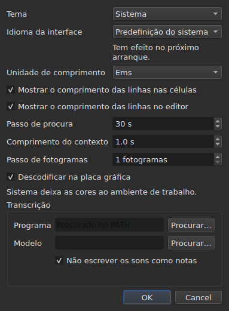

# As preferências

<!-- machine-translated -->
> Esta página é uma tradução automática e ainda não foi revista por nenhum leitor do idioma.

A janela recorda o que se define com o rato — **onde estava**, **se estava
maximizada**, **a largura das suas colunas**, **a posição da
pega** entre o filme e a tabela — e **onde se trabalha**, para que
`Open…` abra no sítio certo. Nada disto se define através de uma caixa de diálogo:
move-se, arrasta-se, e fica memorizado.

**Seis preferências têm uma caixa de diálogo própria**, `Editar ▸ Preferências…`, e esse é o
critério: uma preferência que já tem um gesto não precisa de um campo. O
tema não tem nenhum, nem a unidade dos comprimentos das linhas, nem as duas caixas de seleção que
os mostram, nem o salto e a margem prévia do reprodutor. Veja-se [O tema](#o-tema),
[Comprimentos das linhas](#comprimentos-das-linhas) e [O reprodutor](#o-reprodutor).

**O idioma da interface está na mesma caixa de diálogo, e é o que espera**: aplica-se no
arranque seguinte, não de imediato. Veja-se [O idioma da interface](#o-idioma-da-interface).

**O volume não tem nenhuma**: a barra sob a imagem e dois gestos definem-no, e fica memorizado.

**Outra é definida onde é usada**: o lado em que `Insert Subtitles…` coloca as suas
linhas é um campo dessa caixa de diálogo, e a última escolha fica memorizada. Veja-se
[Inserir, remover, unir e dividir linhas](lines.md#o-lado-é-memorizado).

**O mesmo acontece com as duas opções de pesquisa**: `Regular expression` e
`Ignore case` permanecem assinaladas ou não de uma abertura da caixa de diálogo para a
seguinte, e de uma sessão para a seguinte. Veja-se
[Localizar e substituir](find-and-replace.md#as-duas-opções).

**O mesmo acontece com as definições de `Adjust Durations…`**: a velocidade de leitura, as suas duas
direções, e as três durações com as suas caixas de seleção — cada uma mantém o seu valor, assinalada
ou não. Veja-se [`Adjust Durations…`](operations.md#adjust-durations).

**E a última codificação escolhida em `Save As…`**, com a sua marca de ordem de
bytes. Veja-se [o ficheiro](#o-ficheiro).

**E o que o assistente `Correct Texts…` e `Spell-Check Settings…` definem**: as
tarefas assinaladas e o seu código, as caixas de seleção dos padrões, as definições da quebra de linhas, o idioma,
o alvo da verificação e o sublinhado enquanto se escreve. Veja-se [Corrigir textos…](correct-texts.md) e
[Verificar ortografia…](check-spelling.md#definições-da-verificação-ortográfica). **O alvo e o
documento de `Correct Texts…` não são memorizados.**

**O que não é memorizado:** o último ficheiro aberto — veja-se
[A pasta memorizada](#a-pasta-memorizada).

## O reprodutor

Quatro campos. **Seek length** e **Context length** são do Gaupol e têm os seus valores; **Frame step** e **Decode on the graphics card** são próprios do subedit:

| Campo | O que define | Predefinição | Limites |
| :---- | :----------- | ------: | :----- |
| `Seek length` | o salto de `Seek Backward` e `Seek Forward` | 30 s | de 1 s a uma hora |
| `Context length` | a margem prévia antes da seleção, para `Seek Selection Start`, `Seek Selection End` e `Play Selection` | 1 s | de 0 a 60 s, ao décimo |
| `Frame step` | o passo, **em fotogramas**, de `Step Backward` e `Step Forward`, e do deslocamento de uma extremidade | 1 fotograma | de 1 a 1000 fotogramas |
| `Decode on the graphics card` | deixa a placa gráfica descodificar o filme quando a máquina tem uma; sem placa, nada muda | assinalada | assinalada ou não |

Aplicam-se **de imediato**, sem esperar por um reinício, e ficam memorizados de uma sessão para a seguinte
em `video.seek-length` (em segundos), `video.context-length-ms` (em milissegundos) `video.step-frames` (em fotogramas) e `video.hardware-decoding` (`true` ou `false`).
**Um valor fora dos limites, ou que não seja um número**, não impede a janela de abrir: é
ignorado, a predefinição mantém-se, e a janela di-lo ao abrir. **O passo de fotogramas nunca é em milissegundos**: um passo de N fotogramas são sempre N fotogramas, seja qual for a taxa de fotogramas do filme — veja-se [Sincronização a partir do vídeo](timing.md#fotograma-a-fotograma). O volume é memorizado em `video.volume`,
de 0 a 100, com a mesma tolerância.

## O ficheiro

```
~/.config/subedit/settings.conf
```

Mais exatamente `$XDG_CONFIG_HOME/subedit/settings.conf` quando essa variável
está definida. É escrito **quando a janela fecha**, e lido quando abre.
Um programa interrompido — morto, ou parado por uma falha — não escreve nada, e a
sessão seguinte encontra o que a anterior tinha deixado.

O ficheiro é texto, e pode ser editado à mão. Isso é uma propriedade e não
um efeito secundário: é o que torna uma definição corrigível quando a interface
que a define é precisamente a que está avariada.

### Dois blocos, um partilhado com a linha de comandos

O ficheiro é escrito em **dois blocos**, cada um sob um comentário de cabeçalho:

| Bloco | Chaves | Lido por |
| :---- | :--- | :------ |
| `# Operation settings: shared by the window and the command line` | as chaves `duration-adjust.*` e `correction.*` | a janela **e** `subedit-cli` |
| `# Display preferences: the window's own` | todas as outras chaves — geometria, colunas, tema, idioma da interface, pesquisa, verificação ortográfica, editor, vídeo, última pasta, codificação de escrita | apenas a janela |

**`subedit-cli` lê o bloco das operações por predefinição**: o que `Adjust Durations…` e
`Correct Texts…` aqui memorizam é também aquilo de que [`subedit-cli adjust`](../subedit-cli/adjust.md)
e parte de [`subedit-cli correct`](../subedit-cli/correct.md) partem, a menos que uma opção da
linha de comandos diga outra coisa. **Nunca lê as preferências de apresentação.** O seu
comando [`config`](../subedit-cli/config.md) lista as chaves das operações, mostra os seus valores e
altera-os — `subedit-cli config set duration-adjust.speed 12` — e a janela vê a alteração
na sua abertura seguinte. **Uma alteração feita enquanto a janela está aberta não sobrevive ao seu fecho**: a
janela reescreve o ficheiro inteiro com o que contém. `--no-config` faz uma linha de comandos ignorar o
ficheiro. Veja-se
[O ficheiro de definições](../subedit-cli/invocation.md#o-ficheiro-de-definições).

O leitor aceita as chaves em qualquer ordem, com ou sem os cabeçalhos: um ficheiro escrito antes de os
dois blocos existirem é lido sem alterações, e reescrito em dois blocos no fecho
seguinte.

| Opção | O que contém | Predefinição |
| :----- | :------------ | :------ |
| `window.geometry` | `x,y,width,height`, em píxeis; largura e altura diferentes de zero | a janela dimensiona-se a si própria |
| `window.maximised` | `true` ou `false` | `false` |
| `table.columns` | quatro larguras em píxeis, separadas por vírgulas — `#`, `Start`, `End`, `Duration`, mesmo ocultas | a tabela dimensiona-se a si própria |
| `table.order` | as seis colunas, **cada uma uma só vez**, pela ordem em que a tabela as mostra: `number`, `start`, `end`, `duration`, `text`, `translation` | `number,start,end,duration,text,translation` |
| `table.hidden` | as colunas removidas, entre `number`, `start`, `end` e `duration`; vazio, nenhuma | nenhuma |
| `window.table-share` | a parte da altura atribuída à tabela, em percentagem, de 1 a 99 | a janela reparte como sempre repartiu |
| `file.directory` | o caminho de uma pasta **absoluta** | nenhuma: `Open…` abre onde o programa foi lançado |
| `general.theme` | `system`, `light` ou `dark` | `system` |
| `interface.language` | `system`, ou o nome de um idioma tal como o seu catálogo se chama: duas ou três letras minúsculas, depois opcionalmente `_` e duas maiúsculas — `fr`, `pt_BR`; `en` para o inglês | `system` |
| `edit.insert-placement` | `above` ou `below` | `below` |
| `file.write-encoding` | o nome de uma codificação que o ICU consiga escrever, e cujo conversor não escreva a sua própria marca | nenhuma |
| `file.write-bom` | `true` ou `false` | `false` |
| `search.regex` | `true` ou `false` — o padrão é uma expressão regular | `false` |
| `search.ignore-case` | `true` ou `false` — as maiúsculas e minúsculas são ignoradas | `true` |
| `duration-adjust.speed` | a velocidade de leitura, em carateres por segundo, estritamente positiva; um número decimal é escrito o mais curto possível (`15`, `12.5`) | `15` |
| `duration-adjust.lengthen` | `true` ou `false` — alongar o que é demasiado curto para ser lido | `true` |
| `duration-adjust.shorten` | `true` ou `false` — encurtar o que fica apresentado mais tempo do que o necessário | `false` |
| `duration-adjust.minimum-enabled` | `true` ou `false` — a duração mínima é pedida | `true` |
| `duration-adjust.minimum-ms` | a duração mínima, em milissegundos, inteira e não negativa | `1500` |
| `duration-adjust.maximum-enabled` | `true` ou `false` — a duração máxima é pedida | `false` |
| `duration-adjust.maximum-ms` | a duração máxima, em milissegundos, inteira e não negativa | `6000` |
| `duration-adjust.gap-enabled` | `true` ou `false` — o espaço até à legenda seguinte é pedido | `true` |
| `duration-adjust.gap-ms` | o espaço, em milissegundos, inteiro e não negativo | `0` |
| `correction.mentions.enabled`, `correction.common-errors.enabled`, `correction.capitalization.enabled`, `correction.line-break.enabled` | `true` ou `false` — a tarefa está assinalada na primeira página de `Correct Texts…` | `false`, `true`, `true`, `false` |
| `correction.mentions.code`, `correction.common-errors.code`, `correction.capitalization.code`, `correction.line-break.code` | o código dos padrões da tarefa: `Zyyy`, ou `Script[-language[-COUNTRY]]` — `Latn-en-US`; não vazio | `Zyyy` |
| `correction.human`, `correction.ocr` | `true` ou `false` — as classes de erros comuns | `true`, `true` |
| `correction.sound-in-brackets`, `correction.sound-in-parentheses` | `true` ou `false` — as duas caixas de seleção da página `Mentions` | `false`, `false` |
| `correction.line-break.max-length` | o comprimento máximo de uma linha, decimal; a caixa de diálogo limita-o de 1 a 1000 | `24` |
| `correction.line-break.max-lines` | o número máximo de linhas, inteiro; a caixa de diálogo limita-o de 1 a 100 | `3` |
| `correction.line-break.in-ems` | `true`: o comprimento é medido em *ems*; `false`: em carateres | `true` |
| `correction.line-break.skip-on-length`, `correction.line-break.skip-on-lines` | `true` ou `false` — as duas condições de salto são pedidas | `true`, `true` |
| `correction.line-break.skip-max-length`, `correction.line-break.skip-max-lines` | os dois limiares de salto, na unidade escolhida | `24`, `3` |
| `correction.join-split.enabled` | `true` ou `false` — a tarefa `Join or Split Words` está assinalada | `false` |
| `correction.join-split.join`, `correction.join-split.split` | `true` ou `false` — unir, dividir | `true`, `false` |
| `correction.join-split.language` | um código de localização — `fr`, `en_US`, `sr@Latn` —; vazio: o idioma do sistema | vazio |
| `correction.remove-blank` | `true` ou `false` — `Remove all blank subtitles` | `true` |
| `transcription.engine` | o nome do motor: letras minúsculas, algarismos, `.`, `-` e `_` | `whisper.cpp` |
| `transcription.executable`, `transcription.model` | um caminho absoluto; vazio: o motor é procurado no `PATH`, e nenhum modelo é definido | vazio |
| `transcription.language` | duas letras minúsculas, um código ISO 639-1; vazio: o idioma é detetado | vazio |
| `transcription.suppress-notes` | `true` ou `false` — `Do not write sounds as notes` | `true` |
| `transcription.merge-gap-ms` | os pedaços de uma mesma frase mais próximos do que este valor são unidos, em milissegundos, inteiro e não negativo | `400` |
| `transcription.max-duration-ms` | o tempo máximo que uma legenda transcrita fica no ecrã, em milissegundos, de 1 a 3600000 | `7000` |
| `transcription.max-characters` | o número máximo de carateres de uma legenda transcrita, de 1 a 1000 | `84` |
| `correction.activations` | as caixas de seleção dos padrões que o utilizador alterou, `<type>:<code>:<name>:<0\|1>`, separadas por vírgulas; **uma vírgula ou uma barra invertida num nome escreve-se precedida de uma barra invertida** (`\,` e `\\`), e uma entrada ilegível só perde a sua própria definição — é comunicada, as outras são mantidas | vazio |
| `spell-check.language` | um código de localização, como `fr_FR`; vazio: o idioma do sistema | vazio |
| `spell-check.target` | `selection`, `current-project` ou `all-projects` | `current-project` |
| `spell-check.document` | `main` ou `translation` | `main` |
| `spell-check.inline` | `true` ou `false` — sublinhar as palavras desconhecidas enquanto se escreve no editor de uma célula | `false` |
| `editor.length-unit` | `em` ou `characters` — a unidade dos comprimentos de linha mostrados pela tabela e pelo editor | `em` |
| `editor.show-lengths-cell` | `true` ou `false` — cada linha de uma célula de texto é seguida do seu comprimento | `true` |
| `editor.show-lengths-edit` | `true` ou `false` — o editor de uma célula mostra o comprimento de cada linha numa margem | `true` |

**O ficheiro aceita mais do que a caixa de diálogo.** O leitor aceita qualquer velocidade estritamente
positiva e qualquer duração não negativa; a caixa de diálogo `Adjust
Durations…`, por seu lado, limita a velocidade de 1 a 99 carateres por segundo e cada
duração de 0 a 99 s. Um valor do ficheiro fora desses limites é trazido de volta ao
limite quando a caixa de diálogo abre, e o ficheiro conserva-o assim depois de a
caixa de diálogo ser aceite e a janela fechada. Uma caixa de diálogo cancelada não altera nada do que
está memorizado.

**`file.write-encoding` memoriza a última codificação escolhida em `Save As…`, e
nunca se impõe a um ficheiro.** Um documento aberto traz a sua própria codificação,
e é essa que a caixa propõe: reescrevê-lo noutra porque uma
definição com três semanas o diz perderia o que a leitura conservou.
O que esta definição memoriza serve o documento que não tem ficheiro — o que acabou
de ser criado.

**É um “não” deliberado e não um esquecimento.** Quem entrega sempre na
mesma codificação e abre ficheiros herdados noutra escolhe-a de novo para
cada ficheiro; a caixa propõe-lha, e a garantia de ida e volta vale
para todos.

**`file.write-bom` traz a marca da mesma codificação**, e duas
linhas são de facto necessárias: o nome de uma codificação não diz se é precedida da sua marca, tal como
`--encoding` não diz o que `--bom` diz. Ambas são lidas em conjunto, em
qualquer ordem, e um `file.write-bom` sem codificação memorizada não define nada.

**Uma parte e não alturas para a pega**, e é isso que a torna
útil: três alturas em píxeis deixam de querer dizer fosse o que fosse assim que a janela
abre com outro tamanho, e uma janela abre muitas vezes com outro tamanho.
A parte repete-se em qualquer lado. É **trazida de volta ao que a janela aceita** se
for demasiado pequena — a faixa do filme tem uma altura mínima.

**Quatro larguras para seis colunas**, e não é um esquecimento: são as
de `#`, `Start`, `End` e `Duration`, por essa ordem seja qual for a
da tabela, e **uma coluna oculta guarda a sua** — encontra-a de novo quando
volta a ser mostrada. A última coluna mostrada fica com o que as outras deixam, e dar-lhe
uma largura não faria nada; as do texto e da tradução não são, portanto,
memorizadas.

## O que acontece quando o ficheiro não diz o que se espera

Uma configuração é uma comodidade. **A sua falha custa a comodidade e nada
mais**: a janela abre em todos os casos.

| Caso | O que acontece |
| :--- | :----------- |
| o ficheiro não existe | todas as predefinições, e nada é dito — é o primeiro arranque |
| o ficheiro existe e não pode ser lido | todas as predefinições, e o motivo é escrito no fluxo de erros |
| uma opção está ausente | a sua predefinição |
| uma chave é desconhecida | ignorada, sem uma palavra, e ausente do ficheiro reescrito |
| um valor não pode ser lido | a sua predefinição é mantida, e a opção é nomeada no fluxo de erros |

```console
$ subedit-gui film.srt
subedit-gui: /home/vous/.config/subedit/settings.conf: window.geometry: "plus tard" cannot be read, keeping the default
```

**A mensagem vai para o fluxo de erros e para mais lado nenhum.** Uma janela modal
no arranque por uma preferência ilegível pararia o utilizador por
uma falha que não o impede de nada, e antes de ter pedido fosse o que fosse.

## As opções comentadas

O ficheiro reescrito contém **todas** as opções conhecidas, e as que ficaram na sua
predefinição são escritas como comentários:

```
#window.geometry = 0,0,1280,800
#window.maximised = false
#table.columns = 60,110,110,110
#table.order = number,start,end,duration,text,translation
#table.hidden = start,end
```

Não é uma afetação. Sem isso, uma opção nunca tocada ficaria
congelada no valor do dia em que foi escrita, e **uma predefinição melhorada
nunca chegaria a ninguém**. Com isso, mudar uma predefinição muda o
comportamento de todos os que não a substituíram — que é exatamente
o que uma predefinição deve fazer.

Para substituir uma opção: remova-se o `#` e altere-se o valor. Para voltar
à predefinição: apague-se a linha, ou comente-se de novo.

A geometria, as larguras e as colunas removidas mostram uma **forma** e
não um valor em vigor: a predefinição da geometria e a das larguras são
“o que a janela escolhe”, o que não se escreve em números, e a de
`table.hidden` é “nenhuma”, o que não se pode ler. O cabeçalho do ficheiro di-lo
também. `table.order`, por seu lado, mostra de facto a ordem predefinida.

## A pasta memorizada

`Open…` abre na pasta do **último ficheiro aberto ou guardado**,
e não na de uma caixa que cancelou: o que conta é onde se
trabalha, não onde se olhou.

**O último ficheiro, por seu lado, não é memorizado.** Memorizá-lo seria
reabrir no arranque um documento que ninguém pediu. Memorizar uma pasta
*aponta* uma caixa de diálogo; memorizar um ficheiro abriria um.

## O tema

`Editar ▸ Preferências…` abre com o tema, uma preferência sem gesto, acima dos
[comprimentos das linhas](#comprimentos-das-linhas).

| Valor | O que faz |
| :---- | :----------- |
| `System` | **nada** — as cores continuam a ser as do ambiente de trabalho |
| `Light` | define uma paleta clara |
| `Dark` | define uma paleta escura |

O tema escolhido aplica-se **imediatamente**, sem reiniciar.

**“System” não faz nada, e isso não é uma carência.** A versão do Qt com
que o subedit é compilado não tem maneira de perguntar ao ambiente de trabalho se quer ser
claro ou escuro, nem de ser notificada quando muda de ideias. Em vez de
inventar uma leitura que não sabemos fazer, a ferramenta fornece os dois temas
que se podem pedir e deixa o toolkit decidir quanto ao terceiro —
que é o que o Gaupol faz nas mesmas condições.

Num ambiente de trabalho cujo tema já é escuro, `System` dá portanto uma janela
escura; num ambiente claro, uma janela clara. `Light` e `Dark` sobrepõem-se-lhe,
seja qual for o ambiente de trabalho.

**Os tons das anomalias continuam legíveis nas duas paletas** — veja-se
[A tabela](table.md#as-anomalias). Não é uma suposição: o contraste
do texto sobre cada um dos tons é verificado por um teste, nos dois fundos.

## Transcrição

O grupo **`Transcription`** da caixa de diálogo contém os dois dados sobre a máquina de que
[`Transcribe Audio…`](video.md#transcrever-o-áudio) precisa: **o programa** do motor (whisper.cpp,
`whisper-cli`) e **o modelo** que ele lê. Cada um tem um botão `Browse…`. Se ficar vazio, o programa é procurado
no `PATH`; o modelo não tem valor predefinido.

Sob os campos, **a caixa diz o que existe**: se o motor foi encontrado e onde, se o `ffmpeg`
foi encontrado, e o modelo — não definido, não encontrado, não é um modelo, só para inglês ou multilingue. Quando falta
algo, acrescenta a remissão para
[Instalar as ferramentas de transcrição](../subedit-cli/install-transcription.md), que diz onde encontrar
cada um. Os dois campos são as definições `transcription.executable` e `transcription.model`.

Uma caixa, **“Não escrever os sons como notas”**, é a definição `transcription.suppress-notes` (marcada por predefinição): o motor recebe a ordem de não escrever os sons
como notas, como `(phone ringing)`. Desmarque-a para os conservar, para legendas para surdos e deficientes auditivos. A caixa de diálogo de `Transcribe Audio…` oferece a mesma caixa para a transcrição de cada vez.

## O idioma da interface

`Editar ▸ Preferências…` escolhe o idioma da janela, sob o tema.

| Campo | Valores | Predefinição |
| :---- | :----- | :------ |
| `Interface language` | `System default`; `English`; depois cada idioma instalado com o programa, pelo seu próprio nome — `Français` | `System default` |

**Produz efeito no arranque seguinte**, e a caixa de diálogo di-lo sob o campo: a janela é
traduzida à medida que é construída, e uma janela em execução mantém o idioma em que arrancou. A escolha é
guardada no ficheiro de definições, em `interface.language`, e lida quando a janela abrir de novo.

| Escolha | A janela arranca em |
| :----- | :------------------- |
| `System default` | o idioma do ambiente, como antes de qualquer escolha — `LANGUAGE`, `LC_ALL`, `LC_MESSAGES`, `LANG`; veja-se [Idioma](invocation.md#idioma) |
| `English` | inglês, diga o ambiente o que disser |
| um idioma instalado | esse idioma, **diga o ambiente o que disser**, `LC_ALL=C` incluída: uma escolha feita aqui é explícita |

A lista contém os idiomas cujo catálogo está instalado em `<prefix>/share/subedit/locale`;
o inglês está sempre lá, por ser o idioma em que o programa é escrito. Um idioma é mostrado
pelo seu próprio nome, que nenhum catálogo traduz, para que o leitor encontre aquele que lê.

**Um valor que o programa não pode satisfazer só custa a escolha:**

| O que o ficheiro diz | O que acontece |
| :----------------- | :----------- |
| o nome de um idioma sem catálogo instalado — um ficheiro trazido de outra máquina | a janela segue o ambiente, sem uma palavra; `Preferences…` mostra esse idioma, pelo seu nome ou pelo seu código, e mantém-no a menos que se escolha outro |
| algo que não é o nome de um idioma — `French`, `fr_FR.UTF-8` | `system`, a predefinição, e a opção é nomeada no fluxo de erros, como qualquer valor ilegível |

```console
$ subedit-gui film.srt
subedit-gui: /home/vous/.config/subedit/settings.conf: interface.language: "French" cannot be read, keeping the default
```

**A linha de comandos nunca o lê**: `subedit-cli` escolhe o seu idioma apenas a partir do
ambiente, e `subedit-cli config set interface.language fr` é recusado por ser uma preferência de apresentação.

## Comprimentos das linhas




`Editar ▸ Preferências…` define também **o que a tabela e o editor mostram do
comprimento das linhas** — a régua e a margem do Gaupol.

| Campo | O que faz | Predefinição |
| :---- | :----------- | :------ |
| `Length unit` | a unidade dos comprimentos: `Ems` ou `Characters` | `Ems` |
| `Show line lengths in cells` | cada linha de uma célula de texto é seguida do seu comprimento | assinalada |
| `Show line lengths in the editor` | o editor de uma célula mostra o comprimento de cada linha numa margem à direita | assinalada |

**`Length unit` fica esbatida quando nenhuma das caixas de seleção está assinalada**: sem
comprimento para mostrar, a unidade não define nada. A escolha aplica-se **de imediato** à
tabela, e os editores que abrem depois seguem-na. Os três valores são
memorizados de uma sessão para a seguinte: `editor.length-unit`, `editor.show-lengths-cell`
e `editor.show-lengths-edit`, na tabela [do ficheiro](#o-ficheiro). Veja-se
[O comprimento das linhas](table.md#o-comprimento-das-linhas) e
[no editor](editing.md#o-comprimento-das-linhas).

**Não é o limite do assistente.** A unidade de `Correct Texts…` — o
comprimento a partir do qual quebra as linhas — é uma definição separada, no seu
assistente: pode ler-se em ems na tabela e quebrar em carateres.

## O que não pode ser definido

**Nove definições memorizadas são escolhidas numa caixa de diálogo** — sem contar as do
assistente de correção e da verificação ortográfica, que têm cada uma
as suas —, e cada uma naquela em que é usada: o tema e as três definições de comprimento de linha, aqui; o lado de uma inserção, na caixa de diálogo de inserção;
as duas opções de pesquisa, na caixa de diálogo de pesquisa; a codificação e
a marca de ordem de bytes, em `Save As…`; a velocidade de leitura, as durações
e o espaço do ajuste das durações, na sua própria caixa de diálogo. Não há
mais nenhuma: nada pode ser definido para os diagnósticos, o volume do reprodutor,
nem o formato de gravação predefinido — esse vem do ficheiro aberto.

E **nenhum número que pertença a um documento é guardado de uma sessão para a
seguinte**: uma quantidade de deslocamento, dois marcadores de transformação são verdadeiros para um
ficheiro e falsos para o seguinte. As caixas de diálogo pedem-nos de novo em cada arranque,
deliberadamente. As definições de `Adjust Durations…` são uma exceção do mesmo modo que
as duas opções de pesquisa: uma velocidade de leitura, uma duração mínima ou
um espaço são escolhas de método e não medições de um ficheiro, e
persistem de uma sessão para a seguinte por essa razão.

Este manual descreve o que existe: o que virá está no
[roadmap](../../../../feuille-de-route.md).
