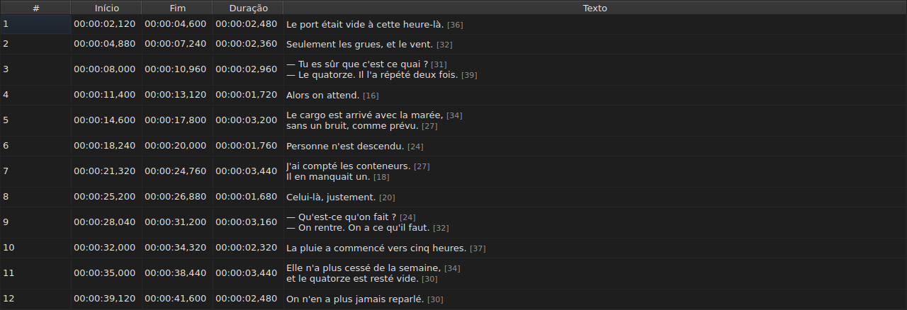
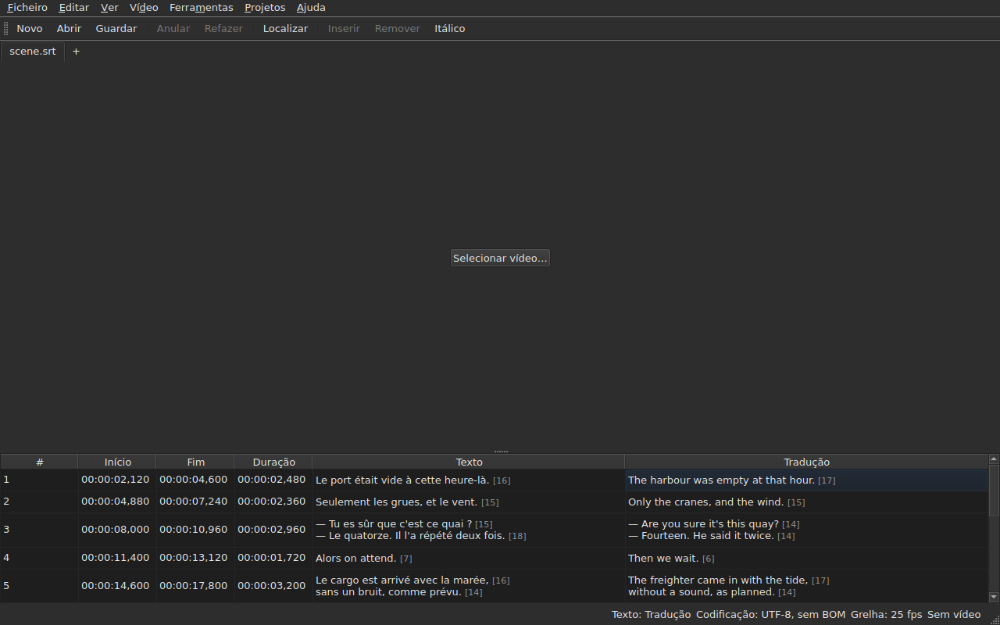

# A tabela

<!-- machine-translated -->
> Esta página é uma tradução automática e ainda não foi revista por nenhum leitor do idioma.

A janela mostra as legendas do ficheiro aberto, uma por linha, em cinco
colunas — seis quando o projeto tem uma tradução.

**Este manual cita os cabeçalhos da janela tal como a janela em inglês os
apresenta**, como faz para a linha de comandos; uma janela traduzida mostra-os
no seu próprio idioma.

| Coluna | O que mostra |
| :----- | :----------- |
| `#` | o número de ordem da legenda, a partir de 1 |
| `Start` | a posição em que aparece, `HH:MM:SS,mmm` |
| `End` | a posição em que desaparece |
| `Duration` | `End − Start` |
| `Text` | o texto da legenda |
| `Translation` | a tradução da legenda — **ausente enquanto o projeto não tiver nenhuma** |


## O comprimento das linhas




**Cada linha de uma célula de texto é seguida do seu comprimento**, `[N]`, mais pequeno
e mais pálido — na coluna `Text` como na coluna `Translation`.
É o que o Gaupol faz.

| O que conta | O que a tabela faz |
| :---------- | :----------------- |
| **as etiquetas** | não contam: `<i>Bonjour</i>` dá `[7]`, tal como `Bonjour` |
| **o arredondamento** | por defeito: uma linha de 12,9 ems apresenta-se `[12]` |
| **uma linha vazia** | não tem comprimento; um texto vazio também não |
| **a unidade** | *ems* por predefinição, ou carateres — `Editar ▸ Preferências…` |
| **uma linha demasiado longa para a coluna** | é cortada por `…` **antes** do número, que continua visível |

**O *em* é o do Gaupol, não o da tipografia**: o alfabeto minúsculo
vale 0,55 em por letra, com o tipo de letra da tabela. Um comprimento em *ems* depende,
portanto, do tipo de letra; um comprimento em carateres conta pontos de código, um
acento por um.

**A tabela não assinala uma linha demasiado longa.** Mostra o número, e cabe
ao olho compará-lo com o limite que a própria pessoa definiu — como o Gaupol. Não é
o limite do assistente `Correct Texts…`, que tem a sua própria definição.

**Para não os ver:** desmarcar `Show line lengths in cells` em
`Editar ▸ Preferências…`. Ver [Comprimentos das linhas](preferences.md#comprimentos-das-linhas).

## Ocultar e mover colunas

**`Ver ▸ Colunas`** tem uma entrada marcável por coluna, **exceto `Text`**:
sem o texto principal, não restaria nada para editar.

| Entrada | Coluna |
| :------ | :----- |
| `Ver ▸ Colunas ▸ N.º` | `#` |
| `Ver ▸ Colunas ▸ Início` | `Start` |
| `Ver ▸ Colunas ▸ Fim` | `End` |
| `Ver ▸ Colunas ▸ Duração` | `Duration` |
| `Ver ▸ Colunas ▸ Tradução` | `Translation` — ver [A coluna de tradução](#a-coluna-de-tradução) |

Desmarcar uma entrada remove a sua coluna, marcá-la de novo repõe-na, com a largura
que tinha. **A definição aplica-se à janela inteira**, todos os separadores
incluídos: há uma única tabela, cujo projeto muda com o separador.

**A célula atual sai da coluna que é removida**: passa para `Text`,
na mesma linha, e a seleção não se move. Uma célula atual numa
coluna que ninguém vê seria uma célula que uma tecla premida editaria
às cegas.

**As colunas movem-se arrastando o seu cabeçalho**, qualquer uma, `Text`
incluída. A última coluna mostrada ocupa o espaço que as outras deixam.

**A ordem e as colunas removidas são memorizadas de uma sessão para a seguinte**, com
as larguras, no [ficheiro de preferências](preferences.md) — `table.order`
e `table.hidden`. A coluna de tradução não está lá: segue a sua própria
regra, e volta com cada tradução aberta.

**O número não é um dado do ficheiro** mas o número de ordem da linha. Uma
inserção ou uma remoção renumera, portanto, tudo o que se segue, sem que nada
seja reescrito.

**O separador decimal segue o formato do ficheiro**: uma vírgula para o SubRip,
um ponto para os outros oito. O SubRip é o único dos nove a escrever uma vírgula.

**É o separador que segue, não toda a grafia.** A tabela escreve sempre
as horas e sempre três casas decimais; um ficheiro WebVTT omite as
horas abaixo de uma hora, o SubViewer 2 e os dois Sub Station Alpha contam em
centésimos, o MPL2 em décimos, o TMPlayer em segundos, o MicroDVD em fotogramas. Uma
coluna cuja largura seguisse o formato seria mais fatigante de ler do que uma
coluna que simplesmente não é a grafia exata do ficheiro.

O que a tabela garante é, portanto, **o valor e o separador**, não o número
de casas decimais. O que um formato de destino arredondaria é dito no momento de
guardar — ver
[O que um formato não pode conter, dito antes de escrever](files.md#o-que-um-formato-não-pode-conter-dito-antes-de-escrever).

**A duração (`Duration`) é calculada**, nunca guardada: escrevê-la move o
fim. Uma legenda cujo fim precede o
início apresenta uma duração negativa em vez de zero: é uma anomalia do
ficheiro, e escondê-la tornaria impossível encontrá-la.

**O início, o fim, a duração, o texto e a tradução editam-se no próprio local**; o
número não. Ver [Editar uma célula](editing.md).

**A seleção designa aquilo a que uma operação se aplica** — ver
[As operações](operations.md).

**A altura de uma linha segue a legenda que contém**: uma legenda de
duas linhas ocupa duas, uma de três ocupa três. O texto é mostrado na
íntegra, tal como será escrito.

**O que continua cortado é uma linha demasiado longa para a sua coluna**, e termina
então com reticências. Alargar a coluna `Text`, ou a janela, mostra-a
na íntegra; abrir a célula também. As linhas do texto nunca são
quebradas automaticamente: só uma verdadeira quebra de linha faz uma linha, de modo que a altura
de uma linha da tabela não muda quando se arrasta a borda de uma coluna.

## Posições em fotogramas

**`Ver ▸ Posições em fotogramas`** — uma entrada marcável, uma única definição para a janela — mostra as
colunas `Start` e `End` **como números de fotograma** em vez de marcas de tempo, e **aceita um número de fotograma como entrada**. Os
cabeçalhos dizem-no: `Start (frames)` e `End (frames)`.

| O que muda | O que não muda |
| :--------- | :------------- |
| o que `Start` e `End` escrevem, e o que aceitam | a coluna `Duration`, que continua a ser um tempo |
| os cabeçalhos dessas duas colunas | o documento: nada é modificado, o histórico não tem nova entrada, e **o que o ficheiro escreve é o que escrevia** |

**A taxa de fotogramas que conta os fotogramas** é, por esta ordem:

1. **a do ficheiro**, quando este é contado em fotogramas — o MicroDVD, que contém números e nenhuma
   taxa de fotogramas: **a janela mostra então os números do seu ficheiro**, seja qual for o vídeo;
2. **a que o vídeo associado declara**;
3. **a grelha que as posições desenham**, quando desenham uma.

A dica de ferramenta da entrada diz qual foi retida: *Positions are frame numbers, counted at 25 fps, the rate the
video declares*. **Sem nenhuma das três, a entrada fica desativada, e a sua dica de ferramenta diz porquê**: o ficheiro não
é contado em fotogramas, o vídeo não declara nenhuma taxa de fotogramas, e as posições não caem em nenhuma grelha.

- **Um número é o número do fotograma em que a posição cai**, arredondado para o fotograma mais próximo. **Escrito, dá
  o instante em que esse fotograma começa**, arredondado **uma só vez** a partir da razão exata
  ([ADR 0013](../../../../adr/0013-mise-a-l-echelle-exacte-des-positions.md)): o fotograma 37 a 23,976 fotogramas por segundo
  começa a 1 543,04 ms, ou seja, `00:00:01,543`.
- **Só são aceites números inteiros** — com o sinal de menos, pois um início pode preceder o filme. Uma
  marca de tempo escrita no modo de fotogramas, ou um número que não o seja, deixa a célula como estava.
- **A barra de reprodução segue a mesma definição**: a posição e a duração de um lado e do outro do cursor deslizante
  escrevem-se como números de fotograma, tal como `Start` e `End`, no mesmo instante — ver
  [A barra de reprodução](player.md#a-barra-de-reprodução). O relógio desenhado no topo da imagem continua a ser uma
  marca de tempo.
- **Esta definição não é memorizada** de uma sessão para a seguinte: é uma definição da janela, não de um
  documento, e volta a ativar-se com um só gesto.

## As anomalias

Uma legenda cujas posições não são coerentes entre si é **tingida nas suas
colunas de tempo**, e pousar o rato nela diz o que está errado.

| Tom | O que assinala | O que fazer |
| :-- | :------------- | :---------- |
| vermelho | `ends before it starts` | corrigir o seu fim, ou o seu início |
| azul | `starts before the previous one starts` | pô-la de novo no seu lugar na ordem |
| âmbar | `starts before the previous one ends` | ajustar a sua sincronização |


Só as colunas `Start`, `End` e `Duration` são tingidas: uma anomalia
fala apenas de tempo, e tingir o texto sugeriria que tinha algo
a ver com isso.

**Uma legenda pode ter várias**, e a dica de ferramenta nomeia-as todas. O
tom é o da primeira a reparar: uma legenda estragada em si mesma
está estragada façam as vizinhas o que fizerem; uma legenda fora do lugar é posta de novo no lugar,
e a sua sobreposição desaparece com isso.

> Não é por acaso que a desordem quase sempre prevalece sobre
> a sobreposição: começar antes de a anterior começar é começar
> antes de ela acabar — a menos que a anterior esteja ela própria estragada.

**A marcação é recalculada após cada alteração de posição**, venha ela
de uma célula editada, de uma operação ou de uma anulação. Diz o que o
ficheiro é agora, não o que era ao abrir.

Não se apoia em nenhuma grelha de fotogramas: logo que uma posição é corrigida à
mão, deixa-a, e uma marcação baseada nela comunicaria o trabalho do
utilizador.

## A coluna de tradução

Uma legenda tem **dois textos e um único par de posições**: a
tradução não tem sincronização própria, está ligada à da legenda.
A tabela mostra-a numa sexta coluna, `Translation`, à direita de `Text`.


**A coluna só existe se o projeto tiver uma tradução.** Sem ela, a tabela
mantém as suas cinco colunas, e a janela comporta-se como se a tradução
não existisse — nada fica a cinzento nem é acrescentado. `Ficheiro ▸ Abrir tradução…` abre
uma: ver [Abrir uma tradução](files.md#abrir-uma-tradução).

**Uma entrada do menu `View` mostra-a ou remove-a**:

| Entrada | O que faz |
| :------ | :-------- |
| `Ver ▸ Colunas ▸ Tradução` | marcada: a coluna é mostrada; desmarcada: é removida |

A entrada fica **desativada quando o projeto não tem tradução** — não há nada a
mostrar — e marcada no arranque. **A escolha de a remover é do
utilizador**: mantém-se de um ficheiro para o seguinte, até ser marcada de
novo. Remover a coluna não remove a tradução: continua no
projeto, e volta com a entrada. Abrir um ficheiro que não tenha nenhuma remove a
coluna.

**As células da tradução escrevem-se como as do texto** — ver
[Editar uma célula](editing.md).

### O texto a que as operações se destinam

Com dois textos numa linha, as operações sobre textos têm de saber qual deles
reescrevem. **É o da coluna da célula atual**: a
tradução se a célula atual está na coluna `Translation`, o texto
principal em todos os outros casos — numa coluna de tempo como em `Text`.

| Operação | A que se destina |
| :------- | :--------------- |
| `Italic`, `Case`, `Dialogue`, `Remove Hearing-Impaired Mentions…` | o texto da coluna atual |
| `Cut Texts`, `Copy Texts`, `Paste Texts` | o texto da coluna atual |
| `Find and Replace…` | o texto da coluna atual — ver [Localizar e substituir](find-and-replace.md#em-que-texto) |
| as operações sobre posições, a inserção, a remoção, a união, a divisão | **os dois textos**: uma legenda é um todo |

**A barra de estado di-lo quando há dois textos**, à esquerda das outras
indicações:

```text
Text: Translation
```

ou `Text: Main` para o texto principal. Fica calada quando a coluna não é
mostrada: há então um só texto, e não vale a pena dizê-lo.




**A linha desenhada na imagem segue a mesma regra**: é o texto da
coluna atual. Ver [O reprodutor](player.md#a-linha-desenhada).

**Nada fica a cinzento.** As operações sobre textos continuam disponíveis seja qual for
a coluna atual, e sem coluna de tradução visam o texto
principal, como antes.

## Acrescentar e remover linhas

`Editar ▸ Inserir legendas…` e `Editar ▸ Remover legendas` acrescentam e removem
linhas, `Editar ▸ Unir legendas` e `Editar ▸ Dividir legenda` unem-nas e
dividem-nas; a tabela renumera-se sozinha. Ver
[Inserir, remover, unir e dividir linhas](lines.md).

## O que a tabela não faz

**A ordenação por coluna não existe.** A ordem apresentada é a do ficheiro, e
é a única que faz sentido para legendas: o número de ordem de uma linha *é*
o seu lugar no tempo.
