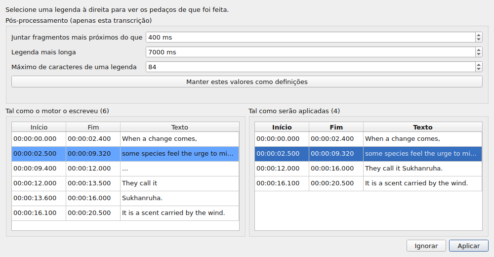
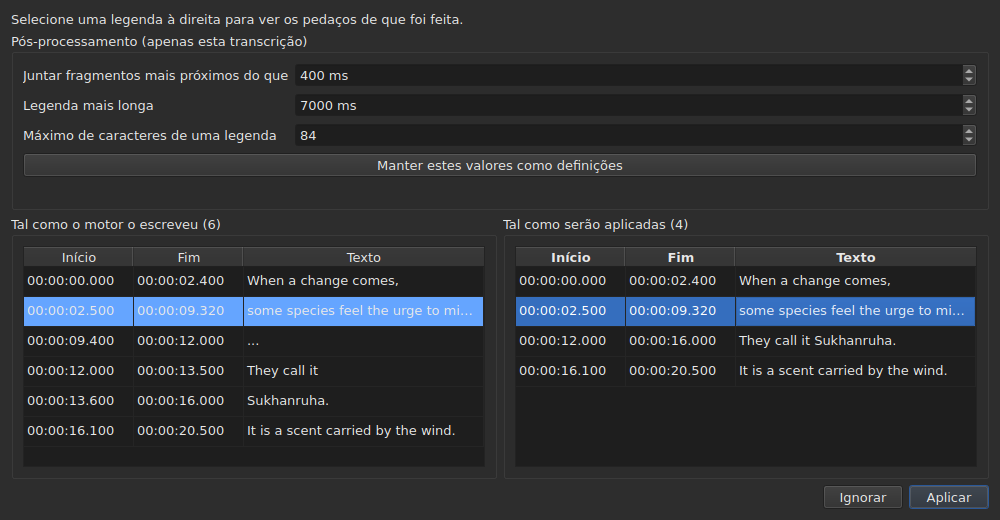

# O vídeo associado

<!-- machine-translated -->
> Esta página é uma tradução automática e ainda não foi revista por nenhum leitor do idioma.

O menu **Vídeo** traz primeiro três comandos, e depois os gestos que conduzem o filme
— ver [O reprodutor](player.md#percorrer-o-filme).

| Comando | Atalho | O que faz |
| :------ | :----- | :-------- |
| Selecionar vídeo… | nenhum | escolhe o ficheiro de vídeo a que o documento está associado |
| Transcrever áudio… | nenhum | transcreve o áudio do filme em legendas que substituem as do projeto — ver [Transcrever o áudio](#transcrever-o-áudio) |
| Reproduzir / Pausa | `Ctrl+P` | reproduz ou pára o vídeo — ver [O reprodutor](player.md#reproduzir-e-parar) |

O vídeo associado é **uma propriedade do documento aberto**, não uma definição
da aplicação: abrir outro ficheiro de legendas recomeça do zero. Não
é escrito em nenhum ficheiro e desaparece com a janela.

## A faixa de áudio

Um filme pode levar várias faixas de som — a versão original, uma dobragem, um comentário. O
submenu **`Vídeo ▸ Áudio ▸ Idioma`** enumera-as, **uma entrada por faixa**, e **marca a que está a ser reproduzida**:

| O que o ficheiro dá | O que a entrada diz |
| :------------------ | :------------------ |
| um idioma e um título | `1: fra — Original` |
| um idioma sozinho | `2: eng` |
| um título sozinho | `3: Commentary` |
| nenhum dos dois | `1` |

O número é **o lugar da faixa no filme**, uma a uma, pela ordem do ficheiro: duas faixas
podem dizer `eng`, e um ficheiro mudo quanto às suas etiquetas tem na mesma uma primeira e uma segunda.

**Escolher uma entrada reproduz essa faixa.** A marca é a resposta do reprodutor, não o clique: indica a
faixa que está a ser reproduzida.

- **O submenu fica desativado** sem vídeo ou sem faixa de áudio. Com uma única faixa, continua ativado e
  mostra-a, assinalada: diz o idioma do filme. Os dois gestos de volume, que estão ao lado, ficam
  ativados em qualquer caso: ver [O volume](player.md#o-volume).
- **A faixa não é memorizada** de um vídeo para o seguinte, nem de uma sessão para a seguinte: um número de faixa é
  o do seu ficheiro, e transpô-lo para o filme seguinte escolheria o que tivesse esse número nesse filme.
  Voltar a um separador reabre o seu filme na faixa que o reprodutor escolhe sozinho.
- Sem atalho: muda-se de idioma raramente, e o menu basta.

## Escolher um vídeo

A caixa de diálogo abre-se na pasta do ficheiro de legendas e filtra pelas
extensões de vídeo reconhecidas:

    .avi .flv .m2ts .mkv .mov .mp4 .ogg .ogv .vob .webm

Oferece também a possibilidade de mostrar todos os ficheiros. Cancelar a caixa de diálogo não altera
nada.

O ficheiro escolhido é **aberto de imediato**: a imagem aparece na janela,
em pausa no seu primeiro instante. Ver [O reprodutor](player.md).

**Largar um ficheiro de vídeo na janela faz o mesmo** — ver
[Largar ficheiros na janela](files.md#largar-ficheiros-na-janela).

**O vídeo é o do projeto do separador atual.** Cada separador guarda
o seu; mudar de separador muda o filme. **Voltar a um separador retoma o seu
filme onde o deixou**, em pausa, como em qualquer abertura. Outro filme
escolhido entretanto para esse projeto começa, por seu lado, do princípio.

## A proposta automática

Quando se abre um ficheiro de legendas, **se nenhum vídeo foi escolhido**,
a janela procura um na mesma pasta: um ficheiro de vídeo cujo nome
sem extensão seja um prefixo do nosso, até um ponto.

| Ficheiro de legendas | Vídeo encontrado | Porquê |
| :------------------- | :--------------- | :----- |
| `film.fr.srt` | `film.mkv` | `film` é um prefixo de `film.fr` |
| `film.en.forced.srt` | `film.mkv` | idem, seja qual for o número de segmentos |
| `film.fr.srt` | `film.fr.mkv` em vez de `film.mkv` | o nome mais longo ganha |
| `film.fr.srt` | nenhum, se `film.mkv` **e** `film.mp4` existirem | não se consegue distinguir dois candidatos |
| `film.fr.srt` | nenhum, se só existir `fil.mkv` | `fil` não pára num ponto |

**Uma proposta não é uma escolha.** Deixa-se substituir por outra
proposta — abrir outro ficheiro, guardar com outro nome. Uma escolha
explícita, pelo contrário, nunca é sobrescrita: depois de usado `Select Video…`, a
proposta automática já não volta atrás dela.

É isso que torna aceitável a suposição: pode ser corrigida, e a sua
correção mantém-se.

## O que a barra de estado mostra

À direita da barra de estado, uma linha diz a que o documento está associado. É
a última de três: a [codificação](files.md#a-codificação-na-barra-de-estado)
do ficheiro lido vem primeiro, a [grelha de fotogramas](frame-grid.md) deduzida das
posições a seguir.

| Situação | O que é escrito |
| :------- | :-------------- |
| um vídeo está associado | `Video: film.mkv` |
| … e `ffprobe` dá a sua taxa de fotogramas | `Video: film.mkv, 24000/1001 fps` |
| nenhum | `No video` |

**A taxa de fotogramas acompanha o filme em vez de ficar ao lado.** São um único facto — aquilo a que
este documento está associado — e uma terceira menção colocá-la-ia ao mesmo nível que
a [grelha deduzida das posições](frame-grid.md), que é outra coisa.

## Transcrever o áudio

**`Transcribe Audio…`** escreve a fala do filme como legendas. Fica desativado enquanto não houver um filme
aberto: é o áudio do **filme do projeto**, nunca de um ficheiro que se escolheria — para transcrever um
ficheiro de áudio, use [`transcribe`](../subedit-cli/transcribe.md) na linha de comandos.

A caixa de diálogo pede quatro coisas, e diz se pode começar:

- **a faixa de áudio**, listada como o menu [`Audio`](#a-faixa-de-áudio) as lista, com o idioma
  e o título que o ficheiro declara;
- **o idioma**, escolhido numa **lista**: primeiro uma entrada que o deteta, “Detetar a partir dos primeiros 30 segundos de som”, depois os idiomas que
  o motor oferece para o modelo, pelo nome no idioma da janela e seguidos do seu código — “francês (fr)”. A lista é a do
  motor: uma centena com um modelo multilingue; com um modelo só para inglês tem a única entrada, inglês, e não pode ser
  alterada, e uma linha diz que o filme sairá em inglês, qualquer que seja o idioma em que fale. A lista começa pelo idioma da faixa
  escolhida quando o ficheiro declara um e o motor o oferece, acompanha a faixa enquanto não tiver escolhido um, e
  **uma linha por baixo diz de onde vem**. Quando o ficheiro não declara nenhum idioma para a faixa, a linha di-lo, e avisa:
  o modelo irá então detetá-lo a partir dos primeiros trinta segundos de som, e **um filme que abre com música ou silêncio pode ser tomado por outro idioma
  e a sua fala então traduzida para esse idioma**. Escolha o idioma se o conhecer;
- **os sons escritos como notas**: uma caixa, “Não escrever os sons como notas”, marcada por predefinição. O motor recebe então a ordem de não escrever os sons como
  notas, como `(phone ringing)` ou `[MUSIC PLAYING]`; onde não tem fala para escrever, escreve `...`, e os pedaços que não têm nem letra nem algarismo
  são descartados pelo pós-processamento. Desmarque a caixa para conservar as notas, para legendas para surdos e deficientes auditivos. A caixa fica a cinzento, com o motivo,
  para um motor a quem isso não se pode dizer. É a definição `transcription.suppress-notes`, que as [preferências](preferences.md#transcrição)
  também contêm;
- **a parte do filme**, de um tempo a outro — veja [Experimentar primeiro uma parte](#experimentar-primeiro-uma-parte). Os dois campos
  vazios querem dizer o filme inteiro.

**Diz também o que falta.** Três linhas dizem se o motor, o `ffmpeg` e o modelo estão presentes, e
onde; quando um não está, `OK` fica desativado, e a caixa di-lo com a remissão para
[Instalar as ferramentas de transcrição](../subedit-cli/install-transcription.md). Um botão `Preferences…` abre
as [preferências](preferences.md#transcrição), onde se definem o programa e o modelo — são factos
sobre a máquina, não escolhas a refazer a cada transcrição — e a caixa verifica de novo quando se fecham.

O idioma é guardado para a vez seguinte. O próprio motor e os limites das legendas são
[definições](preferences.md) (`transcription.*`).

**Quando o projeto já contém legendas, a janela pergunta antes de as substituir**, e diz
quantas se perdem. Pergunta antes do trabalho, para que recusar não custe nada. Quando o projeto está vazio, não há
nada a perguntar.

O trabalho decorre **em segundo plano**, com uma caixa e um botão `Cancel`; a janela continua utilizável à volta. **A caixa
diz em que ponto está o trabalho**, para que saiba que está vivo e quanto tempo vai demorar:

- **a etapa**: primeiro “A extrair o áudio…” — a caixa fica então ocupada, sem valor, porque extrair não diz nada sobre o progresso —,
  depois “A transcrever o áudio…”, com uma barra;
- **o tempo que falta**, “faltam cerca de 38 min”: ausente no início, mostrado quando o motor comunicou progresso que chegue para extrapolar, e
  calculado a partir da sua velocidade desde o início, até ao último minuto; é uma precisão de alguns minutos, não uma promessa;
- **o tempo decorrido**, “decorrido: 0:05:12”, que avança mesmo quando mais nada se mexe;
- **a posição**, “0:12:30 de 0:50:00”: até onde no filme o motor chegou, assim que produziu o seu primeiro texto, mostrada **mesmo acima do último texto** a que corresponde;
- **o último texto** obtido, para que possa ver que o trabalho faz sentido.

Num filme longo com um modelo grande num processador, os primeiros minutos podem ser longos: o motor carrega o modelo e trabalha nas suas primeiras
janelas de trinta segundos. A posição e o último texto mexem-se antes da percentagem própria do motor, que só vem em passos
de 5 % do filme.

### A pré-visualização

**Nada substitui as legendas do projeto antes de as ter visto.** Quando o trabalho termina — e também quando o cancela, ou falha
depois de ter produzido alguma coisa — uma janela mostra o resultado em duas tabelas lado a lado, cada uma com **o seu próprio início e fim**:

- **à esquerda, “Tal como o motor o escreveu”**: tudo o que o motor devolveu, como o cortou, sem qualquer pós-processamento — o que
  [`--raw`](../subedit-cli/transcribe.md) escreveria —, os marcadores de posição (`...`) incluídos;
- **à direita, “Tal como serão aplicadas”**: as legendas depois do pós-processamento, exatamente o que entrará no projeto. Faz-se em três passos, cada um sobre toda a transcrição antes de o seguinte começar: os pedaços sem letra nem dígito (`...`) são descartados; os pedaços próximos de uma mesma frase são unidos; os que são demasiado longos são cortados — **primeiro num fim de frase (`. ? ! …`), depois numa vírgula, num ponto e vírgula ou nos dois pontos, e a meio de uma frase só quando não há pontuação onde cortar**. Evita-se um corte que deixaria uma legenda demasiado pequena para ser lida (poucos caracteres, uma fração de segundo) quando existe outro. Uma legenda que começa um pedaço mantém o seu início, e a que o termina mantém o seu fim: os tempos das palavras só servem para os cortes dentro de um pedaço.

Acima das tabelas, **“Pós-processamento (apenas esta transcrição)”** contém os três limites do pós-processamento: “Juntar fragmentos mais próximos do que”, “Legenda mais longa” e “Máximo de caracteres de uma legenda” — as definições `transcription.merge-gap-ms`, `transcription.max-duration-ms` e `transcription.max-characters`. **Alterar um refaz logo a tabela da direita**, sem passar pelo motor, e a legenda que tinha selecionada continua selecionada. Os valores que introduz valem apenas para **esta transcrição**: quer a aplique, quer a ignore, as definições da aplicação ficam como estavam. **“Manter estes valores como definições”** entrega os três valores às definições da aplicação — as das [preferências](preferences.md#transcrição), guardadas com elas —, e a janela di-lo; fechar a janela não o faz por si só.

As duas não se alinham linha a linha, e é por isso que cada uma tem os seus tempos. **Selecionar uma legenda à direita realça, à esquerda, os pedaços de que
foi feita**, e desloca o lado esquerdo até eles; uma legenda de cada vez, e só nesse sentido. Nenhuma das tabelas se pode editar: o que nenhuma definição acerta edita-se depois, na tabela do projeto, como qualquer legenda.

Dois botões a fecham. **“Aplicar”** substitui as legendas do projeto **numa única operação**: um `Undo` devolve o que lá estava, textos de tradução
incluídos. **“Ignorar”** descarta o resultado, que se perde. “Aplicar” fica desativado quando não há
nada a aplicar.

**Quando o trabalho foi interrompido**, a janela di-lo — “Resultado parcial: o trabalho parou em …” — e oferece o que tinha sido obtido até aí, para aplicar
ou ignorar, para que uma execução longa parada tarde não perca o seu trabalho sem que se tenha pedido. Esses pedaços não têm palavras com tempo (o motor escreve-as no
fim), e o pós-processamento corta nos limites próprios dos pedaços. Uma falha é primeiro dita numa caixa, como qualquer falha; um cancelamento não diz nada disso.

### Experimentar primeiro uma parte

Um intervalo permite **avaliar um modelo ou um idioma em dois minutos antes de se comprometer com duas horas**. Os campos “Parte do filme” recebem um início e um fim, cada um escrito `HH:MM:SS` e escrito por cima dígito a dígito, como em [o diálogo de deslocamento](operations.md#shift-positions) (um tempo colado como `2:00` é posto em forma); um só é permitido (dali até ao fim, ou do início até ali). `OK` fica desativado enquanto um campo não
for um tempo ou o fim não vier depois do início, e uma linha sob os campos diz qual.

- **As legendas mantêm o tempo do filme**: o que é dito aos 2:10 fica em `0:02:10` no resultado.
- **Passa pela pré-visualização como qualquer transcrição**, e substitui as legendas do projeto uma vez aplicada; um `Undo` devolve-as.
  Para experimentar um intervalo sem tocar no seu trabalho, ignore a pré-visualização, ou guarde primeiro.

**O que ela necessita não é fornecido**: um motor (whisper.cpp), um modelo e o `ffmpeg` para extrair o áudio.
Veja [Instalar as ferramentas de transcrição](../subedit-cli/install-transcription.md).

## Quando não há filme

A janela mostra um botão **`Select Video…`** onde estaria a imagem, em vez de
nada. É o mesmo comando que o do menu `Video`, ao
alcance do rato: uma ausência sobre a qual não se pode agir distingue-se mal de uma
falha.

O botão desaparece assim que um filme é aberto, e a imagem ocupa **todo** o seu
lugar: a altura que a tabela deixa acima dela — a que
[`window.table-share`](preferences.md) memorizou de uma sessão para a seguinte —, e
nunca menos do que a altura mínima da imagem, que a tabela cede se for preciso.
Quando o filme desaparece, o botão volta a ocupar o mesmo lugar.

**O nome do ficheiro, nunca o seu caminho.** Um caminho de duzentos carateres
empurraria tudo o resto para fora da barra; o caminho completo é o que a
caixa de diálogo mostrou.

## `ffmpeg` não é necessário

O `subedit-gui` consulta o `ffprobe` — fornecido com o `ffmpeg` — para uma única
coisa: **a taxa de fotogramas que o contentor declara**. É lida uma vez
por filme, quando este é associado.

| Com `ffprobe` | Sem |
| :------------ | :-- |
| a barra de estado escreve a taxa de fotogramas ao lado do nome do filme | escreve apenas o nome |
| a caixa de diálogo da conversão propõe a taxa de fotogramas do filme no campo inferior | não propõe nada, e abre-se como dantes |
| a caixa de diálogo do alinhamento abre-se nela | abre-se na taxa de fotogramas do projeto |

**Nada mais depende dele, e nenhuma operação recusa.** O reprodutor, por seu lado,
não precisa de `ffprobe` de todo: apoia-se na `libmpv`, que é uma
dependência de compilação. A duração do filme, a que serve para comunicar o que
passa do fim, vem do reprodutor e não do `ffprobe`.

**A transcrição é a única coisa que precisa do `ffmpeg`**: ele extrai o áudio do filme. Ver
[Instalar as ferramentas de transcrição](../subedit-cli/install-transcription.md).

Não se trata, portanto, de um modo degradado, mas do **funcionamento normal** de uma máquina
que nunca instalou o `ffmpeg`: o dado vem do utilizador, e o `ffprobe`
propõe-no quando lá está.

Uma taxa de fotogramas lida é um **racional exato** — `24000/1001`, não `23.976`.
É essa a razão por que o `ffprobe` é mantido para esta resposta: o
reprodutor conhece a mesma coisa como número de vírgula flutuante, e uma taxa de fotogramas aproximada
resincronizaria o ficheiro inteiro ligeiramente fora do sítio.
