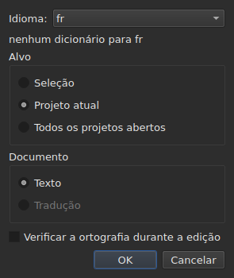
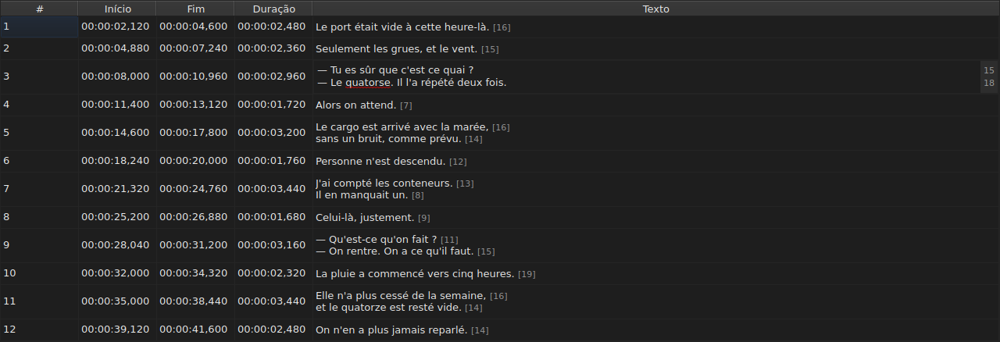
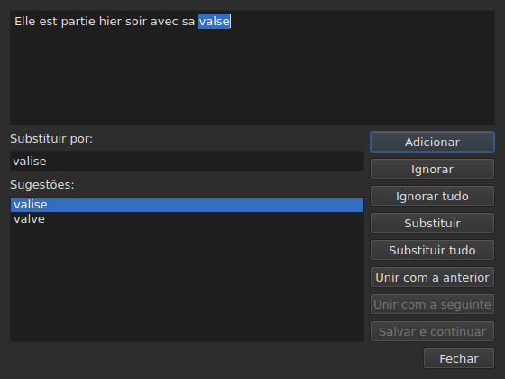

# Verificar ortografia…

<!-- machine-translated -->
> Esta página é uma tradução automática e ainda não foi revisada por um leitor do idioma.

`Ferramentas ▸ Verificar ortografia…` percorre as palavras que o dicionário não conhece,
uma de cada vez, nos moldes do corretor ortográfico do Gaupol. Tem um companheiro,
`Ferramentas ▸ Configurações da verificação ortográfica…`, que define o idioma, o alvo e o documento, e o sublinhado durante a digitação.
Ambos se apoiam nos dicionários do sistema, por meio do Enchant.

O rótulo do primeiro é escrito `Chec&k Spelling…`: `C` já é
a tecla de acesso de `Correct Texts…`, e `k` está livre no menu `Tools`.
Nenhum dos dois tem atalho.

**Ambos ficam desativados em um documento sem legendas**, como
[`Correct Texts…`](correct-texts.md): não há nada a verificar. `Check Spelling…`
também fica desativado sem dicionário para o idioma definido, veja
[Sem dicionário](#sem-dicionário).

## Configurações da verificação ortográfica…




| Grupo | Escolhas | Padrão |
| :---- | :------- | :----- |
| `Language` | os códigos de idioma que o sistema oferece, e o já escolhido | o idioma do sistema, se estiver entre eles |
| `Target` | `Selection`, `Current Project`, `All Open Projects` | `Current Project` |
| `Document` | `Text`, `Translation` | `Text` |
| `Check spelling while editing` | uma caixa de seleção, veja [Sublinhado durante a digitação](#sublinhado-durante-a-digitação) | desmarcada |

`Selection` fica desativado sem nenhuma linha escolhida na aba exibida; `Translation`
fica desativado enquanto nenhum projeto aberto contiver uma tradução. Uma configuração
lembrada que não está mais disponível — uma seleção vazia, uma tradução ausente —
abre em `Current Project` ou `Text`. `OK` mantém as configurações, `Cancel` não muda
nada.

**Esta janela não depende do dicionário**: permanece ativada enquanto o
documento tiver legendas, mesmo sem dicionário para o idioma definido, e é
ela que permite sair de um idioma que não tem nenhum. O idioma para o qual não existe
dicionário continua editável e aparece na lista, com, sob
ele, a frase `no dictionary for` seguida de seu código.

**As quatro configurações são lembradas** de uma sessão para a seguinte, no
arquivo de configurações do `subedit` — veja [As preferências](preferences.md) para sua
localização:

| Chave | Valores | Padrão |
| :---- | :------ | :----- |
| `spell-check.language` | um código de idioma, como `fr_FR`; vazio: o idioma do sistema | vazio |
| `spell-check.target` | `selection`, `current-project`, `all-projects` | `current-project` |
| `spell-check.document` | `main`, `translation` | `main` |
| `spell-check.inline` | `true` ou `false` — sublinhar as palavras desconhecidas no editor de uma célula | `false` |

Um valor que a chave não aceita é ignorado, o padrão se aplica, e a opção
é nomeada no fluxo de erro quando a janela abre — veja
[As preferências](preferences.md#o-que-acontece-quando-o-arquivo-não-diz-o-que-se-espera).

## Sublinhado durante a digitação




A caixa de seleção `Check spelling while editing` de `Spell-Check Settings…` sublinha,
**com uma linha ondulada vermelha e enquanto se digita**, cada palavra desconhecida no editor de uma
célula de texto — tanto a da coluna `Text` quanto a da coluna
`Translation`. O sublinhado acompanha a digitação: aparece, se move e
desaparece com a palavra. **Vem desmarcada por padrão**, como no Gaupol: sem
ela, nada muda no editor.

**O idioma é o de `Language:`**, na mesma janela, e as palavras desconhecidas
são as que `Check Spelling…` encontraria: os mesmos casos de inglês coloquial
(`goin'`, `we'd`, `1st`), a mesma divisão em palavras. Uma palavra sublinhada não é corrigida
por um menu: a caixa de seleção apenas a mostra.

**Sem dicionário para o idioma definido, o editor permanece em silêncio**: nada é
sublinhado e nada falha, e a frase `no dictionary for` da janela diz
por quê. A caixa de seleção vale para os editores abertos depois dela; um editor já
aberto conserva o que tinha.

## O percurso




A janela mostra o texto da legenda onde parou, com a palavra desconhecida
selecionada. **A cada palavra desconhecida, a aba do projeto volta à frente e a
linha da legenda é selecionada na tabela.** O percurso vai de legenda
em legenda, depois de projeto em projeto quando o alvo designa vários.

Sob o texto: a caixa `Replace with:`, preenchida com a primeira sugestão, e a
lista `Suggestions:`. Escolher uma sugestão a copia para a caixa; digitar na
caixa renova a lista.

| Botão | O que faz |
| :---- | :-------- |
| `Add` | acrescenta a palavra ao dicionário pessoal do usuário e passa para a seguinte |
| `Ignore` | deixa esta palavra e passa para a seguinte |
| `Ignore All` | deixa esta palavra, e todas as suas outras ocorrências durante este percurso |
| `Replace` | substitui a palavra pelo conteúdo de `Replace with:`; desativado enquanto a caixa estiver vazia |
| `Replace All` | faz o mesmo para suas outras ocorrências; desativado enquanto a caixa estiver vazia |
| `Join with Previous` | une a palavra à palavra que a precede; desativado se não houver nenhuma, ou se não estiverem separadas por um espaço |
| `Join with Next` | une a palavra à palavra que a segue, nas mesmas condições |
| `Save and Resume` | mantém o texto como a área de texto o contém, e retoma a leitura **deste texto desde o início** |
| `Close` | fecha a janela |

**A área de texto é editável.** Assim que se digita nela, apenas `Save and Resume`
permanece ativado: os outros gestos agem sobre a palavra escolhida, que não é mais
a do texto.

**O percurso termina sozinho** quando não resta nenhuma palavra desconhecida: os
botões ficam desativados, o texto se esvazia. Um alvo sem nenhuma palavra desconhecida
não mostra janela alguma.

### Fechar no meio

`Close`, ou a cruz da janela, **aplica o que foi feito**, como o fim
do percurso: os textos já deixados, **e** os gestos — substituir,
substituir tudo, unir — já feitos no texto atual. É uma divergência em relação ao
Gaupol, que perde o texto atual. O que não conta é o que resta do percurso, nem
os retoques digitados na área de texto que `Save and Resume` não
confirmou.

**Uma única entrada de histórico por projeto tocado**, seja qual for o número de
substituições: `Undo` desfaz de uma vez todas as correções desse projeto.
O menu a nomeia `Undo: correcting texts`. A barra de status então dá a
contagem:

```text
Edited 2 and removed 0 subtitles
```

**A lista de substituições** — o que o usuário substituiu, e pelo quê —
é escrita ao fechar em `spell-check/<language>.repl`, sob o diretório de configuração
do `subedit`, e não no do Gaupol, que nunca é lido.
Ela então conta entre as sugestões do corretor ortográfico, aqui como em
[`Correct Texts…`](correct-texts.md#unir-ou-dividir-palavras--juntar-e-separar-pelo-corretor-ortográfico).
Se não puder ser escrita, uma caixa de erro o diz, `Could not save the
replacements for` seguido do idioma e do motivo, sem cancelar as
correções.

## Sem dicionário

Quando o idioma definido — o do sistema, se nenhum foi escolhido — não tem
dicionário, **`Check Spelling…` fica desativado**, e sua dica de ferramenta, assim como a barra
de status, quando o item está sob o mouse, dizem por quê:

```text
no dictionary for fr
```

`Spell-Check Settings…` permanece, para escolher um idioma que tenha um. Uma janela
construída sem nenhum provedor de dicionários diz a mesma coisa e não verifica
nada.

## As mensagens

| Mensagem | Onde | O que a provoca |
| :------- | :--- | :-------------- |
| `no dictionary for fr` | dica de ferramenta e barra de status | nenhum dicionário para o idioma definido |
| `Nothing to check.` | barra de status | o alvo não designa nenhum texto — uma seleção vazia, por exemplo |
| `Edited N and removed M subtitles` | barra de status | no fim ou ao fechar; `M` permanece em `0` |
| `Could not save the replacements for fr: …` | caixa de erro | a lista de substituições não foi escrita |

## Um exemplo

Um arquivo aberto contém `Elle est partie hier soir avec sa valse`. O dicionário
francês está presente: `Ferramentas ▸ Verificar ortografia…` para em `valse`, seleciona a
linha na tabela, e propõe `valise`, já em `Replace with:`. `Replace`
e depois `Close`: a linha se torna `Elle est partie hier soir avec sa valise`, e a
barra de status diz:

```text
Edited 1 and removed 0 subtitles
```
