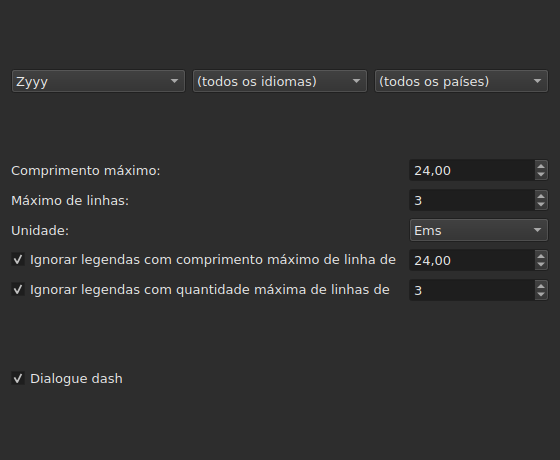
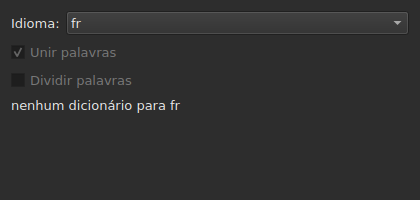
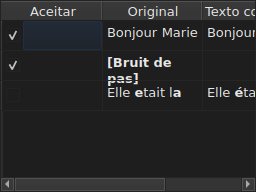

# Corrigir textos…

<!-- machine-translated -->
> Esta página é uma tradução automática e ainda não foi revisada por um leitor do idioma.

`Ferramentas ▸ Corrigir textos…` abre um assistente de várias páginas, nos moldes do
Gaupol: uma página de alvo e tarefas, uma página por tarefa marcada,
uma página de progresso e uma página de confirmação que propõe as
alterações sem nunca as impor.

**Desativado em um documento vazio**: não há nada a corrigir.

**A linha de comando faz o mesmo** para todas as tarefas: [`subedit-cli correct`](../subedit-cli/correct.md), com os
mesmos padrões e as mesmas contagens — e em caracteres onde a janela mede em ems.
**Ela lê, por padrão, quatro das configurações lembradas deste assistente** — as duas classes de
erros comuns (`Human`, `OCR`), `Remove all blank subtitles` e o número máximo de linhas de
`Line Break` — e toma todo o resto (as tarefas, seu código, o comprimento de linha, o idioma,
as caixas de padrões) de sua própria linha. Veja
[Dois blocos, um deles compartilhado com a linha de comando](preferences.md#dois-blocos-um-deles-compartilhado-com-a-linha-de-comando)
e [`subedit-cli config`](../subedit-cli/config.md).

## Tarefas e alvo — a primeira página

| Grupo | Escolhas | Padrão |
| :---- | :------- | :----- |
| `Target` | `Selection`, `Current Project`, `All Open Projects` | `Current Project` |
| `Document` | `Text`, `Translation` | `Text` |
| `Tasks` | `Mentions`, `Join or Split Words`, `Common Errors`, `Capitalization`, `Line Break` — a marcar, uma ou mais | `Common Errors` e `Capitalization` marcadas, as outras três não |

`Selection` fica desativado sem nenhuma linha escolhida na aba exibida; `Translation`
fica desativado enquanto nenhum projeto aberto contiver uma tradução.

**O alvo e o documento não são lembrados**: o assistente sempre reabre
em `Current Project` e `Text`. As tarefas marcadas, por sua vez, são lembradas.

**O que cada alvo designa**:

| Alvo | Age sobre |
| :--- | :-------- |
| `Selection` | as linhas escolhidas na aba exibida |
| `Current Project` | o arquivo inteiro da aba exibida |
| `All Open Projects` | o arquivo inteiro de cada aba aberta |

**`All Open Projects` em `Translation` ignora os projetos sem tradução**:
um projeto que não tem nenhuma não tem nada a propor em uma coluna vazia, e
o assistente não o conta.

**As páginas de tarefas vêm em seguida, na ordem do Gaupol — `Mentions`,
`Join or Split Words`, `Common Errors`, `Capitalization`, `Line Break` — nunca na ordem em que as caixas
foram marcadas.** Uma tarefa desmarcada não tem página; suas configurações
lembradas não mudam por isso. **Nenhuma página de tarefa tem sua própria caixa
“ativa”**: é a desta primeira página, e somente ela,
que decide se a tarefa é executada.

## As páginas de tarefas

Cada uma das quatro páginas de padrões — todas exceto `Join or Split Words`, que não tem nenhum — contém a mesma base: três menus
suspensos em cascata — escrita, idioma, país — para escolher o código dos padrões a
aplicar, depois a lista dos padrões desse código, um a marcar por nome. **Os três
menus oferecem apenas o que o catálogo de padrões realmente
contém** — os distribuídos com o programa e os que um usuário
colocou ali (veja [Padrões descartados](#padrões-descartados)) — nunca uma lista
de idiomas ou países lida em outro lugar. `Zyyy` (“qualquer escrita”) é o código
inicial de `Common Errors`, que fornece os padrões válidos em qualquer lugar. **Os três
outros tipos só têm padrões sob uma escrita**: sua página abre na
primeira que o catálogo oferece, `Latn` com os padrões distribuídos, e não em `Zyyy`.

**A descrição de cada padrão é a dica de ferramenta de sua caixa.** Os nomes e as descrições seguem o
idioma da janela para os padrões distribuídos com o programa; um padrão próprio é exibido como
seu arquivo o escreve ([Idioma](invocation.md#idioma)).

**Um padrão desmarcado continua desmarcado até ser marcado de novo**, inclusive ao
mudar de código e depois voltar a ele, e essa escolha é lembrada de uma abertura
do assistente para a seguinte. Marcado de novo, ele simplesmente reencontra sua configuração
original, e a escolha lembrada desaparece.

| Página | O que acrescenta à base |
| :----- | :---------------------- |
| `Mentions` | duas caixas de seleção, `Sound in brackets` e `Sound in parentheses`, desmarcadas por padrão |
| `Common Errors` | duas caixas de seleção, `Human` e `OCR`, marcadas por padrão |
| `Capitalization` | nada mais |
| `Line Break` | um comprimento máximo (`24`, por padrão), um número máximo de linhas (`3`), uma unidade — `Characters` ou `Ems`, `Ems` por padrão — e duas condições de dispensa, descritas abaixo |

**As duas caixas de `Mentions` não nomeiam nenhum padrão compilado**: elas
acionam uma varredura do texto no núcleo, a mesma que
[`Remove Hearing-Impaired Mentions…`](operations.md#remove-hearing-impaired-mentions)
já faz em um gesto direto. Uma **ou** a outra marcada basta para iniciá-la. **A lista de padrões da página não as repete**: esses dois nomes só aparecem ali como caixas de seleção.

**`Common Errors` filtra por classe**: um padrão que tem as duas classes
se aplica assim que uma das duas caixas é marcada; as três outras páginas não
conhecem essa distinção.

### Quebra de linha — a unidade e a dispensa




| Configuração | O que faz | Padrão |
| :----------- | :-------- | :----- |
| `Maximum length` | o comprimento de uma linha, na unidade escolhida; de `1` a `1000` | `24` |
| `Maximum lines` | o número de linhas visado; de `1` a `100` | `3` |
| `Unit` | `Characters` conta caracteres; `Ems` mede a largura com a fonte da janela, em que uma letra minúscula média vale `0.55` — a unidade do Gaupol | `Ems` |
| `Skip subtitles with maximum line length of` | deixa como está uma legenda cuja linha mais longa cabe neste comprimento, na unidade escolhida | marcada, `24` |
| `Skip subtitles with maximum line amount of` | deixa como está uma legenda cujo número de linhas cabe neste número | marcada, `3` |

**A dispensa tem seus próprios limites**, distintos dos limites visados: é a
regra do Gaupol. Uma legenda é deixada como está se cabe em **todos os
limites cuja caixa está marcada**; caso contrário, é quebrada, e a quebra é
mantida apenas se aproximar a legenda de um limite que ela excedia — menos
comprimento, ou menos linhas. Nenhuma caixa marcada: toda legenda é quebrada,
caiba ela ou não.

**Mudar a unidade muda o que é proposto**: o comprimento de cada linha é
medido a cada cálculo, na unidade da página naquele momento, e nada
resta de uma medição anterior. Um texto de vinte e nove caracteres, metade
deles letras estreitas, excede `24` em `Characters` e cabe nele com folga
em `Ems`.

**As sete configurações são lembradas** de uma sessão para a seguinte, a unidade inclusive.

### Unir ou dividir palavras — juntar e separar pelo corretor ortográfico




Uma página à parte, entre `Mentions` e `Common Errors`, para reparar o que os
programas de reconhecimento de texto fazem com os espaços. Não tem lista de
padrões: apoia-se nos dicionários do sistema, por meio do Enchant.

| Configuração | O que faz | Padrão |
| :----------- | :-------- | :----- |
| `Language` | o idioma do dicionário; os códigos que o sistema oferece, e o já escolhido | o idioma do sistema, se estiver entre eles |
| `Join words` | une uma palavra incorreta à palavra vizinha | marcada |
| `Split words` | corta uma palavra incorreta em duas | desmarcada |

**Unir**: uma palavra incorreta é unida à palavra que a precede ou à
que a segue **se, e somente se, apenas uma das duas direções der uma palavra
corretamente escrita**. Quando as duas dão uma, ou nenhuma, nada é feito.
`bon jour` torna-se `bonjour`; dois espaços seguidos são antes reduzidos a
um, mas um texto em que nada é unido é devolvido como estava, espaços
inclusive.

**Dividir**: uma palavra incorreta é cortada se, entre as sugestões do
corretor ortográfico, **apenas uma** é essa palavra com um espaço — as mesmas
letras, na mesma ordem. Duas sugestões desse tipo, ou nenhuma: nada
é feito. Uma palavra cuja inicial, e somente ela, é maiúscula (`Bonjourtous`) nunca
é dividida: costuma ser um nome, e os dicionários não os têm.

**A lista de substituições do usuário** (`spell-check/<language>.repl`,
no diretório de configuração do programa) conta entre as sugestões do
corretor ortográfico; o assistente a lê e não a escreve.

**Sem dicionário para o idioma escolhido, a página permanece e fica acinzentada**: as
duas caixas ficam desativadas e a página diz `no dictionary for` seguido do código do
idioma. O idioma continua editável — pode haver um dicionário para outro — e a tarefa, marcada ou não na primeira página, não faz então nada e
não relata nenhum erro.

**O idioma, as duas caixas e a caixa da primeira página são lembrados** de uma
abertura do assistente para a seguinte.

### Padrões descartados

Um padrão que um usuário colocou em seu próprio diretório de padrões
é acrescentado aos distribuídos com o programa, no mesmo catálogo e sob os
mesmos menus — nada os distingue depois de carregados.

| Padrões | Onde |
| :------ | :--- |
| distribuídos | `<prefix>/share/subedit/patterns`, ao lado de `<prefix>/bin` |
| os do usuário | `$XDG_DATA_HOME/subedit/patterns`, ou `~/.local/share/subedit/patterns` se a variável não estiver definida ou não for um caminho absoluto |

**O formato é o do Gaupol, lido como está**: um arquivo `<Code>.<type>` por escrita,
idioma e país — `Latn-en.common-error` —, sua ativação `.conf` ao lado. Os tipos
são `common-error`, `capitalization`, `hearing-impaired` e `line-break`. Os arquivos
distribuídos servem de modelo. **Os padrões são lidos uma única vez, na inicialização**: um arquivo
colocado enquanto a janela está aberta só é visto na inicialização seguinte.

## Progresso

Quando `Next` é pressionado a partir da última página de tarefa marcada (ou da
primeira página se nenhuma tarefa estiver marcada), o assistente calcula as
correções propostas em uma thread de segundo plano, com uma barra de progresso indeterminada na
tela. Terminado o cálculo, a página de confirmação abre sozinha.

**`Cancel` nesta etapa abandona o cálculo sem interrompê-lo**: nada
é aplicado, mas o assistente espera, antes de fechar, que o cálculo em
andamento termine — uma espera limitada pelo tempo limite que o mecanismo de
padrões impõe a cada pesquisa.

**`Back` nesta etapa volta à página anterior sem esperar**: o cálculo
termina em segundo plano e seu resultado é descartado — o assistente não salta
sozinho para a confirmação. `Next` inicia um novo cálculo.

## Confirmação — a última página




Uma linha por texto que o assistente alteraria — nunca uma linha para um
texto que uma tarefa deixou como está.

| Coluna | O que mostra |
| :----- | :----------- |
| `Accept` | uma caixa de seleção, marcada por padrão: a correção será aplicada ou não |
| `Original` | o texto como está, a parte que mudaria **em negrito** |
| `Corrected Text` | o texto proposto, a parte alterada em negrito, **editável** — retocá-lo muda o que será escrito, sem mudar a caixa `Accept` |

**A alteração é marcada em negrito, nunca em cor**: o mesmo diff é lido
nas duas paletas sem depender de nenhuma cor.

**Uma linha cuja proposta é uma remoção** — a legenda ficaria sem
texto — mostra a coluna `Corrected Text` vazia, e todo o seu `Original` em
negrito.

| Botão | O que faz |
| :---- | :-------- |
| `Mark All` | marca `Accept` em todas as linhas |
| `Unmark All` | desmarca `Accept` em todas as linhas |
| `Preview` | põe o reprodutor integrado na legenda da linha escolhida, se o projeto tiver um filme — nada se não tiver |
| `Finish` | aplica as linhas marcadas e fecha o assistente |

`Remove all blank subtitles`, marcada por padrão, remove as legendas
que uma correção deixaria sem nenhum texto, em vez de mantê-las vazias.

**Um padrão que o cálculo não pôde aplicar é nomeado sob a tabela**, com
o motivo:

```text
Not applied: some pattern (will not compile)
```

Um padrão nomeado assim é nomeado **uma vez por motivo**, seja qual for o número de
textos ou projetos em que falhou: a tela não diz quais.

| Motivo | O que o provoca |
| :----- | :-------------- |
| `cannot be translated` | a expressão usa o que a tradução da sintaxe do Python recusa |
| `will not compile` | o mecanismo recusa a expressão |
| `has an invalid replacement` | a substituição não é lida como o Python a lê |
| `timed out` | uma pesquisa excedeu o tempo que o mecanismo concede em um texto |
| `never settled` | `Repeat` ainda alterava o texto após cem passagens |
| `grew the text too long` | o texto excedeu 16 384 bytes enquanto o padrão trabalhava nele |

**Um padrão que falha em um texto o deixa como estava antes dele**: uma substituição
feita pela metade vale menos do que nenhuma substituição. Os outros padrões se aplicam.

**Uma linha de um arquivo de padrões que não pode ser lida é nomeada no mesmo
lugar**, por seu arquivo, sua linha e o motivo — a cada abertura do
assistente, já que os padrões são lidos uma única vez, na inicialização:

```text
Could not be read: Zyyy.common-error, line 8 (malformed line)
```

| Motivo | O que o provoca |
| :----- | :-------------- |
| `directory cannot be read` | o diretório dos padrões distribuídos não pôde ser percorrido |
| `file cannot be read` | um arquivo de padrões não pôde ser lido |
| `malformed line` | uma linha que não é nem um cabeçalho, nem um comentário, nem `Key=Value` |
| `field outside any pattern` | um `Key=Value` antes do primeiro cabeçalho de padrão |
| `unknown field` | uma chave de que este tipo de padrão não tem uso — o padrão é mantido |
| `missing field` | uma chave sem a qual este tipo de padrão não pode fazer nada — o padrão é descartado |
| `invalid value` | um valor que a chave não aceita — o padrão é descartado |
| `malformed activation` | um elemento `<pattern>` de um `.conf` que não nomeia nada |

Os outros padrões, os que foram lidos e aplicados corretamente, não são
afetados.

## O que o desfazer diz, e o que `Cancel` nunca faz

**`Finish` faz uma entrada de histórico por projeto tocado**, nunca uma por
correção: `Undo` desfaz de uma vez todas as correções aceitas nesse
projeto, cada uma com o texto que tinha. O menu a nomeia
`Undo: correcting texts`.

A barra de status dá a contagem, os textos alterados primeiro, as legendas
removidas em seguida:

```text
Edited 3 and removed 1 subtitles
```

**`Cancel`, em qualquer página, não aplica nada e não lembra nada** — nem
as configurações escolhidas durante esta abertura, nem a menor correção. A
próxima abertura do assistente recomeça das configurações de antes.

## Um exemplo

Um arquivo aberto contém dois espaços entre duas palavras de uma linha e uma
menção entre colchetes sem nenhum outro texto. `Ferramentas ▸ Corrigir textos…`,
`Common Errors` já marcada, `Next` até a confirmação: a linha com os dois espaços
mostra `Bonjour  Marie` à esquerda, `Bonjour Marie` à direita, a correção em
negrito e já aceita. `Finish` a aplica, e a barra de status diz:

```text
Edited 1 and removed 0 subtitles
```
