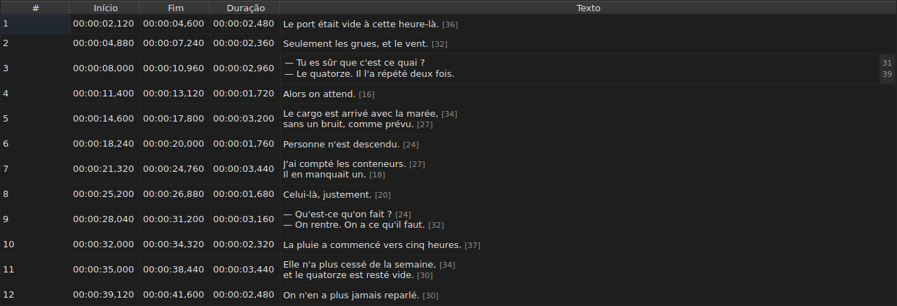

# Editar uma célula

<!-- machine-translated -->
> Esta página é uma tradução automática e ainda não foi revisada por um leitor do idioma.

Quatro colunas são editadas no próprio lugar: `Start`, `End`, `Duration` e `Text` — cinco
com a coluna `Translation`, quando o projeto tem uma tradução. `#` não pode
ser editada — o número é a posição da linha, e não um dado do arquivo.

**Abrir o editor de uma célula:** clicar nela duas vezes, ou selecioná-la
e pressionar `F2`.

## O texto

**A tradução é editada como o texto**, com o mesmo campo de várias linhas e as
mesmas regras; só a célula muda, e o texto principal permanece como
estava. Uma confirmação que não muda nada não faz nada, tanto para um quanto para o
outro — veja [abaixo](#uma-confirmação-que-não-muda-nada-não-faz-nada).

O editor é um campo de **várias linhas**, e abre na altura da legenda:
uma legenda de duas linhas é digitada nele como será escrita, com suas duas linhas
legíveis e sem barra de rolagem. Um `Shift+Enter` que acrescenta uma amplia
o editor; a linha da tabela se ajusta na confirmação.

| Tecla | Efeito |
| :---- | :----- |
| `Enter` | confirma e fecha o editor |
| `Shift+Enter` | insere uma quebra de linha no texto |
| `Esc` | fecha o editor; a célula mantém o que tinha |
| `Tab` | confirma e passa para a próxima célula |

Clicar em outro lugar também confirma: perder o foco equivale a um `Enter`.

**Onze gestos sem caixa de diálogo confirmam do mesmo modo** antes de calcular seu alvo:
`Italic`, `Maiúsculas/minúsculas ▸ …`, `Dialogue`, `Merge Subtitles`, `Split Subtitle`,
`Cut Texts`, `Paste Texts`, `Copy Texts`, `Remove Subtitles`, `Undo` e `Redo`.
Acionados pelo menu, pela barra de ferramentas ou por um atalho da janela, eles
tomam o texto como o editor acabou de confirmá-lo, como após um clique
em outro lugar. `Ctrl+X`, `Ctrl+C` e `Ctrl+V` continuam, no entanto, com o editor enquanto
ele estiver aberto — veja [Recortar, copiar e colar](clipboard.md): é então o
menu que aciona `Cut Texts`, `Copy Texts` e `Paste Texts`.

`Undo` e `Redo` leem o histórico e não o documento: veja
[Desfazer e refazer](undo.md). Um gesto que abre uma caixa de diálogo não
precisa desta regra, pois a caixa de diálogo toma o foco ao abrir, o que
já confirma a entrada.

### As marcações são as do arquivo

O texto mostrado e digitado é **o do arquivo, marcações incluídas**: um
`<i>…</i>` de um SubRip é escrito assim, e um `{\i1}…{\i0}` de um Advanced SSA
também. Nada é traduzido para a exibição — a tabela de
[`Italic`](operations.md#italic) diz o que cada formato escreve.

Para o itálico, portanto, não há nada a saber: `Ctrl+I` define a marcação certa
para o documento aberto, e um formato que não tem nenhuma — TMPlayer, LRC —
desativa a entrada em vez de deixar o usuário procurar. Negrito e sublinhado são
digitados, como no Gaupol.

**E as marcações não acompanham as operações de texto**: pôr uma legenda
em minúsculas não transforma seu `<I>` em `<i>`, e um travessão de diálogo é
colocado antes do texto e não antes de uma marcação de abertura. Veja
[`Case` e `Dialogue`](operations.md#case-e-dialogue).

## O comprimento das linhas

**O editor de texto mostra, numa margem à direita, o comprimento de cada
linha**, alinhado à primeira linha visual dela. A margem tem a largura
do maior número, é atualizada **enquanto se digita**, e acompanha a rolagem.
Um texto vazio não mostra nada. Os comprimentos são os da tabela — sem as
marcações, arredondados para baixo, na unidade definida — e são removidos com a
caixa de seleção `Show line lengths in the editor` de `Editar ▸ Preferências…`. Veja
[Comprimentos de linha](preferences.md#comprimentos-de-linha).

## O início e o fim

O editor é um campo de uma linha, **restrito à forma de uma marca de tempo**:
ele recusa, durante a digitação, o que nunca poderia ser uma.

As formas aceitas são as que a leitura de um arquivo já aceita:

| Elemento | O que passa |
| :------- | :---------- |
| campos | `MM:SS` ou `HH:MM:SS`, de um a dois dígitos cada |
| decimais | de um a três, depois de uma vírgula ou de um ponto, ou nenhum |
| sinal | um `-` inicial, para uma posição anterior ao início do vídeo |
| limites | minutos e segundos abaixo de 60 |

`00:01:02,500`, `1:02.5` e `-0:01,000` são portanto três entradas válidas.

**Uma entrada que a leitura recusa deixa a célula inalterada.** É o caso
de `00:70:00,000`, cuja forma está certa mas cujos minutos estão fora dos
limites: o editor fecha e nada se moveu. Nenhuma posição é inventada
— errar uma posição é silencioso, nada na tela distingue uma legenda
mal sincronizada de uma bem sincronizada.

Mudar um início ou um fim atualiza a `Duration` imediatamente.

## A duração

**Digitar uma duração move o fim, e nunca o início**: o fim se torna
`Start + Duration`. Mover o início moveria a legenda inteira, o que
é o trabalho de [`Shift Positions…`](operations.md), e a coluna `Start` já
pode ser digitada.

A duração é digitada **na forma de uma marca de tempo**, a que a coluna
exibe, e as formas da tabela acima se aplicam — com uma diferença:

| Elemento | Início, fim | Duração |
| :------- | :---------- | :------ |
| forma | a de uma marca de tempo | a mesma |
| sinal `-` inicial | aceito | **recusado durante a digitação** |

`0:02.5` e `00:00:02,500` são portanto duas entradas válidas de uma duração de dois
segundos e meio; `-0:01,000` não pode ser digitado. Uma duração zero é aceita:
a legenda desaparece então no instante em que aparece.

**Um fim que ultrapassa a legenda seguinte é permitido.** A
sobreposição é colorida na tabela, com sua dica de ferramenta — veja
[A tabela](table.md#as-anomalias) — um aviso, e não uma recusa: pode ser o que
se queria. A [lista de diagnósticos](files.md#os-diagnósticos-de-uma-leitura)
também a traz, e a remove quando ela é corrigida.

**Um fim digitado além do fim do filme não é relatado**, ao contrário de
uma operação do menu `Tools` que o empurraria até lá — veja
[As operações](operations.md#além-do-fim-do-filme). Uma célula já mostra
o valor que acabou de ser digitado.

Uma entrada ilegível deixa a célula inalterada, como para uma posição, e
uma duração idêntica à exibida não entra no histórico.

## Uma confirmação que não muda nada não faz nada

Abrir uma célula, não digitar nada, pressionar `Enter`: nada acontece.
Nenhuma modificação é registrada, e o arquivo continua sendo considerado idêntico ao
do disco.

A comparação é feita sobre a **posição**, e não sobre a cadeia de caracteres: digitar `0:01.0`
numa célula que exibe `00:00:01,000` designa o mesmo instante, e
portanto também não muda nada.

## O que acontece com uma célula editada

Ela **pode ser desfeita** — uma célula, uma entrada. Veja
[Desfazer e refazer](undo.md).

Ela **é salva**, e fechar a janela sem tê-lo feito pede
confirmação. Veja [Abrir e salvar](files.md).
