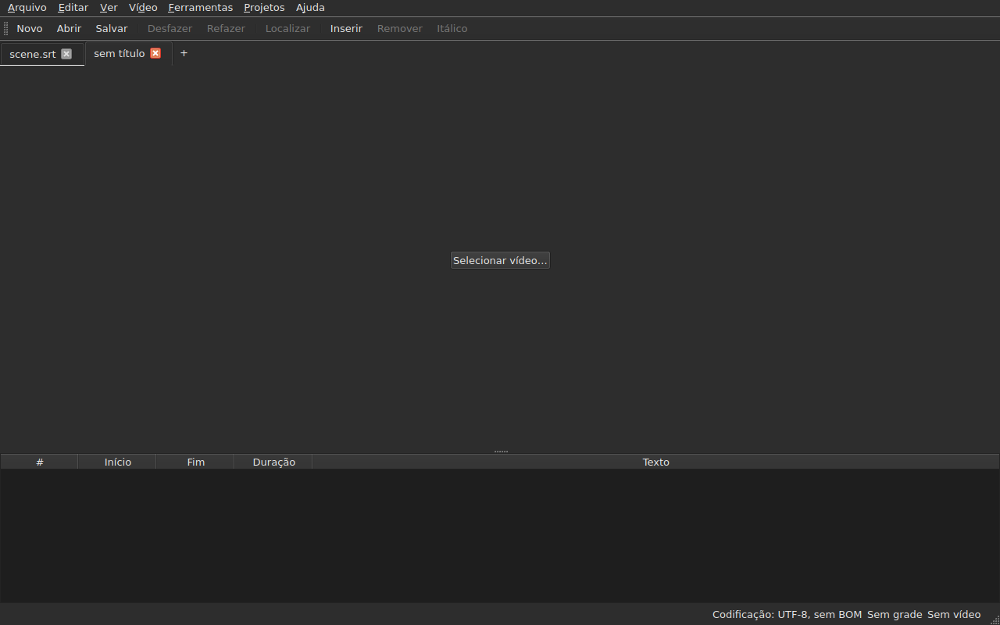
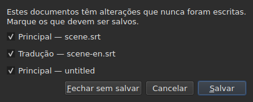
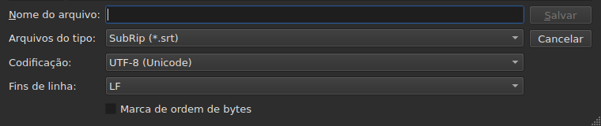
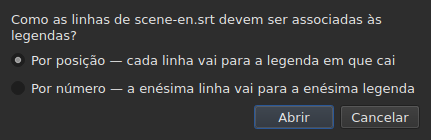
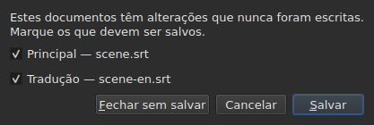

# Abrir e salvar

<!-- machine-translated -->
> Esta página é uma tradução automática e ainda não foi revisada por um leitor do idioma.

O menu **Arquivo** reúne os três comandos, dois para as abas e três
a mais para a tradução; o menu **Projetos** atua sobre todas as abas de uma vez.

| Comando | Atalho | O que faz |
| :------ | :------- | :----------- |
| Novo projeto | `Ctrl+N` | um projeto vazio, em uma nova aba — também o botão `+` após a última aba |
| Abrir… | `Ctrl+O` | escolhe um arquivo e o abre em uma nova aba — ou no lugar de um projeto em branco |
| Abrir tradução… | — | escolhe um arquivo de tradução e o alinha ao arquivo principal da aba atual |
| Salvar | `Ctrl+S` | reescreve o arquivo aberto |
| Salvar como… | `Ctrl+Shift+S` | escolhe um caminho e um formato, depois escreve |
| Salvar tradução | — | reescreve o arquivo da tradução |
| Salvar tradução como… | — | escolhe um caminho e um formato para a tradução, depois escreve |
| Fechar | `Ctrl+W` | fecha a aba atual — desativado se houver apenas uma |

`New Project`, `Open…` e `Save` também estão na
[barra de ferramentas](index.md#a-barra-de-ferramentas), sob as palavras `New`, `Open` e
`Save`. **As três entradas da
tradução não estão na barra**: servem apenas a quem tem uma
tradução, e a barra é de todos.

## Vários projetos, em abas

**Cada projeto aberto tem sua aba**, acima da imagem e da tabela:
seu rótulo é o nome do arquivo, ou `untitled` para um projeto que ainda não
tem nenhum. Clicar em uma aba muda para ela; `Ctrl+PageDown` e `Ctrl+PageUp` fazem
o mesmo, sem o mouse, e voltam à primeira aba depois da última.
**O botão `+`, logo após a última aba**, abre um projeto vazio em uma
nova aba, como `New Project`.




**`Open…` nunca mexe nelas.** Abrir um arquivo não substitui mais o que a
janela mostrava: ele chega em uma nova aba, ao lado, e a aba que se
olhava antes conserva tudo o que tinha — seu histórico, sua seleção, seu
vídeo associado. É também por isso que abrir não pergunta mais nada: não há
nada a perder, já que não há nada a substituir.

**Uma exceção: o projeto em branco cede seu lugar.** Iniciada sem arquivo, ou
depois de `New Project`, a janela mostra um projeto `untitled` sem nada dentro.
Um arquivo aberto — por `Open…` ou por um arraste — **ocupa então sua aba,
no mesmo lugar da barra**, em vez de abrir outra ao lado de um projeto
inútil. Um projeto está em branco quando não tem **nenhum arquivo, nenhuma legenda,
nada a desfazer ou refazer, nenhum filme, e nunca foi modificado**: basta
uma dessas coisas para que ele conserve sua aba. Um projeto em branco que não é
a aba atual não é tocado.

**Um arquivo já aberto não é aberto uma segunda vez.** `Open…` sobre um
arquivo que outra aba já mantém devolve o foco a essa aba, e o diz
na barra de status:

```text
premier.srt: already open
```

**Cada aba é um projeto inteiro, independente das outras**: seu
histórico, sua seleção, seu vídeo associado e o que sua última leitura
encontrou só são mostrados quando essa aba é a atual, e não
mudam enquanto outra o é. **Uma exceção, e ela está na ADR
0033**: o reprodutor de vídeo é único para toda a janela — um único processo
mpv — e seu filme muda com a aba; **cada aba lembra onde estava seu filme**,
e o retoma ali, em pausa, quando se volta a ela. A área de transferência, por sua vez, pertence à janela: copiar
em uma aba e colar em outra é o motivo para abrir duas.

**`Close` fecha a aba atual**, fazendo se necessário
[a pergunta sobre as alterações não salvas](#alterações-não-salvas) —
a desta aba apenas, sem que as outras estejam envolvidas. **Desativado quando
há apenas uma aba**: a janela sempre mantém ao menos uma, e fechá-la
seria fechar a janela — o que o botão do sistema já faz.

**Cada aba também traz uma cruz**, que fecha **o seu** projeto, com a mesma
pergunta. A cruz de uma aba que não é a atual fecha essa, e a aba que se
está olhando continua exibida; se esse projeto tem alterações, sua
aba passa para a frente durante a pergunta. **Nenhuma cruz quando resta
só uma aba**, pela mesma razão que `Close` é desativado.

**Uma aba diz que está modificada**: um asterisco segue seu nome, `premier.srt*`,
enquanto um de seus documentos difere de seu arquivo — como o título da janela
diz do projeto que se está olhando. Ele desaparece ao salvar.

## O menu Projetos

Dois comandos atuam sobre todos os projetos de uma vez.

| Comando | Atalho | O que faz |
| :------ | :------- | :----------- |
| Salvar tudo | `Ctrl+Shift+L` | escreve cada documento modificado, aba por aba |
| Fechar todos | `Ctrl+Shift+W` | fecha todos os projetos — isto é, a janela |

**`Save All` segue a ordem das abas**, o documento principal antes da tradução.
Um documento que tem arquivo é reescrito ali **sem que sua aba passe para a frente**;
**um documento que não tem nenhum abre `Save As…`, um de cada vez**, em sua aba —
o único caso em que `Save All` muda de aba, para que a caixa mostre de qual
projeto se trata. **Cancelar um `Save As…`, ou um
salvamento que falha, interrompe o restante**: os projetos seguintes não são
tocados, e uma caixa diz o que foi escrito.

```text
Save All stopped: 1 of 3 documents saved
```

Quando tudo está escrito, a barra de status o diz — `2 documents saved`, ou
`Nothing to save` quando nada estava modificado. Se um `Save As…` trouxe
uma aba para a frente, a janela volta então àquela em que o comando foi
iniciado.

**`Close All` e a cruz da janela são uma só e mesma coisa**: a janela
sempre mantém um projeto, e fechar todos é fechá-la. Eles fazem portanto
**uma única pergunta para todos os projetos**, a mesma que com
[dois documentos modificados](#fechar-com-dois-documentos-modificados), com uma caixa de seleção
por documento modificado de cada aba:




**`Cancel` não fecha nada**, e não deixa nada escrito. `Save` escreve os
documentos marcados como `Save All`: por trás de sua aba, exceto um documento sem
nome, cuja aba passa para a frente para seu `Save As…`. Com um único documento
modificado em todos os projetos, é a pergunta simples que sempre
existiu, feita em sua aba. `Save All As…` não existe: é uma sequência de
`Save As…`, que `Save All` já pede, um de cada vez, para os documentos sem nome.

## Abertura

A caixa de diálogo filtra **os nove formatos lidos**, uma entrada cada, e uma primeira
entrada que os mostra todos. O formato é então reconhecido **pelo conteúdo, não pela
extensão**: um `.txt` que contém SubRip abre, e o filtro não decide
nada — apenas oculta arquivos.

| Entrada do filtro | Extensão |
| :----------- | :-------- |
| `SubRip` | `.srt` |
| `WebVTT` | `.vtt` |
| `SubViewer 2` | `.sub` |
| `Sub Station Alpha` | `.ssa` |
| `Advanced SSA` | `.ass` |
| `MicroDVD` | `.sub` |
| `MPL2` | `.txt` |
| `TMPlayer` | `.txt` |
| `LRC` | `.lrc` |

**Duas extensões designam dois formatos cada** — `.sub` é SubViewer 2 e
MicroDVD, `.txt` é MPL2 e TMPlayer. Isso não tem consequência ao abrir,
já que o conteúdo decide; ao salvar, é o **nome** da
entrada escolhida que dá o formato, nunca o seu padrão.

**Um arquivo ilegível não abre nada.** Ausente, recusado pelo sistema, escrito
em uma codificação sob a qual seus bytes não se decodificam, ou de nenhum formato
conhecido: uma caixa modal **nomeia a causa**, nenhuma aba é aberta, e as que
existiam não se movem.

| Mensagem | O que aconteceu |
| :------ | :------------ |
| `does not exist` | o caminho não designa nenhum arquivo |
| `cannot be opened: permission denied` | o sistema se recusa a abri-lo |
| `cannot be read` | o sistema recusou por outro motivo |
| `cannot be decoded in the chosen encoding` | os bytes não se leem na codificação adotada |
| `is in no format this tool knows` | nenhum formato reconhece o conteúdo |
| `holds nothing recognisable as a subtitle` | o formato é reconhecido, mas nada nele é uma legenda |

A mensagem é precedida pelo caminho: `notes.txt: is in no format this tool knows`.
São as palavras da linha de comando, e não é por acaso — as duas
superfícies leem um arquivo pela mesma receita.

### Soltar arquivos na janela

**Soltar arquivos em qualquer lugar da janela os abre**, a partir do
gerenciador de arquivos: a tabela, a barra de abas, o botão
`Select Video…`, e **a própria imagem do filme**, em reprodução ou parada.
A imagem é uma janela separada desenhada pelo reprodutor, da qual nada garantia
que repassasse um arraste; isso foi verificado à mão em uma área de trabalho real,
em uma sessão Wayland. O `subedit-gui` é iniciado ali sob X11 para poder mostrar
o filme, de modo que o arraste passa pelo protocolo X11 — o de uma
sessão X11, onde não foi testado separadamente.

- **Cada arquivo de legendas abre sua aba**, na ordem em que foram
  soltos — exatamente como `Open…`. Um arquivo **já aberto** não é
  lido de novo: sua aba passa para a frente, e a barra de status o diz
  (`premier.srt: already open`).
- **Um vídeo solto é associado à aba atual**, como por
  `Select Video…`. Solto junto com legendas, vai para a última aba
  que elas abriram, qualquer que seja a ordem do arraste. Um vídeo é reconhecido por
  sua extensão — a mesma lista da que propõe um filme ao lado do
  arquivo.
- **Dois vídeos ou mais de uma vez não são abertos**: um projeto observa um
  único filme. As legendas do mesmo arraste, por sua vez, abrem.
- **Um arquivo que não abre não interrompe os outros.** Uma única caixa diz então
  o que não pôde ser feito, uma linha por arquivo, com as palavras
  de `Open…`:

  ```text
  /films/notes.txt: is in no format this tool knows
  /films/absent.srt: does not exist
  ```

Apenas arquivos locais são aceitos: um link arrastado de um navegador
não designa nada que a janela possa ler.

Abrir pela linha de comando continua funcionando: `subedit-gui film.srt`.
Ali, a mesma razão é escrita no fluxo de erro, e a janela abre
vazia — veja [Invocação](invocation.md#quando-a-abertura-falha).

## Os diagnósticos de uma leitura

Um arquivo real raramente é perfeito, e a leitura se recupera em vez de
desistir: um número ausente, uma linha que não leva a lugar nenhum, finais de linha
misturados. **O que ela encontrou cabe em um botão da barra de status**
— `2 diagnostics`, à esquerda do que a barra já diz sobre o documento —, e **a lista abre com um clique
em uma janela flutuante** acima do botão. Nenhuma linha da janela é tomada por ela:
a tabela conserva toda a sua altura, quer a leitura tenha algo a dizer ou não. A lista
fecha com um clique em outro lugar ou com `Esc`.

```
a SubRip block without its number, settled by the reader: 5
```

**Cada linha conta**: o que foi encontrado, o que foi feito a respeito e
quantas vezes. Um arquivo mal feito encontra centenas, e saber
quantas de cada tipo é o que permite agir; o número da linha de cada ocorrência no
arquivo, por sua vez, é lido na linha de comando, no nível de detalhamento `-vvv`. O
botão conta essas linhas — uma por tipo —, não as ocorrências.

**A codificação deduzida aparece ali também**, uma vez: ela foi proposta pesando os
bytes, antes de existir uma única linha do arquivo.

```
an encoding nothing declared, settled by the reader: 1
```

Ela só é exibida quando a codificação foi **deduzida e não é
UTF-8** — um arquivo UTF-8 lido como tal não é um evento, e dizê-lo a
cada abertura poria um botão na barra de status de todo documento
comum. Um arquivo que traz uma marca de ordem de bytes também não a
dispara: ele declarou sua codificação, nada foi deduzido.

**A mesma lista conta também o que está errado nas próprias legendas**: uma
legenda que começa antes que a anterior tenha terminado, um fim antes de seu
início, um início antes do da legenda acima. A tabela as colore, mas
uma cor se encontra rolando, e em um arquivo de duas mil linhas
uma passa facilmente despercebida; aqui os tipos estão todos juntos, **um por
linha e com seu número**, nas palavras do relatório de `inspect`:

```
subtitle starts before the previous one ends: 12
subtitle starts before the previous one starts: 3
```

**Um clique em uma delas leva à primeira legenda envolvida**, selecionada na
tabela. Essas linhas **acompanham as correções** — ordenar ou corrigir uma duração
remove algumas, ou reduz seu número —, sem fechar a lista que se
está lendo. Uma legenda pode ser contada duas vezes: começar antes do fim da
anterior e antes de seu início são duas constatações, corrigidas de duas
maneiras. Para nomeá-las uma a uma, `subedit-cli inspect --detail`.

O botão **não aparece** quando não há nada a relatar, nem na leitura nem
nas legendas, e **ele acompanha a aba**: cada projeto conserva os
diagnósticos de sua própria leitura, e o botão mostra os do projeto exibido.

## A codificação na barra de status

**A barra de status sempre indica a codificação do documento aberto**, à esquerda do que
ela diz sobre a [grade de quadros](frame-grid.md) e o
[vídeo associado](video.md):

| Situação | O que é escrito |
| :-------- | :-------------- |
| o arquivo foi lido como UTF-8, sem marca | `Encoding: UTF-8, no BOM` |
| … com marca | `Encoding: UTF-8, BOM` |
| um arquivo em Latin-1 | `Encoding: ISO-8859-1, no BOM` |

**O diagnóstico e esta linha não respondem à mesma pergunta**, e é por isso
que ambos existem. O diagnóstico diz o que a leitura **fez** — ela
deduziu, e talvez se queira conferir; ele só é portanto exibido quando
houve dedução. A barra de status diz o que o documento **é**,
permanentemente, inclusive para um arquivo que declara ele mesmo sua codificação e sobre o
qual a leitura não tem nada a dizer.

**De onde vem a resposta não aparece ali.** `inspect` a dá — `detected`,
`from its byte order mark`, `as asked for` — porque um relatório tem espaço para
dizê-lo; uma linha da barra de status não tem, e a lista de diagnósticos já a traz quando
importa.

## Salvar

`Save` reescreve o arquivo aberto **em sua forma original**: seu formato, sua
codificação, seus finais de linha, sua marca de ordem de bytes e seu cabeçalho. Um
arquivo aberto e depois salvo sem modificação não se move um único byte — veja
a garantia exata abaixo.

A escrita é **atômica**: passa por um arquivo temporário renomeado
sobre o original. Um salvamento interrompido em qualquer momento deixa a versão anterior
intacta.

Salvar um documento que nunca esteve em disco equivale a `Save As…`.

**Uma escrita que falha diz isso e não perde nada**: um disco cheio, um
arquivo somente leitura, um diretório ausente — ou **um caractere que a codificação do
arquivo não consegue escrever**, um `ł` em um arquivo Latin-1. A mensagem é
então `holds a character the chosen encoding cannot write`, e nada é
escrito: substituir o caractere por um `?` perderia texto diante dos olhos de quem
acabou de digitá-lo. A mensagem nomeia o arquivo e a razão, a janela conserva
suas modificações, e a marca do título permanece.

## Salvar como

`Save As…` pede um caminho, um formato, **e a forma dos bytes escritos**:
a codificação, os finais de linha, a marca de ordem de bytes. O documento **passa então a viver
ali**: o título muda, `Save` visa o novo arquivo e escreve na forma
escolhida, e o arquivo original permanece como estava.

**Os nove formatos são oferecidos**, e a entrada selecionada quando a caixa
abre é **a do documento**. Salvar com outro nome sem tocar no
filtro, portanto, não muda o formato.




**As imagens mostram apenas a parte inferior da caixa**, não a lista de arquivos
acima: ela depende da máquina — seus diretórios, suas datas, seus
atalhos laterais —, de modo que sua fotografia nunca seria a mesma duas vezes.
Esta faixa é, e é nela que tudo acontece.

| Campo | O que oferece | Padrão |
| :---- | :------------- | :------ |
| `Encoding` | quatorze codificações que um arquivo de legendas traz na prática, mais `Other…` | **a do arquivo lido** |
| `Other…` | um campo para digitar qualquer codificação que o ICU saiba escrever, **com autocompletar** — `cp1257`, `EUC-KR` | — |
| `Line endings` | `LF`, `CRLF` ou `CR` | os do arquivo lido |
| `Byte order mark` | a marca, **desativada para uma codificação que não traz nenhuma** | a do arquivo lido |

**Os padrões são os do arquivo lido, e isso é uma garantia e não uma
comodidade**: um arquivo aberto e salvo de novo sem tocar nesses três
campos devolve os mesmos bytes.

**A lista é curta, e não é um teto.** O ICU conhece duzentas
e vinte e uma; o que o menu oferece é o que um arquivo de legendas traz
na prática, porque um menu de duzentas entradas não ajuda ninguém. `Other…`
abre o restante.

**O campo completa sobre as duzentas e vinte e uma**, então não é preciso
saber o nome exato: digitar `1252` propõe `windows-1252`, digitar `koi`
propõe `KOI8-R` e `KOI8-U`. A completação age sobre o que o nome **contém**
e não sobre o que ele começa — o nome canônico do Windows Western é
`windows-1252`, e `cp1252` é o que as pessoas têm em mente. Ambos podem
também ser escritos por extenso sem completação: o ICU aceita seus próprios apelidos.

**Um nome que ninguém conhece não escreve nada.** Digitar `klingon-1` não
recai sobre UTF-8: nada é escrito, e a mensagem o diz.

**Um nome que não declara sua ordem de bytes também não.** `UTF-16` e `UTF-32` são
nomes que o ICU conhece, cujo conversor escreve **sua própria marca**: a
caixa de seleção `Byte order mark` deixaria então de decidir qualquer coisa. Ambos
são recusados, e a mensagem aponta `UTF-16LE` ou `UTF-16BE`, que escrevem
os mesmos bytes sob o controle da caixa de seleção. É a mesma recusa, com as
mesmas palavras, que a da linha de comando.

**Um caractere que a codificação escolhida não consegue escrever interrompe o salvamento**
— um `ł` em Latin-1. A mensagem é
`holds a character the chosen encoding cannot write`, a janela conserva suas
modificações, e o arquivo de destino não é tocado.

**O documento também não se move**: ele permanece em seu arquivo, em seu
formato e sua codificação, e o próximo `Save` reescreve o que foi aberto.
Um salvamento que não aconteceu não muda absolutamente nada — nem em disco,
nem na janela.

Mudar de formato muda o que a tabela mostra — o separador decimal segue o
formato, vírgula para SubRip, ponto para WebVTT, e **as marcações são reescritas
no vocabulário do formato de destino**: um `<i>` torna-se `{\i1}` em Sub
Station Alpha, `{Y:i}` em MicroDVD, `/` no início de uma linha em MPL2. O documento
**tornou-se** esse arquivo, então a tabela mostra o que o arquivo traz.

**Não é um comando, e `Ctrl+Z` não o desfaz.** Um documento cujo
formato dissesse LRC e cujos textos ainda dissessem `<i>` seria um documento
incoerente; não há metade a desfazer.

## O que um formato não preservará, dito antes de escrever

**Uma caixa modal avisa, e ainda se pode responder não.** Ela lista o que o
formato de destino não manterá, item por item, nas palavras que a linha de
comando escreve depois:

```
ends are not carried by LRC, line breaks were joined in 2 subtitles, 1 tag dropped
```

| Botão | Efeito |
| :----- | :----- |
| `Save` | escreve mesmo assim, a perda aceita |
| `Cancel` | não escreve nada; o documento não se move, nem arquivo nem formato |

`Cancel` é o botão padrão: um Enter pressionado sem ler mantém o
arquivo como está.

**Nada é perguntado quando nada se perde.** Uma caixa que anunciasse “nada
será perdido” ensinaria a descartar a que importa.

O que pode ser anunciado:

| Item | Quando |
| :--- | :--- |
| os fins | o formato de destino não traz nenhum — TMPlayer, LRC |
| as quebras de linha | o formato de destino não traz nenhuma — LRC |
| as marcações | uma marcação da origem não tem equivalente no destino, ou o pivô não a conhece |
| o cabeçalho | o arquivo lido trazia um, e ele não passa para o outro formato |
| os campos declarados | a ordem das colunas SSA, a forma do tempo do TMPlayer |
| a precisão | o formato de destino conta de modo mais grosseiro — o décimo do MPL2, o segundo do TMPlayer |

**O que pertence ao outro formato é deixado de lado.** Um arquivo WebVTT
traz identificadores de cue e parâmetros de posicionamento; o SubRip traz coordenadas
de exibição. Escrever no outro formato os ignora em vez de
traduzi-los ao acaso — nem por isso estão perdidos, simplesmente
não são escritos.

## A garantia de ida e volta

Ela tem duas metades, e ambas são necessárias:

- **fiel byte a byte** em um arquivo que já está na disposição que o
  `subedit` escreve — a do Gaupol, linha vazia final inclusive —, e **seja qual for
  sua codificação**: um arquivo em CP1252 ou em UTF-16 é reescrito na
  sua própria, marca inclusive;
- **idempotente** nos demais casos: o primeiro salvamento normaliza a disposição,
  nenhum depois dele toca mais em nada.

Concretamente, um arquivo cujo último bloco não é seguido de uma linha vazia
ganha uma, uma vez. É a única mudança que um salvamento sem
modificação pode produzir.

## Abrir uma tradução

`Arquivo ▸ Abrir tradução…` define um **segundo arquivo** ao lado do principal.
A entrada fica desativada enquanto não houver legenda a que dar as linhas da
tradução.

**Duas perguntas, uma depois da outra.** O seletor de arquivos, o de
`Open…` — mesmo filtro, mesma pasta inicial, a codificação reconhecida como para o
arquivo principal — depois **o método de alinhamento**:




| Método | O que faz |
| :----- | :----------- |
| `By position` (padrão) | cada linha vai para a legenda onde cai seu meio |
| `By number` | a enésima linha vai para a enésima legenda, sem olhar as posições |

**A posição é o padrão**, porque uma única linha ausente no meio faz
*todas* as seguintes deslizarem por número, enquanto por posição uma única
legenda fica sem tradução.

**O que é feito, o que é escrito:**

- os textos das linhas ligadas entram na coluna `Translation`, que
  aparece;
- **uma linha que não encontra legenda dá origem a uma**, com **as
  posições dessa linha** — por qualquer dos métodos;
- **nada é ordenado**, nem o arquivo nem o documento: as linhas são percorridas
  em ordem temporal, e a contagem das que não estavam nela é dada;
- **uma tradução já aberta é substituída**, todos os seus textos apagados antes.

**O que aconteceu é dito.** Quando cada linha encontrou sua legenda e
nenhuma ficou sozinha, a barra de status o escreve; caso contrário, **uma caixa a fechar**,
como para qualquer gesto que tenha algo a dizer:

```text
translation: 3 lines attached
translation: 2 lines attached; 1 subtitle left without a translation
translation: 3 lines attached; 1 subtitle born of a line; 2 lines out of order
```

Os itens só são escritos se não forem zero: as linhas ligadas, as
legendas nascidas de uma linha, as que nenhuma linha alcançou, as linhas
fora de ordem. Um arquivo sem nenhuma linha diz isso
(`translation: the file holds no line`) em vez de culpar as
legendas por isso.

**Uma tradução deslocada é reconhecida, e reaberta deslocada.** Uma tradução temporizada dois
segundos atrasada alinha-se às legendas erradas sem que nada a distinga de uma
ligação correta. Quando a abertura **por posição** não é limpa, a janela procura
**um deslocamento constante**: as diferenças entre o início de cada linha e o das legendas
vizinhas dão candidatos, agrupados em intervalos de dez milissegundos, e **cada
um é julgado pela própria ligação da abertura**. Se um único deslocamento torna a abertura
limpa, a caixa o diz depois de sua contagem e **propõe reabrir deslocada**:

```text
translation: 4 subtitles born of a line; 4 subtitles left without a translation
the lines sit 2.000 s later than the subtitles; moved back, 4 lines would attach instead of 0
```

`Yes` desfaz a abertura e a refaz com as linhas trazidas de volta por esse deslocamento; `No`, a
resposta padrão, deixa a abertura como está. **O resultado é uma única entrada
de histórico**: desfazê-la devolve tudo, como para qualquer abertura.

**Nada é proposto quando o deslocamento não é constante** — uma deriva, um deslocamento que
atinge apenas parte do arquivo —, quando dois deslocamentos tornariam a abertura igualmente
limpa, ou quando nenhum a torna limpa: a frase então não diz que existe um. Nem
por número, onde as posições não são consideradas. Não há **linha de comando** para
isso.

**Abrir uma tradução é uma única entrada de histórico**, `Undo: opening a translation`,
e desfazê-la devolve tudo: os textos, as legendas nascidas removidas,
o arquivo da tradução desligado — a coluna desaparece junto. Para abri-la pelo
outro método, desfaz-se primeiro.

**A tradução recém-aberta não está modificada**: nada foi digitado, e
fechá-la não propõe salvá-la. Se legendas nasceram, é o
documento principal que está modificado.

**Uma tradução modificada é oferecida para salvamento antes de ser
substituída**, com os três desfechos da seção sobre
[alterações não salvas](#alterações-não-salvas).

| Mensagem | O que aconteceu |
| :------ | :------------ |
| `the file is already open as the main document` | o arquivo escolhido é o próprio documento principal, seja como for escrito seu caminho |
| `does not exist`, `cannot be decoded in the chosen encoding`, … | as mesmas causas que para `Open…` |

A mensagem é precedida pelo caminho, e **nada muda**: a janela conserva seu
histórico e suas modificações.

**Os problemas que a leitura encontrou**, se houver — uma linha reparada,
um campo ignorado —, vão para a lista de diagnósticos, a da
[última leitura](#os-diagnósticos-de-uma-leitura).

**O que a tradução não conserva**: as configurações **por legenda** de seu
arquivo — um estilo SSA, a posição de uma legenda WebVTT. Uma legenda
traz apenas um conjunto, o do documento principal; elas não são lidas de volta nem reescritas.

## Salvar a tradução

**Cada documento é salvo separadamente**, em seu arquivo, seu formato, sua
codificação e seus finais de linha: uma tradução em `.ass` sob um arquivo principal em
`.srt`, em Windows-1252 sob um arquivo principal em UTF-8, volta como estava.

| Entrada | O que faz |
| :---- | :----------- |
| `Save Translation` | reescreve o arquivo da tradução — aquele de onde ela vem |
| `Save Translation As…` | o seletor de `Save As…`, aberto sobre o arquivo **da tradução**, com seu formato e sua codificação |

Ambas ficam **desativadas enquanto o projeto não tiver tradução**.
`Save Translation As…` é `Save As…` sobre o outro documento: mesmos campos, mesmo
[aviso de perda](#o-que-um-formato-não-preservará-dito-antes-de-escrever), que
conta **o que o arquivo escrito perderia** — as marcações do texto principal
não são as da tradução, e um formato que não escreve itálico
só reclama disso se a tradução tiver algum.

**Cada documento tem seu próprio estado de modificação.** Salvar o documento principal deixa a
tradução modificada, e o inverso; **o título da janela fica modificado se um dos
dois estiver**, e tem apenas um asterisco.

**Nada de um toca no outro**: salvar a tradução não escreve o
documento principal, e não muda nem seu arquivo, nem seu formato, nem seus textos.

## Fechar com dois documentos modificados

Fechar a aba atual, ou a janela, enquanto **dois documentos** ou mais
diferem de seus arquivos faz **uma única pergunta**, uma caixa de seleção por
documento:




| Botão | O que acontece |
| :----- | :----------- |
| `Save` | escreve os documentos cuja caixa de seleção está marcada, depois prossegue — desativado quando nenhuma está |
| `Close Without Saving` | perde ambos, sejam quais forem as caixas de seleção |
| `Cancel` | nada acontece; a janela fica como estava |

**Desmarcar um documento significa perdê-lo**: `Save` escreve os outros e
prossegue. **Se um salvamento falha, a ação não continua.** Fechar a
caixa sem responder vale `Cancel`.

**Com um único documento modificado, a pergunta é a que sempre existiu**,
descrita abaixo, e a frase diz qual: `The translation has changes that were never written.`
ou `The document has …`.

**Um arquivo que sumiu do disco conta como modificado**, e a lista o diz —
`(file is gone from the disk)`: o que a janela mantém é então **a única
cópia**, e fechar sem escrever a destruiria. Com um único documento nesse caso,
a frase é `The document is no longer where it was read from.`

## Alterações não salvas

Fechar a janela, a aba atual, ou abrir uma tradução que substituiria
a já presente, enquanto o documento difere do que está em disco, **pede
confirmação**, com três desfechos:

| Resposta | O que acontece |
| :----- | :----------- |
| `Save` | o documento é escrito, depois a ação prossegue |
| `Discard` | as modificações são perdidas, e a ação prossegue |
| `Cancel` | nada acontece; a janela fica como estava |

Fechar a caixa sem responder vale `Cancel`.

**Se o salvamento falha**, a ação não prossegue: o trabalho não é nem
escrito nem perdido.
