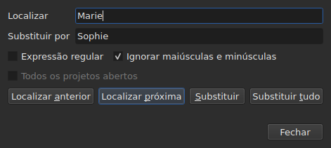
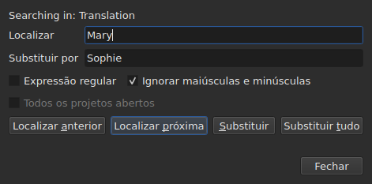

# Localizar e substituir

<!-- machine-translated -->
> Esta página é uma tradução automática e ainda não foi revisada por um leitor do idioma.

`Editar ▸ Localizar e substituir…`, ou `Ctrl+F`, abre a caixa de diálogo de pesquisa.




**A caixa de diálogo não é modal**: permanece aberta enquanto se olha a tabela,
se edita uma célula, se pesquisa de novo. `Close` a fecha; reabri-la
a devolve como foi deixada, padrão e substituição inclusive.

| Campo | O que contém |
| :---- | :----------- |
| `Find` | o padrão pesquisado |
| `Replace with` | o que o substitui |
| `Regular expression` | o padrão é uma expressão regular em vez de texto simples |
| `Ignore case` | “marie” encontra “Marie” |
| `All open projects` | a pesquisa percorre todas as abas — [veja abaixo](#em-todos-os-projetos-abertos) |

O item fica desativado em um documento vazio: não há nada a pesquisar.

## Os quatro gestos

| Botão | O que faz |
| :---- | :-------- |
| `Find Previous` | encontra a correspondência anterior, e a tabela vai até ela |
| `Find Next` | encontra a seguinte — é o botão que `Enter` pressiona |
| `Replace` | substitui a correspondência encontrada e depois encontra a seguinte |
| `Replace All` | substitui todas as do alvo |

Os quatro ficam desativados enquanto `Find` estiver vazio.

**A tabela vai até a correspondência** selecionando sua linha. Chegando à
última, `Find Next` recomeça da primeira; `Find Previous` faz o mesmo no
outro sentido.

**`Replace` sem correspondência encontrada pesquisa primeiro**: o primeiro clique
mostra o que vai ser substituído, o seguinte o substitui. É o que o
Gaupol faz.

## O que a pesquisa abrange

**A seleção, ou o documento inteiro se nada estiver selecionado** — a regra do
menu `Tools`. Veja [As operações](operations.md#sobre-o-que-atuam).

**O alvo é tomado no primeiro gesto e mantido** enquanto a pesquisa
continuar: `Find Next` seleciona a linha de uma correspondência, e essa
seleção não reduz o alvo. **Selecionar outras linhas por conta própria
muda o alvo** para o gesto seguinte.

A pesquisa abrange o texto das legendas; nem as posições nem o número
são pesquisados.

### Em todos os projetos abertos

A caixa de seleção **`All open projects`** amplia o escopo a todas as abas. **Desativada com
um único projeto aberto** — não há nada a ampliar —, ela é ativada assim que uma
segunda aba é aberta, e se desmarca sozinha quando resta apenas uma.

**Marcada, a seleção deixa de contar**: cada projeto é pesquisado por inteiro,
no **documento visado** — o da coluna atual, o principal ou a
tradução, como em um único projeto.

- **`Find Next` e `Find Previous` vão de aba em aba, na ordem das
  abas.** Primeiro o projeto exibido; quando ele não tem mais correspondências, o
  seguinte, cuja aba a janela exibe e cuja linha ela seleciona.
- **A volta termina onde começou**: quando a pesquisa ultrapassa a última
  aba para voltar à primeira — ou o inverso, ao subir —, a linha da caixa de diálogo
  o diz, em vez de recomeçar sem uma palavra:

  ```text
  Search wrapped around
  ```

  O passo seguinte é um passo comum, e a linha se apaga.
- **`Replace` substitui onde a pesquisa está**, depois passa para a seguinte
  correspondência, que pode estar em outra aba.
- **`Replace All` percorre todos os projetos**, e **faz uma entrada de histórico
  por projeto tocado**: desfazer em uma aba desfaz apenas o que essa aba
  recebeu. A contagem diz quantos projetos mudaram, e não apenas quantas
  substituições foram feitas:

  ```text
  replaced 4 matches in 3 projects
  ```

  Um projeto em que o padrão está ausente não é tocado, e não tem nada a desfazer.
  **Nenhuma aba vem para a frente**: cada projeto recebe suas substituições
  atrás de sua aba, que ganha seu asterisco, e a aba de onde o gesto
  partiu continua exibida, com seu filme.

### Em qual texto

**Com uma tradução, a pesquisa abrange apenas um dos dois textos: o da
coluna da célula atual** — a tradução se a célula atual está
na coluna `Translation`, o texto principal em todos os outros casos. É a
regra de todas as operações de texto, e não há configuração adicional:
veja [O texto sobre o qual as operações atuam](table.md#o-texto-sobre-o-qual-as-operações-atuam).

**A caixa de diálogo diz em qual texto pesquisa**, em uma linha acima de
`Find`, e a altera quando a coluna atual muda — mesmo com ela aberta:




| A célula atual está em | A linha diz |
| :--------------------- | :---------- |
| a coluna `Translation` | `Searching in: Translation` |
| qualquer outra coluna | `Searching in: Main` |
| — o projeto não tem tradução, ou a coluna foi removida | nada: a linha não existe |

**Substituir escreve nesse texto, e somente nele.** `Replace` e `Replace
All` na tradução deixam o texto principal como estava, e
o inverso; `Undo` devolve o que escreveram. **As marcações são as do formato
do arquivo desse texto**: uma tradução em Advanced SSA é lida com seus
`{\i1}`, mesmo quando o texto principal é um SubRip. `Replace with` é escrito ali
nas mesmas marcações.

**A tabela permanece na coluna onde estava.** `Find Next` seleciona a linha
de uma correspondência sem mover a célula atual de uma coluna para a outra:
uma pesquisa iniciada na tradução continua na tradução.

**Pesquisar os dois textos ao mesmo tempo não existe**: cada correspondência
seria um par (legenda, texto), e a tabela, indo até ele, não teria
lugar claro aonde ir. Pesquisa-se em um, depois muda-se de coluna.

**O que recomeça do zero**:

| Gesto | O que é esquecido |
| :---- | :---------------- |
| mudar `Find`, `Replace with` ou uma opção | a correspondência atual, e a linha de status |
| selecionar outras linhas por conta própria | o alvo e a correspondência |
| mover a célula atual de um texto para o outro — de `Text` para `Translation`, ou o inverso | a correspondência: é um lugar em um texto |
| abrir outro arquivo | o alvo e a correspondência; a caixa de diálogo permanece aberta, padrão inclusive |

## O texto pesquisado é o texto visível

**Marcações não são texto.** Pesquisar `<i>` não encontra nada, e pesquisar
`Bonjour` encontra um `<i>Bon</i>jour` cortado por uma marcação.

**A substituição é feita no texto do arquivo, sem quebrar as marcações**:

| Texto | Pesquisado → colocado no lugar | O que é escrito |
| :---- | :----------------------------- | :-------------- |
| `<i>Bonjour</i>` | `Bonjour` → `Salut` | `<i>Salut</i>` |
| `<i>Bon</i>jour` | `Bonjour` → `Salut` | `<i>Salut</i>` |
| `<i>Bonjour</i> Marie` | `Bonjour Marie` → `Salut Sophie` | `<i>Salut Sophie</i>` |

Uma marcação que corta uma palavra engloba a palavra inteira, e qualquer estilo que toque a
correspondência cobre a substituição. **As marcações que a correspondência não
toca permanecem onde estão**, mesmo uma que corte outra palavra da mesma
legenda: substituir `Marie` em `<i>Bon</i>jour Marie` dá
`<i>Bon</i>jour Sophie`. Uma palavra é feita de letras e dígitos — um espaço
não separável ou uma aspa não faz parte dela. **`Replace with` é lido nas marcações do
texto visado**: digitar `<b>Salut</b>` ali em um SubRip deixa a palavra em negrito.

## As duas opções

| Opção | Padrão | O que muda |
| :---- | :----- | :--------- |
| `Regular expression` | desmarcada | `.` deixa de procurar um ponto e passa a procurar qualquer caractere |
| `Ignore case` | marcada | maiúsculas e minúsculas não contam, letras acentuadas inclusive: `élise` encontra `Élise` |

Esses são os padrões do Gaupol. **As duas são lembradas** de uma abertura para
a seguinte e de uma sessão para a seguinte, nas opções `search.regex` e
`search.ignore-case` do [arquivo de preferências](preferences.md#o-arquivo).

### Uma expressão regular

O padrão é lido pelo ICU. Como no Gaupol, `.` atravessa uma quebra de linha, e `^`
e `$` valem no início e no fim **de cada linha** de uma legenda:
substituir `^` por `- ` põe um travessão antes de cada linha.

Em `Replace with`, e somente para uma expressão regular:

| Escrito | O que coloca |
| :------ | :----------- |
| `$1` a `$9` | o grupo desse número; um grupo ausente não coloca nada |
| `$0` | a correspondência inteira |
| `\n` | uma quebra de linha |
| `\$`, `\\` | um `$`, uma barra invertida |
| `\` seguida de qualquer outro caractere | esse caractere: `\t` coloca um `t` |

**`\1` não é um grupo**, e coloca um `1`. É a sintaxe do Gaupol, que lê
suas expressões em Python; a daqui é a do ICU, que lê o padrão.

## O que a caixa de diálogo diz

Sob os botões, uma linha diz o que a pesquisa não pôde fazer, ou o que um
`Replace All` fez:

| Situação | O que é exibido |
| :------- | :-------------- |
| nenhuma correspondência no alvo | `"Sophie" not found` |
| uma expressão regular que não é legível | `not a regular expression (U_REGEX_MISMATCHED_PAREN)` |
| `Replace All` substituiu | `replaced 3 matches` |
| `Replace All` encontrou o padrão, mas a substituição não altera nenhum texto | `nothing to change` |

**Uma pesquisa que não encontra nada não toca em nada**: a seleção fica onde
estava, e nada entra no histórico.

**`not found` e `nothing to change` não dizem a mesma coisa.** `not found`
diz que o padrão não está em lugar nenhum do alvo. `nothing to change` diz que ele
está ali, mas a substituição deixa cada texto como estava — substituir
`Marie` por `Marie`, por exemplo. Nos dois casos, nada entra no
histórico. O número de `replaced N matches` conta as correspondências das
legendas cujo texto mudou.

## O que a ação de desfazer diz a respeito

| Gesto | O que `Undo` mostra |
| :---- | :------------------ |
| `Replace` | `Undo: replacing` — uma por substituição |
| `Replace All` | `Undo: replacing all` — **uma única entrada**, seja qual for o número de correspondências |

Veja [Desfazer e refazer](undo.md).
