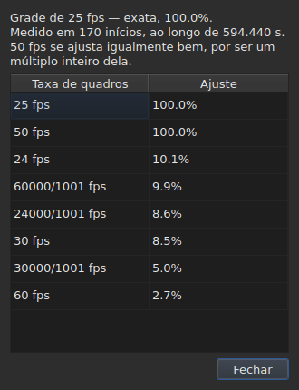

# A grade de quadros

<!-- machine-translated -->
> Esta página é uma tradução automática e ainda não foi revisada por um leitor do idioma.

Um arquivo de legendas **não declara** a taxa de quadros com a qual
suas posições foram calculadas: o SubRip não tem cabeçalho, e o do
WebVTT é texto livre. A janela a **deduz** das próprias posições,
na abertura, e a mostra em dois lugares que não respondem à mesma
pergunta.

| Superfície | O que ela dá |
| :--------- | :----------- |
| a barra de status | **a resposta**, de forma permanente e sem que seja pedida |
| `Ferramentas ▸ Análise da taxa de quadros…` | **o raciocínio**, quando se quer vê-lo |

## O que a barra de status mostra

À direita, entre o que ela diz sobre a
[codificação](files.md#a-codificação-na-barra-de-status) do arquivo lido e o que
diz sobre o [vídeo associado](video.md#o-que-a-barra-de-status-mostra):

| Situação | O que está escrito |
| :------- | :----------------- |
| as posições estão numa grade | `Grid: 24 fps` |
| apenas algumas delas | `Grid: 29.97 fps (partial)` |
| nenhuma grade conhecida se ajusta | `No grid` |

**`No grid` não nomeia nenhuma taxa de quadros, e isso é intencional.** O conjunto de
candidatas é fechado — as oito que a caixa de diálogo de conversão oferece — e
informar a menos errada delas seria dar uma resposta errada onde
“não sei” é a resposta certa.

**`No grid` tem duas causas, e elas não são a mesma resposta.** Ou nenhuma
grade se ajusta, ou o arquivo tem poucas legendas para que se possa dizer
alguma coisa sobre ele — dois inícios sempre parecem perfeitamente alinhados, e isso não prova
nada. A barra de status diz o mesmo nos dois casos;
**a análise os distingue**, e indica, no primeiro caso, por quanto a
melhor candidata falha.

A linha **é atualizada após cada operação**. Alinhar um arquivo a outra
taxa de quadros muda a grade, e a barra de status não deve continuar
anunciando a antiga.

### Um documento contado em quadros não tem grade, tem uma taxa de quadros

**O MicroDVD é o único dos nove que conta em quadros.** Cada uma de suas linhas
traz dois números de quadro e nada mais, e o arquivo **não diz** com que
taxa de quadros lê-los. O mesmo lugar da barra de status escreve então:

| Situação | O que está escrito |
| :------- | :----------------- |
| o documento é contado em quadros | `Frames: 24000/1001 fps` |

**Isso não é a grade, e a grade seria circular aqui.** As posições
de um documento MicroDVD foram calculadas *a partir* de seus quadros com essa mesma
taxa de quadros; deduzir uma grade delas devolveria esse número, isto é, um dado
disfarçado de medição.

**De onde ela vem é dito uma única vez**, pela leitura, na
[lista de diagnósticos](files.md#os-diagnósticos-de-uma-leitura):
`counts in frames and states no rate; it was read at ("24000/1001")`. A linha
da barra de status, por sua vez, diz o que é, de forma permanente.

**Errar a taxa de quadros desloca o arquivo inteiro**, e a caixa de diálogo
[`Convert Frame Rate…`](operations.md#convert-frame-rate) é onde se corrige:
ela abre na taxa de quadros de leitura e diz que é essa.

## O que a análise mostra

`Ferramentas ▸ Análise da taxa de quadros…` **não modifica nada.** Ela abre com um resumo e
a classificação das oito candidatas com sua pontuação.




O resumo dá a resposta, depois o que a qualifica — cada frase aparecendo
somente se tiver algo a dizer:

| O que se pode ler ali | Quando |
| :-------------------- | :----- |
| sobre quantos inícios, e em que intervalo de tempo | sempre |
| quanto o arquivo está deslocado em relação à sua grade | suas posições estão nela, a menos de uma constante |
| que outra taxa de quadros se ajusta tão bem quanto | ela é um múltiplo inteiro da retida |
| que o intervalo não permite distinguir duas taxas de quadros | o arquivo é curto demais para separá-las |
| quantos inícios saem da grade, **e em quantas sequências** | o arquivo é parcial |

**O número de sequências é o que distingue duas histórias** que a
porcentagem sozinha confunde. Muitas sequências de um único início são posições
corrigidas à mão, uma a uma. Poucas sequências longas são um trecho
ressincronizado, ou um arquivo montado a partir de dois outros.

**A classificação completa é mostrada em vez de uma única resposta.** Um arquivo que
se ajusta a 25 a cem por cento e a 50 a cem por cento diz algo que um
veredito sozinho esconderia.

## Quando a conversão estava errada

Um arquivo que não cai em nenhuma grade às vezes é um arquivo **convertido com a taxa de
quadros errada**: ele está então numa grade bem real, mas deslocado por uma razão que não é a de
nenhuma das oito. Quando a dedução retorna `none` ou `partial`, a análise procura **entre os
cinquenta e seis pares ordenados das oito taxas de quadros padrão** — esse é o conjunto, fechado — aquele
cuja conversão devolve as posições a uma grade. Cada razão é aplicada às posições, e
**é a própria dedução que julga o resultado**: a confiança é o que ela diria, nunca um
número inventado. Dois pares que fazem a mesma razão, como 30 para 25 e 60 para 50, são uma única
conversão.

A frase é acrescentada ao resumo:

```text
converting from 24 to 25 fps puts the positions on a 24 fps grid: 99.9%, against 11.8% as they are and 14.9% for the next best conversion
```

Ela indica a conversão, a grade em que as posições cairiam e quão bem elas caem nela,
**depois a diferença em relação às posições como estão e à melhor das outras
conversões.** Um botão `Convert Frame Rate…` fecha a análise e abre [a caixa de diálogo
de conversão](operations.md#convert-frame-rate) **preenchida com o par encontrado** — nada é aplicado
enquanto a caixa de diálogo não for aceita, e cancelar basta para voltar. O vídeo, aberto ao lado,
permite julgar pela imagem se a resposta é a certa.

**Quando dois pares são igualmente bons, nenhum é proposto, e a frase diz isso:**

```text
converting from 30 to 25 fps and converting from 25 to 24 fps fit equally well (99.7% and 99.6%), so none is proposed
```

Este é o caso comum, e não a exceção: uma grade a 28,8 quadros por segundo volta
a 24 tão bem quanto a 30, e um arquivo cujos tempos estão todos dobrados continua na grade de 25.
O gesto que tem um único reparo é converter um arquivo **já** na taxa de quadros de destino. Para
um empate, o vídeo decide: abre-se `Convert Frame Rate…` por conta própria sobre um dos dois pares.

**Nada é dito** sobre um arquivo já numa grade, um arquivo curto demais para que um veredito
valha alguma coisa, nem um arquivo que nenhuma conversão do conjunto devolve a uma grade — uma deriva, uma
razão fora das oito taxas de quadros, posições sem estrutura.

## O que a tabela não mostra

**Nenhuma linha da tabela é marcada por causa da grade**, jamais.

Assim que se corrige uma posição à mão, ela deixa de estar alinhada. Uma
marcação automática relataria portanto o trabalho do usuário como uma
anomalia, num arquivo que ele justamente está corrigindo. A dedução
fala do **documento**, e a análise é a única exceção — porque ela
é aberta para isso.

As marcas da tabela, por sua vez, dizem respeito ao que não se sustenta: um fim
antes do seu início, uma sobreposição, uma ordem quebrada. Veja [A tabela](table.md).
