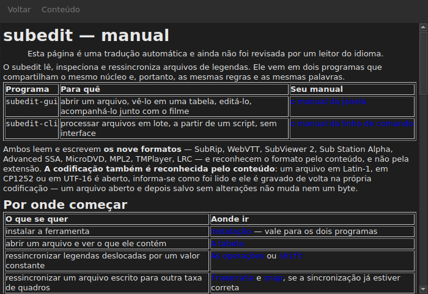

# O manual na janela

<!-- machine-translated -->
> Esta página é uma tradução automática e ainda não foi revisada por um leitor do idioma.

`Ajuda ▸ Manual`, ou `F1`, abre **este mesmo manual** em uma janela própria.




## O que ele abre, e por que não um endereço

**O manual instalado junto ao programa**, e não uma página na internet.

Um endereço descreveria a versão em desenvolvimento, não a que se tem em mãos.
Um usuário que lê o manual de uma versão que não possui fica pior servido do que
um usuário sem manual algum — e por isso a janela lê os arquivos colocados
pela instalação, em `<prefix>/share/subedit/manual`. Veja
[Instalação](../subedit-cli/installation.md).

Ele abre na [página inicial](../index.md), a que diz por onde começar.

## Em qual idioma

**No idioma da janela.** O manual abre no idioma em que a
interface fala: o escolhido em `Editar ▸ Preferências…`, ou o do
ambiente, se nenhum foi escolhido — veja
[O idioma da interface](preferences.md#o-idioma-da-interface).

| A janela fala | O manual abre em |
| :---------------- | :------------------ |
| inglês | inglês |
| um idioma cujo manual está instalado — catalão, tcheco, alemão, espanhol, finlandês, francês, galego, hebraico, húngaro, interlingue, islandês, italiano, holandês, polonês, português, português do Brasil | esse idioma |
| um idioma cujo manual não está instalado | inglês |

**Página por página, não tudo ou nada**: uma página que a tradução não tem
abre em inglês, e todas as outras continuam no idioma da janela. Um
link leva de uma para a outra da mesma maneira.

As traduções são instaladas junto ao manual em inglês, cada uma em um diretório
com o nome de seu idioma: `<prefix>/share/subedit/manual/fr` para o francês. O
idioma é aquele em que a janela foi iniciada, de modo que um idioma escolhido nas
preferências vale também para o manual, na próxima inicialização.

## Navegar

| O que se faz | O que acontece |
| :---------------- | :----------- |
| clicar em um link do manual | a página abre na mesma janela |
| clicar em um link que aponta para uma seção | a página abre, e a janela rola até ela |
| clicar em um link que aponta apenas para uma seção | a janela rola até ela, sem mudar de página |
| `Back` | volta à página anterior; desativado na primeira |
| `Contents` | volta à página inicial; desativado quando já se está nela |

A janela **não é modal**: ela continua aberta enquanto se trabalha, e é esse
todo o sentido de ter o manual à mão. Escolher a entrada de novo não cria uma
segunda janela, apenas traz esta para a frente.

## O que ele não consegue abrir, e diz isso

O manual às vezes se refere ao **roteiro** ou a uma **decisão de
arquitetura**. São documentos do repositório, não do pacote: não são
instalados, e a janela diz isso com palavras simples em vez de deixar o
clique sem efeito.

```
../../feuille-de-route.md is not part of the installed manual;
it lives in the project's repository.
```

Eles podem ser lidos no repositório, cujo endereço está em `Ajuda ▸ Sobre o subedit`.

## Quando a entrada está desativada

**`Ajuda ▸ Manual` fica desativada quando não há manual junto ao programa.** Dois
casos, e nenhum deles é uma falha:

| Caso | Por quê |
| :--- | :-- |
| o binário é executado a partir de sua árvore de compilação | nada foi instalado ali, então não há nada a ler |
| a instalação é parcial | o manual foi removido, ou nunca foi copiado |

Passar o mouse sobre a entrada diz qual dos dois: “Nenhum manual está instalado junto a este
programa”.

Uma página ausente enquanto o manual está presente — um arquivo apagado à mão — não
fecha a janela: ela nomeia o arquivo que não conseguiu ler e mantém na tela o que
estava mostrando.

## Onde o manual é procurado

**Junto ao executável**, em `../share/subedit/manual` — a disposição que toda
instalação produz, qualquer que seja o prefixo. É isso que permite a uma instalação
em `~/.local` encontrar seu manual tanto quanto a um pacote instalado em `/usr`.
