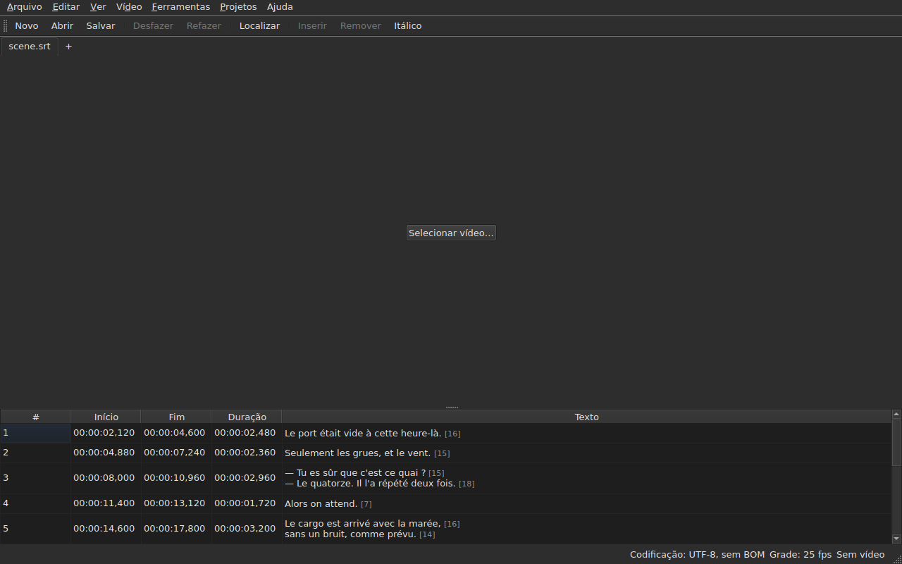

# subedit-gui — manual

<!-- machine-translated -->
> Esta página é uma tradução automática e ainda não foi revisada por um leitor do idioma.

A janela do subedit: abrir um arquivo de legendas e vê-lo em uma tabela. Para o
outro programa e para saber por onde começar, veja [o manual](../index.md).

> **Estado atual.** A janela **abre vários arquivos, um por aba**, seja qual for
> sua codificação — por `Open…` ou soltando-os sobre ela —, **exibe**,
> **edita suas células**, **insere e remove linhas**,
> **desfaz**, **salva — escolhendo a codificação, os finais de linha e a
> marca de ordem de bytes** — e **assinala as legendas cujas posições
> não se sustentam**. Ela **une e divide** linhas, **recorta,
> copia e cola** textos, e **localiza e substitui** no texto visível
> sem quebrar as marcações, em um projeto ou em todos. Ela **abre uma tradução
> ao lado do arquivo principal**, alinhada por posição ou por número, em uma coluna a mais,
> e a salva separadamente. O menu `Tools` reúne dezesseis operações e duas entradas de ortografia —
> deslocar, transformar, converter a taxa de quadros, ajustar durações,
> **anexar um arquivo, dividir o projeto em dois**, colocar em
> itálico, acrescentar travessões de diálogo, mudar as maiúsculas e minúsculas de quatro maneiras,
> remover menções para deficientes auditivos, **corrigir textos por meio de um
> assistente de várias páginas**, **verificar a ortografia palavra por palavra**, alinhar a uma taxa de quadros, recolocar
> na grade — e a análise da grade, que não modifica nada. O menu `Projects`
> **salva e fecha tudo** em um só gesto. Ela **associa um vídeo
> ao documento**, escolhido ou deduzido, e **o reproduz na janela**, com a linha
> atual desenhada sobre a imagem; ela **define um início, um fim ou uma
> legenda a partir da posição do filme**, **avança quadro a quadro** e **move uma extremidade em um quadro**. A barra de reprodução **salta, define o
> volume e a posição**, a tabela **acompanha a reprodução** sem desfazer uma rolagem manual, as posições
> podem ser mostradas **em quadros**, e o menu `Video` **escolhe a faixa de áudio**. Duas detecções
> **propõem sem nunca aplicar**: uma tradução deslocada por um valor constante, que pode ser **reaberta
> deslocada**, e a conversão de taxa de quadros que recoloca um arquivo em uma grade. Ela **lembra sua geometria, a ordem, a largura e a presença de suas
> colunas, e suas configurações** de uma
> sessão para a outra, e se apresenta **clara ou escura** conforme a escolha. `Ajuda ▸ Manual`
> abre **este manual** em uma janela. Este manual descreve o que existe, nunca
> o que está planejado; o que vem a seguir está no
> [roteiro](../../../../feuille-de-route.md).

> **As imagens deste manual são geradas, a prosa não.** Os exemplos do
> `subedit-cli` são gerados executando o comando; as capturas de tela
> são geradas construindo a janela real e fotografando-a — `make
> manual` faz as duas coisas. Uma imagem, portanto, não pode descrever uma interface que
> não existe mais, e uma interface que muda aparece no diff
> do repositório. O que fica sem rede de proteção é o texto ao redor delas, cuja
> exatidão depende da revisão.

**Cada tela é mostrada duas vezes, sob as duas paletas que a
aplicação define** — `Light` e `Dark`, as que
[as preferências](preferences.md#o-tema) oferecem. Em uma área de trabalho cujo
tema manda, `System` dá uma ou outra conforme o que a área de trabalho escolheu.

## Os menus

`File`, `Edit`, `View`, `Video`, `Tools`, `Projects`, `Help` — na ordem em
que são usados: o documento, o que se faz com ele, como se olha para ele, o que
o acompanha, o que o examina, o que se aplica a todos os projetos abertos, o que
o explica.

`View` reúne um submenu, `Columns`, com uma entrada marcável por coluna, exceto `Text`
— veja [A tabela](table.md#ocultar-e-mover-colunas) — e uma configuração, `Positions in Frames`, que mostra
`Start` e `End` como números de quadro — veja [Posições em quadros](table.md#posições-em-quadros).

`Projects` reúne duas entradas, `Save All` e `Close All` — veja
[O menu Projetos](files.md#o-menu-projetos).

`Edit` reúne cinco blocos, cada um sob um separador: desfazer; a
área de transferência — recortar, copiar, colar textos; `Find and Replace…`;
inserir, remover, unir e dividir linhas; por fim
`Preferences…`. Desfazer é o que se faz *com* uma edição, mover um texto
não acrescenta nem remove nenhuma linha, os quatro do bloco seguinte mudam o número de
linhas, e definir o tema não é uma edição de modo algum.

**As teclas são nomeadas como o menu as exibe**, em inglês como o restante
da interface: `Ins`, `Del`, `Ctrl+Shift+Z`. Uma tecla que se pressiona e
que nenhum menu nomeia conserva seu nome em inglês: `Enter`, `Esc`, `Shift`.

`Help` reúne duas entradas, na ordem em que o menu as mostra. `Manual`, ou
`F1`, abre este manual em uma janela — veja
[O manual na janela](help.md). `About subedit` informa a versão, a
licença e as bibliotecas com que a janela funciona, com suas versões — veja
[`--version`](invocation.md#--version).

## A barra de ferramentas

Sob os menus, uma barra reúne **os gestos mais frequentes**, em grupos.
Cada botão traz uma palavra curta; o menu conserva a entrada completa, e o
atalho é o mesmo.

| Botão | Item de menu | Atalho |
| :----- | :--------- | :------- |
| Novo | Arquivo ▸ Novo projeto | `Ctrl+N` |
| Abrir | Arquivo ▸ Abrir… | `Ctrl+O` |
| Salvar | Arquivo ▸ Salvar | `Ctrl+S` |
| Desfazer | Editar ▸ Desfazer | `Ctrl+Z` |
| Refazer | Editar ▸ Refazer | `Ctrl+Shift+Z` |
| Localizar | Editar ▸ Localizar e substituir… | `Ctrl+F` |
| Inserir | Editar ▸ Inserir legendas… | `Ins` |
| Remover | Editar ▸ Remover legendas | `Del` |
| Itálico | Ferramentas ▸ Itálico | `Ctrl+I` |

**Um botão desativado o está pela mesma razão que sua entrada**: `Undo` sem
nada a desfazer, `Remove` sem nenhuma linha escolhida. As entradas da tradução
e as operações do menu `Tools`, exceto `Italic`, ficam em seus
menus: são menos usadas, ou não são usadas por todos.

## Seções

| Seção | Conteúdo |
| :------ | :------- |
| [Instalação](../subedit-cli/installation.md) | compilar e instalar — a página vale para os dois programas |
| [Invocação](invocation.md) | iniciar a janela, argumentos, códigos de saída |
| [Abrir e salvar](files.md) | os comandos, as abas, o menu `Projects`, soltar arquivos, a tradução e sua reabertura deslocada, os diagnósticos, a codificação na barra de status, a ida e volta, o fechamento |
| [A tabela](table.md) | o que cada coluna mostra, ocultá-las e movê-las, as posições em quadros, a coluna de tradução e o texto sobre o qual as operações atuam |
| [Editar uma célula](editing.md) | quais células podem ser editadas, e como |
| [Recortar, copiar e colar textos](clipboard.md) | as três entradas, o que viaja, as linhas acrescentadas, as marcações traduzidas |
| [Localizar e substituir](find-and-replace.md) | a caixa de diálogo, os quatro gestos, as duas opções, o que a pesquisa abrange, em todos os projetos abertos |
| [Inserir, remover, unir e dividir linhas](lines.md) | as quatro entradas, seus atalhos, para onde vão as linhas novas |
| [Desfazer e refazer](undo.md) | o histórico, as duas ações, a marca de modificação |
| [A grade de quadros](frame-grid.md) | a taxa de quadros deduzida das posições, a análise e a conversão que recoloca um arquivo em uma grade |
| [As operações](operations.md) | deslocar, transformar, converter, ajustar durações, anexar um arquivo, dividir o projeto, colocar em itálico, as maiúsculas e minúsculas, os travessões, remover menções, alinhar, recolocar na grade, e o que ultrapassa o fim do filme |
| [Corrigir textos…](correct-texts.md) | o assistente de correção: o alvo e as tarefas, a página de cada tarefa, o progresso, a confirmação |
| [Verificar ortografia…](check-spelling.md) | a verificação ortográfica: suas configurações, o percurso, o fechamento no meio, a ausência de dicionário |
| [O vídeo associado](video.md) | escolher um vídeo, a proposta automática, a faixa de áudio, a barra de status, `ffmpeg` |
| [O reprodutor](player.md) | a vista do vídeo, a barra de reprodução, reproduzir, navegar, o volume, a tabela que acompanha, a linha desenhada |
| [Sincronizar a partir do vídeo](timing.md) | definir o início ou o fim de uma legenda, inserir, selecionar a partir da posição do filme, avançar quadro a quadro, mover uma extremidade |
| [As preferências](preferences.md) | o tema, o arquivo de preferências, suas opções, e o que acontece com um valor ilegível |
| [O manual na janela](help.md) | `Ajuda ▸ Manual`, o que ele abre e como navegar nele |
